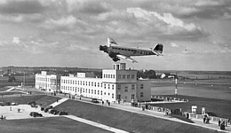
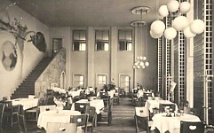
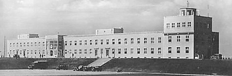
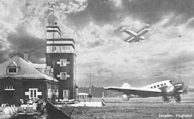
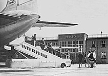
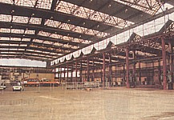

**Websites zum**

**Dresdner Flughafen:**

**DRESDEN INTERNATIONAL**

[**www.dresden-airport.de**](http://www.dresden-airport.de)

Flughafenführungen sonntag 16.30 uhr  erwachsene 8 euro kinder          5 euro  anmeldungen unter tel. 0351/8813300

* * *

Die Geschichte des Klotzscher Flughafens begann am 11. März 1934 mit einem Beschluss des Reichsluftfahrtministeriums, den Dresdner Flugplatz vom Heller auf die Rähnitzer Höhe zu verlegen. Grund war die ungünstige Lage des bisherigen Platzes, der durch seine Windverhältnisse wiederholt zu waghalsigen Landemanövern und Abstürzen geführt hatte. Bereits im Mai 1934 begannen die Verhandlungen mit den Grundbesitzern, die ihre Felder verkaufen mussten. Auch die erst wenige Jahre zuvor entstandene Ödlandsiedlung, sechs Bauernhöfe sowie der Hochbehälter des Klotzscher Wasserwerkes mussten den Bauarbeiten weichen. In den Folgemonaten entstanden unter Leitung der eigens gegründeten Sächsischen Flughafen-Betriebs-Gesellschaft die notwendigen Gebäude, Hallen, technischen Anlagen und die Start- und Landebahn.

Als Hauptgebäude wurde das sogenannte “Hansa-Haus” nach Plänen von Kurt Otto, einem Schüler Heinrich Tessenows, im Stil der Neuen Sachlichkeit errichtet. Hier befanden sich die Abfertigungsanlagen sowie das Post- und Zollamt, die Luftpolizei, die Funkstelle und der Wetterdienst. Teile wurden zudem gastronomisch genutzt, wobei die auf dem Dach des Gebäudes befindliche Gartenterrasse als besondere Attraktion galt. Insgesamt bot das Restaurant Platz für 124 Besucher _(Foto)_, die Terrasse sogar für ca. 750 Gäste. Außerdem gab es einen Ruheraum, eine Kegelbahn sowie ein kleines Hotel. Hinzu kam das ausschließlich für die Angestellten gedachte Betriebsrestaurant.

Am 11. Juli 1935 wurde der Klotzscher Flughafen feierlich eingeweiht. Wichtigste Verbindung war in den Anfangsjahren eine von Berlin über Dresden und Prag nach Wien gehende Linie, die gemeinsam von der Deutschen Lufthansa sowie österreichischen und tschechoslowakischen Gesellschaften bedient wurde. Weitere Verbindungen bestanden nach Breslau, Köln, Halle/Leipzig, Hannover und Hamburg. Für den technischen Betrieb hatte man außerdem eine große Flugzeughalle eingerichtet, in der die Maschinen gewartet, repariert und betankt werden konnten.

**_Foto:_** _Das “Hansa-Haus” des Klotzscher Flughafens kurz nach der Eröffnung_

Zeitgleich mit den zivilen Anlagen entstand auch ein militärischer Bereich. Dieser wurde bis zum Kriegsbeginn vor allem von der am 9. Mai 1936 an der Königsbrücker Landstraße 159 offiziell eingeweihten neuen Luftkriegsschule genutzt, die hier junge Offiziere zu Militärfliegern ausbildete. Zu den spektakulärsten Ereignissen in der Geschichte der Einrichtung gehörte der Absturz des Generalstabschef der Luftwaffe Walter Wever am 3. Juni 1936, der dabei ums Leben kam. Ihm zu Ehren wurde am Flughafen ein Gedenkstein aufgestellt, der heute nicht mehr vorhanden ist. Mit Kriegsbeginn häuften sich die Unglücke von Militärmaschinen. Insgesamt sollen mindestens 25 Flugzeuge in der Nähe von Klotzsche abgestürzt sein, wobei mehrere der oft unerfahrenen Flieger ums Leben kamen. Die beim Luftangriff auf Dresden unbeschädigt gebliebenen Anlagen des Flughafens waren noch bis in die letzten Kriegstage Ausgangsbasis für militärische Aktionen.

Bereits mit Beginn des Zweiten Weltkrieges war der zivile Luftverkehr von Klotzsche aus weitgehend zum Erliegen gekommen. Stattdessen wurde der Flugplatz als Basis der Luftwaffe genutzt, welche schon am 1. April 1937 offiziell die Verwaltung übernommen hatte. Der letzte reguläre Linienflug erfolgte am 25. August 1939. Kurzzeitig gab es im April 1940 noch einen Zwischenstopp beim Lufthansa-Flug nach Prag und Wien. Fortan fanden in Klotzsche nur noch militärische Übungsflüge der Luftkriegsschule statt. Von größeren Kriegsschäden blieb der Flughafen weitgehend verschont. Im April 1945 sprengte die Wehrmacht lediglich einige Nebengebäude.

Trotzdem war nach Ende des Krieges an eine Wiedereröffnung vorerst nicht zu denken. Zunächst besetzte die Rote Armee am 10. Mai 1945 das Gelände und nutzte es fortan als Ausbildungsstätte sowie für eigene Flüge. Zwei der fünf vorhandenen Flugzeughallen wurden als Reparationsleistung demontiert. Erst 1954 erhielt die Regierung der DDR die Erlaubnis, Vorbereitungen zur Wiederaufnahme des zivilen Luftverkehrs zu treffen. Gleichzeitig fasste sie den Beschluss zum Aufbau einer eigenen Flugzeugindustrie, wobei Klotzsche als Standort eines [Flugzeugwerkes](../../../nord/klotzsche/flughafen/flugzeugwerft/) vorgesehen war. Im März 1955 begannen die Bauarbeiten für dieses Werk auf dem Gelände der einstigen Luftkriegsschule. Zeitgleich wurde eine neue 2500 m lange und 80 m breite Start- und Landebahn angelegt, die sowohl für Testflüge als auch für den regulären Flugverkehr zur Verfügung stand.

Ab 16. Juni 1957 konnte schließlich erstmals wieder eine Passagiermaschine in Klotzsche landen. Ziele waren zunächst Berlin, die Ostsee und andere Inlandsflugplätze. Ab 1959 wurde auch Budapest angeflogen und Dresden somit an das internationale Luftverkehrsnetz angeschlossen. Mit Gründung der DDR-Fluggesellschaft “Interflug” 1961 wurde das Netz systematisch weiter ausgebaut. Als Empfangs- und Abfertigungsgebäude diente das bereits vorhandene Hansa-Haus, welches auch wieder ein öffentliches Restaurant und eine Aussichtsterrasse erhielt. Von Bedeutung war Dresden-Klotzsche als Ausweichflughafen für Berlin-Schönefeld. Außerdem gab es regelmäßige Verbindungen nach Budapest, Moskau, Leningrad, Sofia, Burgas, Varna, Tatry und anderen Städten der befreundeten Nachbarstaaten. Hinzu kamen gelegentliche Charterflüge nach Westeuropa. Zusätzlich behielt der Flughafen auch seine militärische Bedeutung, da die NVA 1963 in Klotzsche eine Transportfliegereinheit stationiert hatte. Diese doppelte Nutzung des Flughafens für zivile und militärische Zwecke sowie das spürbar angewachsene Passagieraufkommen machten 1988/89 eine erste größere Erweiterung und Rekonstruktion der Anlagen erforderlich. Nach deren Abschluss ging der Flughafen am 31. Oktober 1989 wieder in Betrieb.

Ein neues Kapitel in der Geschichte des Klotzscher Flughafens begann 1990 mit der Wiedervereinigung, die zu einer deutlichen Zunahme des Flugverkehrs führte. Neben innerdeutschen Flügen kamen auch neue internationale Linien hinzu, außerdem Charter- und Urlauberflüge zu den Touristenzielen in Südeuropa und im Mittelmeerraum. Der Klotzscher Flughafen wurde dafür zum 1. Oktober 1990 in eine GmbH umgewandelt und in mehreren Etappen modernisiert und erweitert. Bis 1995 entstand dabei das Terminal 2A mit 18 zusätzlichen Check-In-Schaltern und neun Gates. Da der Platzkapazität jedoch Grenzen gesetzt waren, entschloss man sich 1997 zum Bau eines neuen Terminals. Durch Ausbau des 1957 für die damalige Flugzeugwerft entstandenen Hangars 219 _(Foto vor dem Umbau)_ entstand nach Plänen von Nils Kampmann ein modernes Abfertigungsgebäude mit verschiedenen Ebenen, Geschäften, Restaurants und einer gläsernen Aussichtsterrasse. Sogar eine Flughafenkapelle wurde eingerichtet. Die Ausstattung der ökumenisch genutzten Kapelle stammt von Bruno von Beck. Außerdem wurden neue Parkmöglichkeiten geschaffen und der Flughafen an die Autobahn und das [S-Bahn-Netz](../../../nord/klotzsche/dresden_-_gorlitz/) angeschlossen. Am 25. März 2001 ging das Terminal offiziell in Betrieb.

Neben dem Terminalneubau war bereits zuvor eine 1935 errichtete Flugzeughalle zum Luftfrachtzentrum ausgebaut worden. 2006/07 folgte der Bau einer neuen Start- und Landebahn, die mit 2.850 m Länge nun auch größeren und schwereren Maschinen die Nutzung des Flughafens erlaubt. Außerdem entstanden bis 2009 ein neuer Tower, Neubauten für die Flughafenfeuerwehr, ein weiteres Parkhaus und eine Halle für Kleinflugzeuge. Seit September 2008 trägt der Dresdner Flughafen offiziell den Namen “Dresden International”. Das zuletzt noch für gelegentliche Großveranstaltungen genutzte alte Terminal mit dem Hansa-Haus wurde 2010 abgerissen. 2019 folgte der Abriss des seit 2001 nicht mehr genutzten Terminals 2A.

**Video von der Landung des amerikanischen Präsidenten Barack Obama**

**in Dresden am 4. Juli 2009**

* * *

 \[ [Home](../../../index.html)\] \[ [Nord](../../../nord/)\] \[ [Nordwest](../../../nordwest/)\] \[ [Neustadt](../../../neustadt/)\] \[ [Nordost](../../../nordost/)\] \[ [West](../../../west/)\] \[ [Zentrum](../../../zentrum/)\] \[ [Südwest](../../../sudwest/)\] \[ [Süd](../../../sud/)\] \[ [Südost](../../../sudost/)\] \[ [Ost](../../../ost/)\] \[ [Register](../../../Register/register.html)\] \[ [Kontakt](../../../Kontakt/kontakt.html)\] \[ [Impressum](../../../impressum/)\]
