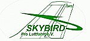
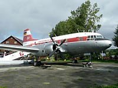
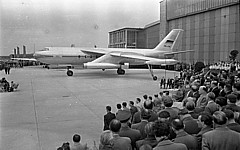

* * *

* * *

**Homepage zum**

**Flugzeugbau  in Dresden:**

**Die Dresdner Luftfahrtseite**

**(private Homepage):** [**www.dresden-spotter.de**](http://www.dresden-spotter.de)

* * *

Die Geschichte des DDR-Flugzeugbaus begann im Jahr 1954, als ein entsprechender Beschluss der Staatsführung die Entwicklung dieses Wirtschaftszweiges forderte. Als Standort für ein modernes Flugzeugwerk wurde eine Fläche neben dem [Flughafen](../../../../nord/klotzsche/flughafen/) Dresden-Klotzsche ausgewählt. Nach Zusammenschluss des VEB Maschinen- und Apparatebau Dresden und des VEB Industriewerke zum VEB Flugzeugwerk begann hier zunächst der Bau von sowjetischen Maschinen der Baureihe “Iljuschin 14” in Lizenzfertigung. Für das neue Werk wurden bis Ende der 1950er Jahre zahlreiche Werkhallen, Büro- und Verwaltungsgebäude errichtet. Außerdem siedelten sich verschiedene Zulieferfirmen in Klotzsche an. Um auch eigene Maschinen entwickeln zu können, kamen Versuchslabors und ein Windkanal für Testzwecke hinzu. Den Stamm der Belegschaft bildeten erfahrene Flugzeugingenieure aus den Dessauer Junkers-Werken, die in einer von den Einheimischen “Klein-Dessau” genannten Siedlung in der Nähe des Flughafens wohnten. Bis 1959 entstanden insgesamt 80 Maschinen dieses mehrfach modifizierten Typs (IL-14 P) als erstes in Serie gebautes Verkehrsflugzeug in Deutschland nach dem Zweiten Weltkrieg. Einige dieser Maschinen blieben bis heute als technische Denkmale bzw. als Touristenattraktion erhalten, u.a. in Luftfahrtmuseen Polens und der USA sowie im erzgebirgischen Cämmerswalde _(Foto: Wikipedia)_.

Als einziges Passagierflugzeug der DDR entwickelte ein Ingenieursteam um Brunolf Baade die Passagiermaschine 152, die in Klotzsche erprobt und auch produziert werden sollte. Die Triebwerke für die Maschinen entstanden in Pirna. Als erstes Strahlverkehrsflugzeug Deutschlands war neben dem Inlandseinsatz auch der Verkauf ins benachbarte Ausland vorgesehen. Am 30. April 1958 wurde das zu diesem Zeitpunkt noch nicht endgültig fertiggestellte Flugzeug der Öffentlichkeit vorgestellt _(Foto: Wikipedia)_ und startete am 4. Dezember zu seinem ersten Flug. Bei einem weiteren Testflug am 4. März 1959, der im Anschluss zu einer Messevorführung in Leipzig führen sollte, stürzte einer der Prototypen in der Nähe von Ottendorf-Okrilla ab, wobei vier Menschen ums Leben kamen. Die Männer wurden in einer Gemeinschaftsgrabanlage auf dem Neuen Friedhof Klotzsche beigesetzt.

Bedingt durch diesen Rückschlag, aber auch aus finanziellen Erwägungen beschloss die DDR-Führung ab März 1961 die Einstellung aller Forschungs- und Konstruktionsarbeiten an diesen Maschinen. Obwohl bereits zehn Flugzeuge fertiggestellt waren und zudem Entwürfe für weitere Baureihen vorlagen, wurde das Flugzeugwerk geschlossen und die noch vorhandenen Prototypen verschrottet. Lediglich ein Flugzeugrumpf diente noch viele Jahre auf dem Flugplatz Rothenburg/Oberlausitz als Batterieausleihstation der NVA, wurde dort nach 1990 wiederentdeckt und gehört heute zum Bestand des Verkehrsmuseums. Ein Modell des Flugzeugs ist im Terminal des Flughafens zu sehen.

Die nach der Auflösung des Flugzeugwerks leerstehenden Gebäude wurden später von verschiedenen Nachfolgeunternehmen genutzt, u.a. vom VEB Elektromat, dem Institut für Mikroelektronik, dem VEB Lufttechnische Anlagen und dem Institut für Leichtbau. Außerdem entstand der VEB Flugzeugwerft, der bis 1989 Militärflugzeuge der NVA und aus anderen befreundeten Staaten wartete. In Kooperation mit der Deutschen Airbus GmbH wurde am 27. April 1990 die Elbe Flugzeugwerke Dresden gegründet. Hier werden u.a. Bauteile für den Airbus gefertigt sowie ausgesonderte Passagiermaschinen zu Frachtflugzeugen umgebaut. Weitere Betriebe widmen sich der Materialforschung und führen Tests an neuen Großraumflugzeugen durch. Als kleine Spezialfirma existierte von 1976 bis Ende 2013 die Dresdner Sportgeräte GmbH. Hier wurden in einer Halle der früheren Luftkriegsschule Sportgeräte für den Leistungssport entwickelt und im Windkanal getestet. Bekannt wurde das Unternehmen als Hersteller von Bobschlitten für die Weltelite dieses Sports. Bis zur Schließung entstanden insgesamt 303 Zweier- und Vierer-Bobs für 38 Nationen.

* * *

 \[ [Home](../../../../index.html)\] \[ [Nord](../../../../nord/)\] \[ [Nordwest](../../../../nordwest/)\] \[ [Neustadt](../../../../neustadt/)\] \[ [Nordost](../../../../nordost/)\] \[ [West](../../../../west/)\] \[ [Zentrum](../../../../zentrum/)\] \[ [Südwest](../../../../sudwest/)\] \[ [Süd](../../../../sud/)\] \[ [Südost](../../../../sudost/)\] \[ [Ost](../../../../ost/)\] \[ [Register](../../../../Register/register.html)\] \[ [Kontakt](../../../../Kontakt/kontakt.html)\] \[ [Impressum](../../../../impressum/)\]
