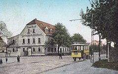
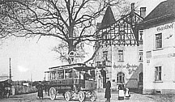
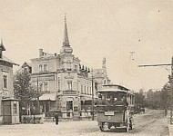

* * *

Die “Dresdner Haidebahn” entstand als eine der ersten O-Bus-Linien überhaupt und wurde am 24. März 1903 eingeweiht. Die Konstruktion der gleislosen Fahrzeuge stammte vom Dresdner Schmiedemeister Carl Stoll, der als Eigentümer der [“Dresdner Geschäfts-, Luxus- und Straßenbahnwagenfabrik”](../../../neustadt/leipziger_vorstadt/leipziger_strasse/) die Strecke als Privatunternehmen betrieb. Dabei griff er auf die zuvor mit derartigen Fahrzeugen gemachten Erfahrungen im Bielatal bei Königstein zurück. Ihren Ausgangspunkt hatte die “Haidebahn” an der Endstelle der Straßenbahn am Arsenal. Von dort fuhren die Wagen die Königsbrücker Landstraße hinauf zum Schänkhübel _(Foto links)_ und weiter durch den Ortsteil Königswald bis zur Endhaltestelle an der Gaststätte “Deutsche Eiche”. Für die 5,2 km lange Strecke benötigten die Fahrzeuge ca. 20 Minuten. Um eine unerwünschte Konkurrenz zur Staatseisenbahn zu vermeiden, waren die Fahrpreise auf deren Niveau abgestimmt, was die wirtschaftliche Betriebsführung erschwerte.

**_Foto:_** _Die “Dresdner Haidebahn” an ihrer Endhaltestelle in Klotzsche_

Zum Einsatz kamen insgesamt sechs Fahrzeuge, die mit jeweils zwei AEG-Elektromotoren und Stromabnehmer ausgestattet waren. Der eigentliche Fahrgastraum befand sich in einem sattelschlepperartigen “Anhänger” und bot 16 Sitz- und sechs Stehplätze. Die Wagen bestanden im wesentlichen aus einer Holzkonstruktion mit eisenbereiften Speichenrädern, welche in den Wintermonaten durch Schlittenkufen ersetzt werden konnten. Der für die Bahn erforderliche Strom wurde in einem Kraftwerk an Stelle des späteren Straßenbahnhofes Klotzsche erzeugt, wo sich auch das Depot der Wagen befand.

Obwohl die Bahn zunächst von den Einwohnern gut angenommen wurde und für internationales Aufsehen sorgte, stellten sich schon bald technische Mängel heraus. So beklagten die Anwohner “unerträglichen Lärm” und Staub, der durch die Wagen aufgewirbelt wurde und die Luft im Kurort beeinträchtigte. Außerdem kam es häufig zu Ausfällen durch defekte Motoren und Kontakte an der Oberleitung. Letztlich musste das Unternehmen 1903 Konkurs anmelden und den Betrieb am 19. März 1904 einstellen. Die technischen Anlagen wurden daraufhin nach Poprad in die Slowakei verkauft. Ab Juli 1904 ersetzte eine Pferdebuslinie die Bahn. 1911 entstand an Stelle der Haidebahn eine elektrische Straßenbahn nach Klotzsche.

* * *

 \[ [Nord](../../../nord/)\] \[ [Nordwest](../../../nordwest/)\] \[ [Neustadt](../../../neustadt/)\] \[ [Nordost](../../../nordost/)\]
 \[ [West](../../../west/)\] \[ [Zentrum](../../../zentrum/)\] \[ [Südwest](../../../sudwest/)\] \[ [Süd](../../../sud/)\] \[ [Südost](../../../sudost/)\] \[ [Ost](../../../ost/)\] \[ [Register](../../../Register/register.html)\] \[ [Kontakt](../../../Kontakt/kontakt.html)\] \[ [Impressum](../../../impressum/)\]
