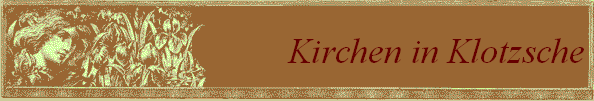

* * *

* * *

* * *

* * *

* * *

* * *

**Ev.-Lutherische Kirchgemeinde:**

**Homepage der Jungen Gemeinde Klotzsche:**

****

* * *

**Kath. Kirchgemeinde:**

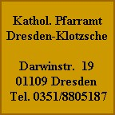

* * *

**Friedhöfe in Klotzsche:**

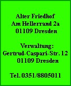

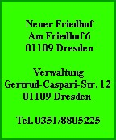

Dorfkirche Klotzsche

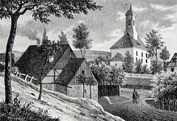Klotzsche unterstand ursprünglich der Frauenkirche. Die Bewohner mussten deshalb zum Besuch der Gottesdienste den langen, beschwerlichen und oft auch gefährlichen Weg über den Heller bis ins Elbtal unternehmen. Um diesen zu verkürzen, errichtete man 1321 eine eigene Dorfkirche. Zuvor bestand vermutlich bereits eine Kapelle mit Friedhof, deren Reste um 1820 bei Bauarbeiten im Grundstück Altklotzsche Nr. 89 freigelegt wurden. Nach der Reformation wurde die Klotzscher Kirche 1540 der Parochie Wilschdorf unterstellt und vom dortigen Pfarrer betreut. Zunächst fanden die Sonntagsgottesdienste abwechselnd in Klotzsche und Wilschdorf, später regelmäßig in beiden Orten statt. Am 1. Oktober 1729 fiel diese Kirche einem Dorfbrand zum Opfer und musste neu aufgebaut werden.

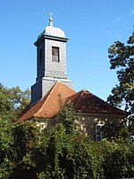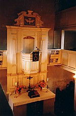Auch dem Nachfolgebau war kein langes Leben beschieden, denn er brannte 1802 gemeinsam mit fast dem ganzen Dorf ab. Lediglich drei vermutlich um 1510 geschaffene Heiligenfiguren aus Holz konnten gerettet werden. Nach dem Brand gingen Spenden aus ganz Sachsen für den Wiederaufbau des Ortes ein. Selbst König Friedrich August der Gerechte gab 500 Taler Zuschuss für die neue Kirche. Schließlich konnte im Jahr 1811 der Neubau geweiht werden. Leiter des Wiederaufbaus war der Zimmermann Georg Samuel Höring. Die Kirche erhielt dabei einen klassizistischen Altar _(Foto links)_, eine neue Orgel der Firma Kayser und zwei Glocken, die jedoch bereits im Folgejahr zersprangen und erst 1834 ersetzt werden konnten. Eine dieser Glocken blieb bis zur Gegenwart erhalten, die anderen wurden während des Zweiten Weltkrieges eingeschmolzen. 1961 bekam die Kirche ein neues Geläut. Seit dem 1. April 1895 ist Klotzsche kirchlich selbständig und besitzt ein Pfarrhaus an der Hendrichstraße 35.

Steinkreuz: An der den Kirchhof umgebenden Mauer wurde bei Bauarbeiten 2012 ein historisches Steinkreuz entdeckt. Das in Form eines Malteserkreuzes gestaltete Kreuz diente ursprünglich als Sühnekreuz und stammt aus
der Zeit vor 1530. Der ursprüngliche Ort und der Grund der Aufstellung sind unbekannt. Das Kreuz wurde später in die Mauer eingefügt, um so Baumaterial zu sparen. Eine Freilegung und Umsetzung an einen geeigneten Ort werden erwogen.

Christuskirche

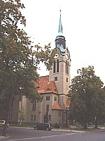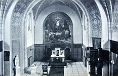Nachdem die alte Kirche im Dorfkern um 1900 nicht mehr den Anforderungen genügte und zudem zu weit von den neuen Wohngebieten entfernt lag, wurde am 3. Oktober 1905 am damaligen Kaiser-Wilhelm-Platz (heute Boltenhagener Platz) der Grundstein für eine eigene neue Kirche des Villenortes Königswald gelegt. Zuvor hatten wohlhabende Bürger des Stadtteils über 15.000 Reichsmark für das Vorhaben gesammelt. Nach Plänen des Architekten Woldemar Kandler und des Radeberger Baumeisters Petrich entstand ein neogotischer Neubau mit Anklängen an den Jugendstil, der am 17. März 1907 eingeweiht wurde.

Zur Ausstattung gehören u. a. ein Altar aus Stuckmarmor von Carl Hauer mit einem Gemälde von Prof. Osmar Schindler, eine Jehmlich-Orgel und eine Christus-Plastik des unweit der Kirche wohnenden Bildhauers Johannes Schilling. Die Kanzel stiftete der Baumeister Martin Kühne. Vier Stahlglocken wurden 1920 in Bochum gegossen und 1999 restauriert. 1925 erhielt diese Kirche den Namen Christuskirche _(Fotos)_. Der mehrfach renovierte Bau mit seinem 52 Meter hohen Turm prägt bis heute das Ortsbild.

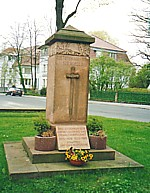Gefallenendenkmal: Vor der Kirche erinnert ein von Woldemar Kandler geschaffenes Denkmal an die 161 Klotzscher Gefallenen des Ersten Weltkrieges. Das vom Sächsischen Militärverein zu Klotzsche-Königswald initiierte Mahnmal wurde aus Rochlitzer Porphyr gefertigt und am 11. Mai 1923 feierlich eingeweiht. An drei Seiten sind die Namen der 1914-1918 getöteten Einwohner eingemeißelt. Ein ursprünglich vorhandener Schriftzug “Getreu bis an den Tod” wurde nach 1945 entfernt und durch den Spruch “Die Toten mahnen: Nie wieder” ersetzt. Auch die einstige Grünanlage um das Denkmal ging verloren.

1999 wurde es saniert und in diesem Zusammenhang um eine Gedenktafel für die Opfer des Nationalsozialismus, des Zweiten Weltkrieges und der DDR-Diktatur ergänzt:

_Die Toten mahnen - nie wieder._

_Dem Andenken der Opfer von Krieg und Gewaltherrschaft_

_1914-1918, 1933-1989 - Stadtteil Dresden-Klotzsche_

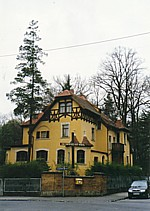Heilig-Kreuz-Kapelle

Die katholische Kapelle in Klotzsche geht auf eine 1927 entstandene Ordensniederlassung der Klarissen-Kapuzinerinnen zurück. Diese bezogen die Villa
“Odin” an der heutigen Darwinstraße 19. Als die Kapuzinerinnen 1947 Klotzsche verließen, übernahmen Franziskaner-Mönche das Gebäude und richteten hier 1948 die
Heilig-Kreuz-Kapelle ein. 1975 gaben die Mönche ihre Klotzscher Niederlassung auf, woraufhin die Kapelle als katholische Pfarrei “Heiliges Kreuz” Gotteshaus der Klotzscher
Katholiken wurde. In den 1980er Jahren entstand ein neuer Pfarrsaal für die Gemeinde.

Alter Friedhof Klotzsche

Der Alte Friedhof Klotzsche wurde ab 1883 am Rande des Hellers angelegt und drei Jahre später eröffnet. Für die Anlage, welche wegen Platzmangels auf dem alten Kirchhof erforderlich geworden war, entstanden auch einige Grüfte und eine Totenhalle. Ausgeführt wurden diese von der Radeberger Baufirma Schmutzler. 1900 wurde der Friedhof nochmals in Richtung Alberthöhe erweitert und erhielt eine neue Friedhofskapelle. Die Entwürfe für diesen Bau stammen von Woldemar Kandler.

Ab 1909 diente der Alte Friedhof Klotzsche zugleich als Begräbnisplatz der neu entstandenen Gartenstadt Hellerau. Bereits 1927 mussten aus Platzgründen Einschränkungen für die Vergabe neuer Grabstellen angeordnet werden. Auf eine geplante Erweiterung verzichtete man zugunsten des Neuen Klotzscher Friedhofes. 1942 sollte der Alte Friedhof sogar zugunsten eines Straßenbauprojektes teilweise geschlossen werden, blieb jedoch letztlich erhalten.

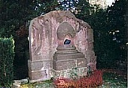Zu den bekannten Persönlichkeiten, die hier ruhen, gehören der 1919 verstorbene dänische Literaturnobelpreisträger Karl Adolph Gjellerup _(Foto)_,
der Karthograph und TH-Professor Sophus Ruge (1831-1903), die Kunstmaler Friedrich Alfred Oehme (+ 1935) und Georg Estler (1868-1954), der Architekt der Christuskirche Woldemar Kandler (1866-1929) und Karl Schmidt-Hellerau, Gründer der Deutschen Werkstätten in Hellerau (1873-1948). Auch der viele Jahre in Klotzsche lebende Musiker Clemens Braun (1862-1933) wurde hier beigesetzt. Braun war ab 1882 Leiter des Dresdner akademischen Gesangvereins sowie des Bachvereins und wirkte zwischen 1898-1925 als Organist an der Annenkirche. Weitere Künstler, die hier ihre letzte Ruhe fanden, waren der Schriftsteller und Journalist Ernst Georg Klaar (+ 1920) und der Oberlausitzer Mundartschriftsteller Paul Rudolf Gärtner (+ 1952).

Neuer Friedhof Klotzsche

Nachdem der Alte Friedhof wegen stark gewachsener Bevölkerungszahl an seine Kapazitätsgrenzen gelangt war und eine geplante Erweiterung nicht zustande kam, entschloss sich die Kirchgemeinde Klotzsche zum Bau eines Neuen Friedhofes hinter dem Jugendheim am Trobischberg. Der Entwurf nach dem Vorbild des Ohlsdorfer Friedhofs in Hamburg stammt vom Gartenarchitekten Wilhelm Röhnick und wurde von Stadtbaumeister Martin Dutschke umgesetzt, die Gebäude wurden von Max Otto entworfen. Am 19. Oktober 1931 erfolgte der erste Spatenstich für die parkartige Anlage, welche am 28. August 1932 offiziell eröffnet wurde. Für den neuen Friedhof war ursprünglich noch eine Kapelle vorgesehen, die jedoch nicht gebaut wurde. Seit 1999 steht die Anlage unter Denkmalschutz.

Auf dem Neuen Friedhof befindet sich u. a. das Grab der viele Jahre in Klotzsche lebenden Kinderbuchillustratorin Gertrud Caspari (1873-1948). 1959 entstand die beeindruckende Gemeinschaftsgrabanlage für die vier beim Testflug der in Klotzsche entwickelten “152” ums Leben gekommenen Piloten der Flugzeugwerft.

* * *

 \[ [Home](../../../index.html)\] \[ [Nord](../../../nord/)\] \[ [Nordwest](../../../nordwest/)\] \[ [Neustadt](../../../neustadt/)\] \[ [Nordost](../../../nordost/)\] \[ [West](../../../west/)\] \[ [Zentrum](../../../zentrum/)\] \[ [Südwest](../../../sudwest/)\] \[ [Süd](../../../sud/)\] \[ [Südost](../../../sudost/)\] \[ [Ost](../../../ost/)\] \[ [Register](../../../Register/register.html)\] \[ [Kontakt](../../../Kontakt/kontakt.html)\] \[ [Impressum](../../../impressum/)\]
