## Ahlbecker Straße

Die Ahlbecker Straße wurde in den 1970er Jahren im Zusammenhang mit dem Neubaugebiet an der Karl-Marx-Straße angelegt.
Einer Klotzscher Tradition folgend, neue Straßen nach Orten im Ostseeraum zu benennen, erhielt sie 1974 den Namen Ahlbecker Straße.

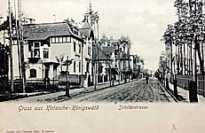Die Alexander-Herzen-Straße wurde Ende des 19. Jahrhunderts im Villenviertel Königswald angelegt und erhielt zunächst den Namen Schillerstraße. Um Verwechslungen mit einer gleichnamigen Straße in Loschwitz zu vermeiden, wurde sie nach der Eingemeindung Klotzsches in Alexander-Herzen-Straße umbenannt. Namensgeber war der russische Philosoph und Schriftsteller Alexander Herzen (1812-1870), der sich aktiv gegen die zaristische Alleinherrschaft stellte und mit der Zeitung “Kolokol” (“Glocke”) die freie russische Auslandspresse begründete.

Im Haus Alexander-Herzen-Straße 1 hatte früher die Klotzscher Ortskrankenkasse ihren Sitz. Später nutzte die Volkssolidarität die Räume als Rentnertreff. Neben weiteren Villenbauten aus der Entstehungszeit des Ortsteiles, darunter die von Woldemar Kandler entworfene Villa Nr. 9 und die Villen "Melusine" (Nr. 14, 1899) und "Brünhilde" (Nr. 15, 1902) von Edmund Hacault, wurden hier zu DDR-Zeiten auch einige Neubaublocks errichtet. Nach 1990 folgten weitere Gebäude an der Einmündung zur Theodor-Fontane-Straße.

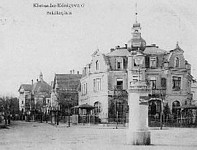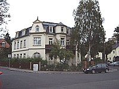

**_Fotos:_** _Das Haus Alexander-Herzen-Straße 1 (Villa Bismarck) um 1911 und 2011_

## [Altklotzsche](../../../nord/klotzsche/strassen_klotzsche/altklotzsche/)

## Am Feldgehölz

Die Gebäude entstanden am Ende des Zweiten Weltkrieges als Notquartiere für Flüchtlinge und Ausgebombte. Für den Bau wurden u. a. Teile der Umkleidekabinen des [Waldbades Klotzsche](../../../nord/klotzsche/strassen_klotzsche/waldbad_klotzsche/) sowie der früheren Wandelhalle des Waldparks verwendet. Zunächst
“Behelfsheimsiedlung” genannt, erhielt die Straße 1956 den Namen Am Feldgehölz. Nach 1990 wurde die kleine Siedlung durch moderne Einfamilienhäuser komplettiert.

## Am Forsthaus

Der auf der Grenze von Klotzsche zur Dresdner Heide führende Weg wurde wegen seiner Lage ursprünglich Grenzweg genannt.
Einziges Gebäude war lange Zeit das Klotzscher Forsthaus mit dem Sitz der Königlichen Oberförsterei. Mit der Eingemeindung
Klotzsches gab es den Namen Grenzweg zweimal in Dresden, so dass man die Straße im Februar 1963 in Am Forsthaus umbenannte.

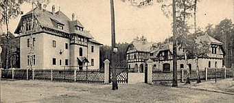

_Foto: Das Forsthaus Klotzsche um 1910_

## Am Friedhof

Die Straße Am Friedhof entstand 1932 als Zufahrt zum [Neuen Friedhof Klotzsche](../../../nord/klotzsche/klotzscher_kirchen/) und wurde deshalb Friedhofstraße genannt. Eine
Namensdoppelung nach der Eingemeindung führte 1953 zur Umbenennung in Am Friedhof.

## Am Grünen Grund

Die in der zweiten Hälfte des 19. Jahrhunderts  angelegte Verbindung zwischen der heutigen Max-Hünig- und William-
Shakespeare-Straße erhielt zunächst den Namen Hellerstraße. Der südliche Abschnitt bis zum Heller wurde hingegen um 1900 als
Langer Weg bezeichnet. Dieser ist eines alten Botenweges, welcher auch unter der Bezeichnung „Rennsteig“ bekannt war. 1905 ging
der Name Hellerweg auch auf diesen Straßenteil über. Im Zusammenhang mit der Eingemeindung von Hellerau und Klotzsche erfolgte im September 1953 die Umbenennung in Am Grünen Grund.

## Am Hellerrand

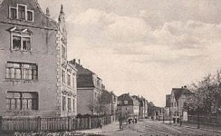Die Straße Am Hellerrand führt vom [Alten Friedhof Klotzsche](../../../nord/klotzsche/klotzscher_kirchen/) zur Klotzscher Hauptstraße. Da diese einst Teil des Fußweges nach Dresden war, ist sie in alten Karten als Dresdnischer Weg bezeichnet. Ende des 19. Jahrhunderts wurde sie dann Dresdner Straße genannt _(Foto um 1910)_. Um doppelte Straßennamen zu vermeiden, erfolgte nach der Eingemeindung Klotzsches 1953 die Umbenennung in Am Hellerrand. Abschnittsweise bildet sie zugleich die Flurgrenze zwischen Klotzsche und Hellerau.

Bemerkenswert sind einige im Zusammenhang mit dem Bau der Gartenstadt Hellerau errichtete Wohngebäude. Die ersten Reihenhäuser entstanden 1910 nach Plänen von Richard Riemerschmid (Nr. 1 - 13). Die anschließende Wohnzeile Nr. 17 - 27 und das Haus Nr. 29 wurden von Hermann Muthesius entworfen, die Häuser Nr. 31 und 33 - 41 von Curt Frick.

## Am Rasen

Die kurze Sackgasse entstand Ende der 1920er Jahre als Nebenstraße des Schänkenwegs. 1930 ist sie unter dem Namen
Wiesenstraße im Adressbuch verzeichnet. Nach der Eingemeindung Klotzsches erfolgte im September 1953 die Umbenennung in Am Rasen.

## Am Steinacker

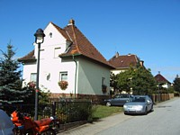Der Straßenname Am Steinacker nördlich des Dorfkerns geht auf eine alte Klotzscher
Flurbezeichnung zurück. Die hier abgelagerten Steine stammen aus der letzten Eiszeit.

Die Häuser wurden zwischen 1920 und 1934 durch die Siedlervereinigung “Am Steinacker e. V.”
erbaut. Vorstandsvorsitzender war Kurt Wachtveitl, der 1945 erster Bürgermeister der Nachkriegszeit in Klotzsche wurde. 1943/44 entstand an der Straße ein nach Kriegsende gesprengter ziviler Luftschutzbunker.

## Am Steinborn

Die Quelle am Steinborn war möglicherweise Ausgangspunkt der Gründung Klotzsches. Im Mittelalter galt deren Wasser als wohltätig
und wurde deshalb in einer nahen Kapelle als Weihwasser verwendet. 1583 entstand in der Nähe ein kurfürstliches Jagdhaus mit Stallgebäude, woraufhin die Quelle den Namen Fürstenborn
erhielt. Das Wasser wurde in hölzernen Röhren in die Pferdeställe geleitet und diente zur Versorgung des Anwesens. Im Dreißigjährigen Krieg wurde dieses Jagdhaus 1637 zerstört. Die zuvor Am Fürstenborn
genannte Straße trägt seit 1945 den Namen Am Steinborn. Reste der Brunnenanlage blieben in einem Privatgrundstück erhalten und sind dort durch ein kleines Sandsteingewölbe vor Verunreinigung geschützt.

## Am Trobischberg

Die Bezeichnung Trobischberg geht auf einen alten Flurnamen zurück Einst besaßen Angehörige einer im Klotzscher Raum weit
verzweigten Bauernfamilie Trobisch hier ihre Felder. Die Siedlung Am Trobischberg entstand zwischen 1927 und 1931 auf Initiative
des Pharmazeuten Max Glausch, der das benötigte Grundstück der Gemeinde kostenlos zur Verfügung stellte. Die modern
ausgestatteten Doppelhäuser wurden anfangs bevorzugt an Kriegsversehrte des Ersten Weltkriegs vergeben und von Professor Oswin Hempel entworfen.

## Am Waldblick

Die heutige Straße wurde erstmals 1897 im Klotzscher Adressbuch aufgeführt und trug damals den Namen Forststraße. Grund war
die Lage der Straße am Rande der Dresdner Heide. Im September 1953 erfolgte die Umbenennung in Am Waldblick.

## Am Wasserwerk

Die Straße Am Wasserwerk wurde 2005 im Zusamenhang mit dem Bau einer neuen Wohnsiedlung angelegt. Der Name erinnert an das frühere Klotzscher [Wasserwerk](../../../nord/klotzsche/), welches 1899 von Baurat Salbach an der Königsbrücker Landstraße errichtet worden war. In
der Nachkriegszeit wurde der Betrieb stillgelegt. Bis 2009 entstanden hier insgesamt 24 Einfamilien- und Doppelhäuser der Siedlung “Wohnerlebnis am Königswald”.

## An den Ruschewiesen

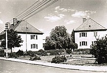Die Bezeichnung An den Ruschewiesen geht vermutlich auf einen früheren Klotzscher Flurnamen zurück. Als Rusche wurden einst einfache Alarmanlagen bezeichnet, bei denen in Kriegszeiten von besonders hohen Bäumen Wachposten auf Bretter schlugen, um die Bewohner des Dorfes zu warnen. Da in unmittelbarer Nähe der Klotzscher Ruschewiesen einst wichtige Handelswege entlangführten, sicherte man diesen Platz mit Wassergräben und ähnlichen einfachen Hilfsmitteln.

Der Name Rusche tauchte früher auch in der Bezeichnung Ruscheborn und Ruscheweg auf, wie die heutige Greifswalder Straße noch bis zum Ersten Weltkrieg genannt wurde. Das Bild zeigt die Wohnsiedlung An den Ruschewiesen um 1950. Die Häuser wurden Mitte der Dreißiger Jahre für Angestellte des Flughafens erbaut. Seinen Namen hatte der zuvor unbenannte Weg bereits 1929 erhalten. Im gleichen Jahr eröffnete im Haus Nr. 4 ein Kindergarten.

## An der Nordsiedlung

Die Straße wurde 1935 unter dem Namen Siedlerstraße angelegt. Die hier entstandenen Häuser dienten vorrangig der Unterbringung
der Angestellten des Klotzscher Flughafens und der Luftkriegsschule. Im September 1953 erfolgte die Umbenennung in An der Nordsiedlung.

## Arkonastraße

Die Arkonastraße wurde Ende der Zwanziger Jahre angelegt und ist 1930 erstmals unter dem Namen Gabelsbergerstraße im
Adressbuch verzeichnet. Diese Namensgebung erfolgte nach dem Begründer der Stenographie Franz Xaver Gabelsberger
(1789-1849). Im September 1953 erhielt sie ihren heutigen Namen Arkonastraße. Da es in der Umgebung bereits mehrere nach Orten im Ostseeraum benannte Straßen gab, wählte man das Kap Arkona auf Rügen als Namensgeber.

## Binzer Weg

Der Binzer Weg entstand nach 1980 beim Bau des Neubaugebietes am der Grenzstraße. 1985 erhielt er seinen Namen nach dem Ostseebad Binz.

Der Boltenhagener Platz wurde als Vorplatz der [Christuskirche](../../../nord/klotzsche/klotzscher_kirchen/) und im Jahr der Weihe 1907 zu Ehren des deutschen Kaisers Kaiser-Wilhelm-Platz benannt. Im Mai 1945 erfolgte nach dem sowjetischen Staatschef Josef Stalin die Umbenennung in Marschall-Stalin-Platz. Da dieser Name jedoch seit den 1950er Jahren nicht mehr als geeignet betrachtet wurde, erhielt der Platz im Dezember 1961 seinen heutigen Namen nach dem Ostseebad Boltenhagen.

Zu den Bewohnern der umliegenden Villen gehörte zeitweise der sächsische Oberkirchenrat und Superintendent Armin Oskar Colditz (Nr. 9). Nach 1945 war hier die sowjetische Ortskommandantur untergebracht.

## Boltenhagener Straße

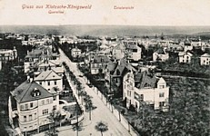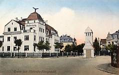 Die Boltenhagener Straße bildet die Hauptverbindungsstraße zwischen [Dorfkern](../../../nord/klotzsche/strassen_klotzsche/altklotzsche/) und der Ende des 19. Jahrhunderts entstandenen Villenkolonie Königswald. Bereits zuvor war sie eine der wichtigsten Fahrstraßen des Dorfes. Ursprünglich Querweg genannt, wechselte die Boltenhagener Straße mehrfach ihren Namen: Querallee, ab 1933 Adolf-Hitler-Straße, ab 1945 Marschall-Stalin-Straße. Ihren heutigen Namen erhielt sie 1950 nach dem Seebad Boltenhagen, womit an die Tradition angeknüpft wurde, Klotzscher Straßen nach Orten im Ostseegebiet zu benennen.

Am Boltenhagener Platz (ehemals Kaiser-Wilhelm-Platz) wurde 1907 die Christuskirche als zweites Klotzscher Gotteshaus eingeweiht. Unweit davon entstand 1914 das ebenfalls von Woldemar Kandler erbaute evangelische Jugendheim, später Gemeindehaus der Christuskirche (Nr. 58). Kandler war auch Architekt der Villen Boltenhagener Straße 17 und 27. Im Haus Nr. 12 lebte 12 zeitweise der Maler Oskar Zwintscher. 2003 entstand an der Boltenhagener Straße ein neues Einkaufszentrum.

Nr. 7: Die Ende des 19. Jahrhunderts in der Villenkolonie Königswald entstandene Villa "Hedwigs Waldhütte" war ab 1911 Wohnsitz des Schriftstellers Ernst Georg Klaar (1861-1920). Klaar war Mitglied der SPD und arbeitete als Journalist für die Dresdner Volkszeitung und den "Wahren Jacob" Zudem verfasste er proletarische Gedichte und Lieder. Sein Grab befindet sich auf dem Alten Friedhof.

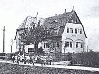Kirchgemeindehaus (Nr. 58): Das Gebäude entstand ursprünglich für den 1912 gegründeten Verein zur Pflege der Jugend und wurde zwei Jahre später seiner Bestimmung übergeben. Architekt war Woldemar Kandler. Bis Mitte der 1930er Jahre wurde es als Domizil verschiedener Jugendvereine wie z.B. den Pfadfindern genutzt. Nach der Machtübernahme der Nazis musste der Verein seine Arbeit einstellen, da außerstaatliche Aktivitäten in der Jugendarbeit nun nicht mehr geduldet wurden. Entgegen der Vereinssatzung, die im Falle der Auflösung eine Übergabe an die Kirchgemeinde vorsah, zwang das Landeskirchenamt die Gemeinde am 19. Oktober 1936 zur Übergabe des Hauses an die Stadt Klotzsche. Bis 1945 diente es nun als kommunales Jugendheim.

In der Nachkriegszeit richtete die Stadtverwaltung im früheren Jugendheim einen kommunalen Kindergarten ein, da der bisherige An den Ruschewiesen 4 von der Roten Armee beschlagnahmt worden war. Im Zuge eines Befehls der sowjetischen Militärverwaltung erhielt die Kirche 1948 das enteignete Jugendheim wieder zurück. 1949 unterzeichnete die damals noch selbständige Stadt Klotzsche die Auflassung und Rückgabe des Hauses an die evangelische Kirchgemeinde. Fortan diente das ehemalige Jugendheim als Kirchgemeindehaus. Heute wird es als privates Wohnhaus genutzt.

Feuerwache: Das moderne Gebäude entstand ab 2015 als Feuer- und Rettungswache für die Freiwilligen Feuerwehren Klotzsche und Hellerau. Der Neubau an der Ecke zur Travemünder Straße dient als Ersatz für die alte Wache hinter dem Klotzscher Rathaus. Nach Plänen der Architektin Ulrike Steglich bietet er neben Aufenthalts- und Schulungsräumen eine Fahrzeughalle für zwei Löschfahrzeuge und den Mannschaftsbus sowie Platz für den Malteser Hilfsdienst mit Fahrzeughalle und Schlafräumen für den Nachtdienst.

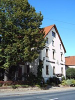Schmiedeschänke:

Die Schmiedeschänke entstand 1899 und war eines von zahlreichen neuen Lokalen des aufstrebenden Kurortes. Ursprünglich trug die Gaststätte den Namen “Glück auf”, wurde jedoch bereits wenig später in
Erinnerung an die beiden einstigen Klotzscher Dorfschmieden in “Schmiedeschänke” umbenannt.  1910 erwarb der Besitzer der Hellerauer Waldschänke Hugo Hahn das Lokal und ließ es um einen Bier- und
Konzertgarten erweitern. In einem Seitengebäude befand sich bis in die 1930er Jahre eine Mosterei. Die beliebte Gaststätte schloss in den 1960er Jahren ihre Pforten. Das Gebäude diente fortan als Schulhort der
83\. POS. 1997 wurde hier nach kompletter Renovierung wieder eine Gaststätte mit Pension eröffnet _(Foto)_.

## Brueghelstraße

Die Brueghelstraße wurde Mitte der 1930er Jahre im Zuge des Ausbaus der Nordsiedlung angelegt und zunächst nach einer
Flurbezeichnung An den Teichwiesen genannt.  Ihren heutigen Namen erhielt sie im Februar 1956 nach dem niederländischen Maler
und Zeichner Pieter Brueghel d. Ä. (um 1525-1569). Brueghel schuf vor allem Darstellungen des ländlichen Lebens in seiner Heimat, was ihm den Beinamen “Bauern-Brueghel” einbrachte.

## Darwinstraße

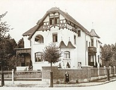Die Ende des 19. Jahrhunderts im Ortsteil Königswald angelegte und 1901 nach dem Komponisten und Hofkapellmeister Richard Wagner (1818-1883) benannte frühere Richard-Wagner-Straße erhielt nach der Eingemeindung Klotzsches 1953 ihren heutigen Namen Darwinstraße. Charles Darwin (1809-1982) gehört zu den bedeutendsten Naturforschern des 19. Jahrhunderts und begründete die Abstammungstheorie der Arten. Die frühere Villa “Odin” (Darwinstraße 19 - _Foto_) diente seit 1927 als Ordensniederlassung der Klarissen-Kapuzinerinnen und wird heute als katholische [Heilig-Kreuz-Kapelle](../../../nord/klotzsche/klotzscher_kirchen/) genutzt. Im Haus Nr. 11 begand sich einst die Familien- und Kurpension “Tristan”, welche mit “Diätkuren streng nach ärztlicher Vorschrift”, Bädern im Haus und “komfortabel eingerichteten Zimmern” warb. In der Nr. 2 lebte ab 1927 der als Dokumentarfilmer bekannt gewordene Ingenieur Wolfgang Filzinger.

## Dörnichtweg

Die Straßenbezeichnung Dörnichtweg geht auf einen früheren Klotzscher Flurnamen zurück. Anlass für diese Namensgebung war der karge Bewuchs in diesem Gebiet. Der Weg gehört zu den ältesten Verkehrsverbindungen des Ortes und führte vom alten Ortskern in nordöstliche Richtung zu den Weideflächen der Bauern. 1897 ist er erstmals als Dörnigtweg in Ortsplänen verzeichnet. Später erfolgte eine Änderung der Schreibweise und eine Verlängerung bis zur Grenzstraße.

In den 1960er Jahren entstanden zwischen Dörnichtweg und Karl-Marx-Straße mehrere Wohnblöcke für die Angestellten der Klotzscher Flugzeugwerft und anderer Betriebe. 1996 wurde in Ergänzung des Wohngebietes zwischen Dörnichtweg und Göhrener Weg eine der größten Dresdner Wohnanlagen der Nachwendezeit mit über 800 Wohnungen und einem Einkaufszentrum angelegt (Fontanepark). Die architektonisch bemerkenswerte Anlage bietet als Attraktion ein Schwimmbad auf dem Dach eines der Gebäude, welches jedoch nur den Mietern zugänglich ist. In Anlehnung an die Tradition, Straßen in Klotzsche nach Orten im Ostseeraum zu benennen, erhielten zwei neu angelegte Erschließungsstraßen 1996 den Namen Putbuser bzw. Sagarder Weg.

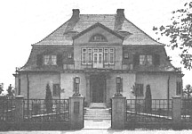Nr. 32 (Haus Glausch): Das Haus entstand 1922 nach Plänen des Architekten Oswin Hempel für den Apotheker Maximilian Glausch. Glausch gehörte zu Beginn des 20. Jahrhunderts zu den Honoratioren Klotzsches und setzte sich für gemeinnützige Belange ein. Nach dem Ersten Weltkrieg stellte er das Land für den Bau der Trobischberg-Siedlung zur Verfügung, um hier Häuser für ehemalige Soldaten bauen zu lassen. Zudem spendete er Geld für den Bau des Kindergartens "An den Ruschwiesen". Sein früheres Wohnhaus am Dörnichtweg wird heute ebenfalls als Kita genutzt ("Fröbelzentrum").

## Fichtestraße

Die Fichtestraße, zwischen Zinnowitzer und Tichystraße gelegen, trug ursprünglich den Namen Ebertstraße. Namensgeber war der
Sozialdemokrat Friedrich Ebert (1871-1925), erster Reichspräsident der Weimarer Republik. Nach der Machtübernahme der
Nationalsozialisten wurde sie 1933 nach dem deutschen Philosophen Johann Gottlieb Fichte (1762–1814) umbenannt. Fichte wurde in
Rammenau bei Bischofswerda geboren und gilt als wichtigster Vertreter des deutschen Idealismus.

## Florianstraße

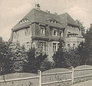Die Florianstraße beginnt am Boltenhagener Platz und enstand 1913. Zunächst wurde sie bis 1945 nach dem preußischen Generalfeldmarschall Helmuth Karl Bernhard von Moltke (1800–1891) Moltkestraße genannt. Wegen dieses militärischen Bezugs erfolgte bereits im Mai 1945 die Umbenennung in Friedensstraße. Da es jedoch in Dresden bereits eine Friedensstraße gab, entschied
man sich nach der Eingemeindung Klotzsches im September 1953 zu einer erneuten Namensänderung in Florianstraße.

In der von Woldemar Kandler errichteten Villa Nr. 1 befand sich einst die Pension “Villa Columbia” _(Foto)_.

## Flughafenstraße

Die Flughafenstraße wurde 1935 als Zufahrt zum [Flughafen Klotzsche](../../../nord/klotzsche/flughafen/) angelegt und mündete dort in den heute nicht mehr benannten
Immelmannplatz. 1945 erfolgte die Umbenennung in Karl-Marx-Straße. Mit diesem Namen sollte der deutsche Philosoph und
Ökonom Karl Marx (1818-1883) geehrt werden, der als wichtigster Theoretiker des Sozialismus und Kommunismus gilt. Im Februar
1993 beschloss der Dresdner Stadtrat, ein Teilstück der Karl-Marx-Straße zwischen Boltenhagener Straße und Flughafen wieder in Flughafenstraße rückzubenennen.

## Flurstraße

Die Flurstraße entstand 1902 und hieß zunächst Hainstraße. Um Verwechslungen mit einer gleichnamigen Straße in der Inneren
Neustadt zu vermeiden, erfolgte nach der Eingemeindung Klotzsches im September 1953 die Umbenennung in Flurstraße.

## Georg-Estler-Straße

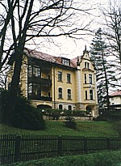Die frühere Carolastraße in der Nähe des Klotzscher Bahnhofes wurde nach der Eingemeindung des Ortes in Siegfried-Rädel-Straße umbenannt. Rädel (1893-1943) gehörte der KPD an und war einige Jahre Mitglied des Reichstages. 1993 erhielt sie den Namen Georg-Estler-Straße. Georg Estler (1860-1954) war als Landschaftsmaler tätig und wohnte viele Jahre in Klotzsche auf der Carolastraße 3. Sein Grab befindet sich auf dem Alten Klotzscher Friedhof. Das Straßenbild prägen vor allem Villen, die früher teilweise auch als Pensionen genutzt wurden. So gab es in der Nr. 5 einst die Pension "Quisisana", die in Prospekten als "vornehme Familien- und Kurpension" mit ihrer Nähe zum Bahnhof, zum Waldpark und zum Prießnitzgrund warb.

Nr. 8: Zu den bemerkenswerten Gebäuden gehört die Villa Georg-Estler-Straße 8 _(Foto)_, welche 1887 nach Plänen des Architekten Ernst Friedrich Giese errichtet wurde. Bauherr des einst “Villa Burgfrieden” genannten Hauses war der Stukkateur Carl Hauer, der als einer der ersten Künstler überhaupt Kunstmarmor verwendete und u.a. den Altar der Klotzscher Christuskirche schuf. 1940 verkauften seine Nachkommen das Haus an eine Kaufmannsfamilie. Nach deren Wegzug in den Westen kam es 1958 in den Besitz der Stadt, welche hier Mietwohnungen einrichtete. Nach erfolgreicher Restitution 1995 wurde die Villa denkmalgerecht saniert und dient heute Wohnzwecken.

## Gertrud-Caspari-Straße

Die Gertrud-Caspari-Straße wurde 1859 im Zusammenhang mit dem Ausbau des Villenviertels Königswald angelegt und hieß ursprünglich Auenstraße. Als wichtige öffentliche Gebäude entstanden hier 1896 die [Grundschule](../../../nord/klotzsche/) Klotzsche-Königswald (Nr. 9) und 1936 das neue Klotzscher [Postamt](../../../nord/klotzsche/) (Nr. 10), welches seit 2017 als Gemeindehaus der evangelischen Kirchgemeinde genutzt wird. Im Haus Nr. 12 befindet sich das Pfarramt der Christuskirche. Nach Eingemeindung des Ortes wurde die Straße 1954 nach der Kinderbuchillustratorin Gertrud Caspari (1873-1948) benannt, die viele Jahre in Klotzsche lebte.

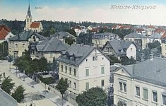

**_Foto:_** _Blick in die Auenstraße zur Christuskirche_

## Geschwister-Scholl-Straße

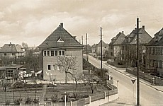Die ersten Häuser an dieser Straße entstanden 1928/29 durch die “Arbeitsgemeinschaft Eigenwerk e. V.”. Das Bauland hatte der Verein von der Klotzscher Familie Hüttig günstig erworben. Die Siedlung sollte Auftakt für weitere Wohnviertel in diesem Gebiet sein. Der Bau des Flughafens verhindert jedoch alle weiteren Pläne. Stattdessen mussten sogar sechs Wohnhäuser der “Ödlandsiedlung” am Ende der Straße 1934 wieder abgerissen werden.

Ursprünglich trug die Geschwister-Scholl-Straße ab 1929 den Namen Eigenwerkstraße. Während der Nazizeit zwischen 1933 und 1945 nach dem sächsischen Gauleiter Mutschmannstraße genannt, erhielt sie im Juni 1945 den Namen Ernst-Thälmann-Straße. Um Verwechslungen mit der gleichnamigen Straße im Stadtzentrum zu vermeiden, wurde sie nach der Eingemeindung Klotzsches im September 1953 in Geschwister-Scholl-Straße umbenannt. Das Geschwisterpaar Hans und Sophie Scholl war im Kampf gegen das Naziregime aktiv und wurde wegen der Verteilung illegaler Flugblätter 1943 hingerichtet. Auf dem Grundstück Geschwister-Scholl-Straße 52 an der Ecke zur Travemünder Straße erinnert ein am 3. Oktober 1990 gepflanzter Einheitsbaum an die deutsche Wiedervereinigung.

Die Goethestraße gehört zu den Straßen Klotzsches, die Ende des 19. Jahrhunderts im Villenviertel Königswald angelegt wurden. 1899 erhielt sie ihren Namen nach dem Dichter Johann Wolfgang von Goethe (1749–1832). Während die benachbarte Schillerstraße nach der Eingemeindung Klotzsches in Alexander-Herzen-Straße umbenannt wurde, behielt die Goethestraße bis heute ihren Namen.

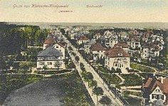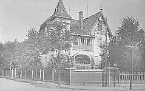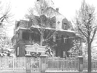

**_Fotos:_** _Historische Aufnahmen der Goethestraße,_

_in der Mitte die Villa “Baldur” (Nr. 11), rechts das Fremdenheim Doehn (Nr. 18)_

Nr. 3:
Das Landhaus Goethestraße 3 war Wohnsitz des Architekten Woldemar Kandler, der die Christuskirche und einige Klotzscher
Villen entwarf. Von ihm stammen auch die Kapelle auf dem Alten Friedhof Klotzsche, das Pfarrhaus auf der Hendrichstraße, das Kriegerdenkmal vor der Christuskirche und die Kirche von Bühlau.

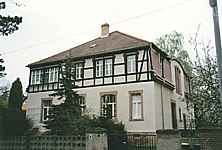

**_Foto:_** _Die 1907 errichtete Villa Woldemar Kandlers auf der Goethestraße 3_

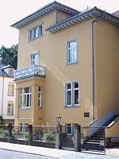Nr. 9: Seit 1900 lebte im
von ihm selbst entworfenen Haus Goethestraße 9der Bildhauer Johannes Schilling. Schilling verstarb am 21. März 1910 in Klotzsche und schuf u.a. die vier Figurengruppen am
Aufgang zur Brühlschen Terrasse, das König-Johann-Denkmal auf dem Theaterplatz sowie die Quadriga der Semperoper. Bis 1945 blieb die Villa in Familienbesitz. Nach dem Zweiten Weltkrieg wurde sie u.a.
von der Firma Meißner, später vom VEB Mantissa als Produktionsstätte für Rechenschieber genutzt. Aus Anlass seines 100. Todestages wurde am Haus _(Foto rechts)_ eine Gedenktafel für den Künstler angebracht.

Nr. 11: Auch die benachbarte Villa Baldur, um 1900 nach Plänen von Richard Otto Gänzel erbaut, war Wohnhaus eines Prominenten. 1917 hatte der dänische Schriftsteller Karl Gjellerup das Haus vom Geld seines Literaturnobelpreises erworben und bewohnte es bis zu seinem Tod 1919. Danach befand es sich ab 1932 im Besitz der Familie Sternberg, welche auf der Wilsdruffer Straße 44 in der Innenstadt ein Wollwarengeschäft betrieb.

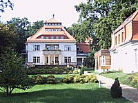Villa Harzer (Nr. 17): Das repräsentative Gebäude wurde 1907 für den Unternehmer Max Bruno Harzer nach Plänen des Architekten Gustav Schleinitz errichtet. Harzer war mit 25 Jahren nach Mexiko ausgewandert, dort als Plantagenbesitzer zu erheblichem Wohnstand gekommen und später wieder nach Deutschland zurückgekehrt. Das von einer großen Parkanlage umgebene Haus wurde deshalb auch spöttisch “Ananasvilla” genannt. Nach dem Auszug der sechs Kinder des Paares vermietete Harzer das Erdgeschoss des Gebäudes an die katholische Gemeinde Klotzsche, die hier ihre Gottesdienste abhielt. Am 1. Oktober 1938 wurde der Kirchenraum geweiht und Klotzsche zur eigenständigen Vikarie erhoben.

1940 vermietete die Witwe Bruno Harzers weitere Räume an die Haushaltschule der Mathilde-Zimmer-Stiftung. 1943 wurde die Villa jedoch von den Behörden enteignet und an das Deutsche Rote Kreuz zur Nutzung übertragen. Fortan befand sich hier die Frauenabteilung des Instituts für Wirbeltuberkulose. 1946 übernahm das Land Sachsen das Haus. Seit den 1970er Jahren war in der ehemaligen Villa Harzer bis 1989 das Internat des Dresdner Datenverarbeitungszentrums untergebracht. Nach langjährigem Leerstand erfolgte 2007/08 der Umbau zum Wohnhaus.

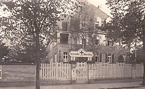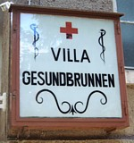Institut für Wirbeltuberkulose: Zu den wichtigen medizinischen Einrichtungen Klotzsches gehörte das 1926 auf der Goethestraße im früheren Fremdenheim Doehn gegründete Institut für Wirbeltuberkulose. Leiter war der aus Livland stammende und 1918 emigrierte Arzt Prof. Dr. med. Julius von Finck. Für die Heilstätte nutzte dieser zunächst die Villa “Gesundbrunnen” (Nr. 18), ab 1943 auch die benachbarte Villa “Harzer” (Nr. 17). Behandelt wurden vor allem Kinder und Jugendliche, die an der bislang als unheilbar geltenden “Buckelkrankheit” litten. Julius von Finck führte sein Institut auch nach 1945 bis zu seinem Tod im April 1951 weiter. Wenig später wurde die Privatklinik in die Medizinische Akademie eingegliedert. Das Gebäude in Klotzsche nutzte ab 1972 die Poliklinik Dresden-Mickten als Außenstelle. Heute dient die Villa Gesundbrunnen als Ärztehaus.

## Göhrener Weg

Der Göhrener Weg entstand in den 1980er Jahren beim Bau des Neubaugebiet an der Selliner Straße. Wie zahlreiche weitere Straßen
in diesem Viertel erhielt er seinen Namen 1985 nach einem Ort im Ostseeraum, dem Ostseebad Göhren auf der Insel Rügen.

## Granitzer Weg

Ebenso wie andere Straßen in Klotzsche verdankt auch der Granitzer Weg seinen Namen einem Ort an der Ostsee. Granitz auf der
Insel Rügen ist vor allem durch sein gleichnamiges Jagdschloss bekannt. Am Granitzer Weg entstanden Mitte der 1980er zahlreiche Eigenheime.

## Greifswalder Straße

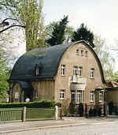Die heutige Greifswalder Straße hieß ursprünglich Parkstraße, bevor sie, ebenso wie zahlreiche weitere
Straßen in Klotzsche, nach einer Stadt an der Ostsee benannt wurde. Vor dem Ausbau um 1900 wurde sie Ruscheweg genannt. Bereits Mitte des 17. Jahrhunderts führte dieser Weg an den sogenannten “Ruschewiesen” vorbei. Als Rusche wurden einfache Alarmanlagen aus Brettern bezeichnet, bei denen in
Kriegszeiten durch Anschlagen die Bewohner vor drohenden  Gefahren gewarnt werden konnten. Nach 1945 erhielt sie kurzzeitig den Namen Wilhelm-Külz-Straße. Der liberale Politiker Wilhelm Külz
(1875-1948) hatte bis zu seiner Vertreibung 1933 das Amt des Oberbürgermeisters von Dresden inne. Da es im benachbarten Hellerau jedoch ebenfalls eine Wilhelm-Külz-Straße gabe, erfolgte im September
1953 die Umbenennung in Greifswalder Straße.

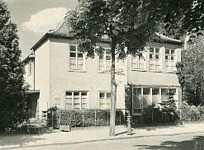Das Wohnhaus Nr. 10
_(Foto links oben)_ wurde 1925 für den Kunstmaler Friedrich Alfred Oehme (1881-1935) erbaut, dessen Atelier mit einer von ihm gestalteten Kassettendecke noch
erhalten ist. Architekt der Villa war Woldemar Kandler, der auch die Christuskirche am Boltenhagener Platz schuf. Oehme malte vor allem Landschafts- und Porträtbilder und wurde nach
seinem Tod auf dem Alten Friedhof Klotzsche beigesetzt. Nach 1945 war das Haus zeitweise Sitz des sowjetischen Geheimdienstes. Architektonisch interessant sind auch die benachbarten Häuser
Nr. 8 und 14. Letzteres stammt ebenfalls von Woldemar Kandler. Das Wohnhaus Parkstraße 8 ( _Foto rechts_) wurde 1927 für den Apotheker Ernst Halle als Apotheke und Labor errichtet. Architekt war Oswin Hempel.

## Grenzstraße

Die Grenzstraße, Teil des ehemaligen Fürstenweges zwischen Volkersdorf und [Hofewiese](../../../nordost/dresdner_heide/hofewiese/), erhielt ihren Namen 1945, da sie an der
Ortsgrenze Klotzsches verläuft. 1935 entstand auf dem Areal zwischen Grenzstraße und Weixdorf die Luftnachrichtenschule mit
ausgedehnten Kasernenanlagen. Hier siedelten sich nach 1945 Gewerbebetriebe an, für die man eigens eine Stichbahn mit S-Bahnhof
anlegte. Außerdem wurde zwischen 1986 und 1990 ein Wohngebiet mit ca. 700 Wohnungen in Plattenbauweise errichtet. Nach 1990
entstand auf dem Gelände des ehemaligen Zentrums für Mikroelektronik ein moderner Büropark, der in den kommenden Jahren noch
erweitert werden soll. Die Bahnstrecke wurde 2000/01 als Flughafenzubringer ausgebaut und verlängert.

## Grüner Weg

Der Grüne Weg wurde um 1930 als eine von der Querallee (heute Boltenhagener Straße) abgehende Sackgasse angelegt und erhielt zunächst den Namen Grüne Straße. Noch vor dem Zweiten Weltkrieg wechselte der Name in Am Querweg. Da es im Stadtteil Leubnitz-Neuostra jedoch ebenfalls eine Straße mit diesem Namen gab, machte sich nach der Eingemeindung von Klotzsche eine erneute Umbenennung erforderlich. Diese erfolgte im September 1953 in Grüner Weg. Im Zusammenhang mit dem Bau des Neubauviertels an der Karl-Marx-Straße wurde der Grüne Weg in den 1960er Jahren verlängert.

## Hauerstraße

Die Hauerstraße entstand mit Anlage der Wohnsiedlung nördlich der Christuskirche und verdankt ihren Namen dem königlich-preußischen Hofstuckateur Carl Borromäus Hauer. Hauer ist Schöpfer des Altars der Kirche und gestaltete auch das heute nicht mehr vorhandene König-Albert-Denkmal im Waldpark. Amtlich benannt wurde sie 1936.

## Heiderandweg

Der Heiderandweg verbindet die Königsbrücker Landstraße mit dem Klotzscher Weg und erhielt seinen Namen, da er südlich des Ortsteils Alberthöhe am Rand zur Dresdner Heide verläuft. Verwendet wird die Bezeichnung seit ca. 1940.

## Hendrichstraße

Die Hendrichstraße befindet sich im alten Dorfkern und bildet zugleich die Flurgrenze zwischen Klotzsche und Hellerau. Ursprünglich war sie Teil eines um das ganze Dorf herumführenden Weges und wurde als Dorffrieden bezeichnet. Seit dem Ausbau zur Straße um 1900 erinnert der heutige Name an den früheren Gemeindevorstand Friedrich Gottlob Theodor Hendrich (1834-1900). Hendrich erwarb sich große Verdienste bei der Wandlung des Ortes vom Bauerndorf zum Villenvorort und wohnte im Haus Hendrichstraße 1. Unter seiner Regie erhielt Klotzsche u. a. seine erste Straßenbeleuchtung und ein gemeindeeigenes Wasserwerk. 1933 wurde die Hendrichstraße kurzzeitig Horst-Wessel-Straße genannt, bis dieser Name auf die heutige Tichystraße übertragen wurde. Die Wohnhäuser Nr. 2-8 und 9-27 gehören bereits zur Gartenstadt Hellerau und wurden 1911/13 von Curt Frick entworfen. Weitere Gebäude (Nr. 3-7) stammen von Hermann Muthesius. Das 1895 errichtete Pfarrhaus der Klotzscher Kirche entstand 1895 nach Plänen von Woldemar Kandler.

Ein besonderes Kuriosum ist unmittelbar am Durchgang zur Alten Klotzscher Kirche zu entdecken. In einer stillgelegten Telefonzelle wurde “Dresdens kleinste Leihbücherei” eingerichtet. Literaturbegeisterte können sich hier kostenlos Bücher ausleihen bzw. durch eigene Exemplare austauschen.

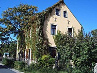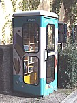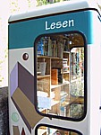

**_Fotos:_** _Hendrichstraße mit der “Literaturzelle” am Durchgang zum Kirchhof_

## Hermann-Reichelt-Straße

Die Hermann-Reichelt-Straße auf dem Gelände des Flughafens erinnert an den deutschen Flugpionier Hermann Reichelt (1878-1914), der 1909 erste Versuche mit selbstgebauten Fluggeräten unternahm. 1912 gründete er in Dresden-Kaditz eine Flugschule und war auch als Konstrukteur tätig. 1914 kam er bei einer Schauvorführung ums Leben. Ursprünglich war sie als Werkstraße 11 lediglich für den internen Verkehr gedacht, wurde Mitte der 1990er Jahre jedoch öffentlich gewidmet und bis zur Grenzstraße verlängert. Die amtliche Namensgebung erfolgte im April 1995. Von Bedeutung ist sie als Hauptzufahrt zum Terminal und als Verbindung zur Autobahnabfahrt "Dresden-Flughafen".

## Hugo-Junkers-Ring

Der Hugo-Junkers-Ring befindet sich auf dem Gelände der früheren Flugzeugwerft und erhielt seinen Namen nach dem deutschen Techniker und Unternehmer Hugo Junkers (1859–1935). Junkers war Gründer und Eigentümer der Junkers Flugzeugwerke AG und gilt als einer der bedeutendsten Flugzeugkonstrukteure überhaupt.

Der Ikarusweg befindet sich auf dem Gelände der ehemaligen [Flugzeugwerft](../../../nord/klotzsche/flughafen/flugzeugwerft/) und wurde innerbetrieblich Werkstraße 67 genannt. Nach 1990 erfolgte die öffentliche Widmung und in diesem Zusammenhang im November 1995 die Benennung mit Ikarusweg. Mit der Namensgebung nach der griechischen Sagengestalt Ikarus soll der historische Bezug zum Flugwesen hergestellt werden.

Der Immelmannplatz entstand als Vorplatz des Flughafens mit dem "Hansa-Haus" und wurde 1935 nach dem deutschen Jagdpiloten des Ersten Weltkriegs Max Immelmann (1890-1916) Immelmannplatz benannt. Da diese Bezeichnung als militaristisch galt, erfolgte 1945 die Umbenennung in Roter Platz. Wenig später wurde diese Benennung aufgehoben, so dass der Platz heute namenlos ist. Seit einige Jahren gibt es jedoch Bestrebungen, dem Vorplatz wieder einen Namen zu geben.

## Karl-Gjellerup-Straße

Die 2004 im Zusammenhang mit einem Neubaugebiet am Dörnichtweg angelegte Karl-Gjellerup-Straße erhielt ihren Namen nach dem dänischen Schriftsteller und Literaturnobelpreisträger Karl Adolph Gjellerup (1857-1919), der seine letzten Lebensjahre in Klotzsche (Gartenstraße 28, heute Kieler Straße) verbrachte und auf dem Alten Klotzscher Friedhof begraben liegt.

## Karl-Marx-Straße

Die Karl-Marx-Straße verbindet die Königsbrücker Landstraße mit dem Flughafen. Ursprünglich gab es hier nur einen kurzen Verbindungsweg bis zur Kieler Straße, den man Blumenstraße nannte, der jedoch unbebaut war. Ausgebaut wurde die Straße erst im Zusammenhang mit dem Bau des Flughafens 1935. Ursprünglich sollte hier eine neue Hauptachse mit Straßenbahntrasse entstehen. Zu beiden Seiten waren repräsentative Gebäude für die junge Stadt, u. a. ein Stadion, eine Stadthalle und ein Aufmarschplatz für nationalsozialistische “Weihestunden” vorgesehen. Kriegsbedingt wurden diese Pläne des Stadtbaumeisters Dutschke nicht mehr realisiert, so dass heute nur einige Wohnhäuser aus dieser Zeit an das Projekt erinnern. Bereits Ende 1945 erfolgte eine Umbenennung der Flughafenstraße nach dem deutschen Philosophen und geistigen Urvater der kommunistischen Bewegung Karl Marx (1818–1883) in Karl-Marx- Straße. Der hintere Straßenteil erhielt im Februar 1993 seinen früheren Namen Flughafenstraße wieder zurück.

In den 1960er Jahren wurden an der Karl-Marx-Straße Wohnblöcke für die Angestellten von Klotzscher Betrieben errichtet, denen später eine Plattenbausiedlung folgte. Bemerkenswert ist der 1952/55 als Konstruktionsbüro der [DDR-Luftfahrtindustrie](../../../nord/klotzsche/flughafen/flugzeugwerft/) errichtete Stahlbetonbau am Flughafen, welcher unter Denkmalschutz steht. 1997 wurde das Haus zum Airport Bürocenter umgebaut. 2009/10 entstand an der Ecke zur Boltenhagener Straße ein modernes Einkaufszentrum nach einem Entwurf des Dresdner Architekten Dieter Gechter.

Der Karlshagener Weg wurde in den 1970er Jahren als Zugang zu zwei damals neu errichteten Kindereinrichtungen angelegt. Ähnlich wie bei einigen Nachbarstraßen erfolgte die Namensgebung nach einem Ort an der Ostseeküste, dem Ostseebad Karlshagen

## Käthe-Kollwitz-Platz

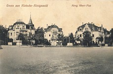Der heutige Käthe-Kollwitz-Platz wurde Ende des 19. Jahrhunderts an der Kreuzung Königsbrücker Landstraße / Langebrücker Straße angelegt. Um den Platz entstanden wenig später Villen des Kurortes Königswald. Außerdem befand sich hier ab 1898 die aus einer alten Kutscherschänke hervorgegangene Gaststätte [“Deutsche Eiche”](../../../nord/klotzsche/strassen_klotzsche/konigsbrucker_landstrasse/). Der Platz wurde ab 1903 bis 1945 König-Albert-Platz bzw. Albertplatz genannt und war zwischen 1903-1905 Endpunkt der gleislosen [“Haidebahn”](../../../nord/klotzsche/haidebahn/).

Im Juni 1945 erfolgte zunächst nach dem deutschen Arbeiterführer August Bebel (1840-1913) die Umbenennung in August-Bebel-Platz. Da es diesen Straßennamen in Dresden bereits gab, musste der Platz nach der Eingemeindung Klotzsches bereits im September 1953 erneut seinen Namen wechseln. Die Malerin und Bildhauerin Käthe Kollwitz (1867-1945) wurde mit ihren Anti-Kriegs-Darstellungen international bekannt und verbrachte ihre letzten Lebensmonate in Moritzburg, wo eine Gedenkstätte an sie erinnert. Heute hat der Käthe-Kollwitz-Platz vor allem als Verkehrsknotenpunkt für den öffentlichen Nahverkehr Bedeutung.

## Kieler Straße

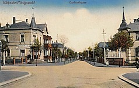Die Kieler Straße verbindet parallel zur Königsbrücker Landstraße den alten Ortskern mit dem Villenviertel Königswald. Die ersten Gebäude entstanden Ende des 19. Jahrhunderts. 1907 folgte auf damals noch unbebautem Gebiet das Klotzscher [Rathaus](../../../nord/klotzsche/). Die übrigen Häuser wurden bis zum Beginn des Zweiten Weltkrieges für Offiziere der Klotzscher Luftkriegsschule errichtet. Zunächst ab 1897 Gartenstraße genannt, erfolgte 1933 die Umbenennung in Bismarckstraße, bevor 1945 der Straßenname August-Bebel-Straße
eingeführt wurde. Auch hier war die Namensgleichheit mit einer Dresdner Straße Anlass für eine erneute Umbennung nach der Hafenstadt Kiel im September 1953.

Bis zur Gegenwart sind an der Kieler Straße zahlreiche Gebäude aus der Zeit des Kurortes erhalten geblieben. Im Haus Nr. 7 gab es einst ein Lehrerinnen-Heim,
1910 unter dem Namen Carolastift in den Adressbüchern verzeichnet. Im Eckhaus Nr. 18 _(im Bild ganz links)_ gab es bereits vor dem Ersten Weltkrieg das Restaurant zur Wartburg. In der Bismarckstraße 58 hatte bis 1945 eine Dienststelle der Kriminalpolizei ihren Sitz.

Die Straße Klotzscher Berglehne liegt in einem Neubaugebiet zwischen Oderstraße und Dörnichtweg und geht in östliche Richtung über in die Traute-Richter-Straße. Sie entstand nach 2000 und erhielt ihren Namen nach örtlichen Gegebenheiten.

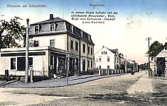Die frühere Hauptstraße, wichtigste Verbindung zwischen Schänkhübel und Dorfkern erhielt erst nach 1990 ihren heutigen Namen. Ursprünglich führte sie durch den gesamten Ortskern bis zur Flurgrenze nach Hellerau und wurde seit den 1890er Jahren als Hauptstraße bezeichnet. Im November 1991 erhielt jedoch die Straße der Befreiung in der Inneren Neustadt ihren alten Namen zurück, so dass es nun zu einer Namensdoppelung kam. Der Stadtrat beschloss deshalb, die in Klotzsche gelegene Hauptstraße zu teilen und in ihrem nördlichen Abschnitt Altklotzsche, im südlichen Teil ab Am Hellerrand Klotzscher Hauptstraße zu nennen.

Die Gebäude an der Klotzscher Hauptstraße entstanden ab Ende des 19. Jahrhunderts, als rund um den Schänkhübel ein neues Wohnviertel angelegt wurde, welches auch als Ortsteil “Alberthöhe” bezeichnet wird. Im Haus Nr. 1 befand sich von 1873 bis 1899 das erste Klotzscher Postamt _(Foto)_. 1880 wurde auf dem Grundstück Nr. 24 ein “Lufthüttenbad” angelegt, welches jedoch nur wenige Jahre existierte. Außerdem finden sich hier die Gebäude der früheren [Volksschule](../../../nord/klotzsche/) (Nr. 26) und der 1914 erbauten Neuen Schule.

## [Königsbrücker Landstraße](../../../nord/klotzsche/strassen_klotzsche/konigsbrucker_landstrasse/)

Als Königswaldplatz wird die platzartige Anlage am Zusammentreffen von Rostocker Straße, Alexander-Herzen-Straße, Prof.-von-Finck-Straße und Boltenhagener Straße bezeichnet. In älteren Stadtplänen ist die Anlage als Schillerplatz eingetragen, besaß jedoch keine Adressen, weshalb man die Bezeichnung später aufhob. Erst im Februar 1993 erhielt der Platz wieder einen Namen nach dem Klotzscher Ortsteil Königswald.

Die Konrad-Zuse-Straße wurde 2004 zur Erschließung des neuen Gewerbeparks “data.base” angelegt und nach dem Computerpionier Konrad Zuse (1910-1995) benannt. Zuse entwickelte 1941 den ersten programmgesteuerten Rechenautomaten und gilt als “Vater des Computers”. 1981 erhielt er die Ehrendoktorwürde der TU Dresden. In den letzten Jahren entstanden an der Konrad-Zuse-Straße verschiedene Labor- und Produktionshallen, u.a. für das Fraunhofer-Institut für Photonische Mikrosysteme.

Die Korolenkostraße wurde ium 1890 m Zusammenhang mit dem Bau des Villenviertels Königswald angelegt und zunächst Florastraße genannt. Zwischen 1933 und 1945 trug sie nach einem nationalsozialistischen “Vorkämpfer” den Namen Leo-Schlageter-Straße. Bereits im Sommer 1945 wurde die Straße in Rosa-Luxemburg-Straße umbenannt. Da es in Dresden bereits eine gleichnamige Straße in der Inneren Neustadt gab, erhielt sie nach der Eingemeindung Klotzsches ihre heutige Bezeichnung nach dem russischen Schriftsteller und Erzähler Wladimir Korolenko (1853-1921). Auf der Korolenkostraße befindet sich seit 1914 die Neue Schule Klotzsche, heute [82\. Oberschule](../../../nord/klotzsche/) "Am Flughafen" (Nr. 6).

Der Kunitzteichweg entstand Mitte der 1990er Jahre zur Erschließung eines kleinen Wohnparks an der Königsbrücker Straße und verbindet diese mit der Traubelstraße. Im März 1996 erhielt die neue Straße ihren Namen nach einem früher dort vorhandenen Teich, der auf einer Karte von 1850 als "Paul Kunitz Teich" bezeichnet wurde.

Die Langebrücker Straße verbindet den Klotzscher Ortsteil Königswald mit dem benachbarten Langebrück und durchquert dabei den nördlichen Teil der Dresdner Heide. Amtlich eingeführt wurde die Straßenbenennung um 1900. An der Flurgrenze zu Langebrück wechelt der Straßenname in Dresdner Straße.

Am Abzweig Königsbrücker Landstraße befindet sich seit 1897 die Gaststätte [“Deutsche Eiche”](../../../nord/klotzsche/strassen_klotzsche/konigsbrucker_landstrasse/) (Nr. 2). Unweit davon gab es ab 1889 einen der ersten Dresdner Kindergärten (Nr. 3a). Die Einrichtung wurde 1866 vom Dresdner Stadtverein für Innere Mission in der Oppellvorstadt gegründet und 1888/89 in einen Neubau im Vorort Königswald verlegt. Bereits vor dem Ersten Weltkrieg bot dieser Kindergarten Platz für über 200 Kinder. Zu den Bauvorhaben der jüngsten Vergangenheit gehört ein nach 1990 entstandener Wohnpark.

Der Lauschigwiesenweg entstand bereits 2000 zur Erschließung eines geplanten neuen Wohngebiet an der Travemünder Straße. Benannt wurde sie nach einem alten Flurnamen. Im Herbst 2015 begannen die Bauarbeiten für die neue Siedlung.

Die Lindenstraße entstand in der 2. Hälfte des 19. Jahrhunderts im Ortsteil Alberthöhe. Ihren Namen erhielt sie nach den hier gepflanzten Lindenbäumen.

Die Lubminer Straße wurde Anfang der 1970er Jahre im Zuge des Neubaugebietes Klotzsche angelegt. 1974 erhielt sie, so wie andere Straßen in diesem Viertel, ihren Namen nach einem Ort an der Ostsee, dem Seebad Lubmin.

Die Ludwig-Jahn-Straße verbindet die Kieler Straße mit der Straße An den Ruschewiesen. Sie wurde 1937 Begründer der deutschen Turnbewegung Friedrich Ludwig Jahn (1778-1852) benannt.

Die Maria-Reiche-Straße entstand 2004 im Zusammenhang mit dem Ausbau des Klotzscher Gewerbeparks “data.base”. Ihren Namen erhielt sie nach der in Dresden geborenen Geographin und Archäologin Maria Reiche (1903-1998). Maria Reiche verbrachte einen Großteil ihres Lebens mit völkerkundlichen Studien in Peru und befasste sich mit der Erforschung der weltbekannten Scharrbilder von Nazca, die sie als frühgeschichtlichen Kalender deutete.

Zentrum Mikroelektronik Dresden (ZMD): Das Institut in Klotzsche geht auf die am 1. August 1961 gegründete Arbeitsstelle für Molekularelektronik zurück. Unter Leitung des Physikers Prof. Werner Hartmann begann in einer ehemaligen Kaserne an der Königsbrücker Landstraße (Objekt 1) die Entwicklung der integrierten Halbleitertechnik in der DDR. In mehreren Gebäuden der früheren Luftkriegsschule richtete man die erforderlichen Laboranlagen und Forschungsräume ein. Zu den ersten Ergebnissen gehörte die Entwicklung von Logik-Schaltkreisen in Bipolartechnik und der Einstieg in die Unipolartechnik.

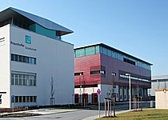1974 wurde Werner Hartmann als Leiter der Einrichtung aus politischen Gründen abberufen. Zwei Jahre später wurde die Einrichtung in Institut für Mikroelektronik Dresden umbenannt und 1978 dem Kombinat Mikroelektronik Erfurt, 1986 dem Kombinat Carl Zeiss Jena zugeordnet. 1981 erfolgte an der Grenzstraße die Grundsteinlegung zum Objekt 2, der Zentrale Verfahrensentwicklung (ZVE). Bis 1990 wurden hier grundlegende Technologien der Mikroelektronik erforscht und industriell umgesetzt. Im Mittelpunkt stand die Herstellung von Wafern und Chips und deren Einsatz in Schaltkreisen. Nach der Wende bildeten diese Entwicklungen die Grundlage für die bis zur Gegenwart in Klotzsche ansässigen Hochtechnologiefirmen der Branche.

Mit der Herauslösung der Forschungseinrichtung aus dem Kombinat Carl Zeiss Jena begann 1990 ein neuer Abschnitt der Firmengeschichte. Fortan firmierte diese als Zentrum Mikroelektronik Dresden GmbH. 1992 entstand schließlich das heutige
Fraunhofer-Institut für Mikroelektronische Schaltungen und Systeme, welches sich sowohl mit Forschungsaufgaben als auch industrienahmen Dienstleistungen für Unternehmen der Branche befasst. Seit 2003 wird dieses als Fraunhofer-Institut für Photonische Mikrosysteme (IPMS) bezeichnet. Heute arbeiten hier ca. 210 Mitarbeiter an elektronischen, mechanischen und optischen Komponenten und ihrer Integration in intelligente Bauelemente und Systeme.

Die Marsdorfer Straße entstand ursprünglich als Marsdorfer Weg und ist seit 1897 im Adressbuch verzeichnet. Wenig später wechselte die Bezeichnung Weg in Straße. Benannt ist sie nach dem kleinen Ort Marsdorf, der seit 1999 als Stadtteil zu Dresden gehört. Reste des alten Marsdorfer Weges sind noch nördlich des Flugplatzes erhalten. An der Einmündung der Marsdorfer in die Rähnitzer Straße steht eine Stieleiche, die als Naturdenkmal ausgewiesen ist.

Nr. 10: In diesem Haus wohnte zwischen 1937/38 und 1945 der Schriftstellers Richard Blasius (1885-1968). Er verfasste in den 1920er und 1930er Jahren zahlreiche Abenteuerromane, die in verschiedenen Heftreihen veröffentlicht wurden und sich zeitweise großer Popularität erfreuten. Außerdem sind von ihm einige Erzählungen und Gedichte in Oberlausitzer Mundart bekannt.

## Max-Hünig-Straße

Die Max-Hünig-Straße wurde 1953 nach dem Gründer der Kindererholungsstätte am Oberen Waldteich, Max Hünig (1851-1935),
benannt, der sich als Mitglied der SPD (später der KPD) auch politisch engagierte. Bis zur Eingemeindung Klotzsches trug sie den
Namen Georgstraße (ab Juni 1945 Rudolf-Breitscheid-Straße). Hier entwickelte sich nach 1890 eine kleine Wohnsiedlung, die im
Laufe der Zeit mit der vorhandenen Bebauung am Schänkhübel zusammenwuchs und fortan den Ortsteil Alberthöhe bildete.
Ursprünglich befand sich an dieser Stelle ein kurfürstlicher Ortolanherd, eine Vogelfangstelle für Gartenammern (Ortolanen). Ende der
1960er Jahre war unterhalb der Alberthöhe der Bau eines Neubaugebietes mit mehrgeschossigen Plattenbauten vorgesehen, was
jedoch wegen der Nähe zu den militärischen Anlagen am Einspruch der sowjetischen Streitkräfte scheiterte.

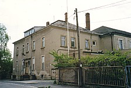Alberthöhe (Nr. 13): Die Gaststätte wurde 1888 als Ballhaus und Hotel “Alberthöhe” eröffnet
und war eines der größten Restaurants in der Dresdner Umgebung. Zum Haus gehörten u. a. ein wegen des Fernblicks berühmtes Café mit Terrasse und Aussichtsturm, ein Restaurant und
mehrere Tanzsäle. Architekt des Gebäudes war Johann Wachs, Inhaber der Gastwirt Moritz Reiche. In den Dreißiger Jahren wurden die Gebäude nochmals modernisiert und um eine
Freitanzdiele erweitert. Am 28. November 1935 fand im großen Saal der Alberthöhe die Feier zur Verleihung des Stadtrechts statt. Bis zum Zweiten Weltkrieg gastronomisch genutzt, diente
die Alberthöhe zeitweise als Lazarett und wurde 1952 geschlossen. In den Jahren nach 1945 fanden hier noch Konzerte, Theater- und Opernaufführungen sowie Filmvorführungen statt. 2009 erfolgte der Umbau der einstigen
Gaststätte zu einer Wohnanlage.

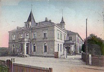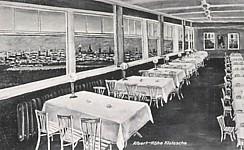

**_Fotos:_** _Die “Alberthöhe”um 1890 (links) und in den 1930er Jahren (rechts)_

In den Räumen der “Alberthöhe” produzierte ab 1953 die Süßwarenfabrik Herbert Wendler KG ihre Dominosteine. Wendler hatte
dieses Marzipan-Marmeladen-Gebäck bereits 1933 erfunden und auf der Rosenstraße 39, später in Radebeul hergestellt. Da es im
zerstörten Dresden keine geeigneten Produktionsräume mehr gab, erwarb Wendler das Gebäude vom letzten Besitzer Bernhard
Lukaschek und richtete hier seine Fabrik ein. Die Firma wurde 1972 verstaatlicht und 1990 privatisiert. 1998 übernahm die Dr.
Quendt Backwaren GmbH das Unternehmen und verlegte es zwei Jahre später nach Coschütz/Gittersee.

## Oderstraße

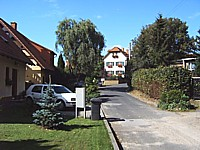Die Oderstraße, früher Nordstraße genannt, gehört zu den Straßen um alten Dorfkern. Bis ins 19.
Jahrhundert lagen nördlich dieser Straße die Bauernweinberge des Ortes. Noch 1955 existierte im Grundstück Nr. 5 eine alte Weinpresse, die zur Weinhandlung und Probierstube “Zum Winzer” der
Familie Hempelt gehörte. Bemerkenswert ist auch das Wohnhaus der ehemaligen Molkerei Leuschner mit einem Haussegen über dem Eingang. Leuschner besaß in Dresden eine Molkerei und
ließ 1936 in Klotzsche einen Neubau errichten. Später dienten die Kühlräume als Lager für Wild und Geflügel und wurden ab 1962 durch den VEB Mantissa genutzt. An der Oderstraße hatte einst
auch die Grützmühle zum Mahlen des Heidekorns ihren Standort. 1925 entstand an deren Stelle der Sportplatz des Klotzscher Turnvereins  “Gut Heil”.

Die ehemalige Jägerstraße im Ortsteil Königswald erhielt 1954 den Namen Prof.-von-Finck-Straße. Mit der Namensgebung wird an
den 1918 aus Rußland emigrierten Arzt Prof. Dr. Julius von Finck (1864-1951) erinnert, der 1926 die Leitung des Institutes für
Wirbeltuberkulose auf der Goethestraße 18 übernahm. Finck wurde für seine Verdienste zur Bekämpfung dieser Krankheit vielfach geehrt und war nach 1945 bis zu seinem Tod
an diesem Institut tätig. Seit 2009 erinnert eine Gedenktafel im Klotzscher Rathaus an ihn.

## Quosdorfstraße

Die Quosdorfstraße wurde im Zusammenbau mit der Anlage weiterer Siedlungen zwischen Klotzsche und dem Ortsteil Königswald
angelegt und nach dem früheren “Bezirksfeldwebel” (Landrat) Friedrich August Quosdorf (1840-1889) benannt. Quosdorf gilt als eigentlicher Gründer des Ortsteils Königswald und ließ hier 1884 das [Bahnhofshotel](../../../nord/klotzsche/strassen_klotzsche/bahnhofshotel/) als “Sommerfrische Quosdorf” erbauen. An ihn erinnert seit 1896
ein Gedenkstein gegenüber vom Bahnhof.

Die Richard-Riemerschmid-Straße wurde 2017 als Erschließungsstraße für das Gewerbegebiet Rähnitzsteig angelegt. Ihren Namen erhielt sie nach dem Architekten Richard Riemerschmid (1868-1957), Mitbegründer des Deutschen Werkbunds und maßgeblich am Bau der Gartenstadt Hellerau beteiligt.

## Rostocker Straße

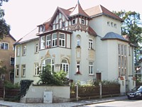
Die Rostocker Straße im Stadtteil Königswald (früher Mozartstraße) erhielt ihren Namen nach der Hafenstadt Rostock, wobei dabei an eine nach der Eingemeindung entstandene Klotzscher
Tradition angeknüpft wurde, Straßen den Namen von Orten im Ostseegebiet zu geben. Im Wohnhaus Rostocker Straße 17 lebte bis zu seinem Tod 1983 der Kunstmaler und Graphiker
Rudolf Nehmer, der zu den Mitbegründern der Künstlergruppe “Das Ufer - Gruppe 1947” gehörte. Bemerkenswert ist auch die Villa an der Ecke zur Goethestraße   (Nr. 15) mit Jugendstilelementen an der Fassade _(Foto)_.

## Rudolf-Nehmer-Straße

Die Rudolf-Nehmer-Straße wurde als Querstraße der Geschwister-Scholl-Straße 2002 angelegt und im Anschluss mit einer neuen
Doppelhaussiedlung bebaut. Der Name erinnert an den Kunstmaler Rudolf Nehmer (1912-1983), der seit 1936 in Dresden lebte und
in den 60er Jahren ein Wohnhaus in Klotzsche besaß. Nehmer gehörte der Künstlergruppe “Das Ufer - Gruppe 1947” an und erhielt für seine Arbeiten 1962 den Martin-Andersen-Nexö-Kunstpreis der Stadt Dresden.

## Selliner Straße

Die heutige Selliner Straße entstand um 1905 und war bis 1953 nach dem Reformator Philipp Melanchton benannt. Zur Vermeidung von Verwechslungen mit der gleichnamigen Melanchtonstraße in der Äußeren Neustadt wurde sie im September 1953, einer Klotzscher Nachkriegstradition entsprechend, nach einem Ostseebad in Selliner Straße umbenannt.

Die Selliner Straße ist Standort eines der letzten Plattenbaukomplexe Dresdens. Die mehrgeschossigen Wohnblocks sowie Schule, Sporthalle und Kaufhalle wurden 1989 erbaut und erst im Frühjahr 1990 bezogen. Ein kleiner Wohnpark mit ca. 450 Wohnungen folgte bis 1995. 2013 begann die Sächsische Wohnungsgenossenschaft Dresden mit einer umfassenden Modernisierung der Gebäude, welche künftig als Wohnpark "Klotzscher Höfe" vermarktet werden sollen. Begonnen wurde mit dem "Lindenhof" an der Selliner Straße, gefolgt vom "Sonnenhof" am Göhrener Weg und dem "Kirschhof" an der Nordecke des Gebäudeblocks. Neben Umbauten und einem Teilabbruch von Obergeschossen sind auch einige Lückenbauten geplant.

Außerdem existieren an der Selliner Straße noch einige Villen aus der ersten Hälfte des 20. Jahrhunderts. Bemerkenswert sind u.a. die Häuser Nr. 1 und Nr. 12, welche nach 1990 denkmalgerecht saniert wurden.

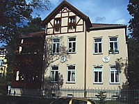An der Stendaler Straße 24, die bis zur Eingemeindung den Namen Martin-Luther-Straße trug, richteten 1945 die Franziskaner das St.-Marien-Krankenhaus ein. Zuvor hatte der Besitzer des Gebäudes, der Dresdner Zigarettenfabrikant Galm, die Villa für soziale Zwecke zur Verfügung gestellt und hier Flüchtlinge versorgen lassen. Wenig später kam auch das Nachbarhaus (Nr. 26) hinzu. Die Betreuung der Patienten oblag zunächst den “Grauen Schwestern”, einem katholischen Laienorden.
Die seit 1944 in Klotzsche wohnenden Ordensschwestern waren gegen Kriegsende aus Mönchengladbach gekommen, um hier ein Altersheim einzurichten. Am 18. April 1945 wurden die ersten beiden Frauen aufgenommen. Zunächst diente die Einrichtung unter dem Namen St.-Marien-Hospital vorrangig der Altenpflege, bevor man sich auf die medizinische Behandlung konzentrierte. Seit Dezember 1946 wird sie offiziell St.-Marien-Krankenhaus genannt. Schwerpunkt waren in den 1950er und 1960er Jahren die Bereiche Chirurgie und Gynäkologie.

Nach Weggang der Ordensschwestern und erfolgter Modernisierung und Erweiterung wird die Klinik seit 1969 als Fachkrankenhaus für Psychiatrie, Psychotherapie und Neurologie betrieben. Träger ist heute der Caritasverband des Bistums Dresden-Meißen. 1998 und 2003/04 wurde die Klinik in zwei Bauabschnitten um einen Neubau erweitert. Seitdem stehen hier ca. 100 Betten und 25 Tagesplätze zur Verfügung. 2011 kam eine kleine Turnhalle für die Patienten hinzu.

## Tichystraße

Die heutige Tichystraße wurde im Zusammenhang mit der Bebauung des Areals nach dem Ersten Weltkrieg angelegt. Nach
Machtübernahme der Nationalsozialisten erhielt sie den Namen des “Märtyrers der Bewegung” Horst Wessel, der bei politischen
Auseinandersetzungen in Berlin 1930 ums Leben kam. Bereits 1945 erfolgte die Umbenennung der Straße in Karl-Liebknecht- Straße.

Da es jedoch im benachbarten Hellerau bereits eine Karl-Liebknecht-Straße gab, folgte nach der Eingemeindung 1950 eine erneute
Namensänderung in Leo-Jogiches-Straße. Leo Jogiches-Tyszka (1867-1919) leitete um 1900 die ersten polnischen Kampfzirkel der
revolutionären Arbeiter und war ein Kampfgefährte Karl Liebknechts. 1919 wurde er im Gefängnis in Berlin-Moabit erschossen. 1993
erhielt die Tichystraße ihren heutigen Namen. Professor Dr. Hans Tichy (1888-1970) war Begründer des Institutes für Rheumatologie in Klotzsche.

## Traute-Richter-Straße

Die Traute-Richter-Straße entstand 2004 im Zusammenhang mit dem Bau eines neuen Wohngebietes am Dörnichtweg. Ihren Namen
verdankt sie der Schauspielerin Edeltraud Antonia (“Traute”) Richter (1924-1986), welche zwischen 1949 und 1986 zum Ensemble des Dresdner Staatsschauspiels gehörte und ab 1984 dessen Ehrenmitglied war.

## Travemünder Straße

Die aus einem früheren Feldweg hervorgegangene Travemünder Straße erhielt  ihren Namen nach dem Ostseebad Travemünde,
welches heute als Stadtteil zu Lübeck gehört. Ursprünglich befand sich auf diesem Gelände eine Kiesgrube, welche später als
Hausmülldeponie genutzt wurde. Nach deren Rekultivierung begann hier 2009 der Bau einer Wohnsiedlung mit ca. 120 Eigenheimen.

Der Vogelstellerweg wurde 2016 zur Erschließung eines neuen Wohnviertels an der Travemünder Straße angelegt. Benannt ist er nach der einst in Klotzsche verbreiteten Vogelstellerei zum Fang von Goldammern, Finken und Lerchen für den kurfürstlichen Hof. Das Ende des Weges war einst Standort einer Fanganlage, an der die Vogelsteller mit Lockpfeifen die Tiere anlockten und dann in Netzen einfingen. 1613 ist diese als "Jansen Strygers Vogelherd" erwähnt. Letzte Reste davon verschwanden 1931. Das frühere Wohnhaus des Vogelstellers ist jedoch noch erhalten (Altklotzsche 44).

## Wilhelmine-Reichard-Ring

Als Wilhelmine-Reichard-Ring wird seit März 1996 der Vorplatz des Klotzscher Flughafens bezeichnet. Mit dem Namen soll an die
deutsche Luftfahrtpionierin Johanne Wilhelmine Siegmundine Reichard (1788-1848) erinnert werden, die 1811 als erste Frau überhaupt eine Reise im Ballon unternahm. Gemeinsam mit ihrem Ehemann verdiente sie sich
später ihren Lebensunterhalt mit Ballonfahrten und erwarb sich so internationales Ansehen.

## William-Shakespeare-Straße

Die William-Shakespeare-Straße im Klotzscher Stadtteil Alberthöhe wurde Ende des 19. Jahrhunderts als Albertstraße angelegt.
Nach 1945 kurzzeitig Rennerstraße genannt, erhielt sie 1953 ihren heutigen Namen nach dem berühmten englischen Schriftsteller William Shakespeare (1564-1616).

## Windmühlenweg

Die Siedlungshäuser am Windmühlenweg entstanden ab 1914 durch die Heimhüttengesellschaft Sachsen gGmbH. Seinen Namen verdankt der Weg der ehemaligen [Rähnitzer Windmühle](../../../nord/rahnitz/), die 1955 dem Ausbau des Flughafens weichen musste.

## Wolgaster Straße

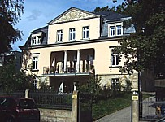Die Wolgaster Straße wurde 1875 als Verbindungsstraße zwischen Königsbrücker Landstraße
und dem neu eröffneten Eisenbahnhaltepunkt Klotzsche angelegt und erhielt zunächst den Namen Bahnhofstraße. Später wurde sie Graf-Spee-Straße bzw. ab 1945 Schnellerstraße genannt. Nach
der Eingemeindung des Ortes erhielt sie ihren heutigen Namen Wolgaster Straße. Im Wohnhaus Nr. 3 _(Foto)_ wohnte viele Jahre der bekannte Geodät und Professor Sophus Ruge (1831-1903),
dessen Grab sich auf dem Alten Friedhof in Klotzsche befindet.

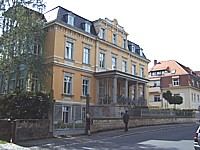Bürgerschänke: Das Gebäude Wolgaster Straße 7 entstand 1887 als zweites Hotel im Ortsteil
Königswald. Auf Initiative des Gründers des Kurbades Friedrich August Quosdorf wurden in die Fassade vier Säulen des ehemaligen “Café Reale” eingefügt, welches 1886 dem Bau der
Kunstakademie auf der Brühlschen Terrasse weichen musste. Im Haus befand sich ab 1888 das Gast- und Logierhaus “Goldener Apfel”.

Nach Einstellung des Kurbetriebes und dem damit verbundenem Rückgang der Gästezahl
wandelten die Besitzer ihr Hotel in ein Mietshaus um. In den früheren Weinkeller zog nun die Gaststätte “Bürgerschänke” ein, die im Volksmund auch “U-Boot” genannt wurde und bis 2004
existierte. Seinen Namen verdankte das Lokal einem früheren Besitzer mit Namen Hans Bürger. Heute dient das vor einigen Jahren komplett sanierte Gebäude _(Foto)_ ausschließlich Wohnzwecken.

Die Straße entstand 1875 als Zufahrt zum neu eingerichteten Klotzscher Eisenbahnhaltepunkt und erhielt zunächst den Namen
Königstraße. Ihre heutige Bezeichnung verdankt sie dem nahegelegenen Nesselgrundviadukt der Bahnstrecke Dresden - Görlitz. Markanteste Gebäude sind neben dem 1907 entstandenen Empfangsgebäude das ehemalige [Bahnhofshotel](../../../nord/klotzsche/strassen_klotzsche/bahnhofshotel/) und einige Villen aus der
Gründerzeit von Klotzsche-Königswald. Ein Gedenkstein in der Nähe des Bahnhofsvorplatzes erinnert an Friedrich August Quosdorf, Gründer des Ortsteils.

## Zur Wetterwarte

Die nach der hier gelegenen Wetterwarte Dresden-Klotzsche benannte Straße befindet sich auf dem Gelände der früheren Flugzeugwerft. Ursprünglich waren diese Werksstraßen, welche nicht dem öffentlichen Verkehr dienten, nur mit Nummern bezeichnet (41 und 68). Im November 1995 entschied sich der Stadtrat zur Vergabe von Straßennamen. Mit der Namensgebung "Zur Wetterwarte", "Zum Windkanal" und "Ikarusweg" wird die Erinnerung an die Geschichte des Areals wachgehalten.

Zu den heute in diesem Areal ansässigen Einrichtungen gehören das Landesamt für Archäologie (Zur Wetterwarte 7) und ein städtisches Wohnheim für Obdachlose (Nr. 34). Früher wurde dieses Haus als Lazarett genutzt und war 2015 als Übergangswohnheim für Flüchtlinge vorgesehen.

[Klotzsche auf OpenStreetMap](https://www.openstreetmap.org/search?query=Dresden+Klotzsche)

* * *

 \[ [Home](../../../index.html)\] \[ [Nord](../../../nord/)\] \[ [Nordwest](../../../nordwest/)\] \[ [Neustadt](../../../neustadt/)\] \[ [Nordost](../../../nordost/)\] \[ [West](../../../west/)\] \[ [Zentrum](../../../zentrum/)\] \[ [Südwest](../../../sudwest/)\] \[ [Süd](../../../sud/)\] \[ [Südost](../../../sudost/)\] \[ [Ost](../../../ost/)\] \[ [Register](../../../Register/register.html)\] \[ [Kontakt](../../../Kontakt/kontakt.html)\] \[ [Impressum](../../../impressum/)\]
