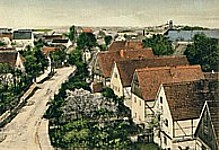
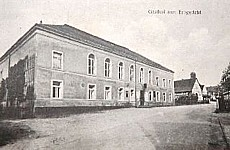
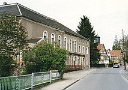
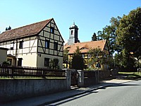
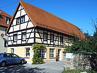

* * *

Die Straße bildet den Kern des ehemaligen Dorfes und wurde deshalb früher
Hauptstraße genannt. Erst im November 1991 erhielt sie, um Verwechslungen mit der rückbenannten Hauptstraße in der Inneren Neustadt zu vermeiden, ihren neuen
Namen Altklotzsche. Der südliche Abschnitt ab der Einmündung Am Hellerrand heißt seitdem Klotzscher Hauptstraße.

Die meisten Gebäude entstanden nach dem letzten großen Dorfbrand von 1802 und
stehen unter Denkmalschutz. Zu den wenigen Häusern des Ortes, welche den Brand überstanden, gehört das ehemalige Vogelstellerhaus (Nr. 44), in dem früher der
Vogelfänger des Dresdner Hofes seinen Sitz hatte. Bemerkenswert sind auch die Gebäude Altklotzsche 51 (Baujahr 1670),
59, 60 (Baujahr 1864) und 61 (ehem. Pfarrhaus) sowie die Gebäudegruppe Nr. 91-97. Im Dorfkern Altklotzsche befindet sich auch die alte [Dorfkirche](../../../../nord/klotzsche/klotzscher_kirchen/) des Ortes. Noch bis in die Nachkriegszeit wurden einige Gehöfte landwirtschaftlich genutzt.

Erbgericht:Das Erbgericht Klotzsche wurde 1501 erstmals erwähnt. Erster namentlich bekannter Erbrichter war der Gutsbesitzer Zceissigk. Zu den frühen
Zeugnissen der dörflichen Gerichtsbarkeit gehört das Klotzscher Rügenbuch mit vielfältigen Regeln zum Zusammenleben im Ort, von dem sich eine Abschrift erhalten
hat. Mit der Gerichtsbarkeit war auch das Schankrecht verbunden, wodurch das Erbgericht zum Gasthof des Ortes wurde. Zusätzlich diente es ab 1583 als
kurfürstliche Ausspanne und gelegentlich als Versorgungspunkt bei größeren Jagdvergnügen. Neben dem eigentlichen Ausschank im Dorfkern bewirtschaftete
der Erbrichter auch eine Bierschänke an der Königsbrücker Landstraße, aus der 1835 das Gasthaus [Schänkhübel](../../../../nord/klotzsche/strassen_klotzsche/konigsbrucker_landstrasse/)
hervorging.

Mehrfach durch Brände zerstört, umgebaut und erweitert, blieb das Erbgericht bis in
die jüngste Vergangenheit ein wichtiges kulturelles Zentrum des Ortes. Um 1900 besaß es einen großen Saal, mehrere Restaurationsräume, Kegelbahn und einen Gästegarten
mit Tanzdiele. Zugleich diente das Gebäude bis zur Fertigstellung des Rathauses als Tagungsort des Gemeinderates. Nach einer Rekonstruktion 1948 war das Haus als
“Stadtsäle Klotzsche” bekannt, später als Klubhaus der Flugzeugbauer bzw. als Kulturhaus “Friedrich Wolf” _(Foto)_. Einige Räume im Obergeschoss beherbergten
zeitweise ein Studentenwohnheim. Das nach der Wende geschlossene und zuletzt leer stehende Gebäude wurde im Herbst 2003 abgerissen. An seiner Stelle befinden sich heute mehrere Wohnhäuser.

**_Fotos:_** _Historische Gebäude im Dorfkern Altklotzsche_

__

* * *

 \[ [Home](../../../../index.html)\] \[ [Nord](../../../../nord/)\] \[ [Nordwest](../../../../nordwest/)\] \[ [Neustadt](../../../../neustadt/)\] \[ [Nordost](../../../../nordost/)\] \[ [West](../../../../west/)\] \[ [Zentrum](../../../../zentrum/)\] \[ [Südwest](../../../../sudwest/)\] \[ [Süd](../../../../sud/)\] \[ [Südost](../../../../sudost/)\] \[ [Ost](../../../../ost/)\] \[ [Register](../../../../Register/register.html)\] \[ [Kontakt](../../../../Kontakt/kontakt.html)\] \[ [Impressum](../../../../impressum/)\]
