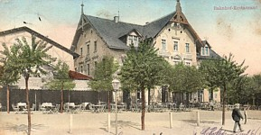
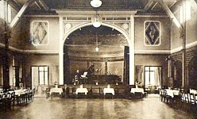

* * *

* * *

* * *

* * *

* * *

* * *

Das Gebäude gegenüber dem Klotzscher Bahnhof entstand 1884 als “Sommerfrische Quosdorf” im Auftrag des damaligen Bezirksfeldwebels Friedrich August Quosdorf. Quosdorf hatte ab 1875 größere Flächen Land in
diesem Bereich erworben und gilt als Gründer des Kurbades [Königswald](../../../../nord/klotzsche/). Nachdem er die klimatisch günstige Lage am Rand der Dresdner Heide erkannt hatte, richtete er
in dem im Schweizerstil erbauten Gebäude ein Kurbad ein. Zum Lokal gehörten auch ein großer Saal, Kegelbahn, Billardsalon, Gästegarten und mehrere Restaurationsräume. Das Wasser für den Kurbetrieb wurde aus dem
nahegelegenen “Teufelsloch” im Prießnitzgrund nach oben gepumpt und speiste hier die Wannenbäder. Eine von Quosdorf behauptete Heilwirkung konnte jedoch nicht nachgewiesen werden.

Nach dem Verkauf des Hauses an Louis Herrmann 1887 entwickelte sich das Kurbad zu einem vornehmen Hotel,
welches vor allem von Dresdner Ausflüglern gern besucht wurde. Selbst König Friedrich August III. war hier mehrfach zu Gast. Nach Einstellung des Badebetriebes wurde das Haus “Hotel zum Bahnhof “ genannt und war
Schauplatz für Konzerte und Theateraufführungen. Um 1900 gehörte es dem Gastronomen Adolf Ernst Selle und galt
als eine der renommiertesten Gastwirtschaften im Norden der Stadt. Selle selbst bewohnte mit seiner Familie die benachbarte Villa Königstraße 5 (heute “Zur Neuen Brücke).

Auch nach dem Ersten Weltkrieg blieb das Hotel in Betrieb, auch wenn die
Blütezeit des Kurortes Königswald nun der Vergangenheit angehörte. Regelmäßig fanden hier Platzkonzerte und andere Vergnügungen statt. 1934 gab es im Saal _(Foto)_ eine Ausstellung des Klotzscher
Verschönerungsvereins aus Anlass der 625-Jahr-Feier des Ortes. Erst in der Nachkriegszeit nach 1945 schloss das Haus seine Pforten. Die Räume wurden nun als Lager der Konsum- Genossenschaft genutzt. Nach 1990
stand das ehemalige Bahnhofshotel viele Jahre leer und verfiel. Ein Mitte der 90er Jahre geplanter Umbau zu einer Wohnanlage für altersgerechtes
Wohnen kam aus bautechnischen Gründen nicht zustande. 2011 begann im Auftrag einer Hamburger Investorengemeinschaft  der Umbau des ehemaligen Bahnhofshotels zum Wohnhaus mit 16 Wohnungen. Außerdem
wurden auf dem Grundstück weitere Wohngebäude errichtet.
