* * *

[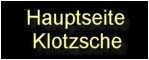](../../../../nord/klotzsche/)

[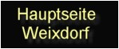](../../../../nord/weixdorf/)

* * *

Die Königsbrücker Landstraße ist Teil der wichtigen Verbindung zwischen Altstadt und den nördlichen Vororten Dresdens. Vermutlich entstand sie bereits in slawischer Zeit und blieb über Jahrhunderte ein bedeutender Heer- und Handelsweg. 1414 wurde dieser "als weg gen der Langenbrucken" und 1519 als "Langebrugker straße" erwähnt. Im 18. Jahrhundert wurde diese Straße als Poststraße ausgebaut und war Teil des “Krönungswegs” August des Starken. Aus dieser Zeit stammt auch die seit Ende des 17. Jahrhundert verwendete Bezeichnung Königsbrücker Straße.

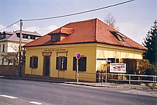1706 wurde eine reitende Post von Dresden über Königsbrück - Hoyerswerda - Sorau nach Warschau eingerichtet. Am Ende des langen und beschwerlichen Anstiegs befand sich am Schänkhübel eine Pferdewechsel- und Raststation. Aus der ehemaligen Poststation ging 1873 die erste Klotzscher Postagentur hervor (Klotzscher Hauptstraße Nr. 1). An der Grenzstraße erinnert noch eine alte Brücke mit einem Schlußstein von 1790 an die Postkutschenzeit. In Weixdorf wurde in den letzten Jahren die frühere “Königlich-Sächsische Chausseegeld-Einnahme” rekonstruiert _(Nr. 338 - Foto)_.

1911 erhielt Klotzsche Anschluss an das Dresdner Straßenbahnnetz, nachdem die bereits seit längerem geplante Strecke vom Arsenal bis zum Schänkhübel mit einem Abzweig nach Hellerau übergeben wurde. Die Eröffnungsfahrt erfolgte am 21. Januar 1911 unter großer Anteilnahme der Bevölkerung. im gleichen Jahr entstand der heute nicht mehr in Betrieb befindliche Straßenbahnhof. Auf Wunsch der Bevölkerung des Ortsteiles Königswald und der Nachbargemeinde Lausa-Weixdorf wurde die Straßenbahn 1925 bis zum Kurhaus Klotzsche, ein Jahr später bis zur “Deutschen Eiche” verlängert. 1928/29 folgte der Neubauabschnitt nach Weixdorf, wobei die Straßenbahn hier die Trasse der früheren Schmalspurbahn nutzt.

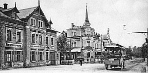

Die Bebauung der Straße in Klotzsche begann im Zusammenhang mit der Gründung des Kurbades und dessen Erweiterung zum Villenvorort Königswald. Neben repräsentativen Villen und Landhäusern entstanden hier auch mehrere Gaststätten,
Läden und kleine Gewerbebetriebe, die die Königsbrücker Landstraße zur wichtigsten Geschäftsstraße Klotzsches machten. Nach der Eingemeindung von Klotzsche wurde sie als Verlängerung der gleichnamigen Straße in der Dresdner Neustadt im September 1953 in Königsbrücker Landstraße umbenannt. 1999 wurde diese Bezeichnung auf die Straßenabschnitte in den eingemeindeten Ortsteilen von Weixdorf übertragen und die dortigen Gebäude neu durchnummeriert.

Einzelne Gebäude:

_Klotzsche:_

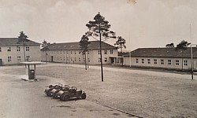Luftnachrichten-Schule: Der Gebäudekomplex entstand 1934 im südlichen Teil der Ortsflur gegenüber der Abzweigung des Moritzburger Wegs. Die Militärschule diente der Ausbildung von Richtfunkern und Flugmeldern und arbeitete eng mit der Luftkriegsschule in der Nähe des Flughafens zusammen. Außerdem war hier das Luftnachrichten-Regiment Nr. 1 stationiert. Auf dem Nachbargrundstück gab es eine Tierklinik mit Pferdelazarett. 1937 erfolgte die Benennung des aus mehreren Gebäuden bestehenden Komplexes in Hermann-Göring-Kaserne. 1992 wurde ein Großteil der früheren Kasernenbauten zugunsten des Chipherstellers Infinion abgerissen. Erhalten blieb der Eingangsbereich, der heute unter Denkmalschutz steht. Das Areal dient als “Technopark Nord” gewerblichen Zwecken.

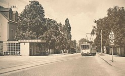Straßenbahnhof Klotzsche: Der Betriebshof ging auf die einstige [“Haidebahn”](../../../../nord/klotzsche/haidebahn/) zurück, welche 1902 eröffnet, jedoch bereits zwei Jahre später ihren Betrieb wieder einstellen musste. Als Depot für seine Fahrzeuge ließ Erbauer Carl Stoll auf dem Grundstück eine Wagenhalle errichten und ein für den Betrieb der O-Bus-Linie notwendiges Kraftwerk bauen. 1916 wurde diese Halle durch einen Neubau von Bruno Wagenbreth ersetzt, welcher nun als Straßenbahnhof der nach Klotzsche verlängerten Linie 7 diente. Der zu den kleinsten Dresdner Betriebshöfen gehörende Klotzscher Straßenbahnhof besaß sechs Gleise sowie eine Werkstatt für einfachere Reparaturen. Außerdem gab es ein Verwaltungs- und Sozialgebäude. 1994 wurde der Straßenbahnhof stillgelegt und im Anschluss bis zum Abriss von einem Baumaschinenhandel genutzt. 2003 entstand auf dem Areal ein Umspannwerk der DREWAG. Das Bild zeigt die alte Straßenbahn-Rangierstelle am Schänkhübel um 1944.

Nr. 3: Ehemaliges Wohnhaus der bekannten Kinderbuchillustratorin Gertrud Caspari, die hier ab 1914 lebte. Sie verstarb
1948 und liegt auf dem Neuen Friedhof Klotzsche begraben. Seit 1998 erinnert am Haus eine Gedenktafel an sie.

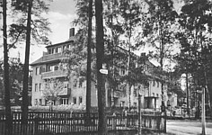Institut für Rheumathologie (Nr. 6a): Die Einrichtung wurde 1934 von Elisabeth Schuricht als Rentnerheim gegründet und umfasste nach Erweiterungen 120 Kleinstwohnungen für alte Menschen, die hier versorgt und betreut wurden. 1945 in ein Seniorenheim umgewandelt, verschmolz sie 1948 mit der Rheumapoliklinik des Arztes Prof. Dr. Hans Tichy. Diese war kurz zuvor vom Hellerauer Arzt Dr. Martin Vogel angeregt worden und nutzte ab 1947 das Gesundheitshaus Klotzsche. Unter Leitung des verdienstvollen Arztes entwickelte sich das Klotzscher Institut zu einer international anerkannten Forschungsstätte für Rheuma-Erkrankungen mit mehreren Fachabteilungen. Dafür entstand an der Greifswalder Straße 3 ein modernes Bettenhaus. 1973 wurde das Institut aufgelöst und dessen Aufgaben der Poliklinik Mickten übertragen. Das Gesundheitshaus bestand noch bis 1991 als Stadtambulanz.

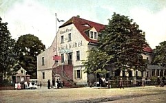Schänkhübel (Nr. 7): Die Gaststätte am Schänkhübel entstand als Rasthaus für die hier vorbeifahrenden Fuhrleute und ist bereits in einer Karte von 1568 eingezeichnet. Zunächst wurde sie von kurfürstlichen Forstleuten als Sommerschänke betrieben, erhielt aber später eine offizielle Konzession. 1835/36 wurde nach Übernahme des Lokals durch den Besitzer des Klotzscher Erbgerichts Clemens Hofmann ein neues Gasthausgebäude errichtet _(Foto links)_. Auf der gegenüber liegenden Straßenseite befand sich bis 1920 zusätzlich ein Gartenlokal.

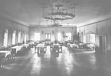Mit dem Bau der “Haidebahn” 1903 und dem Straßenbahnanschluss 1911 entwickelte sich der Schänkhübel zu einer beliebten Ausflugsgaststätte mit großem Saal und Übernachtungsmöglichkeiten. In der früheren Turnhalle des Klotzscher Turnvereins wurde 1912 eines der ersten Kinos im Dresdner Umland eingerichtet (“Heidepark-Kinotheater”). Das Filmtheater besaß zunächst 60, später 450 Plätze. Gaststätte und Filmtheater mussten 1945 schließen, nachdem sowjetische Militärbehörden das Haus in Beschlag genommen hatten. Diese betrieben hier zeitweise ein Offizierskasino, welches später als öffentliche Gaststätte auch der deutschen Bevölkerung offen stand. Nach dem Abzug der Sowjetarmee stand das Gebäude viele Jahre leer. 2011 erfolgte der Umbau zum Wohnhaus. Den ehemaligen Kinosaal nutzt heute ein Tanz- und Fitnesscenter _(Foto SLUB / Fotothek)_.

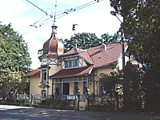Nr. 50: Die um 1900 für die Hofschauspielerin Gerda Hermany entstandene Villa _(Foto)_ war ab 1937 im Besitz des Freitaler Fabrikanten Albin Wilhelm, zugleich Vorsitzender des [Dresdner Sportclubs](../../../../zentrum/friedrichstadt/ostragehege/dsc/) DSC. Zu Wilhelms regelmäßigen Besuchern gehörten bekannte Dresdner Sportler wie der Fußballer und spätere Bundestrainer Helmut Schön und der DSC-Spieler Richard Hofmann. Letzterer war einige Zeit auch als Chauffeur Wilhelms angestellt. 1945 wurde die Villa von der Roten Armee besetzt, war zeitweise Sitz des Quartieramtes der Stadt, einer Polizeistation, des Deutschen Roten Kreuzes sowie der SED-Ortsleitung Klotzsche. Nach 1990 stand das Gebäude viele Jahre leer und wurde 2007 denkmalgerecht saniert.

Nr. 52: In diesem Wohnhaus, 1910 als "Villa zum Löwen" bezeichnet, eröffnete 1891 der Buchbindermeister Clemens Behr eine private Leihbibliothek. Zudem befanden sich im Anbau des Hauses die Räume seiner Buch- und Papierhandlung. Bis heute werden diese gewerblich genutzt, nach 1990 u.a. von einem Matratzen-Outlet.

Nr. 61: Das Gebäude an der Ecke zur Auenstraße (heute Gertrud-Caspari-Straße) war ab 1918 Wohnsitz des bekannten Kunstmalers Conrad Felixmüller, der auch einige Bilder mit Klotzscher Motiven schuf. Felixmüller lebte zuvor einige Monate auf der Gartenstraße 10 (Kieler Straße). 1931 verließ er Klotzsche und verzog nach Dresden.

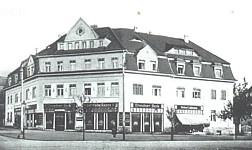Dresdner Bank (Nr. 66): Das markante Eckhaus zur Wolgaster Straße _(Foto rechts)_ entstand Ende des 19. Jahrhunderts und beherbergte einst die Klotzscher Niederlassung der Dresdner Bank. Außerdem gab es im Erdgeschoss weitere Geschäfte.Zu DDR-Zeiten nutzte ein Obst-Gemüse-Geschäft und eine Haushaltwarenhandlung des Konsums die Räume, welche heute Sitz einer Sparkassenfiliale sind.

Heide-Apotheke (Nr. 67): Die Apotheke entstand als erste derartige Einrichtung Klotzsches 1895 und wurde zunächst Prinzeß-Luisa-Apotheke genannt. Mehrfach wechselten die Besitzer, bevor die Apotheke 1949 verstaatlicht wurde. In diesem Zusammenhang erhielt sie ihren heutigen Namen Heide-Apotheke. Seit 1990 wird sie wieder als Privatapotheke geführt.

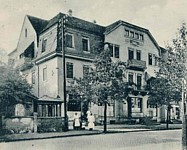Café Königswald (Nr. 69): Das bis heute in Familienbesitz gebliebene Café _(Foto links)_ wurde 1897 von Max Oswald Donath eröffnet. Zu den Besuchern gehörte u.a. der letzte sächsische König Friedrich August III. Nach dem Zweiten Weltkrieg diente das Café einige Jahre als Bäckerei der Roten Armee, konnte aber 1949 wieder für die Bevölkerung geöffnet werden. 1993 wurde das Lokal umfassend saniert und neu eröffnet.

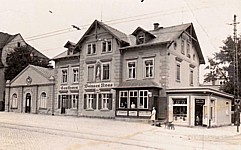Weißes Roß (Nr. 71): Das Haus wurde 1889 erbaut und seit 1897 als Gasthaus “Weißes Roߔ genutzt _(Foto rechts)_. Der Besitzer Karl Wöllner, von den Klotzschern nur “Tilly” genannt, galt als Original und machte sein Lokal weithin bekannt. Neben dem Lokal betrieb die Familie auch eine Möbelexpedition im Hinterhaus. Die Gaststätte mit angeschlossenem Saal war bis in die 1960er Jahre geöffnet. Später zog eine Zweigstelle der Stadtbibliothek ein. Nach Rekonstruktion des Gebäudes befindet sich hier seit 1994 ein Hotel mit öffentlicher Gaststätte.

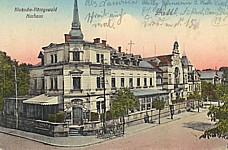Kurhaus Klotzsche (Nr. 73/75): Das Kurhaus Klotzsche entstand um 1850 als Gasthaus “Carolaschlößchen” und wurde 1886/88 unter Einbeziehung der Nachbarvilla “Elise” zum Kur- und Ballhaus erweitert. Die architektonische Gestaltung oblag dem Baumeister Haenschel, erster Betreiber war der Gastronom Kamprad. Wenig später erwarb es der Gastwirt und Hotelier Carl Christoph Arndt und nannte es fortan “Arndt´s Kurhaus”. Das Gebäude war Ende des 19. Jahrhunderts Mittelpunkt des Kurbades Königswald und Schauplatz für Tanz- und Vergnügungsveranstaltungen, Konzerte, Theateraufführungen u.a. Auch nach Ende des Kurbetriebes blieb die Gaststätte bestehen und bis 1945 gesellschaftliches Zentrum Klotzsches. Zu den bekanntesten Gästen des Lokals gehörte der Schriftsteller Erich Kästner und die Tanzpädagogin Gret Palucca.

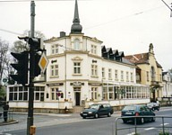1949 wurde der Ballsaal geschlossen und nun als Lager bzw. Produktionshalle genutzt. Später brannte der Saal aus und konnte nur notdürftig wiederhergestellt werden. Pläne, das Gebäude als Stadtkulturhaus und Kino auszubauen, scheiterten an den Besitzverhältnissen und dem hohen Sanierungsaufwand. Die ab 1955 von der volkseigenen HO bewirtschaftete Gaststätte im Kurhaus bestand jedoch noch bis in die 1980er Jahre. 1993 begann die Sanierung des stark verfallenen Hauses, welches heute als Hotel dient. 1999 fand im wiederhergestellten Saal erstmals seit 1945 wieder eine öffentliche Veranstaltung statt. Eine originelle Bar, die mit Flugzeugsitzen und Kabinenteilen eines Airbus ausgestattet ist und den Namen “Last Minute” trägt, befindet sich im Souterrain.

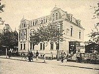Nr. 79: Das Wohn- und Geschäftshaus entstand 1899 und beherbergte bis 1936 das Kaiserliche Postamt des Ortes, später eine Filiale der Reichspost _(Foto)_. 1936 wurde die Poststelle zur Gertrud-Caspari-Straße 10 verlegt.

Im Nachbarhaus Nr. 79a betrieb der Apotheker Maximilian Glausch viele Jahre sein Chemisch-pharmazeutisches Laboratorium. Glausch wirkte zudem als Mäzen seines Heimatortes und stellte 1927 das Grundstück für den Bau der Trobischbergsiedlung kostenlos zur Verfügung.

Nr. 82: In der Ende des 19. Jahrhunderts errichteten Villa “Silvana” befand sich von 1916 bis 1920 die [Privatschule](../../../../nord/klotzsche/) des Studienrates Manfred Pollatz und seiner Frau Lili. Die Schule verfolgte ein Reformschulkonzept ähnlich der heutigen Waldorfschulen und wurde mit dem Wechsel von Manfred Pollatz an die Landesschule Klotzsche geschlossen.

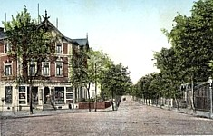Nr. 83: Das Gebäude an der Einmündung der Wolgaster Straße _(Foto rechts)_ beherbergte früher das Kaufhaus Königswald, einziges Kaufhaus im Ort. Hier befanden sich mehrere Geschäfte sowie eine Tischlerwerkstatt im Hintergebäude.

Nr. 91: Die Ende des 19. Jahrhunderts errichtete Villa Baum war einige Jahre Wohnung der Eltern von Grete Weiser, die hier einen Teil ihrer Kindheit verbrachte und später eine der bekanntesten deutschen Filmschauspielerinnen wurde. Das Gebäude verfiel in der Nachkriegszeit und wurde nach 1990 abgerissen.

Nr. 98: Das moderne Gebäude an der Ecke der Straße Am Wasserwerk beherbergt seit 2015 das Gesundheitszentrum Klotzsche mit verschiedenen Arzt-, Hebammen- und Therapiepraxen, einer Apotheke und Geschäften für medizinische Hilfsmittel.

Nr. 159: In diesem Gelände befand sich bis 1990 der Sitz des VEB Gemeinschaftskost Dresden. Die in den 1960er Jahren gegründete Firma belieferte volkseigene Betriebe, Schulen und Krankenhäuser mit vorgekochtem Essen. Zudem wurde hier Kühlkost in Einzel- oder Mehrportionsgebinden produziert, die man dann an Betriebskantinen zum Selbstaufwärmen lieferte.

**Gasthaus “Deutsche Eiche”:**

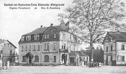 Die Gaststätte entstand 1897 an der Ecke Königsbrücker Straße/Langebrücker Straße. Bereits um 1560 soll sich an dieser Stelle eine Schankwirtschaft befunden haben, die vor allem von Fuhrleuten gern aufgesucht wurde. Die Bewirtschaftung übernahmen dabei Forstangestellte des Klotzscher Reviers. Mit der Entwicklung Königswalds zum Kur- und Villenort entschied man sich zu einem Neubau im altdeutschen Stil _(Foto)_.

Um die Jahrhundertwende wurde die Schänke auch als “Krug zur Deutschen
Eiche” bezeichnet. 1903/04 befand sich hier die Endstation der gleislosen [“Haidebahn”](../../../../nord/klotzsche/haidebahn/), die dem Gasthof zahlreiche Ausflügler brachte. 1942 übernahm der Gastwirt Kamillo Kolitsch das Lokal mit angeschlossener Fleischerei und betrieb es bis zu seinem Tod 1950.

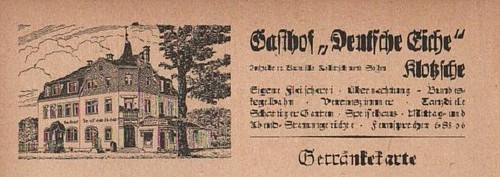

Während des Zweiten Weltkrieges befanden sich in den Räumen Notunterkünfte für deutsche Flüchtlinge. Später nutzte die Rote Armee das Lokal zeitweise als Verpflegungsstützpunkt. Nachfolger von Kamillo Kolitsch war zunächst seine Frau Elsa, später ihr Sohn Heinz Kolitsch, der die “Deutsche Eiche” bis zum Renteneintritt 1991 führte. Als eine der wenigen ununterbrochen bewirtschafteten Gaststätten gehört die “Deutsche Eiche” bis heute zu den traditionsreichsten Dresdner Lokalen. Das Haus wurde 1998/99 saniert und wird jetzt als italienisches Restaurant “Fellini” betrieben.

_Weixdorf:_

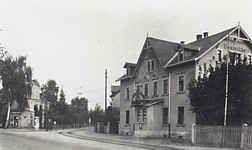Bahnhofsrestaurant (Nr. 256): Das Gebäude am Abzweig der heutigen Brühler Straße entstand Ende des 19. Jahrhunderts im Landhausstil und wurde einst Bahnhofsrestaurant genannt. Später finden sich auch die Bezeichnungen Bahnrestaurant Lausa bzw. Bahnhofsgaststätte Weixdorf in den Adressbüchern. Unmittelbar am Haus vorbei verlief einst die Trasse der [Schmalspurbahn nach Königsbrück](../../../../nord/klotzsche/dresden_-_gorlitz/schmalspurbahn/), die 1897 in Normalspur umgebaut und dabei zum Teil neu trassiert wurde. Seit 1928 nutzt die Straßenbahn den alten Bahndamm. Das Haus mit seinem großen Biergarten wird heute als thailändisches Restaurant genutzt _(Foto um 1930 / SLUB - Fotothek)_.

Lichtspiele Weixdorf (Nr. 265): Das Gebäude entstand 1938 als Kino der Gemeinde und wurde am 18. Februar 1938 im Beisein des deutschen Filmpioniers Max Skladanowsky eröffnet. Das moderne Filmtheater besaß 255 Plätze und wurde zunächst privat betrieben. 1948 erfolgte die Übernahme in Volkseigentum und eine Erweiterung der Platzkapazität auf über 400 Plätze. Wirtschaftliche Hründe führten nach 1990 zur Schließung und 2006 schließlich zum Abriss des Filmtheaters.

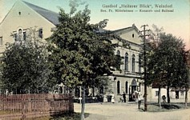Gasthof Weixdorf (Nr. 303): Eine weitere Gaststätte gab es bis nach 1990 auf der Königsbrücker Landstraße 303. Das ursprünglich als Gasthof Weixdorf bezeichnete Gebäude entstand 1870 und besaß neben den Gasträumen auch einen Konzert- und Ballsaal im Obergeschoss, Kegelbahn und Biergarten. Für auswärtige Besucher standen zudem einige Fremdenzimmer zur Verfügung. Später wurde das Haus als Gasthof Heiterer Blick bezeichnet und war bis zur Wende als Kulturhaus "Heiterer Blick" das Zentrum des kulturellen Lebens im Ort. Nach dem Abriss in den 1990er Jahren befindet sich auf dem Grundstück heute ein Supermarkt.

Lauschenbachmühle (Nr. 470): Auf diesem Grundstück an der Flurgrenze von Lausa zu Hermsdorf befand sich einst die Lauschenbachmühle, eine im Besitz der Hermsdorfer Rittergutsbesitzer befindliche Wassermühle mit zwei Mahlgängen und einem oberschlächtigen Mühlrad. 1657 erwarb Johann Georg Freiherr von Rechenberg diese Mühle zusammen mit der Grundherrschaft über Hermsdorf. 1791 ist die Lauschenbachmühle in einem Verzeichnis aller sächsischen Mühlen ebenfalls verzeichnet. Der Mahlbetrieb wurde um 1975 eingestellt und der Mühlgraben später zugeschüttet.

* * *

 \[ [Home](../../../../index.html)\] \[ [Nord](../../../../nord/)\] \[ [Nordwest](../../../../nordwest/)\] \[ [Neustadt](../../../../neustadt/)\] \[ [Nordost](../../../../nordost/)\] \[ [West](../../../../west/)\] \[ [Zentrum](../../../../zentrum/)\] \[ [Südwest](../../../../sudwest/)\] \[ [Süd](../../../../sud/)\] \[ [Südost](../../../../sudost/)\] \[ [Ost](../../../../ost/)\] \[ [Register](../../../../Register/register.html)\] \[ [Kontakt](../../../../Kontakt/kontakt.html)\] \[ [Impressum](../../../../impressum/)\]
