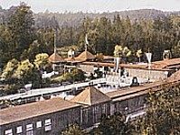
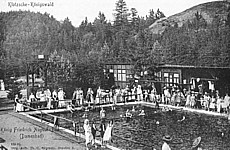
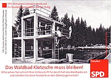

* * *

Das Waldbad Klotzsche wurde als erstes Freibad in der Dresdner Heide angelegt und
am 20. Juli 1902 eingeweiht. Schon im folgenden Jahr erweiterte man das Areal und verlieh dem Bad in diesem Zusammenhang den Namen Kronprinz-Friedrich-August-Bad _(Foto)_
. Bereits zuvor war diese Stelle an der Prießnitz von den Kurgästen Königswalds als Flussbad genutzt worden. Das Waldbad bestand ursprünglich aus zwei Schwimmbecken, die als Männer- und als Frauenbad genutzt
wurden. Eigens für Besuche des sächsischen Königs gab es in der Anfangszeit sogar eine mit einer Krone gekennzeichnete Umkleidekabine. Um gesundheitsbewusste Gäste
anzulocken, existierte bis zum Ersten Weltkrieg auch eine Kurbadeanstalt unter Leitung des Arztes Dr. med. Reichardt. Hier wirkte um 1910 der dänische Turnlehrer Jörgen Peterson Müller, der mit seinen
Körper- und Atemübungen allgemeine Anerkennung fand. Da das Bad von der Prießnitz gespeist wurde, wurde das Wasser ab 1913 in einer speziellen Wasservorwärmanlage aufgeheizt.

Zu den bekannten Besuchern gehörte der Schriftsteller Erich Kästner, der hier das
Schwimmen erlernte. 1918 und 1926 richteten Unwetter im Prießnitzgrund schwere Schäden an den Anlagen an, die jedoch schon bald wieder behoben werden konnten. Da nach dem Ersten Weltkrieg die Einrichtung von
Familienbädern genehmigt worden war, machte sich 1925 der Neubau eines größeren Schwimmbeckens mit 50-m-Bahnen an Stelle der ehemaligen Damenabteilung erforderlich. Außerdem wurden neue Umkleidekabinen errichtet
und die Spiel- und Liegeflächen erweitert.

Nach 1945 verschwanden die meisten der hölzernen Umkleidekabinen, da diese als Baumaterial von der Bevölkerung
abgetragen wurden. Als Ersatz diente ab 1956 ein aus dem Freibad Wostra umgesetzter Kabinenblock mit fünfzig
Einzelkabinen. Dank weiterer Modernisierungsmaßnahmen in den 60er und 70er Jahren blieb das Waldbad Klotzsche bis
zur Wende beliebtes Erholungsziel in der Heide und gehörte wegen seiner Lage zu den schönsten Dresdner Freibädern.
Nach 1990 zeigten sich jedoch größere Mängel an den technischen Anlagen. 1998 wurde aus wirtschaftlichen Gründen
eines der beiden Schwimmbecken verfüllt. Trotz Protesten und Gründung einer Bürgerinitiative beschloss der Stadtrat
2006 die endgültige Schließung des Waldbades Klotzsche, welches bereits im Sommer 2005 nicht mehr geöffnet hatte. Seit 2007 befindet sich auf dem Gelände der private “Kletterwald Dresdner Heide”.

**_Foto:_** _Protestpostkarte gegen die geplante Schließung des Waldbades Klotzsche (2002)_

* * *

 \[ [Nord](../../../../nord/)\] \[ [Nordwest](../../../../nordwest/)\] \[ [Neustadt](../../../../neustadt/)\] \[ [Nordost](../../../../nordost/)\] \[ [West](../../../../west/)\] \[ [Zentrum](../../../../zentrum/)\] \[ [Südwest](../../../../sudwest/)\]
 \[ [Süd](../../../../sud/)\] \[ [Südost](../../../../sudost/)\] \[ [Ost](../../../../ost/)\] \[ [Register](../../../../Register/register.html)\] \[ [Kontakt](../../../../Kontakt/kontakt.html)\] \[ [Impressum](../../../../impressum/)\]
