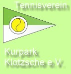
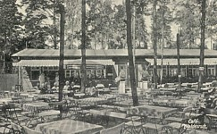
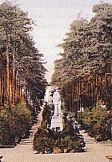

* * *

Der Waldpark Klotzsche wurde nach 1875 auf einem ca. 180 Hektar großen
Teilstück der Dresdner Heide angelegt. Das Areal sollte als Erholungsgebiet des entstehenden Kurbades Königswald dienen. Um 1890 begann die gärtnerische Gestaltung des Parks, um welche sich vor allem der Apotheker
Glausch verdient machte. Unter Einbeziehung des vorhandenen Waldbestandes wurden Wege, Blumenrabatten, Ruhebänke und Tennisplätze angelegt. Zu Ehren des verstorbenen Königs Albert entstand auf Initiative des
Verschönerungsvereins Klotzsche-Königswald ein Denkmal, umgeben von mehreren steinernen Vasen und Ruhebänken. In den Sommermonaten wurde
im Waldpark ein Café eingerichtet, in dem die Gäste bei Kaffee und Kuchen Konzerten lauschen konnten _(Foto)_. Auch
nach Einstellung des Kurbetriebes blieb der Waldpark beliebtes Erholungsgebiet. An die Anlage des Parkes erinnert ein Gedenkstein, der im Jahr 2000 erneuert wurde.

König-Albert-Denkmal:

Das Denkmal wurde am 21. Mai 1905 als Mittelpunkt des Festplatzes im Waldpark
aufgestellt. Es zeigte König Albert in Jägerkleidung und erinnerte an die häufigen Besuche Alberts in der Dresdner Heide. Schöpfer war der Hofstuckateur Carl Hauer. Finanziert wurde
das Monument vom Verschönerungsverein Klotzsche-Königswald. Vor dem Denkmal wurde ein kleiner Steingarten angelegt, in dem typische Heidepflanzen zu sehen waren.

Das Denkmal König Alberts fiel in der Nachkriegszeit 1948 einer gezielten Zerstörungsaktion der Freien Deutschen Jugend (FDJ) zum Opfer. Die Trümmer wurden später auf dem Schulhof
der 82. Mittelschule vergraben, wo sie erst 1992 entdeckt und geborgen wurden. An das Denkmal erinnert der noch erhaltene Sockel im Park.

**Foto:**_Waldpark Klotzsche mit König-Albert-Denkmal um 1910 (historische Postkarte)_

* * *

 \[ [Nord](../../../nord/)\] \[ [Nordwest](../../../nordwest/)\] \[ [Neustadt](../../../neustadt/)\] \[ [Nordost](../../../nordost/)\]
 \[ [West](../../../west/)\] \[ [Zentrum](../../../zentrum/)\] \[ [Südwest](../../../sudwest/)\] \[ [Süd](../../../sud/)\] \[ [Südost](../../../sudost/)\] \[ [Ost](../../../ost/)\] \[ [Register](../../../Register/register.html)\] \[ [Kontakt](../../../Kontakt/kontakt.html)\] \[ [Impressum](../../../impressum/)\]
