* * *

* * *

* * *

**Langebrücker Stadtteilseiten:**

****

* * *

**Bildungseinrichtungen in Langebrück:**

* * *

**Vereine in Langebrück:**

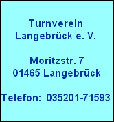

* * *

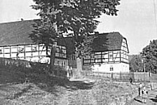Langebrück gehört zu den Heidedörfern am nördlichen Dresdner Stadtrand und
wurde am 1. Oktober 1288 erstmals urkundlich erwähnt. Die Herkunft des Namens ist unklar, da die erste bekannte Brücke erst 1799 erbaut wurde.
Vermutlich leitet sich die Bezeichnung von der Lage in einem langen, sumpfigen Gebiet (Bruch) ab, da 1346 “Langenbrugk” in den Matrikeln der Meißner
Bischöfe aufgeführt ist. Gründer waren fränkische Bauern, woraus sich auch die typische Form eines Waldhufendorfs herleitet. Deutlich älter sind Besiedlungsspuren, welche am westlichen Ortsrand und östlich des Dorfkerns
gefunden wurden und auf eine einst hier gelegene größere bronzezeitliche Siedlung hindeuten.

Um 1280 erhielt der Ort eine in ihren Grundzügen noch erhaltene [Wehrkirche](../../nord/langebruck/langebrucker_kirche/). Ab 1444 war Langebrück Standort
eines Lehnrichtergutes, welches über 250 Jahre im Besitz der Familie Stiehler blieb. Der von Abgaben und Zins an den
Lehnsherrn befreite Lehnrichter war für die Aufrechterhaltung der dörflichen Ordnung zuständig und besaß zugleich das
Brau- und Schankrecht. Erst im 19. Jahrhundert löste ein gewählter Gemeinderat die jahrhundertealte Ortsverwaltung durch den Lehnrichter ab.

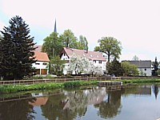Die Bewohner des Dorfes lebten hauptsächlich von der Landwirtschaft und der Bewirtschaftung der Dresdner Heide, von der Jagd, der Holzwirtschaft und der Gewinnung von Honig. Hinzu kamen einige kleinere Handwerksbetriebe sowie spätestens 1524 eine Mühle **_(Foto:_** _Mühlteich)_. Ab 1440 unterstand Langebrück dem Amt Dresden und war nach dort zins- und dienstpflichtig. Zu den historischen Gebäuden des Ortes gehört das alte Forsthaus, welches seit dem 15. Jahrhundert Sitz des Langebrücker Revierförsters war und künftig ein Museum zur Dresdner Heide aufnehmen soll. 1780 entstand in der Nähe des Ortes der [Langebrücker Saugarten](../../nordost/dresdner_heide/), der heute besterhaltener Garten seiner Art im Heidegebiet ist. Im Dreißigjährigen Krieg wurde Langebrück 1639 von schwedischen Soldaten geplündert und anschließend niedergebrannt. Ein weiterer großer Dorfbrand zerstörte am 29. Juni 1857 16 Langebrücker Bauerngüter und 25 Häusleranwesen, 300 Menschen verloren ihr Heim. Ursache war ein durch Brandstiftung in einer Scheune des Ortsrichters ausgebrochenes Feuer.

Als erstes gewerbliches Unternehmen ist 1567 eine Pottaschesiederei verbürgt. In diesem Jahr legte der Sohn des kurfürstlichen Kellerknechtes Mirisch eine solche außerhalb des Dorfkerns an. Wegen Holzmangels musste das Unternehmen jedoch wenig später wieder eingestellt werden. Stattdessen gewannen im 18. Jahrhundert die
Leineweberei, Seilerei und Posamentenherstellung an Bedeutung, ohne jedoch die vorherrschende Waldwirtschaft gänzlich zu verdrängen. Bekannt waren auch die Langebrücker Sänftenträger, die ihre Dienste im nahen Dresden anboten.

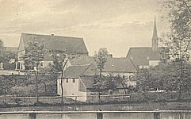Erst durch den Bau der [Eisenbahnstrecke](../../nord/klotzsche/dresden_-_gorlitz/) über Langebrück im Jahr 1845 wandelte sich die Struktur des Ortes. Wohlhabende Dresdner erkannten die erholsame Lage am Rand der Heide und errichteten hier ihre Villen. Zu ihnen gehörten der Hofschauspieler und Wagner- Interpret Anton Mitterwurzer und der Komponist Jean Nicodé, der auch in Langebrück begraben wurde. Nach dem Erwerb eines Grundstücks zur Errichtung einer Ausspanne ließ Frohwald Hippe um 1870 Probebohrungen vornehmen, um hier ein Kurhaus einzurichten. 1875 entstand das ”Curbad Langebrück”, welches heute als [“Lindenhof”](../../nord/langebruck/lindenhof/) bekannt ist. Weitere gastronomische Einrichtungen folgten bis zur Jahrhundertwende. Neu entstandene Villenviertel, Pensionen und Landhäuser wohlhabender Bürger machten Langebrück um die Jahrhundertwende zur zweitreichsten Gemeinde in Sachsen. Langebrück erhielt nun auch offiziell den Titel eines Kurbades. 1906 legte die Gemeinde das erste, 1912 das noch heute bestehende [Freibad](../../nord/langebruck/waldbad_langebruck/) an. Erst 1947 wurde der Status “Luftkurort” amtlich gestrichen.

Nach dem Ersten Weltkrieg sank Langebrücks Bedeutung als Kurort, so dass das ehemalige Kurhaus zum Hotel umgebaut wurde. Während des Krieges diente es als Lazarett und war 1918-1920 Arbeitsstelle des bekannten Dramatikers und Arztes Friedrich Wolf. Langebrück blieb jedoch auch weiterhin beliebtes Naherholungsziel für die Dresdner und ist bis heute Ausgangspunkt für Wanderausflüge in die nördliche Heide. 1934 entstand nordwestlich des Ortes das Wohngebiet Heidehof mit Einfamilienhäusern und Villen.

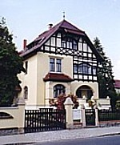Die von größeren Schäden verschont gebliebene Gemeinde konnte auch in den Jahren nach 1945 ihren Ruf als attraktiver Wohnort behaupten. 1953 schlossen sich die Bauern des Unterdorfes zur LPG “Florian Geyer” zusammen. 1960 folgte die LPG “An der Heide”, die später mit weiteren Genossenschaften zu einem landwirtschaftlichen Großbetrieb zusammengelegt wurde. Heute werden die Felder von der Agrarzentrum Grünberg GmbH & Co. KG bewirtschaftet. Als größere Bauvorhaben entstanden 1954 eine Poliklinik, in den 1970er Jahren eine neue Schule mit Turnhalle sowie ein Schulungszentrum des Bezirkswirtschaftsrates Dresden an Stelle des abgerissenen Saales der Gaststätte “Lindenhof”. Ein geplanter Neubaukomplex mit über 30.000 Wohnungen, sozialen Einrichtungen und einem eigenen S-Bahn-Anschluss wurde wegen der hohen Kosten und ungünstigen geologischen Bedingungen nicht realisiert.

Die Jahre nach der Wende waren von der Erschließung weiterer Bauflächen geprägt. Im April 1993 begannen die Vorarbeiten für ein neues Wohngebiet im Ortsteil Heidehof. Wenig später folgte das Gewerbegebiet am Lösigberg, welches 1989 noch als Standort für ein Tanklager vorgesehen war. 1996 kam die kleine Gemeinde [Schönborn](../../nord/langebruck/schonborn/) zu Langebrück. Im gleichen Jahr wurde der bisherige Landkreis Dresden aufgelöst und der Ort dem neuen Westlausitzkreis Kamenz zugeordnet. Nachdem sich in einem Volksentscheid 1996 die Mehrheit der Langebrücker für einen Anschluss an Dresden ausgesprochen hatte, kamen Langebrück und Schönborn am 1. Januar 1999 als Ortsteile zu Dresden. In den letzten Jahren entstanden mehrere neue Wohngebiete, u.a. im Ortsteil Heidehof und an der Dresdner Straße (“An der Heide”).

Ortsteil Heidehof:

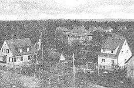Der Ortsteil Heidehof entstand Anfang der Dreißiger Jahre westlich des alten
Dorfkerns auf einem Gelände zwischen Bahndamm und Dresdner Straße. Zuvor befand sich hier ein gleichnamiges Bauerngut, welches jedoch 1933 durch einen Großbrand zerstört wurde. Auf dem Areal errichtete man bis zum
Beginn des Zweiten Weltkrieges kleine Siedlungshäuser in schlichten Bauformen _(Foto)_.

Auf den noch vorhandenen Freiflächen wurde 1993 mit dem Bau einer
Reihenhaussiedlung mit insgesamt 127 Wohnhäusern begonnen. In diesem Zusammenhang entstanden auch einige neue Straßen, die teilweise nach bekannten Langebrücker Persönlichkeiten benannt wurden. Der von der ZEYN-Haus
GmbH errichtete und 1996 vollendete Wohnpark bietet heute ca. 400 Langebrücker Einwohnern ein Zuhause. Weitere Wohnhäuser wurden 1994/95 am Heideweg errichtet. 2012 folgte ein weiteres Wohngebiet an der Neulußheimer
Straße.

Gemeindeamt:

Ursprünglich wurde der Ort vom Lehnrichtergut verwaltet, welches sich über 250 Jahre im Besitz der Familie Stiehler befand, die damit auch für alle örtlichen Belange zuständig war. Erst im 19. Jahrhundert wurde die Lehnsgutverwaltung durch einen gewählten Gemeinderat abgelöst. Die erste Gemeinderatswahl fand am 4. Juli 1839 statt. Als Sitz diente zunächst das Gut des Gemeindevorstehers Höntzsch auf der Hauptstraße 63. 1900 wurde dieser zur Hauptstraße 1 verlegt, 1917 zur Schillerstraße 7. In der um 1900 errichteten Villa befanden sich neben dem Büro des Bürgermeisters und Verwaltungsräumen auch die örtliche Polizeiwache, das Einwohnermeldeamt, die Gemeindekasse und das Büro des Elektrizitätswerkes. Mit der Eingemeindung von Langebrück 1999 endete die kommunale Selbständigkeit. Der Sitz der Ortschaftsverwaltung befindet sich heute auf der Weißiger Straße 5.

Postwesen:

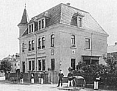 Langebrücks erste Postagentur wurde am 1. Juli 1883 eröffnet. Zuvor gab es bereits seit 1878 eine Filiale der Lausaer Post im Langebrücker Bahnhof. Die angeschlossene [Gaststätte “Zur Post”](../../nord/langebruck/strassen_langebruck/dresdner_strasse_langebruck/) war um 1900 Stammlokal des letzten sächsischen Königs Friedrich August III. Nach 1945 wurde sie vom Konsum weitergeführt und 1990 geschlossen. Seit 1993 befindet sich in dem Gebäude wieder ein Lokal, welches mit historischen Requisiten rund um die Post ausgestaltet wurde.

Bereits drei Jahre nach Eröffnung wurde die Postagentur verlegt und befand sich ab 1899 im neuen Postamt auf der Dresdner Straße 17 _(Foto)_. Dieses Postamt wurde in den letzten Kriegstagen 1945 evakuiert, wobei fast der gesamte Bestand verloren ging. Erst am 17. Mai konnte der Betrieb wieder aufgenommen werden.1998 schloss das Postamt Langebrück seine Pforten. Die Aufgaben wurden von einer Postagentur in unmittelbarer Nachbarschaft übernommen.

Schulen in Langebrück:

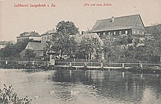Alte Schule: Die erste Erwähnung eines Schulmeisters in Langebrück stammt aus dem Jahr 1577. Der Unterricht fand damals zunächst in den Stuben der Bauern bzw. in einem Nebengebäude der Kirche statt. Erst 1755 erhielt der Ort ein eigenes Schulhaus an der Kirchstraße 17. Nachdem dieses im 19. Jahrhundert trotz mehrerer Erweiterungen nicht mehr den Anforderungen genügte, entstand 1875/76 ein neues Schulgebäude hinter dem Friedhof (Kirchstraße 46). Neben Klassenzimmern befanden sich hier auch die Wohnungen des Lehrers und eines Hilfslehrers. Am 10. November 1883 wurden aus Anlass des 400. Geburtstages Martin Luthers vor beiden Schulen Lutherbäume gepflanzt - eine Luthereiche an der Kirchstraße 17, eine Lutherlinde Langebrück an der Kirchstraße 48.

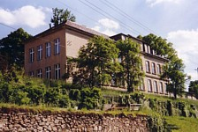Neue Schule: Mit dem Bau neuer Villenviertel und dem daraus resultierenden Wachstum der Einwohnerzahl Langebrücks war die alte Schule schon wenige Jahre nach ihrer Eröffnung zu klein. 1897 musste deshalb auf dem Nachbargrundstück Kirchstraße 48 ein Neubau errichtet werden, der am 12. September feierlich eingeweiht wurde _(Foto)_. Beide Schulhäuser dienten bis 1972 ihrem Zweck. Danach nutzten der Konsum sowie ein elektrotechnischer Betrieb die Gebäude.

Da in der Nachkriegszeit erneut Platzprobleme in den beiden vorhandenen Schulen bestanden, entschloss man sich 1951 zum Anbau zweier Klassenräume an die Neue Schule. 1963 entstand zusätzlich ein kleines Schulhaus am Wiesenweg. 1972 wurde in dessen Nachbarschaft ein modernes Schulgebäude übergeben, welches den Namen des Schriftsteller Friedrich Wolf erhielt. 1987 folgte noch eine moderne Turnhalle. Auf
Beschluss des Dresdner Stadtrates wurde die Mittelschule Langebrück im Sommer 2002 geschlossen. Das frühere Schulgebäude soll künftig als “Kinderhaus Langebrück” die bisher noch dezentral untergebrachten Kindereinrichtungen des Stadtteils aufnehmen. Für die Grundschule entstand 2001 nach Plänen des Architekturbüros Höhne und Langenbrunner ein moderner Neubau an der Friedrich-Wolf-Straße.

Postgehilfenvorbereitungsanstalt: Im Oktober 1888 gründete der pensionierte Pastor Pache im Wohnhaus Berger-/
Ecke Albertstraße (heute Beethovenstraße) eine Postgehilfenvorbereitungsanstalt. Die private Post- und Beamtenschule wurde später zur Carolastraße 4 (heute Radeberger Straße) verlegt und bestand bis 1899. Zeitweise
wurden hier bis zu 300 Schüler für ihre künftigen Aufgaben im Postdienst ausgebildet. Am 28. Juni 1892 entstand
zusätzlich eine höhere Buben- und Mädchenschule, die ihre Unterrichtsräume im gleichen Gebäude besaß. Nach der
Schließung richtete man  im Gebäude ein Schwestern- und Genesungsheim, 1904 ein Sanatorium für Herz- und Nervenkranke ein. Heute hat hier das DRK-Seniorenheim “Albert Schweitzer” sein Domizil.

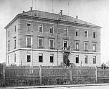

**_Foto:_** _Die frühere Postgehilfenvorbereitungsanstalt um 1900_

Schule des Privaten Schulvereins:
Eine weitere Privatschule entstand 1904 in einer Villa auf der Stiehlerstraße 1. Betrieben wurde sie vom Privaten Schulverein Langebrück. Die kombinierte Knaben- und Mädchenschule wurde
1907 in die Räume des ehemaligen Gemeindeamtes auf der Hauptstraße 12 verlegt und 1935 geschlossen.

Ortsfeuerwehr:

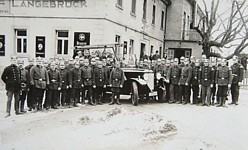Nachdem die Brandbekämpfung jahrhundertelang Aufgabe aller dazu fähigen Männer des Dorfes war, gründete die Gemeinde 1878 eine Pflichtfeuerwehr, der per Gesetz ebenfalls alle männlichen Einwohner Langebrücks angehörten. Allerdings erwies sie sich als unzuverlässig und wenig dienstbeflissen, so dass man sich schließlich zur Umwandlung in eine Freiwillige Feuerwehr entschloss. Diese entstand zunächst gegen den Willen des Gemeinderates, wurde jedoch am 17. März 1894 offiziell bestätigt.

Da das aus dem 18. Jahrhundert stammende alte Gemeindespritzenhaus nicht mehr den Anforderungen entsprach, wurde bereits kurz nach Bildung der Feuerwehr ein neues Haus an der Kirchstraße eingerichtet. 1898 erfolgte ein Neubau an der Hauptstraße, der noch bis nach 1990 genutzt wurde und heute ein kleines [Feuerwehrmuseum](../../nord/langebruck/strassen_langebruck/hauptstrasse/) beherbergt. 1994 konnte ein modernes Feuerwehrdepot auf der Lessingstraße eingeweiht werden.

Turnverein Langebrück:

Der Langebrücker Turnverein wurde am 10. August 1884 von zehn Einwohnern gegründet und nutzte für seine Tätigkeit zunächst die Räume eines alten Pferdestalls. Erst nach der Jahrhundertwende wuchs die Mitgliederzahl
deutlich an und betrug 1920 über 500 Mitglieder. 1919 entstand zusätzlich ein Arbeiter-Turn- und Sportverein, welcher jedoch 1933 von den Nationalsozialisten verboten wurde.

1955 verlor der Turnverein Langebrück seine Selbständigkeit und gehörte fortan zur BSG Motor Radeberg. Neben
den Turnern entstanden weitere Sektionen, u.a. für Saalradfahren, Boxen, Schwimmen und Pferdesport. 1993 konnte
der Turnverein als TVL Turnverein Langebrück e.V. neu gegründet werden und ist bis heute aktiv. Derzeit gehören ihm
ca. 360 Mitglieder, darunter viele Kinder und Jugendliche an, die sich in 10 Sektionen sportlich betätigen. Genutzt wird
die Turnhalle der Langebrücker Grundschule. 2009 wurde mit einer Festwoche und einer Ausstellung im Bürgerhaus das 125-jährige Bestehen des TLV gefeiert.

Vogelkeller:

Der Vogelkeller am Steinweg entstand 1445 als Lagerraum für Jagdvergnügungen des Hofes. Seinen Namen erhielt er nach den Vogelstellern, die noch bis ins 18. Jahrhundert um Langebrück
der Vogeljagd nachgingen. Während des Zweiten Weltkrieges wurde der Vogelkeller als Luftschutzbunker genutzt und dient heute einem Kleingartenverein als Lagerraum. Seit 1997 ist das Denkmal wieder zugänglich.

Duellstein:

Der Granitwürfel in einem Waldstück bei Langebrück erinnert an den tragischen Ausgang eines Duells am 25. Juni
1834\. Wegen einer angeblichen Beleidigung durch den Oberleutnant Alexander Liskow forderten sechzehn Offiziere diesen zum Duell, welches zwischen Liskow und dem durch Losentscheid bestimmten Leutnant Otto Julius Köhler
ausgetragen wurde. Köhler kam in Folge des Schusswechsels ums Leben, was seinem Gegner ein Jahr Festungshaft
auf dem Königstein einbrachte. Nach seiner Entlassung aus der sächsischen Armee lebte Liskow als Postmeister in
Dresden und verstarb am 26. Juli 1870. 1849 war er letzter Kommandant des Neustädter Bataillons der Dresdner Kommunalgarde. Der Gedenkstein bei Langebrück wurde von den Hinterbliebenen des Opfers 1835 in der Nähe des
Roten Grabenwegs aufgestellt und vor einigen Jahren saniert. Er trägt die Inschrift:

_“Dem Andenken des am 25. Juni 1834 hier im Zweikampf gefallenen Artillerie-Lieutenants_

_Otto Bernhard Julius Koehler setzte diesen Stein die tief trauernde Liebe der Seinen”_

[_Weiterführende Literatur und Quellen_](../../impressum/quellenverzeichnis/)

 \[ [Home](../../index.html)\] \[ [Nord](../../nord/)\] \[ [Nordwest](../../nordwest/)\] \[ [Neustadt](../../neustadt/)\] \[ [Nordost](../../nordost/)\] \[ [West](../../west/)\] \[ [Zentrum](../../zentrum/)\] \[ [Südwest](../../sudwest/)\] \[ [Süd](../../sud/)\]
 \[ [Südost](../../sudost/)\] \[ [Ost](../../ost/)\] \[ [Register](../../Register/register.html)\] \[ [Kontakt](../../Kontakt/kontakt.html)\] \[ [Impressum](../../impressum/)\]
