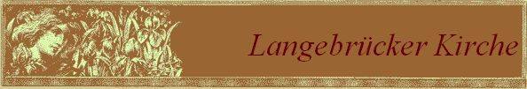
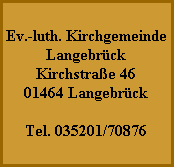
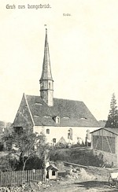
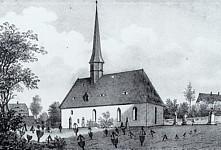
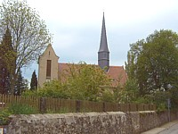
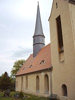
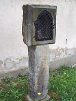

* * *

* * *

* * *

* * *

* * *

* * *

* * *

_Die Langebrücker Kirche um 1920_

Kirche:

Die 1280 erstmals erwähnte Langebrücker Kirche entstand vermutlich im 11. Jahrhundert als kleine Kapelle. Ursprünglich war sie wahrscheinlich aus Holz und wurde erst zum Ende des 14. Jahrhunderts in Stein ausgeführt. Die Betreuung der zum Sprengel Radeberg gehörenden Gemeinde oblag den Pfarrern der benachbarten Kirchspiele Grünberg, Lausa und Radeberg, die bei kirchlichen Anlässen wie Taufen, Trauungen und Beerdigungen eigens anreisen mussten und in einem kleinen Haus in der Nähe dieser Kapelle übernachteten.

Mit Amtseinführung des Pfarrers Georg Schammer wurde die Langebrücker Kirche 1539 protestantisch. 1558 entstand das zugehörige Pfarramt, womit die Zuordnung des Dorfes zum Radeberger Kirchsprengel mit Wirkung vom 28. August 1558 endgültig endete. Zwischen 1674 und 1682 erhielt die Kirche bei Umbauten im Wesentlichen ihr heutiges Aussehen mit dem Chor und den Seitenkapellen. Als Ersatz für den damals fehlenden Turm wurde 1798 der noch heute existierende Dachreiter mit Wetterfahne aufgesetzt.

Als im Oktober 1899 feierlich drei neue Kirchenglocken geweiht werden konnten, entstand abseits der Kirche ein hölzerner Glockenstuhl. Erst 1929 wurde nach einem Entwurf des Architekten Rudolf Kolbe ein richtiger Glockenturm als Anbau an das Kirchenschiff errichtet. Hier läutet auch die um 1350 gegossene "Friedensglocke", die zu den ältesten in Sachsen gehört. Die übrigen Glocken mussten 1917, ihre 1929 gegossenen Nachfolger 1939/42 zum Einschmelzen abgegeben werden. 1968 erhielt die Langebrücker Kirche eine 1878 gegossene Bronzeglocke aus dem erzgebirgischen Schwarzenberg. Da diese jedoch seit längerem nicht mehr geläutet werden darf, ist ihre Rückgabe an die Heimatgemeinde geplant.

Im Zusammenhang mit dem Umbau der Kirche erfolgte in den Zwanziger Jahren eine Erweiterung der 1905 geschaffenen pneumatischen Jehmlich-Orgel und des Chorraumes mit der Sakristei. Bemerkenswert waren die 1772 eingebauten Emporen an der Nord-, Ost- und Westseite, ein kleiner Altar mit Darstellung von Christi Geburt und Auferstehung vom Ende des 17. Jahrhunderts sowie die aus der gleichen Zeit stammende Kanzel. Der Hauptaltar mit einem Auferstehungsgemälde "Durch Nacht zum Licht" von Karl Gottlob Schönherr stammt von 1883. Es befindet sich heute in der Pfarrscheune. Die Weihe der erneuerten Kirche fand am 23. Februar 1930 statt.

Zwischen 1982 bis 1984 wurde die Langebrücker Dorfkirche vollständig restauriert und dabei im Inneren modern umgestaltet. Dabei erfolgte u.a. der Abriss der Emporen und der Kanzel. Eingebaut wurden ein modernes Hängekreuz aus Gasbeton mit Glassplittern, ein Kreuzweg mit 16 Stationen, ein neues Taufbecken sowie acht Bleiglasfenster mit Motiven zur Taufe, zum Abendmal und dem himmlischen Jerusalem. Die Innenraumgestaltung übernahm dabei Gottfried Zawadzki. Das neue Altarrelief stammt von Kristof Grunert. Neben Gottesdiensten finden hier auch regelmäßig Konzerte und Kammermusikabende statt.

Friedhof:

Zeitgleich mit dem Bau der Kirche wurde vermutlich auch der Kirchhof angelegt. Auf dem kleinen Dorffriedhof befindet sich eine Gruft aus der Barockzeit, in der der sächsische Oberregierungsförster Johann George Bruhm (+ 1755) beigesetzt wurde. Weitere historische Wandgräber des 18. Jahrhunderts>findet man an der Nordmauer des Friedhofs. Bemerkenswert sind die Gräber des viele Jahre in Langebrück lebenden Komponisten Jean-Louis Nicodé (+1919) und des Malerehepaares Schaberschul. Auch der Gründer des ersten Kindererholungsheims in Sachsen Hugo Hickmann (+ 1922) und sein Sohn, der erste Landesvorsitzende der sächsischen CDU nach 1945 Hugo Hickmann (+ 1955) wurde hier beigesetzt. Eine spätgotische Betsäule aus dem 15. Jahrhundert steht unmittelbar an der Kirche _(Foto)_.

* * *

 \[ [Home](../../../index.html)\] \[ [Nord](../../../nord/)\] \[ [Nordwest](../../../nordwest/)\] \[ [Neustadt](../../../neustadt/)\] \[ [Nordost](../../../nordost/)\] \[ [West](../../../west/)\] \[ [Zentrum](../../../zentrum/)\] \[ [Südwest](../../../sudwest/)\] \[ [Süd](../../../sud/)\] \[ [Südost](../../../sudost/)\] \[ [Ost](../../../ost/)\] \[ [Register](../../../Register/register.html)\] \[ [Kontakt](../../../Kontakt/kontakt.html)\] \[ [Impressum](../../../impressum/)\]
