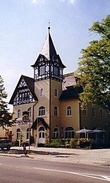
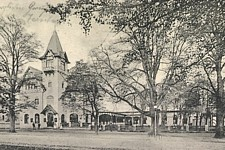

* * *

Der heutige “Lindenhof” Langebrück entstand 1875 auf einem Grundstück,
welches Frohwald Hippe zwei Jahre zuvor zur Errichtung einer Ausspanne erworben hatte. Hippe ließ hier Probebohrungen nach mineralhaltigem Wasser vornehmen und gründete nach Abschluss der Arbeiten das “Curbad
Langebrück”. Das Bad entwickelte sich schnell zum Mittelpunkt des aufstrebenden Erholungsortes und war bis zum Ersten Weltkrieg Ziel tausender Sommergäste, die hier Tanzveranstaltungen und Konzerte besuchten. Nach
einem Brand in der Silvesternacht 1898 ließen die Besitzer das Gebäude bis 1901 verändert wieder aufbauen _(Foto um 1910)_. Der Kurbetrieb wurde
eingestellt und das Haus fortan unter Namen “Kurhaus Langebrück” als Ausflugsgaststätte weitergeführt. 1905 konnte in unmittelbarer Nachbarschaft eine Turnhalle des 1884 entstandenen Ortsturnvereins eingeweiht werden.

Zwischen 1918 und 1921 diente das Kurhaus als Kriegs-Reservelazarett zur Betreuung verwundeter Soldaten. In diesem war der bekannte Dramatiker Friedrich Wolf als Chefarzt beschäftigt. Seine Söhne Konrad und Markus
wurden später ebenfalls als Schriftsteller bzw. Agent des DDR-Auslandsgeheimdienstes bekannt. 1928 erhielt das Lokal den Namen “Lindenhof”. Namensgeber war eine zwischen 1740 und 1750 vom Oberförster Bruhm angelegte
Lindenallee.

Nach Kriegsende diente der Lindenhof noch bis in die 1960er Jahre als Tanzgaststätte. Nach Abriss des baufälligen
Saales wurden die Räume zunächst von der HO übernommen und später Schulungs- und Betriebsferienheim des Chemnitzer Betriebes VEB Starkstromanlagenbau. An Stelle des einstigen Saalbaus entstand 1973 ein Gebäude der
Akademie für Sozialistische Wirtschaftsführung, welches nach 1990 bis 2004 von der Technischen Akademie
Esslingen als Weiterbildungszentrum  genutzt wurde. Seit 1990 befindet sich die Gaststätte wieder in Privatbesitz und besitzt auch einige Hotelzimmer.

* * *

 \[ [Home](../../../index.html)\] \[ [Nord](../../../nord/)\] \[ [Nordwest](../../../nordwest/)\] \[ [Neustadt](../../../neustadt/)\] \[ [Nordost](../../../nordost/)\] \[ [West](../../../west/)\] \[ [Zentrum](../../../zentrum/)\] \[ [Südwest](../../../sudwest/)\] \[ [Süd](../../../sud/)\] \[ [Südost](../../../sudost/)\] \[ [Ost](../../../ost/)\] \[ [Register](../../../Register/register.html)\] \[ [Kontakt](../../../Kontakt/kontakt.html)\] \[ [Impressum](../../../impressum/)\]
