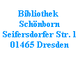
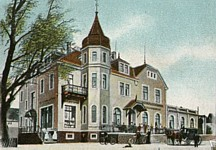

* * *

**Gemeindesiegel von Schönborn**

Schönborn wurde 1297 erstmals urkundlich erwähnt und verdankt seinen Namen der Lage an einer Quelle. Der Ort wurde durch fränkische Siedler als Waldhufendorf gegründet und war ursprünglich frei von einer
Herrschaft. Erst 1297 kam das Dorf in den Besitz einer Adelsfamilie. Bereits um 1250 bestand vermutlich eine Kapelle, Vorgängerin der heutigen [Dorfkirche](../../../nord/langebruck/schonborn/schonborner_kirche/). 1350 ist Schönborn als “Schonenburn” in den Urkunden verzeichnet, wobei der Ortsname als Ort am schönen (=
ergiebigen) Quell zu deuten ist. Ab 1461 gehörte Schönborn zum Rittergut Seifersdorf und unterstand dessen wechselnden Besitzern. Zu den Privilegien der Bewohner gehörte das Recht, in der nahen Dresdner Heide Holz zu
sammeln und Vieh weiden zu lassen. Als Gegenleistung mussten sie noch bis ins 17. Jahrhundert als Treiber bei Hofjagden helfen. Nach Übernahme der Rittergutsherrschaft durch die Familie von Haugkwitz entstanden die
Dorfrügen, heute ältestes bekanntes Rügenbuch des Radeberger Landes.

Die Geschicke des Dorfes wurden seit 1608 faktisch von der Stadt Radeberg geleitet. 1773 konnte mit Unterstützung der Kirchgemeinde erstmals
eine eigene Schule in Schönborn eröffnet werden. Radeberg hatte eine finanzielle Unterstützung dieses Vorhabens zuvor abgelehnt. Ein Jahr später kam der Ort in den Besitz der Familie Brühl, die das Rittergut
Seifersdorf erworben hatte. Das heutige Ortsbild entstand nach einem Brand im Jahr 1840 und wird von größeren Bauerngehöften geprägt. Hinzu kommen einige Häusleranwesen und Arbeiterwohnhäuser sowie das frühere
Gemeindearmenhaus an der Langebrücker Straße 4.

Dominierender Wirtschaftszweig blieb bis zum Ende des 19. Jahrhunderts die Landwirtschaft. Erst dann siedelten sich einige Handwerker und Gewerbetreibende an. Nach dem
Zweiten Weltkrieg schlossen sich bereits 1953 acht Bauern zur LPG “Lachendes Land” zusammen, welche 1968 mit einer weiteren LPG zur LPG “Vereinte Kraft” vereinigt  wurde. Für diese entstanden 1971/72 mehrere Ställe
für die Schweinezucht. Außerdem gab es bis 1989 im Oberdorf einen Betriebsteil der Radeberger Gartenbaugenossenschaft “Rödertalblume”. Die kleine Gemeinde kam trotz ihrer traditionell engen Bindungen an Radeberg 1996
als Ortsteil zu Langebrück und wurde mit diesem am 1. Januar 1999 Stadtteil von Dresden.

Gasthof Schönborn:

Der Gasthof entstand um 1900 und war einst beliebtes
Ausflugsziel, begünstigt durch die Nähe zur Dresdner Heide und zum Seifersdorfer Tal. Neben der Gaststube und einer angebauten Veranda besaß das Lokal einen großen Saal, der bis zu 1000 Personen fasste und für
verschiedene Vergnügungen genutzt wurde. 1953 wurde der Gasthof Schönborn geschlossen und fortan bis 1997 als Pflegeheim mit 100 Betten genutzt. Lediglich der angeschlossene Saal blieb nach einem Umbau 1957 für
kulturelle und gesellschaftliche Veranstaltungen der Gemeinde erhalten. Heute dient das unter Denkmalschutz stehende Gebäude als Wohnhaus.

**_Foto:_** _Der Gasthof Schönborn auf einer historischen Ansichtskarte_

Eine weitere Schankstätte gab es im Ort seit Ende des 19. Jahrhunderts. Um 1870 entstand an der Seifersdorfer Straße 2 die “Restauration zum Grenadier”. Später
erhielt das Lokal nach seiner Besitzerfamilie den Namen “Winters Gaststätte” und hat bis heute geöffnet.

Kindergarten:

Der Schönborner Kindergarten entstand 1954 als sogenannter “Erntekindergarten” und befand sich zunächst in einigen Nebenräumen des Dorfgasthofes und der Schule. Am 29. April 1957 wurde er in das sanierte ehemalige
Gemeindearmenhaus (Langebrücker Straße 4) verlegt und hatte bis 1968 nur in den Sommermonaten geöffnet. Seit
1996 betreibt die Arbeiterwohlfahrt Radeberger Land den Kindergarten, der mit 20 Plätzen zu den kleinsten in Dresden gehört.

Schule:

Um den langen und vor allem in den Wintermonaten beschwerlichen Schulweg nach Seifersdorf bzw. Radeberg abzukürzen, konnte Schönborn 1773 mit Unterstützung der Kirchgemeinde erstmals eine eigene Schule einrichten.
Radeberg hatte eine finanzielle Unterstützung dieses Vorhabens zuvor abgelehnt. 1840 entstand für diese schließlich
ein richtiges Schulhaus, welches 1908 durch einen größeren Neubau ersetzt wurde. Dieser blieb bis 1968 in Betrieb
und diente später u.a. als Bibliothek. Heute besuchen die Kinder des Ortes die Schule im benachbarten Langebrück.

Brettmühle (Kunathmühle):

Die im Seifersdorfer Tal an der Großen Röder gelegene Brettmühle, nach ihrem früheren Besitzer auch Kunathmühle
genannt, diente ursprünglich als Mahl- und Schneidemühle. Erstmals erwähnt wurde sie im Jahr 1602, als der aus der
Lausitz stammende Fabian Schramm die bereits bestehende Mühle von den Erben des Vorbesitzers übernahm. Ab
1842 befand sie sich im Besitz der Familie Kunath, an welche einst ein Zunftzeichen und die Initialen E.W.K an der Fassade erinnerten.

1900 erwarb der Unternehmer Carl Oskar Schmiedtgen die Kunathmühle und wandelte sie in eine Fabrik um. Das Unternehmen stellte nach seiner Modernisierung 1910 vor allem Korkprodukte her, war aber auch in der Holz- und
Strohverarbeitung tätig. Eine installierte Turbine lieferte zugleich elektrischen Strom für den Betrieb und einige
Gebäude im Dorf. Noch bis 1970 wurde hier Holzwolle für den Bedarf der Meißner Porzellanmanufaktur hergestellt. Die nach der Schließung des Werkes noch zu Wohnzwecken genutzten und verfallenen Gebäude wurden nach 1990
abgerissen. Heute erinnern nur noch ein ca. 20 Meter hoher Schornstein und einige Reste des Mühlgrabens an die frühere Brettmühle.

[_Weiterführende Literatur und Quellen_](../../../impressum/quellenverzeichnis/)

 \[ [Home](../../../index.html)\] \[ [Nord](../../../nord/)\] \[ [Nordwest](../../../nordwest/)\] \[ [Neustadt](../../../neustadt/)\] \[ [Nordost](../../../nordost/)\] \[ [West](../../../west/)\] \[ [Zentrum](../../../zentrum/)\] \[ [Südwest](../../../sudwest/)\] \[ [Süd](../../../sud/)\] \[ [Südost](../../../sudost/)\] \[ [Ost](../../../ost/)\] \[ [Register](../../../Register/register.html)\] \[ [Kontakt](../../../Kontakt/kontakt.html)\] \[ [Impressum](../../../impressum/)\]
