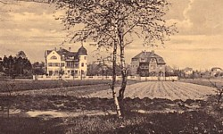Die Albert-Richter-Straße bildet die Verlängerung des sogenannten Kannenhenkels, eines nach einem alten Wegzeichen benannten Heideweges zwischen Langebrück und Dresden-Neustadt. 1908 ist sie als Kaiser-Wilhelm-Straße erstmals im Adressbuch verzeichnet. 1945 erfolgte die Umbenennung nach dem sozialdemokratischen Politiker Rudolf Breitscheid (1874-1944), der während der NS-Zeit im Konzentrationslager Buchenwald inhaftiert wurde, wo er bei einem Luftangriff ums Leben kam. Ihren heutige Namen erhielt sie nach dem Kunstmaler Albert Richter (1845-1898), der ab 1893 in Langebrück wohnte und zahlreiche Bilder mit Jagdszenen und Motiven aus der Dresdner Heide schuf. An Albert Richter erinnert auch ein Gedenkstein am Kannenhenkelweg.

Die Straße Am Braugraben wurde 2012 zur Erschließung des Wohngebietes "An der Heide" angelegt. Ihren Namen erhielt sie im Januar 2013 nach einem kleinen Bach, der seine Quelle nördlich der Dresdner Straße hat und den Brauteich speist. An der Hauptstraße mündet er in den Roten Graben.

Die kleine Straße Am Heidehof wurde in den 1930er Jahren im westlichen Teil von Langebrück angelegt, als hier eine kleine Siedlung entstand. Ihren Namen erhielt sie nach einem hier befindlichen, 1933 bei einem Brand zerstörten Bauerngut mit diesem Namen. Zunächst hieß die gesamte Siedlung ab 1933 postalisch "Heidehof-Siedlungsgelände", bevor 1936 der heutige Name eingeführt wurde.

Auch die jetzige August-Bebel-Straße entstand in den 1930er Jahren im Wohngebiet Heidehof. Zunächst wurden die Gebäude ab 1933 unter dem Namen Heidehof-Siedlungsgelände geführt, bevor man der Straße zwei Jahre später den Namen Konstant-May-Straße gab. Konstant May war der Inhaber des Hotels "Heidehof" an dieser Straße. Nach 1945 erfolgte nach dem sozialdemokratischen Politiker August Bebel (1840-1913) die Umbenennung in August-Bebel-Straße.

Die Badstraße entstand kurz nach der Jahrhundertwende und ist unter dem Namen Radeberger Straße 1902 erstmals im Adressbuch verzeichnet. Nach Machtübernahme der Nationalsozialisten wurde sie 1933 in Adolf-Hitler-Straße umbenannt. Da sie ursprünglich als Zufahrt zum Waldbad Langebrück diente, erhielt sie 1945 ihren jetzigen Namen.

Als Bahnhäuser wird ein Weg nördlich der [Eisenbahnstrecke Dresden-Görlitz](../../../nord/klotzsche/dresden_-_gorlitz/) bezeichnet. Bereits beim Bau der Strecke entstand hier ein Bahnwärterhaus, dem später weitere Wohnhäuser für Bahnbeamte folgten. Nach 1945 wurde für diese Grundstücke die postalische Bezeichnung Bahnweg eingeführt, welche nach der Eingemeindung Langebrücks in Bahnhäuser wechselte.

Die heutige Beethovenstraße wurde als Albertstraße Ende des 19. Jahrhunderts angelegt und mit villenartigen Landhäusern bebaut. Markantestes Gebäude ist die Villa “Edelweiߔ (Nr. 14), die sich einst im Besitz des Gutsbesitzer Moritz Claus
befand. Der nach 1945 eingeführte Straßenname erinnert an den bekannten deutschen Komponisten Ludwig van Beethoven (1770-1827).

Der nach örtlichen Gegebenheiten benannte Bergweg führt im Unterdorf von Langebrück vom Grundweg zur Hauptstraße und überquert dabei den Roten Graben. Erstmals ist er im Adressbuch von 1930 zu finden.

Die 1885 angelegte Bergerstraße verdankt ihren Namen dem früheren Langebrücker Mühlenbesitzer Johann Carl Hermann Berger (1818-1891), der zwischen 1851 und 1889 das Amt des Ortsvorstehers ausübte. Während seiner Amtszeit begann die Erschließung der Villenviertel südlich des alten Dorfkerns. Im Wohnhaus Nr. 12 wohnte ab 1894 bis zu seinem Tod 1937 der Landschaftsmaler Karl Hanns Taeger, der zahlreiche Bilder der Langebrücker Umgebung schuf. Einige Villen, u.a. Nr. 5 und Nr. 11, dienten einst als Pensionen. 1996/97 entstand an der Bergerstraße eine kleine Wohnanlage mit 24 Sozialwohnungen.

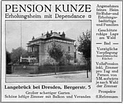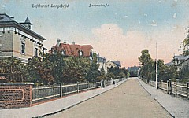

**_Fotos:_** _Blick in die Bergerstraße, links die Pension Kunze (Nr. 5)_

Die im Zuge der Erschließung des Wohngebietes “An der Heide” 2012 angelegte Bertha-Dißmann-Straße erinnert an die Kochbuchautorin Agnes Clara Bertha Dißmann (1874-1954), die viele Jahre in Langebrück auf der Höntzschstraße 6 wohnte. Ihr bekanntestes Werk ist der bereits vor dem Ersten Weltkrieg erstmals erschienene und in zahlreichen Auflagen gedruckte „Ratgeber für Herd und Haus“. Außerdem war sie zwischen 1903 und 1912 Vorsteherin der Haushaltungsschule der Inneren Mission in Dresden.

Die Blumenstraße im Langebrücker Oberdorf verbindet seit 1897 die Bergerstraße mit der Moritzstraße. Die Villen und Landhäuser an dieser Straße stammen aus der Zeit um 1900.

Das Borngässchen wurde Ende der 1920er Jahre im Unterdorf von Langebrück angelegt. Es verbindet die Langebrücker Hauptstraße mit der Kirchstraße und führt am Roten Graben entlang. Der kleine Wasserlauf war auch Anlass für die 1929 erstmals nachweisbare Namensgebung.

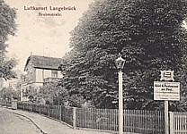Die Bruhmstraße im Langebrücker Villenviertel erinnert an die Försterfamilie Bruhm, die seit dem 17. Jahrhundert das Amt des Langebrücker Erbförsters inne hatte. Verliehen wurde dieses von Kurfürst Johann Georg III., nachdem der kursächsische Oberförster Anton Bruhm (+ 1692) seinen Landesherren in der Schlacht bei Wien vor türkischer Gefangenschaft bewahrt hatte. Enkelsohn Johann George Bruhm (1688-1755) ließ 1740 die Lindenallee an der Dresdner Straße anlegen. Zugleich war er Besitzer des sogenannten Forstgutes an der heutigen Bruhmstraße. Auch seine Nachkommen waren noch bis 1913 als Revierförster in Langebrück tätig.

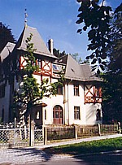Im letzten Drittel des 19. Jahrhundert entstanden an der Bruhmstraße repräsentative Villen und Landhäuser. Zu den Besitzern gehörte u. a. der Dresdner Fabrikant C. Hildebrandt (Eisengießerei Kelle & Hildebrandt), der für sich die Villa Sidonie (Nr. 13) erbauen ließ. Nach 1945 wurde dieses Gebäude als “Haus der Gemeinschaft” Sitz verschiedener Vereine. In der Nr. 1 wohnte 1903/04 der Maler Rudolf Trache (1886-1948). Trache hatte ab 1881 bei Ferdinand Pauwels an der Dresdner Kunstakademie studiert und schuf später vor allem Pferde- und Schlachtendarstellungen, die sich heute in den Sammlungen des Stadtmuseums und im Militärhistorischen Museum befinden.

1996/97 begann an der Bruhmstraße der Bau des Wohnkomplexes Forsthof. Neben Wohn- und Büroräumen befinden sich hier auch eine Sparkassenfiliale und mehrere Geschäfte. Zwei unter Denkmalschutz stehende Gebäude des ehemaligen Forstgutes wurden in das Areal einbezogen.

**Bruhmstr. 4 h, 01465 Langebrück** [**www.beyer-immobilien.de**](http://www.beyer-immobilien.de)

Die 1936 erstmals erwähnte Brunnenstraße befindet sich im Langebrücker Ortsteil Heidehof. Zunächst führte sie nur von der heutigen August-Bebel-Straße "nach dem Walde", d.h. in Richtung Heide. Nach dem Zweiten Weltkrieg wurde sie bis zur Dresdner Straße verlängert.

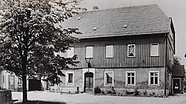Die Forststraße erhielt ihren Namen nach dem hier befindlichen Langebrücker
Forstamt. Dieses entstand im 17. Jahrhundert. als Forst- und Jagdhaus und wurde 1635 erstmals erwähnt. 1780/81 wurde das heutige Gebäude errichtet, welches neben den Dienst- und Wohnräumen des Revierförsters zugleich
Unterkunftsräume für kurfürstliche Jagdgesellschaften besaß. Später als Königliches Forstamt genutzt, ist es heute Sitz der Revierförsterei Langebrück _(Foto)_. Künftig ist in diesem Haus die Einrichtung eines kleinen Museums zur Dresdner Heide geplant.

Die kurze Friedrich-Ebert-Straße zweigt von der Liegauer Straße ab und erhielt deshalb nach ihrer Anlegung 1929 zunächst den Namen Liegauer Querstraße. 1931 erfolgte die Umbenennung nach dem SPD-Politiker und früheren Reichspräsidenten Friedrich Ebert in Ebertstraße. Da dieser Name während der NS-Zeit als unpassend betrachtet wurde, veränderte man die Bezeichnung 1935 in Horst-Wessel-Straße. Der bei Straßenkämpfen in Berlin 1930 ums Leben gekommene Wessel galt nach 1933 als "Märtyrer" und wurde vielfach geehrt. Unmittelbar nach Kriegsende erhielt die Ebertstraße, nun unter Ergänzung des Vornamens, wieder ihren früheren Namen.

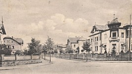Die Friedrich-Wolf-Straße, im Villenviertel gelegen, entstand um 1897 und wurde zunächst Hermannstraße genannt. In den 1950er Jahren erfolgte die Umbenennung nach dem Arzt und Schriftsteller Friedrich Wolf (1888-1953). Wolf war zwischen 1918 und 1920 als Chefarzt eines Kriegs-Reservelazaretts im Kurhaus tätig. Zu seinen bekanntesten Werken gehört bis heute die 1946 erstmals veröffentlichte Geschichte “Die Weihnachtsgans Auguste”. Auch die Langebrücker Schule trägt seinen Namen. Außerdem erinnert eine Gedenktafel an seinem früheren Wohnhaus Jakob-Weinheimer- / Ecke Albert-Richter-Straße an ihn.

Im Wohnhaus Friedrich-Wolf-Straße befand sich ab 1926 die private Leihbibliothek von Annemarie Pöthig. Ab 1933 wohnte in diesem Gebäude der Jurist Ernst Venus (1880-1971). Venus war 1905/1906 Berichterstatter der "Sächsischen Staatszeitung" im Sächsischen Landtag und danach in verschiedenen Funktionen in der sächsischen Verwaltung beschäftigt. Nach seiner Tätigkeit als Landrat von Stollberg und Annaberg übernahm er 1928 die Leitung der Amtshauptmannschaft Dresden und blieb bis 1944 letzter Amtshauptmann des Kreises.

Die Gartenstraße entstand 1934 als Planstraße B im Wohnviertel Heidehof. Zwischen 1935 und 1945 trug sie den Namen
Maikowski- bzw. Hans-Maikowski-Straße. Hans Maikowski (1908-1933) war Führer einer SA-Sturmabteilung in Berlin- Charlottenburg und wurde am 31. Januar 1933, dem Tag der nationalsozialistischen Machtübernahme, unter ungeklärten
Umständen erschossen. Während der Nazizeit galt er ähnlich wie Horst Wessel als “Märtyrer”. Unmittelbar nach Kriegsende 1945 erfolgte die Umbenennung in Gartenstraße.

Die Georg-Kühne-Straße wurde 1993 im Wohngebiet Heidehof angelegt und erhielt in Würdigung der Verdienste des früheren Bürgermeisters Georg Kühne (1879-1965) ihren Namen. Kühne war ab 1913 Gemeindevorstand des Ortes und
trug ab 1924 bis zu seiner Entlassung 1945 den Titel Bürgermeister. In seiner Amtszeit entstand u.a. das Wohngebiet Heidehof, der Bau einer Kläranlage und die Erweiterung des Waldbades. Maßgeblich setzte er sich für den Erhalt des
Charakters Langebrücks als Urlaubs- und Erholungsort ein.

Die Gerhard-Hauptmann-Straße im Langebrücker Oberdorf erhielt 1897 nach dem im Jahr zuvor verstorbenen ehemaligen
deutschen Reichskanzler Otto von Bismarck den Namen Bismarckstraße. Nach dem Zweiten Weltkrieg erfolgte die  Umbenennung nach dem Schriftsteller Gerhart Hauptmann (1862–1946). Hauptmann wurde durch seine Erzählungen und
Dramen bekannt und verfasste wenige Tage nach dem Bombenangriff auf Dresden sein bekanntes Werk [“Wer das Weinen verlernt hat ...”](../../../nordost/wachwitz/strassen_wachwitz/weidners_sanatorium/dresden_1945/)

Die Goethestraße und die benachbarte Schillerstraße entstanden kurz vor dem Ersten Weltkrieg und sind erstmals im Adressbuch von 1913 aufgeführt. Zeitgleich entstanden hier neue Wohnhäuser. Der Name erinnert an den deutschen Dichter Johann Wolfgang von Goethe (1749–1832).

Der Grundweg verläuft in Verlängerung der Kirchstraße östlich des Roten Grabens und ist seit 1930 amtlich nachweisbar. Da der Weg zum Großteil in einem Geländeeinschnitt verläuft, erhielt er vermutlich seinen Namen.

Die Güterbahnhofstraße wurde im Jahr 1913 als Zufahrt zum Langebrücker Bahnhof angelegt. Hier befanden sich früher zahlreiche Gewerbebetriebe, die die Bahnverbindung nach Dresden und Radeberg als Transportweg nutzten. In der 7 wohnte bis zu seinem Tod Max Radestock (1854-1913), der 1882 den Consum-Verein Pieschen initiierte und später als Vorstandsmitglied und Erster Vorsitzender des Verbandes sächsischer Konsumvereine zu den Mitbegründern der Konsumgenossenschaften gehörte.

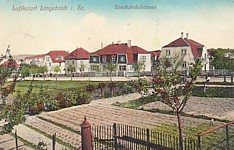

**_Foto:_** _Die Güterbahnhofstraße auf einer historischen Postkarte_

Der Heideweg befindet sich im Langebrücker Ortsteil Heidehof und dient als Zufahrt in ein Anfang der 1990er Jahre entstandenes Wohngebiet. Seinen Namen verdankt er der Nähe zur Dresdner Heide.

Die Heinrich-Heine-Straße entstand Mitte der 1930er Jahre als Zufahrt in das neue Wohngebiet Heidehof und ist 1934 erstmals als Straße A im Adressbuch verzeichnet. Im Folgejahr wurde sie nach dem Nationalsozialisten Eugen Eichhorn (1906-1927) benannt. Eichhorn gehörte in den Zwanziger Jahren der SA-Ortsgruppe in Plauen/Vogtland an und wurde 1924 bei einer Auseinandersetzung zwischen Nazis und Kommunisten schwer verletzt. 1927 verstarb er an den Spätfolgen seiner Verletzung und wurde in der NS-Zeit als "Blutzeuge der Bewegung" verehrt.

Bereits 1945 erfolgte die Umbenennung der Eugen-Eichhorn- in Heinrich-Heine-Straße. Namensgeber war der deutsche Dichter Heinrich Heine (1797-1856)

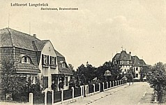Die kurze Herltstraße im Langebrücker Villenviertel erinnert an die frühere Gärtnerei Herlt, die sich an der Ecke Moritzstraße/ Blumenstraße befand und sich vor allem der Zucht von Koniferen widmete. Kurt Herlt war Ende des 19. Jahrhunderts an der Ausgestaltung vieler Villengärten beteiligt und bepflanzte auch den noch heute bestehenden Park am “Haus der Gemeinschaft”. Seine Wohnung hatte er in der um 1910 entstandenen Villa Herltstraße 2 _(Foto)_. Bereits 1908 hatte die an seinem Grundstück vorbeiführende Straße ihren Namen bekommen.

Die Höntzschstraße wurde Anfang des 20. Jahrhunderts angelegt und bis zum Ersten Weltkrieg mit Villen bebaut. Ihren Namen erhielt sie 1916 nach dem früheren Gemeindevorstand Friedrich August Höntzsch (1846-1921), der zwischen 1889 und 1913 amtierte und maßgeblich zum Aufschwung Langebrücks als Kur- und Erholungsort beitrug. 1906 entstand an der Ecke Höntzsch-/ Friedrich-August-Straße das erste Langebrücker Freibad, welches mit Eröffnung des [Germaniabades](../../../nord/langebruck/waldbad_langebruck/) 1912 jedoch wieder geschlossen wurde. Im Wohnhaus Höntzschstraße 6 lebte viele Jahre die durch ihre Koch- und Haushaltsbücher bekannt gewordene Autorin Bertha Dißmann.

Die Hugo-Hickmann-Straße wurde 2012 im Wohngebiet “An der Heide” angelegt und erinnert an den Politiker Hugo Hickmann (1877-1955), der bis 1933 als Abgeordneter der Deutschen Volkspartei dem Sächsischen Landtag angehörte. Außerdem war er ab 1926 Vizepräses der evangelisch-lutherischen Landessynode. Nach dem Zweiten Weltkrieg gehörte Hickmann zu den Mitbegründern der CDU in Sachsen und war bis zu seinem aus politischen Gründen erzwungenen Rücktritt erneut Landtagsabgeordneter und Abgeordneter der DDR-Volkskammer.

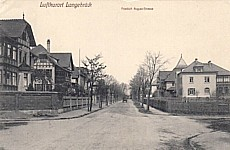Die heutige Jakob-Weinheimer-Straße wurde Ende des 19. Jahrhunderts als Friedrich-August-Straße angelegt und mit Landhäusern bebaut. Erstmals ist sie im Adressbuch von 1897 zu finden. Markanteste dieser Villen ist die einst im Besitz des Schokoladenfabrikanten Riedel befindliche Nr. 22, die seit 1959 als Feierabendheim diente. Nach 1945 wurde die Straße in Ernst-Thälmann-Straße umbenannt. 1990 erhielt sie den Namen des Malers und Grafikers Jakob Weinheimer. Weinheimer (1878-1962) lebte ab 1911 als freischaffender Maler in Langebrück (Moritzstraße 5) und schuf neben Grafiken und Jugendstil-Ornamentik auch verschiedene Landschaftsbilder der Dresdner Heide.

Nr. 12: In diesem Haus lebte ab 1904 bis zu seinem Tod der Landschaftsmaler Rudolf Trache (1886-1948). Trache war ein Schüler von Ferdinand Pauwels und schuf neben Landschaftsbildern auch zahlreiche Pferde- und Schlachtendarstellungen. Im Ersten Weltkrieg kam er offiziell als "Kriegsmaler" der 8. Armee zum Einsatz. Die dabei entstandenen Werke erschienen später im Kriegsgedenkbuch „Sachsen in großer Zeit“ von Johann Edmund Hottenroth. Einige seiner Bilder sind heute im Stadtmuseum und im Militärhistorischen Museum in Dresden zu sehen.

Nr. 21: Am früheren Wohnhaus von Friedrich Wolf erinnert eine Gedenktafel an den Aufenthalt des Schriftstellers 1918-19 in Langebrück. Bereits 1916 war seine Frau mit der gemeinsamen Tochter Johanna in das Haus gezogen. Wolf übernahm 1918 die Leitung des im Kurhaus untergebrachten Hilfslazaretts und gehörte als Vertreter der USPD zeitweise dem Langebrücker Gemeinderat an. 1919 wurde sein Sohn Lucas Friedemann geboren. Nach Auflösung des Lazaretts verzog die Familie 1920 nach Remscheid.

Der Kiefernweg entstand Mitte der 1970er Jahre zur Erschließung eines kleinen Wohngebietes zwischen Albert-Richter-Straße und Am Gänsefuß. Die Namensgebung erfolgte in Bezug auf die nahe Dresdner Heide.

Die parallel zur Hauptstraße des Unterdorfes führende Kirchstraße erhielt ihren Namen nach der bereits im 13. Jahrhundert entstandenen [Dorfkirche](../../../nord/langebruck/langebrucker_kirche/).  Hier befinden sich auch die beiden ältesten Langebrücker [Schulgebäude](../../../nord/langebruck/) von 1755 und 1875 sowie die mittlerweile ebenfalls nicht mehr genutzte Schule von 1897. Historisch interessant ist das im Kern aus dem 18. Jahrhundert stammenden Pfarramt (Nr. 46). Nachdem ein Vorgängerbau 1750 abgebrannt war, entstand wenig später ein Neubau. Sein heutiges Aussehen erhielt es bei einem Umbau 1830.

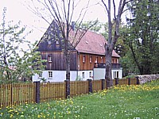

**_Foto:_** _Blick vom Friedhof zum Pfarramt an der Kirchstraße_

Die Klotzscher Straße ist Teil eines alten Verbindungsweges zwischen Dresden und den Herrensitzen von Seifersdorf und Wachau, der in der Nähe des Mühlteiches den Roten Graben überquerte. Diese Stelle war vermutlich Keimzelle des Dorfes Langebrück. Ab 1845 kreuzte der Weg die Eisenbahnstrecke Dresden - Görlitz, bevor 1916 von russischen Kriegsgefangenen die noch heute bestehende Brücke erbaut wurde. Nördlich der Straße befindet sich der Brauteich mit einer seit 1958 unter Naturschutz stehenden Eiche. 1934 ist die Straße erstmals im Adressbuch genannt und erhielt ihren Namen, da sie vom Unterdorf in Richtung Klotzsche führt. Historisch interessant ist eine alte Wegsäule an der Ecke Klotzscher Straße / Hauptstraße.

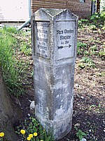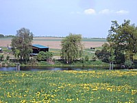

**_Fotos:_** _Wegsäule an der Klotzscher Straße - Blick zum Brauteich_

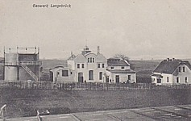An der heute nach dem deutschen Dichter Gottfried Ephraim Lessing (1729-1781) benannten Lessingstraße befand sich ab 1907 die gemeindeeigene Gasanstalt _(Foto)_. Ursprünglich wurde die Straße deshalb auch Am Gaswerk, ab 1915 Gasanstaltstraße genannt. Das Werk lieferte Steinkohlengas für die Straßenbeleuchtung und zur Versorgung der Wohnhäuser des Ortes. Erst im Dezember 1914 erhielten die ersten Gebäude Stromanschluss.

Später siedelten sich an der als Zufahrt zum Werk geplanten Straße mehrere Gewerbebetriebe an. 1931 erfolgte die Umbenennung in Hindenburgstraße, bevor man nach 1945 den heutigen Namen vergab. Seit 1994 hat an der Lessingstraße die Freiwillige Feuerwehr Langebrück ihr Domizil.

Die Liegauer Straße verbindet Langebrück mit dem Nachbarort Liegau-Augustusbad und erhielt danach ihren Namen. Erstmals ist sie im Adressbuch von 1897 aufgeführt.

Die Moritzstraße wurde 1883 angelegt und im Anschluss bebaut. Die Erschließungskosten übernahm der Gutsbesitzer Carl
Moritz Claus, der der Straße auch seinen Namen verlieh. Mit ihrer Anlage begann der Bau der Villenviertel südlich der Bahnlinie.

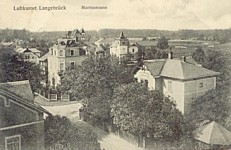

**_Foto:_** _Blick in die Moritzstraße um 1900_

Die Neulußheimer Straße entstand erst nach 1990 im Zusammenhang mit dem Bau der neuen Heidehofsiedlung westlich des
Dorfkerns. Ihren Namen erhielt sie nach der bei Speyer gelegenen Partnergemeinde Langebrücks, Neulußheim.

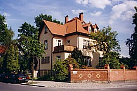Die Nicodéstraße, vor 1945 Albertstraße genannt,  erinnert an den Pianisten,
Komponisten und Dirigenten Jean Louis Nicodé (1853-1919). Er lebte ab 1900 bis zu seinem Tod am 5. Oktober 1919 in Langebrück und wurde auf dem örtlichen
Friedhof beigesetzt. Nicodé war als Klavierlehrer am königlichen Konservatorium in Dresden tätig und zugleich Leiter der Philharmonischen Konzerte.

Im August 2003 wurde aus Anlass seines 150. Geburtstages am früheren Wohnhaus
(Nr. 11) eine Gedenktafel angebracht _(Foto)_.

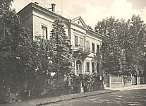An der Radeberger Straße, ehemals Carolastraße genannt, entstanden im letzten Drittel
des 19. Jahrhunderts einige für Langebrück bedeutende Einrichtungen. 1893 gründete der Arzt Dr. med. Lesovsky ein privates Sanatorium zur Behandlung von Herz-,
Nerven- und Stoffwechselerkrankungen. Zu dieser Klinik gehörten mehrere Gebäude, eine Badeanstalt sowie Turn- und Tennisplätze.

Auch das Landhaus Carolastraße 3 _(Foto)_ diente unter dem Namen “Waldhaus” einst
als Erholungsheim. In einem dieser Gebäude war bis 1899 die von Pastor a. D. Pache 1888 gegründete Postgehilfenvorbereitungsanstalt zur Ausbildung angehender
Postbeamter untergebracht. Heute nutzt ein Seniorenheim das Gebäude. Ein moderner Neubau wurde im Februar 1997 übergeben.

Die Rudolf-Trache-Straße wurde 2002 beim Bau eines neuen Wohngebietes im Ortsteil Heidehof angelegt und nach dem Maler Johann Friedrich Rudolf Trache (1866-1948) benannt. Trache
lebte ab 1904 in Langebrück und schuf zahlreiche Gemälde, meist mit militärischen Motiven. Historisch bemerkenswert ist seine Bilderserie über die Uniformierung der sächsischen Armee.

Die Schaberschulstraße entstand nach 1990 im neu angelegten Wohnpark im Ortsteil Heidehof. Der Straßenname erinnert
an die Langebrücker Malerfamilie Schaberschul. Sowohl Vater Wilhelm (1830-1903) als auch Sohn Max (1875-1940) sowie dessen Tochter Johanna (1903-1991) lebten viele Jahre im Ort und schufen zahlreiche Darstellungen der Umgebung.
Max Schaberschul wurde auch als Karikaturist und Buchillustrator bekannt. Tochter Hanna Roth-Schaberschul gestaltete vor allem Kinderbücher.

Der Schillerplatz wurde nach der Jahrhundert im Zuge der weiteren Bebauung des Gebietes zwischen Badstraße und
Liegauer Straße angelegt und gärtnerisch gestaltet. 1908 erhielt er, ebenso wie die von ihm abgehende Schillerstraße, den Namen des Dichters Friedrich Schiller (1759–1805).

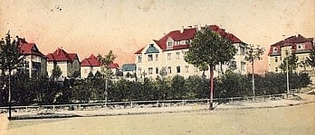

**_Foto:_** _Der Schillerplatz auf einer alten Ansicht um 1910_

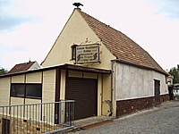Als Schmiedegäßchen wird der kurze Verbindungsweg zwischen Hauptstraße und
Kirchstraße im Unterdorf bezeichnet. Hier steht die alte Dorfschmiede, welche als erste Hufschmiede des Ortes bereits 1625 erwähnt wurde. Ab 1715 war sie Eigentum der
Gemeinde. Als eines der wenigen Gebäude überstand sie auch den Dorfbrand von 1857 und blieb über viele Generationen im Familienbesitz. Hauptsächlich diente sie als
Beschlagschmiede bzw. Reparaturbetrieb für Wagen und landwirtschaftliche Geräte. 1960 erfolgte ein Umbau der früheren Scheune zur Werkstatt für den bis heute hier ansässigen Metallbaubetrieb.

Die Seeligstraße im Wohngebiet Heidehof wurde 1935 angelegt und im Anschluss mit Siedlungshäusern bebaut. Ihren
Namen verdankt sie dem Heimatforscher Theodor Seelig (1850-1904). Dieser kam 1883 als Postagent nach Langebrück und wohnte bis zu seinem Tode auf der Liegauer Straße 3. Seelig führte bis zu seinem Tode die Langebrücker Ortschronik
und verfasste auch eine ortsgeschichtliche Monografie.

Der am Rande der Dresdner Heide gelegene Steinweg ist seit 1922 Standort eines Kriegerdenkmals. Das Monument
besteht aus einem wuchtigen Sandsteinsockel, auf dessen Deckplatte ein den Kopf erhebender brüllender Löwe liegt. Es
wurde am 22. Oktober 1922 als Ehrenmal für die Gefallenen des Ersten Weltkrieges eingeweiht und 1993 restauriert. Am
Sockel befinden sich die Inschrift: “Den gefallenen Söhnen Langebrücks” sowie vier Tafeln mit den Namen der 95 Opfer.

Die Stiehlerstraße erinnert an die alteingesessene Langebrücker Familie Stiehler. Diese war ab 1476 Besitzer des
Lehnrichtergutes, dem die niedere Gerichtsbarkeit über Langebrück oblag und blieb ununterbrochen bis 1729 im Amt. Nach 1900 wurde die Straße mit Landhäusern bebaut. 1912 entstand hier auch das heute noch existierende [Waldbad](../../../nord/langebruck/waldbad_langebruck/).

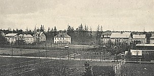

**_Foto:_** _die Siedlung an der Stiehlerstraße in den 1920er Jahren_

Nach 1990 wurde im Ortsteil Heidehof ein neues Wohngebiet angelegt. In diesem Zusammenhang entstand auch die Taegerstraße. Karl Hanns Taeger (1856-1937) war Lehrer für Landschaftsmalerei an der Dresdner Kunstakademie und
wohnte ab 1894 in Langebrück auf der Bergerstraße. Hier schuf er verschiedene Gemälde, meist Motive aus der Dresdner Heide und dem Seifersdorfer Tal. Ein Teil davon war bis vor einigen Jahren in den Gasträumen der [Hofewiese](../../../nordost/dresdner_heide/hofewiese/) zu sehen.

Die Weißiger Straße ist erstmals im Adressbuch von 1897 erwähnt. Ursprünglich führte sie nur vom Schillerplatz bis zur Forststraße, wurde später jedoch mit zunehmender Bebauung in Richtung Süden verlängert. Ihren Namen erhielt sie nach dem Ort Weißig im Schönfelder Hochland, seit 1999 Stadtteil von Dresden.

An der Weißiger Straße 5 befindet sich seit 2001 die Verwaltungsstelle des Ortes. Vor dem Gebäude erinnert die am 3. Oktober 1990 gepflanzte "Einheitseiche" an die deutsche Wiedervereinigung. Der von der Umweltgruppe Langebrück gepflanzte Baum stand ursprünglich auf dem Schulgelände Friedrich-Wolf-Straße 7, wurde wegen eines Neubaus jedoch 2001 an den heutigen Platz versetzt.

Sieben Friedenseichen: An der Kreuzung der Weißiger Straße mit dem Heideweg Kreuzringel stehen die sogenannten "Friedenseichen", die im April 1871 in Erinnerung an das Ende des Deutsch-Französischen Kriegs gepflanzt wurden. Initiator war der Langebrücker Oberförster Wilhelm Theodor Bruhm, ihm zur Seite stand Forstgehilfe Max Neumeister. Ursprünglich waren die sieben Bäume mit einer Inschriftstafel versehen, die jedoch bereits nach dem Ersten Weltkrieg gestohlen wurde:

_“Große Männer, Euch zum Ruhme wachsen hier im Heiligtum deutschen Waldes_

_diese Eichen, Eurer Kraft und Taten Zeugen”._

1931 ließen Verehrer von Neumeister, der inzwischen Direktor der Tharandter Forstakademie war, die Tafel erneuern. Heute ist sie jedoch nicht mehr vorhanden.

[Langebrück auf OpenStreetMap](https://www.openstreetmap.org/search?query=Dresden+Langebr%C3%BCck)

* * *

 \[ [Home](../../../index.html)\] \[ [Nord](../../../nord/)\] \[ [Nordwest](../../../nordwest/)\] \[ [Neustadt](../../../neustadt/)\] \[ [Nordost](../../../nordost/)\] \[ [West](../../../west/)\] \[ [Zentrum](../../../zentrum/)\] \[ [Südwest](../../../sudwest/)\] \[ [Süd](../../../sud/)\] \[ [Südost](../../../sudost/)\] \[ [Ost](../../../ost/)\] \[ [Register](../../../Register/register.html)\] \[ [Kontakt](../../../Kontakt/kontakt.html)\] \[ [Impressum](../../../impressum/)\]
