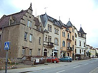
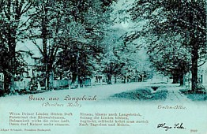
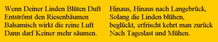
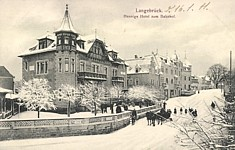
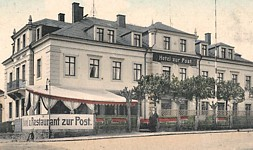
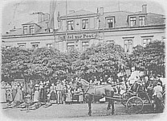
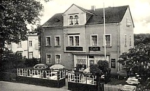

Die Dresdner Straße geht auf einen alten Verbindungsweg zwischen Klotzsche und Liegau-Augustusbad zurück. Erst 1815 wurde dieser zur Straße ausgebaut. Bereits 1740 hatte Revierförster Johann Georg Bruhm der Ältere den Weg mit Lindenbäumen bepflanzen lassen, weshalb die Straße viele Jahre den Namen Lindenallee trug. Zu den ältesten Gebäuden gehörten die sogenannten Pikörhäuser (Nr. 5-7), die einst als Unterkunft für die Jagdknechte und
ihre Hunde dienten. Auch ein Vorgängerbau des späteren Bahnhofshotels stand mit der Jagd in Verbindung, da hier der Vogelsteller wohnte. Historisch bedeutsam ist außerdem das Wohnhaus Dresdner Straße 30. Das frühere "Curbad Langebrück" ist heute unter dem Namen ["Lindenhof"](../../../../nord/langebruck/lindenhof/) eine beliebte Ausflugsgaststätte.

Der um 1895 mit städtischen Wohn- und Geschäftshäusern bebaute Vorplatz des Bahnhofshotels _(Foto links)_ wurde früher als Dresdner Platz bezeichnet. Zwischen 1886 und 1899 befand sich in den Räumen der späteren Germania-Drogerie (Dresdner Straße 4) die Langebrücker Postfiliale, die im Anschluss in das neu errichtete Postamt (Nr. 17) verlegt wurde.

Gebäude:

Bahnhofshotel (Nr. 1): 1845 wurde das alte Vogelstellerhaus zum Gasthof umgebaut, der von 1883 bis 1897 als “Hennigs Restauration” seine Gäste empfing. Nach dem Teilabriss entstand an gleicher Stelle das repräsentative Bahnhofshotel _(Foto rechts)_ mit Restaurant, Fremdenzimmern und Gesellschaftssaal. Nach dessen Schließung 1947 diente das Gebäude viele Jahre als Domizil des Konsums, der Gemeindeverwaltung, der örtlichen Bibliothek und zu Wohnzwecken. Nachdem ein 2009 geplanter Umbau zu einer Appartement-Wohnanlage scheiterte, steht das Haus heute leer.

“Hotel zur Post” (Nr. 9): Das Gebäude wurde 1883 für den Gastwirt Moritz Claus erbaut und am 25. Dezember eröffnet. Neben den Gasträumen befand sich in dem Gebäude bis 1886 auch die erste Postfiliale des Ortes. Danach diente das Haus nur noch als Gaststätte, die gern von Angehörigen des sächsischen Hofes besucht wurde. U.a. war diese Stammlokal des letzten Königs Friedrich August III., der oft in Langebrück weilte. 1945 wurde hier der Nicodéchor gegründet, der sich der Pflege der musikalischen Traditionen verschrieben hat.

**_Fotos:_** _Das “Hotel zur Post” um 1900 - rechts bei einem Besuch König Alberts nach einer Hofjagd_

Nr. 11: In diesem Haus befand sich ab 1914 die Bäckerei und Konditorei von Georg Hickmann mit angeschlossenem Café. Danach übernahm Fritz Dubielzig die Leitung. Bis heute dienen die Räume als Bäckerei _(Foto links)_.

Nr. 13 (ehem. Bibliothek): Im Jahr 1885 wurde in Langebrück die erste Gemeindebibliothek gegründet, die damals 79 Bände besaß. Mit dem Zuwachs des Bestandes machten sich mehrfache Umzüge in größere Räume erforderlich, so um 1940 in das ehemalige Grünwarengeschäft Houdek auf der Dresdner Straße 13. Nach 1945 nutzte die Bibliothek dann das Gebäude Dresdner Straße 1. Mit Hilfe von Fördermitteln konnten 1998 auf der Weißiger Straße 5 neue Räume saniert und umgebaut werden. Seit 1. Januar 1999 gehört die Bibliothek Langebrück zu den Städtischen Bibliotheken Dresden.

Nr. 20 (Fleischerei Höfgen): In diesem Ende des 19. Jahrhunderts entstandenen Gebäude befand sich viele Jahre eine Fleischerei. Errichtet wurde das Haus von Wilhelm Kunath für Wilhelm Bruhm, der es 1899 an Ferdinand Höfgen verkaufte. 1901 ließ Höfgen noch ein neues Schlachthaus bauen, welches das frühere am Ende des Grundwegs ersetzte. Um den Status als Luftkurort nicht zu gefährden, waren solche Einrichtungen zuvor im Oberdorf nicht erlaubt.

Ferdinand Höfgen betrieb seine Fleischerei bis 1930. Zur Kühlung der Ware gab es einen Eiskeller, der noch bis 1946 mit im Winter im Waldbad Langebrück gewonnenen Natureis betrieben wurde. Der Transport der Fleisch- und Wurstwaren erfolgte bis 1932 zum Teil mit Hundewagen. 1930 übernahm Sohn Otto Höfgen die Flei-
scherei, der sie 1958 an seinen Sohn Harald weitergab. In diesen Jahren erfolgten auch mehrfach Umbau- und Modernisierungsarbeiten. Zwischen 1989 und 1992 war das Geschäft an fremde Fleischer verpachtet, bevor dann eine Sanitärtechnikfirma die Räume übernahm. Heute dienen sie Wohnzwecken.

Nr. 23 (Villa St. Hubertus): Die landhausartige Villa entstand Ende des 19. Jahrhunderts und gehörte ab 1878 dem Landschaftsmaler
Albert Richter (1845-1898), der neben Natur, Tier- und Jagdbildern auch zahlreiche Bücher von Karl May illustrierte. Richter hatte nach seinem Studium an der Dresdner Kunstakademie mehrere große Reisen, u.a. nach Tunesien, Algerien und Nordamerika unternommen und ließ sich nach seiner Rückkehr in Langebrück nieder. An ihn erinnert heute die Albert-Richter-Straße und ein Gedenkstein am Kannenhenkelweg.

Nr. 41: In diesem Haus wohnte bis zu seinem Tod 1913 der Landschaftsmaler Carl Friedrich Moritz Emil von Haase (1844-1913). Haase hatte zunächst von 1862 bis 1875 in Leipzig und Düsseldorf studiert und ließ sich dann in Dresden, wenig später in Langebrück nieder. Hauptsächlich schuf er Landschafts-, Genre- und Jagdbilder. Sein Grab befindet sich auf dem Langebrücker Friedhof.

* * *

 \[ [Home](../../../../index.html)\] \[ [Nord](../../../../nord/)\] \[ [Nordwest](../../../../nordwest/)\] \[ [Neustadt](../../../../neustadt/)\] \[ [Nordost](../../../../nordost/)\] \[ [West](../../../../west/)\] \[ [Zentrum](../../../../zentrum/)\] \[ [Südwest](../../../../sudwest/)\] \[ [Süd](../../../../sud/)\] \[ [Südost](../../../../sudost/)\] \[ [Ost](../../../../ost/)\] \[ [Register](../../../../Register/register.html)\] \[ [Kontakt](../../../../Kontakt/kontakt.html)\] \[ [Impressum](../../../../impressum/)\]
