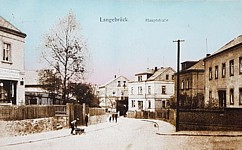
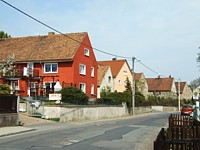
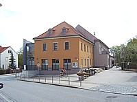
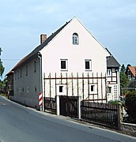
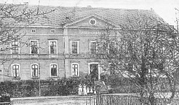
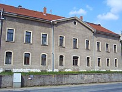
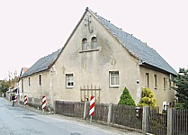

* * *

* * *

Entlang der parallel zum Dorfbach “Roter Graben” führenden Hauptstraße des Unterdorfes haben sich zahlreiche Dreiseithöfe aus der bäuerlichen Vergangenheit Langebrücks erhalten. Ihre Anordnung lässt noch deutlich die Form des früheren Waldhufendorfes erkennen, auch wenn die Gebäude selbst meist erst im 19. Jahrhundert entstanden. Einige Häuser weisen interessante Fachwerkkonstruktionen auf (u.a. Nr. 19 und Nr. 21) und wurden in den letzten Jahren saniert. Im Wohnhaus Hauptstraße 1 befand sich früher die Buchdruckerei von Kurt Imgrund (1878-1944), Herausgeber der Ortszeitung “Heide-Bote”. Die Zeitung erschien zum ersten Mal im Dezember 1913, wurde 1937 aus finanziellen Gründen eingestellt und 1990 wieder ins Leben gerufen. Zugleich war hier zwischen 1900 und 1917 das Gemeindeamt untergebracht. Nr. 12 beherbergte von 1907 bis 1935 die Schule des Privaten Schulvereins.

In diesem ältesten Teil des Ortes wurde 1524 erstmals eine Dorfmühle erwähnt, die sich damals im Besitz des kurfürstlichen Försters Matthes Günther befand. Ihm gelang es auch, beim Kurfürsten die Aufhebung des Mahlzwanges für die Langebrücker Bauern zu erreichen. An die alte Mühle erinnert heute noch der Mühlteich. Hier stand ab 1568 auch die erste Dorfschule. Um 1900 diente der Mühlteich zeitweise als Gondelteich.

Einzelne Gebäude:

Gasthof Langebrück: (Nr. 2)  Die Geschichte des Langebrücker Gasthofes lässt sich bis ins Jahr 1444 zurückverfolgen, als am “Roten Graben” in der Mitte des Dorfes erstmals ein Erbgericht mit Brauschenke erwähnt wurde. Das Erblehngericht befand sich in Höhe der Kirche an der sogenannten Schenkenbrücke und war lange Zeit politischer und kultureller Mittelpunkt des Dorfes. Zum Areal gehörten später drei weitere Grundstücke, darunter das “Kellerhaus” an der Kirchstraße und die 1738 eingerichtete Oberschenke an der Kreuzung mit der Liegauer Straße. Neben der eigentlichen Schankwirtschaft gehörte auch eine Brauerei, eine Brennerei sowie eine Bäckerei zum Schankgut.

1846 wurde an der Hauptstraße in der Nähe der Eisenbahnstrecke der neue “Gasthof zu Langebrück” gegründet und ersetzte die bisherigen Schankwirtschaften in der Oberschänke und im Erbgericht. Schnell entwickelte sich das Lokal zum gesellschaftliches Zentrum des Ortes. 1925 wurde hier ein Kino eingerichtet, welches als “Filmschau Langebrück” bis 1987 bestand. So wie in vielen unzerstörten Veranstaltungsstätten des Dresdner Umlandes fanden auch im Langebrücker Gasthof nach 1945 gelegentlich Aufführungen des Dresdner Staatsschauspiels und der Staatsoper statt. Mehrfach traten im Saal der Kreuzchor und die Staatskapelle auf.

Nachdem diese provisorische Nutzung 1949 beendet wurde, erfolgte ein größerer Umbau. Neben Filmvorführungen gab es hier regelmäßig kulturelle und politische Veranstaltungen wie Schuleinführungs- und Jugendweihefeiern. Seit 1969 war das Haus Schauplatz des überregional bekannten Langebrücker Karnevals. Auf Grund des schlechten Bauzustandes musste die “Filmschau” 1987 geschlossen werden.

1991 erwarb die Gemeinde das baufällige Gebäude. Allerdings scheiterten alle Sanierungspläne zunächst an den hohen Kosten, so dass zeitweise sogar der Abriss des ehemaligen Gasthofes erwogen wurde. 2001 konnte schließlich mit der Sanierung begonnen werden. Seit Oktober 2004 wird das Haus unter dem Namen “Bürgerhaus” als Stadtteilzentrum genutzt. Im früheren Kinosaal entstanden Ausstellungs- und Veranstaltungsräumen, während das Obergeschoss u. a. als Trauzimmer zur Verfügung steht. Hinter dem Bürgerhaus erinnert die am 24. September 2013 gepflanzte Jubiläumslinde an das 725. Ortsjubiläum.

Nr. 3: Das Haus wurde 1891 als Wohn- und Geschäftshaus errichtet und beherbergte früher u.a. ein Schokoladengeschäft sowie ab 1931 den Laden des Friseurmeisters Karl Siebenhaar. Später dienten beide Ladenlokale als Damen- und Herrenfriseursalons. Auch in einigen Nachbarhäusern gab es früher kleine Geschäfte, so in der Nr. 6 die Werkstatt des Schuhmachers Pohle sowie ein Kolonial- und Delikateßwaren-Geschäft. In der Nr. 10 existierte viele Jahre die Drogerie Jurk. Außerdem gab es hier ab 1912 eine Geschäftsstelle des Darlehns- und Sparkassenvereins Langebrück.

Nr. 22: Das kleine Fachwerkhaus _(Foto)_ gehört zu den ältesten noch erhaltenen Wohngebäuden des Langebrücker Unterdorfes. Es entstand 1856 nach der Zerstörung des Vorgängerbaus bei einem Dorfbrand und wurde 1986/87 saniert.

Feuerwehrmuseum (Nr. 38): Das Gebäude wurde 1898 als Spritzenhaus für die vier Jahre zuvor gebildete Freiwillige Feuerwehr des Ortes errichtet. Diese war entgegen dem Willen des Gemeinderates, der an der bestehenden Pflichtfeuerwehr festhalten wollte, am 25. Februar 1894 ins Leben gerufen worden. Das Haus diente viele Jahrzehnte als Aufbewahrungsort der Feuerspritze und der notwendigen Technik der Kameraden. Nachdem 1994 ein modernes Feuerwehrdepot auf der Lessingstraße eingeweiht werden konnte, entstand im alten Spritzenhaus ein kleines Feuerwehrmuseum.

Lehngericht (Nr. 49): Das zu den größten Bauernhöfen des Ortes gehörende Gut entstand Mitte des 15. Jahrhunderts und war Sitz des Lehnrichters, welcher über kleinere Vergehen wie Diebstahl oder beiStreitigkeiten zwischen Nachbarn entscheiden durfte. Zugleich besaß dieser das Brau- und Schankrecht. Erstmals erwähnt wurde das Gut im Jahr 1444. Lange Zeit diente das mehrfach umgebaute Haus als Gasthof des Ortes, wofür im Obergeschoss sogar ein Tanzsaal existierte. Von 1921 bis 1939 gab es im Haus die Fleischerei von Hugo Stein, ab 1929 ein Weißnäh-Atelier, in dem junge Mädchen auch in verschiedenen Näharbeiten unterrichtet wurden.

Nach 1945 wurde der Vierseithof Sitz der örtlichen LPG “Florian Geyer”, welche sich später mit der LPG “An der Heide” zusammenschloss. Für die Rinderzucht entstanden hinter dem Areal mehrere Rinderställe, eine Schweinezuchtanlage folgte 1970-71 am unteren Ortsrand. Heute gehören diese zur Agrarzentrum Grünberg GmbH. Das frühere Gastwirtschaftsgebäude dient Wohnzwecken und wurde 2005 verkauft. Seitdem bemühen sich die neuen Eigentümer um eine schrittweise Sanierung.

Teichmühle (Nr. 50): Auf diesem Grundstück befand sich einst die 1524 erstmals genannte Teichmühle unterhalb des noch heute bestehenden Mühlteiches. Besitzer war der Förster Matthes Günther, der zugleich eine Brettschneidemühle in der Dresdner Heide betrieb. 1731/32 erfolgte im Mühlteich der Einbau von Rechen und Absperrgattern zur Karpfenzucht. Das heutige Gebäude entstand 1804 und wurde um 1930 zum Wohnhaus umgebaut. Über der Tür erinnert ein Schlussstein an den Neubau im 19. Jahrhundert.

* * *

 \[ [Home](../../../../index.html)\] \[ [Nord](../../../../nord/)\] \[ [Nordwest](../../../../nordwest/)\] \[ [Neustadt](../../../../neustadt/)\] \[ [Nordost](../../../../nordost/)\] \[ [West](../../../../west/)\] \[ [Zentrum](../../../../zentrum/)\] \[ [Südwest](../../../../sudwest/)\] \[ [Süd](../../../../sud/)\] \[ [Südost](../../../../sudost/)\] \[ [Ost](../../../../ost/)\] \[ [Register](../../../../Register/register.html)\] \[ [Kontakt](../../../../Kontakt/kontakt.html)\] \[ [Impressum](../../../../impressum/)\]
