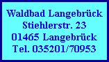
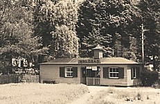
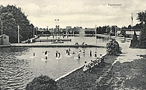

* * *

* * *

* * *

* * *

Nachdem Langebrück im letzten Drittel des 19. Jahrhunderts zum Kur- und Erholungsort geworden war, kamen um 1880 erstmals Pläne zur Errichtung eines Luft- und Freibades auf. 1883 ließ der Gutsbesitzer Moritz Claus an einem kleinen Teich ein Badehaus zur öffentlichen Benutzung aufstellen. 1906 wurde schließlich das erste richtige Bad an der Ecke Friedrich-August / Höntzschstraße eingeweiht. Dieses Bad besaß ein kleines Schwimmbecken mit ca. 250 m² Wasserfläche und wurde bereits 1912 wieder geschlossen.

Im gleichen Jahr erwarb die Gemeinde außerhalb des Ortskerns mehrere Grundstücke und legte das heute noch existierende Waldbad Langebrück an. Am 23. Juni 1912 wurde es eingeweiht. Seinen früheren Namen Germaniabad erhielt es nach dem Dresdner Schwimmklub “Germania”, der hier regelmäßig trainierte. Das Bad besaß zwei durch einen Bretterzaun getrennte Bereiche für Damen und Herren, gasbeheizte Duschen und einen Sprungturm mit 3- und 6-Meter-Brett. Außerdem bestand zeitweise ein Gondelverleih.

In den Zwanziger Jahren erfolgten einige Erweiterungen, u.a. der Bau neuer Umkleidekabinen, einer kleinen Badgaststätte sowie die Einrichtung eines Familienbades _(Foto)_, in dem nun Männer und Frauen gemeinsam schwimmen durften. In den Wintermonaten diente das Bad als Eisbahn. 1926 wurde ein neuer Sprungturm errichtet sowie eine Wasserrutsche aufgestellt, 1929 nach Plänen des Dresdner Architekten Paul Weiße ein Planschbecken mit Brunnen angelegt.

1946 entstand die noch heute vorhandene Verbindung zwischen dem ehemaligen Damen- und Herrenbad sowie eine Brücke über den Graben zwischen beiden Bassins. Da der Name Germaniabad als nicht mehr zeitgemäß erachtet wurde, erfolgte um 1950 die Umbenennung in Waldbad Langebrück. In den letzten Jahren konnten einige Modernisierungsmaßnahmen wie die Installation einer neuen Rutsche, der Bau moderner Sanitäranlagen sowie die Schaffung weiterer Sportmöglichkeiten umgesetzt werden. Das frühere Damenbad wird seit 1993 zur biologischen Selbstreinigung des Wassers genutzt. 2004 übernahm die städtische Tochtergesellschaft QAD das Langebrücker Waldbad in freie Trägerschaft, seit 2012 gehört es wieder zum städtischen Sportstätten- und Bäderbetrieb. Teile der Anlage, u.a. das Kassenhäuschen, der Kiosk und die Erfrischungshalle stehen unter Denkmalschutz.
