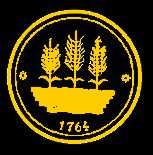
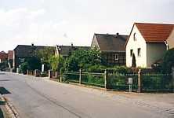
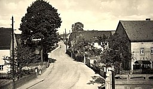
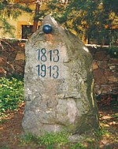
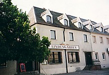
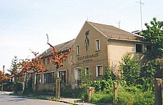
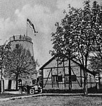
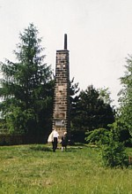
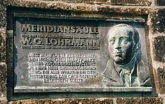

* * *

**Gemeindesiegel von Rähnitz**

* * *

* * *

**Rähnitzer Vereine:**

* * *

**Schulen in Rähnitz:**

Rähnitz wurde 1269 erstmals als “Ranis” urkundlich erwähnt. Der Name ist
vermutlich von einem slawischen Ortsgründer Ronyz abgeleitet. Die Besiedlung erfolgte in zwei Etappen, wobei sich der ältere Dorfteil zwischen Bauernweg und
Hellerstraße erstreckt und schon um 1150 besiedelt worden sein könnte. Später folgte der jüngere Teil zwischen Hellerstraße und Vorerlenweg, wahrscheinlich
bereits durch deutsche Zuwanderer. 1441 befanden sich auf Rähnitzer Flur zwei Vorwerke. Das niedere, auch als Knapsdorf bezeichnet, gehörte bis 1310 dem
Dresdner Hospital, später zum Amt Moritzburg. 1547 wurde es unter fünf Rähnitzer Bauern aufgeteilt, die bis ins 19. Jahrhundert die sogenannte
“Klöppelgemeinde” bildeten. Die Bauern des oberen Vorwerks unterstanden bis zur Auflösung der Patrimonialgerichtsbarkeit um 1840 dem Rittergut Döhlen (heute Stadtteil von Freital) und gehörten der
“Bullengemeinde” an. Beide umgangssprachliche Bezeichnungen gehen auf bäuerliche Traditionen zurück: während in der
“Klöppelgemeinde” die Bewohner durch Anschlagen eines Klöppels zu Versammlungen gerufen wurden, mussten die
Bauern der “Bullengemeinde” den Gemeindebullen zur Deckung der Kühe stellen. Erst 1840 endete diese Trennung mit Einführung der sächsischen Agrarreformen und Rähnitz wurde ein eigenständiges Dorf mit eigenem Gemeinderat.

Der von der Landwirtschaft geprägte Ort hat bis heute sein früheres Bild
teilweise bewahrt. Am Bauernweg sind noch einige Gehöfte erhalten geblieben, die meist nach 1813 entstanden sind. An die frühere Bedeutung der hiesigen Bauerngüter zur Versorgung der Stadt Dresden erinnert auch
die Rähnitzgasse in der Inneren Neustadt. Noch im 19. Jahrhundert gab es am Bauernweg eine Dorflinde, die ihren Standort zwischen den Anwesen Bauernweg 12 und 14 hatte und einst als Gerichtslinde diente. Leider fiel
diese wie auch der 1929 zugeschüttete Dorfteich späteren Veränderungen zum Opfer.

Im Jahr 1590 ist erstmals eine Dorfschmiede erwähnt. Um 1600 kam die Vogelstellerei auf, wobei die Tiere vorrangig zur Befriedigung der Bedürfnisse des Hofes gefangen wurden. 1673
erteilte Kurfürst Johann Georg II. seinem Kammerjunker Hans Caspar Knoch die Genehmigung zur Anlage eines Weinbergs auf Rähnitzer Flur. Aus diesem Weingut ging die spätere Ausflugsgaststätte [“Hellerschänke”](../../nord/hellerau/hellerschanke/) hervor, die bis 1956 existierte. 1813 wurde Rähnitz in den Napoleonischen Kriegen in Mitleidenschaft gezogen. An die Kämpfe erinnert
ein Gedenkstein vor dem alten Spritzenhaus am Bauernweg _(Foto)_.

1899 erhielt Rähnitz einen eigenen Friedhof mit einer kleinen Kapelle, die 1904 zur heutigen [Kirche](../../nord/rahnitz/rahnitzer_kirche/) erweitert wurde. Bereits 1839 war eine Dorfschule entstanden, die sich bis heute zur
85\. Mittelschule an der Radeburger Straße weiterentwickelte. Hier war der Schriftsteller Kurt Gerlach als Lehrer tätig, dessen Tochter Tine Schulze-Gerlach ebenfalls als Schriftstellerin bekannt wurde.

Um die Jahrhundertwende wurde Rähnitz in Richtung Hellerstraße um eine
Kleinhaussiedlung erweitert. Seit dieser Zeit besteht hier auch die beliebte Gaststätte Lindengarten. Aus einem weiteren Lokal mit Namen “Zur Hoffnung”
entstand 1950 das Kulturhaus Hellerau. Begünstigt wurde die Entwicklung des Ortes durch die ab 1909 auf Rähnitzer Flur entstandene Gartenstadt Hellerau, mit
der sich Rähnitz 1919 zum Doppelort Rähnitz-Hellerau vereinigte. In den 1930er Jahren wurde die Autobahn Dresden - Bautzen an Rähnitz vorbeigeführt und die
Straßenbahn von Hellerau bis hier verlängert. Das Autobahndreieck vor den Toren des Ortes war zwischen 1951 und 1972 Schauplatz für Motorradrennen auf der [“Hellerauer Spinne”](../../west/kemnitz/autobahn/). Noch am 17. April 1945 beschädigte eine verirrte Fliegerbombe das Rähnitzer Anwesen
Bauernweg 23, an dessen Stallgebäude heute eine Gedenktafel an dieses Ereignis erinnert.

**_Foto:_** _Das mittlerweile abgerissene ehemalige Kulturhaus Hellerau im Rähnitzer Ortskern_

Bedingt durch den Bau des Flughafens verloren die Rähnitzer Bauern einen Teil ihrer Anbauflächen. Nach Kriegsende gewannen deshalb
kleinere Industriebetriebe an Bedeutung. Die verbliebenen Bauern schlossen sich 1953 zur LPG “Kurt Schlosser” zusammen und bewirtschafteten Flächen in Rähnitz, Klotzsche, Wilschdorf, Volkersdorf und
Moritzburg. Bis 1969 existierte in Rähnitz noch eine zweite LPG “Heiderand”, die sich später mit weiteren genossenschaftlichen Landwirtschaftsbetrieben der Umgebung zusammenschloss. Für diesen Betrieb entstanden am
Ortsrand einige größere Stallanlagen. Außerdem wurde bereits 1957 das frühere “Erbgericht” zum Verwaltungszentrum umgebaut.

Schulen in Rähnitz:

Rähnitz bildete seit dem 19. Jahrhundert einen eigenen Schulbezirk. Allerdings fand der Unterricht zunächst in Form einer “Wandelschule” in verschiedenen angemieteten Räumen statt. 1839 entstand am Bauernweg 20 das heute als Wohnhaus genutzte erste Rähnitzer Schulgebäude. Später wurde an der Hellerstraße 4 ein neues Schulhaus errichtet, welches heute als Kindertagesstätte "Pfiffikus" dient. Als Lehrer wirkten hier der Kantor Karl August Heller, nach dem die Hellerstraße ihren Namen erhielt, sowie Kurt Gerlach. Gerlach erwarb sich auch als Schriftsteller und Ortschronist einen Namen und ist der Vater der Schriftstellerin Tine Schulze-Gerlach und Großvater des Sängers und Moderators Hartmut Schulze-Gerlach.

In den 1980er Jahren entstand ein moderner Schulneubau an der Radeburger Straße 168 (85. POS "Carl Bobach". Dieser wurde nach 1990 als 85. Mittelschule “An der Meridiansäule” genutzt und im Sommer 2006 geschlossen. Heute befindet sich hier die 85. Grundschule.

Rähnitzer Windmühle:

Das Baujahr der ersten Windmühle ist nicht bekannt. Vermutlich entstand sie nach 1780 und war eine hölzerne Bockwindmühle. 1804 wurde diese Mühle durch einen Steinbau ersetzt. Dieser war während der Napoleonischen Kriege 1813 umkämpft, woran später eine in den Grundmauern steckengebliebene Kanonenkugel erinnerte. Schadhafte Mühlenflügel und die zunehmende Konkurrenz moderner Industriemühlen führten 1904 zur Einstellung des Mahlbetriebs. Daraufhin wurde sie von ihrem Besitzer Reinhold Karnagel zum Aussichtsturm umgebaut. Am Fuße der Mühle entstand ein Gasthaus, welches wegen seiner herrlichen Aussicht vor dem Zweiten Weltkrieg beliebtes Ausflugsziel war. 1955 mussten Mühle und Gasthaus der Erweiterung des Klotzscher Flughafens weichen.

Meridiansäule:

Die 10 Meter hohe Sandsteinsäule, wegen ihrer Form im Volksmund auch “Butterstampe” genannt, wurde 1828 als nördlicher Vermessungspunkt eines geodätischen Koordinatensystems errichtet. Das Gegenstück befand sich auf der
Goldenen Höhe in der Nähe von Bannewitz. Initiator der Säule war der sächsische Vermesser Wilhelm Gotthelf Lohrmann (1796-1840), der mit der Vorbereitung eines neuen Katastersystems für die Grundsteuererhebung beauftragt war. Die eigentliche Messtelle lag auf dem Zwingerwall in der Innenstadt. Von dort aus bestimmte Lohrmann mit Hilfe seiner Instrumente die exakte Nord-Süd-Linie. An sein Projekt erinnert seit 1928 eine Gedenktafel an der Rähnitzer Säule. Eine zusätzliche Bronzetafel mit einem Porträt Lohrmanns und entsprechender Erläuterung kam 1955 dazu. 1987 wurde die Meridiansäule auf Initiative Rähnitzer Bürger restauriert.

**_Foto:_** _Meridiansäule mit Lohrmann-Gedenktafel_

[_Weiterführende Literatur und Quellen_](../../impressum/quellenverzeichnis/)

 \[ [Home](../../index.html)\] \[ [Nord](../../nord/)\] \[ [Nordwest](../../nordwest/)\] \[ [Neustadt](../../neustadt/)\] \[ [Nordost](../../nordost/)\] \[ [West](../../west/)\] \[ [Zentrum](../../zentrum/)\] \[ [Südwest](../../sudwest/)\] \[ [Süd](../../sud/)\]
 \[ [Südost](../../sudost/)\] \[ [Ost](../../ost/)\] \[ [Register](../../Register/register.html)\] \[ [Kontakt](../../Kontakt/kontakt.html)\] \[ [Impressum](../../impressum/)\]
