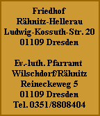
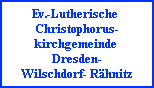
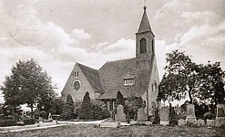
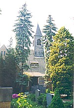

* * *

* * *

Rähnitz gehörte noch bis in die jüngere Vergangenheit kirchlich zur Parochie Reichenberg. Bereits 1836 setzten sich die Einwohner des Ortes für eine Umpfarrung zur näher gelegenen Wilschdorfer Kirche ein, zunächst jedoch ohne Erfolg. Erst 1898 organisierten einige Rähnitzer Einwohner, unter ihnen der Gemeindevorstand Luther sowie der Lehrer Heller, eine Spendensammlung, um die erforderlichen finanziellen Mittel für einen Kirchenbau zu beschaffen. Noch im selben Jahr konnte am 8. August mit den Arbeiten begonnen werden. Nach Plänen des Bauunternehmers Ernst Trepte entstand eine kleine Parentationshalle, die auch für Gottesdienste genutzt werden sollte.

Zugleich war auf einem vom Gutsbesitzer Karl Schütze zur Verfügung gestellten Grundstück der Rähnitzer Friedhof als “Außenstelle” des Wilschdorfer Friedhofs angelegt und am 20. Februar 1899 eröffnet worden. Wenig später erfolgte der erste Gottesdienst in der neuen Feierhalle, die noch im selben Jahr Kanzel und Glocke erhielt. Leider musste eine 1906 erworbene zweite Glocke 1917 zum Einschmelzen abgegeben werden. Auch deren beide Nachfolgerinnen, 1938 gegossen, sind heute nicht mehr vorhanden, da sie 1942 eingeschmolzen wurden. Das jetzige Geläut stammt von 1953 und wurde in der Apoldaer Glockengießerei Schilling & Lattermann hergestellt.

Schon bald nach seiner Einweihung genügte das eigentlich als Trauerhalle konzipierte Gebäude nicht mehr den Anforderungen und wurde 1904 durch die noch heute vorhandene Kapelle mit 240 Plätzen ersetzt. Am 16. Oktober erfolgte deren feierliche Weihe. Architekt des Neubaus war Ernst Meißner. Am 1. Juli 1913 wurde diese Kapelle zur Pfarrkirche erhoben und Rähnitz somit kirchlich selbständig. Seit 1932 besteht ein Schwesterkirchverhältnis mit der Wilschdorfer Kirche, seit 1999 auch mit Klotzsche. Im Jahr 2006 erfolgte die Vereinigung zur neuen Christophorusgemeinde. Zwischen 1996 und 2000 erfolgte eine Restaurierung der Kirche, die 2004 mit einer Festwoche ihr 100-jähriges Jubiläum beging. Umfassende Erneuerungsarbeiten fanden zudem ab 2014 statt. Die heute vorhandene Innenraumgestaltung mit Altar und Taufbecken stammt aus den 1970er Jahren und wurde von Werner Juza geschaffen. Der Künstler gestaltete auch die bronzeverkleidete Tür zur Sakristei sowie die Glasfenster mit Motiven zum Pfingstfest. Außerdem besaß die Rähnitzer Kirche seit 1906 eine Orgel der Dresdner Firma Jehmlich. Diese wurde 2018 durch eine ca. 200 Jahre alte Orgel der Firma Kayser aus einem privaten Nachlass ersetzt.

Auf dem angrenzenden Friedhof ruht neben dem Initiator des Kirchenbaus, dem Rähnitzer Lehrer und Kantor Karl Heller, auch der 1947 verstorbene ehemalige sächsische Generalstaatsanwalt Prof. Dr. John Ulrich Schroeder. Schroeder war an der Novemberrevolution beteiligt und stellte sich 1918 als juristischer Berater dem Cuxhavener Arbeiter- und Soldatenrat zur Verfügung. Ein 1925 aufgestelltes Kriegerdenkmal erinnert an die Gefallenen des Ersten Weltkriegs. In der Nordwestecke des Friedhofes steht seit 1905 eine aus Anlass des 100. Todestages des Dichters gepflanzte Schillerlinde mit Gedenkstein.

* * *

 \[ [Home](../../../index.html)\] \[ [Nord](../../../nord/)\] \[ [Nordwest](../../../nordwest/)\] \[ [Neustadt](../../../neustadt/)\] \[ [Nordost](../../../nordost/)\] \[ [West](../../../west/)\] \[ [Zentrum](../../../zentrum/)\] \[ [Südwest](../../../sudwest/)\] \[ [Süd](../../../sud/)\] \[ [Südost](../../../sudost/)\] \[ [Ost](../../../ost/)\] \[ [Register](../../../Register/register.html)\] \[ [Kontakt](../../../Kontakt/kontakt.html)\] \[ [Impressum](../../../impressum/)\]
