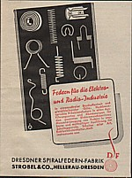
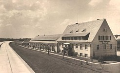
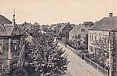
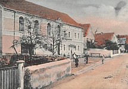
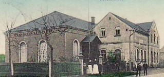
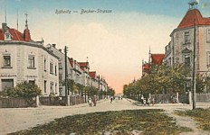
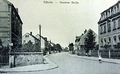
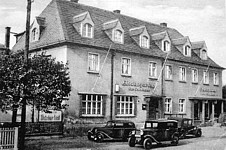
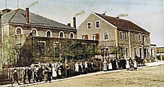
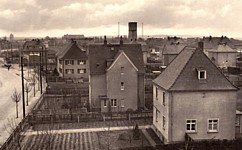

* * *

Die Straße Am Erlichberg wurde Ende der 1990er Jahre zur Erschließung des Gewerbegebietes Rähnitz angelegt. Ihren Namen erhielt sie nach dem nahegelegenen Erlichberg.

Die Straße Am Ilschengraben liegt im nördlichen Teil des Rähnitzer Gewerbegebietes und wurde Ende der 1990er Jahre angelegt. Ihren Namen verdankt sie dem nahegelegenen Ilschengraben, dem Hauptzufluss der Promnitz. Er entspringt zwischen dem Dresdner Flughafens und dem Autobahnzubringer (Hermann-Reichelt-Straße). Von dort fließt er nach Unterquerung der Autobahn durch das Gewerbegebiet Rähnitz und trägt ab der Stadtgrenze den Namen Promnitz. Im Bereich des Gewerbeparks wurde der Verlauf des Ilschengraben etwas verlegt und zum Hochwasserschutz zudem der Rähnitzteich an der Wilschdorfer Landstraße angelegt.

Auch die Straße Am Kammerholz wurde im Zusammenhang mit dem Bau des Gewerbegebietes Rähnitz angelegt. Die Benennung erfolgte nach einer alten Flurbezeichnung.

Die Straße Am Kronenhügel ist erstmals 1936 in den Gemeindeakten von Rähnitz erwähnt. Der Name wurde vermutlich von einer alten Flurbezeichnung abgeleitet.

Die Mitte der 1930er Jahre angelegte Straße wurde 1936 nach den in der Nähe befindlichen [Oltersteinen](../../../nordost/dresdner_heide/) Am Olter genannt. Zuvor waren die Häuser der Radeburger Straße zugeordnet. Olterteich und Oltersteine befinden sich im Waldgebiet der Jungen Heide und waren in frühgeschichtlicher Zeit Standort einer Kultstätte.

Die parallel zur Autobahn verlaufende Straße Am Torfmoor wurde 1930 im Zusammenhang mit dem Bau einer Kleinhaussiedlung am Ortsrand von Rähnitz angelegt. 1931 erhielt sie ihren Namen nach einem einst auf der Hochfläche zwischen Rähnitz und Hellerau liegenden Torfmoor. Neben Wohnhäusern entstand hier in den 1930er Jahren ein Draht- und Federnwerk (Nr. 3 - _Foto rechts_). Unter dem Namen Dresdner Spiralfedern-Fabrik Strobel & Co. Hellerau-Dresden fertigte das Unternehmen Präzisionsfedern für den Elektromaschinenbau, Schalter und Messinstrumente. 1946 wurde der Betrieb enteignet und als VEB Federnwerk in Volkseigentum überführt. Später gehörte die Firma als Betriebsteil zum VEB Federnwerk Marienberg.

_**Bild links:** Werbung der Dresdner Spiralfedern-Fabrik aus den 1930er Jahren_

Die Straße An den Ellerwiesen liegt im südlichen Teil des Gewerbegebietes Rähnitz und entstand im Zuge von dessen Erschließung Ende der 1990er Jahre. Benannt ist sie nach den im nahen Wilschdorf gelegenen Ellerwiesen.

Auch die Straße An der Bartlake wurde im Zuge des Rähnitzer Gewerbegebietes angelegt und liegt ebenfalls in dessen südlichen Teil. Westlich der Straße fließt die Bartlake, ein mundartlich auch als Bromse bezeichneter kleiner Bach. Er entspringt im Süden von Wilschdorf, durchfließt den Ort in nördliche Richtung und mündet in der Nähe des Oberen Waldteichs in die Promnitz.

Die südlich des alten Dorfkerns befindliche Straße An der Südlehne wurde 1937 zur Erschließung eines kleinen Wohngebietes angeleght. Die Namensgebung bezieht sich auf die örtlichen Verhältnisse.

Der Bauernweg in Rähnitz, ab März 1900 bis 1933 Dorf- bzw. Hauptstraße genannt, bildet den Kern des aus zwei Gemeindeteilen zusammengewachsenen Dorfes. Der ältere Teil zwischen Radeburger und Hellerstraße entstand um 1150 und wurde einst als “Klöppelgemeinde” bezeichnet, während der östliche Teil bis zum Vorerlenweg die “Bullengemeinde” bildete. Erst 1836 wurden beide Gemeindeteile vereinigt. 1933 erfolgte nach Reichspräsident Paul von Hindenburg die offizielle Benennung als Hindenburgstraße, im Mai 1945 die Rückbenennung in Hauptstraße. Um nach der Eingemeindung Verwechslungen mit der Hauptstraße in Klotzsche zu vermeiden, erfolgte wenig später die neue Namensgebung Bauernweg.

Die meisten Gebäude, überwiegend Dreiseithöfe und Häusleranwesen, entstanden nach 1813 und lassen in ihrer Anordnung noch deutlich das frühere Dorfbild erkennen. Zwischen den Bauernhöfen Nr. 12 und 14 stand noch im 19. Jahrhundert eine alte Dorf- und Gerichtslinde, während in Höhe von Nr. 20 einst der Dorfteich lag. Der auch als “Schleicherpfütze” bezeichnete Teich wurde 1929 verfüllt, wodurch der Anger endgültig sein romantisches Aussehen verlor. Bereits 1889 war die enge Dorfstraße begradigt worden. Historisch interessant sind das zu den ältesten erhaltenen Häusern des Ortes gehörende Haus Bauernweg 14, ein 1913 in Erinnerung an die Kämpfe von 1813 aufgestellter Gedenkstein mit zwei Gedächtniseichen sowie eine Gedenktafel an der Scheune von Gut Nr. 23, die an die letzte auf Dresden abgeworfene Fliegerbombe vom 17. April 1945 erinnert. In der Nr. 38 öffnete 1839 das erste Schulhaus des Ortes. Das Foto zeigt die Dorfstraße um 1910.

Erbgericht (Nr. 17): Das Erbgericht war der einstige Dorfgasthof des Ortes und hatte bis in die Nachkriegszeit geöffnet. Seinen Namen erhielt es, da die Besitzer zugleich Inhaber der niederen Gerichtsbarkeit waren. Im Erdgeschoss befanden sich die Gasträume, während es im Obergeschoss einen großen Tanzsaal gab _(Foto rechts)_. Ab 1957 diente das Gebäude der Verwaltung der örtlichen LPG. Nach seiner Sanierung wird es heute als Wohnhaus und von einem Kosmetikinstitut genutzt.

Kulturhaus Hellerau (Nr. 60): Das Gebäude entstand ursprünglich als Gasthaus “Zur Hoffnung”. 1948 erfolgte der Umbau zum Kulturhaus Hellerau. Das in freiwilliger Aufbauleistung errichtete Kulturhaus war eines der ersten auf dem Gebiet der späteren DDR und wurde anlässlich der 40-Jahrfeier von Hellerau am 20. August 1949 eröffnet. Neben dem Gastronomiebetrieb gab es hier auch regelmäßig verschiedene Veranstaltungen und Filmvorführungen. Nach der Wende
wurde das Kulturhaus geschlossen und nach jahrelangem Leerstand 2008 abgerissen. Heute stehen auf dem Grundstück zwei Einfamilienhäuser.

**_Foto:_** _Die “Restauration Zur Hoffnung” in Rähnitz um 1900_

Die im Zusammenhang mit einer Ortserweiterung Anfang des 20. Jahrhundert angelegte Beckerstraße verdankt ihren Namen dem früheren langjährigen Gemeindevorstand Karl Friedrich Wilhelm Becker (1841-1901), der sich auch für den Bau der Kirche einsetzte. Ursprünglich trug sie ab März 1900 den Namen Neue Straße, bevor um 1910 die Umbenennung zu Ehren Beckers erfolgte.

**_Foto:_** _Blick in die Beckerstraße um 1915_

Der Birkenweg entstand Ende der 1940er Jahre als Verbindung zwischen den Straßen Am Torfmoor und  Kiefernweg.
Später wurde er bis zum Kronenhügel erweitert. Im April 1949 erfolgte die amtliche Namensgebung Birkenweg.

Die Blankensteiner Straße im westlichen Teil der Rähnitzer Flur entstand erst in den 1970er Jahren beim Bau einer neuen
Wohnsiedlung. Ihren Namen erhielt sie 1975 nach dem kleinen Ort Blankenstein bei Wilsdruff.

Der Erlenweg entstand Mitte der 1930er Jahre als Querverbindung zwischen Becker- und Radeburger Straße. Erstmals ist
der 1938 Name im Adressbuch zu finden. Die Namensgebung erfolgte nach einer Baumart.

Die Feldstraße beginnt im alten Ortskern von Rähnitz und zweigt dort vom Bauernweg ab. Ursprünglich wurde sie nach einem Grundstücksbesitzer Menzels Gasse genannt, bevor der Name um 1930 in Feldstraße wechselte. Grund dieser Benennung war, dass sie in die nördlich gelegenen Felder des Dorfes bis zum Volkersdorfer Weg führte. Durch den Bau der Autobahn wurde die Feldstraße 1937 unterbrochen und unterquerte die Autobahntrasse nun in einer Unterführung. Beim
Bau der neuen Anschlussstelle Dresden-Flughafen verschwand diese, so dass die Feldstraße heute aus zwei Teilabschnitten besteht: vom Bauernweg bis zur Rähnitzer Allee und von der Wilschdorfer Landstraße bis zum Volkersdorfer Weg.

Die Grüne Aue wurde Mitte der 1930er im Rahmen von Arbeitsbeschaffungsmaßnahmen angelegt und zeitgleich mit einigen Doppelhäusern bebaut. Allerdings erfolgte dieser Ausbau nur im bebauten Bereich, während der weitere Verlauf ein Fußweg blieb. Erst nach dem Jahr 2000 wurde die Straße bis zur Radeburger Straße verlängert.

Die von der Dorfstraße (Bauernweg) in südlicher Richtung zur Radeberger Straße abzweigende Hellerstraße erhielt ihren Namen 1929 nach dem Rähnitzer Lehrer und Kantor Karl Heller, der sich als Organisator einer Spendensammlung für den Bau der Rähnitzer Kirche einsetzte. Sein Grab befindet sich auf dem 1899 angelegten Friedhof des Ortes. Zuvor wurde sie ab März 1900 Dresdner Straße genannt Markanteste Gebäude an der Hellerstraße sind der aus dem früheren Dorfgasthof hervorgegangene “Lindengarten Hellerau” sowie das heute als Kindertagesstätte "Pfiffikus" genutzte ehemalige Schulhaus des Ortes (Nr. 4). Im Haus Hellerstraße 6 gab es früher die Bäckerei mit angeschlossenem Café von B. Fischer.

Lindengarten Hellerau: Der Lindengarten entstand als Dorfgasthof des Ortes Rähnitz und erhielt 1898 einen bis heute erhaltenen Saalanbau. Um 1900 wurde diese Gaststätte nach ihrem Besitzer “Traugott Schmiedgens Etablissement” genannt und war beliebtes Tanz- und Vergnügungslokal. Der während des Ersten Weltkriegs als Lazarett genutzte Bau erlebte in den Zwanziger Jahren, bedingt durch den Zuzug zahlreicher neuer Einwohner nach Hellerau, eine neue Blütezeit und wurde 1928 erweitert _(Foto rechts um 1935)_. 1945 befand sich in den Räumen kurzzeitig die Lotterieauswertungsstelle der Stadt Dresden, bevor das Haus als “Lindengarten Hellerau” wieder geöffnet wurde. 1995 erfolgte ein kompletter Umbau zur Diskothek, bei dem die historische Innenraumgestaltung des Ballsaales weitgehend verloren ging. Inzwischen ist das Gebäude abgerissen und wurde durch zwei Einfamilienhäuser ersetzt.

**_Foto:_** _Der Lindengarten Rähnitz vor dem Umbau 1928 auf einer historischen Postkarte_

Die Hohle Gasse, ein vom Bauernweg abzweigender Feldweg, erhielt ihren heutigen Namen offiziell 1950, wurde aber bereits seit den 1930er Jahren so bezeichnet. Postalisch waren die wenigen Gebäude zuvor der zuvor der Dorfstraße (Bauernweg) zugeordnet. Früher wurde die Hohle Gasse auch Pappritz Gasse genannt, wobei der Name wahrscheinlich auf eine einst hier ansässige Bauernfamilie zurückgeht Interessant ist das am Beginn des Weges angebrachtes Straßenschild, wobei der Name hier nicht wie üblich auf Metall angebracht, sondern in Sandstein gemeißelt wurde.

Die Knappsdorfer Straße wurde erst Ende der 1990er Jahre im Zusammenhang mit der Erschließung eines neuen Gewerbegebietes nördlich des historischen Dorfkerns angelegt. Der Name erinnert an das frühere Vorwerk Knappsdorf, welches 1547 aufgelöst und an Rähnitzer Bauern aufgeteilt wurde. Die umliegenden Erschließungsstraßen erhielten ihre Bezeichnungen nach alten Flurnamen wie Kammerholz, Ellerwiesen und Ilschengraben.

Die Straße Kurze Reihe wurde um 1910 parallel zur Hellerstraße angelegt und bekam zunächst den Namen Tannenstraße. Nach der Eingemeindung 1950 erfolgte wegen der bereits vorhandenen Tannenstraße in der Leipziger Vorstadt die Umbenennung in Kurze Reihe.

Die Lausaer Straße ist Teil des alten Mühlenweges, der von Boxdorf über Wilschdorf und Rähnitz bis zur Hermsdorfer Mühle führte. Ab März 1900 trug der Rähnitzer Abschnitt offiziell den Namen Mühlenstraße, da hier auch die [Rähnitzer Windmühle](../../../nord/rahnitz/) stand. 1910 erfolgte eine Umbenennung in Weixdorfer Straße. Da es nach der Eingemeindung von Rähnitz-Hellerau diesen Straßennamen in Dresden bereits gab, wurde die Straße im September 1953 in Lausaer Straße umbenannt. Lausa ist ein Ortsteil der 1999 ebenfalls zu Dresden eingemeindeten Ortschaft Weixdorf. Der durch die Autobahn A4 abgetrennte östliche Abschnitt erhielt im Februar 1993 den Namen Lausaer Weg.

Die Ludwig-Kossuth-Straße verbindet Rähnitz mit dem benachbarten Hellerau und führt von der Radeburger Straße zum Moritzburger Weg. Ursprünglich war sie Teil eines alten Verbindungsweges zwischen Moritzburg und der heutigen Königsbrücker Landstraße. Zunächst Querweg genannt, wechselte die Bezeichnung später in Moritzburger Straße. 1910 erhielt sie zwischen Wilschdorf und der Flurgrenze zu Klotzsche den Namen Klotzscher Straße.

Durch den Autobahnbau unterbrochen, wurde für den westlichen Abschnitt 1939 die Bezeichnung Adorf-Hitler-Straße eingeführt. Zum Ende des Zweiten Weltkriegs erfolgte bereits im Mai 1945 die Umbenennung in Karl-Marx-Straße. Da es jedoch nach der Eingemeindung von Rähnitz-Hellerau und Klotzsche bereits eine weitere Karl-Marx-Straße gab, wechselte im September 1993 erneut die Straßenbezeichnung. Ihren jetzigen Namen erhielt sie nach dem ungarischen Politiker und Revolutionär Ludwig Kossuth (1802-1894), der zu den Führern der bürgerlichen Revolution 1848 gehörte und sich für die Unabhängigkeit Ungarns vom Habsburgerreich einsetzte. Bemerkenswert ist das Wohnhaus Ludwig-Kossuth-Str. 35 mit Fachwerkobergeschoss.

Die kurze Meridianstraße entstand Anfang des 20. Jahrhunderts zur Erschließung eines neuen Wohnviertels und der angrenzenden Kleingartenanlage. Ihren Namen erhielt sie nach der 1828 aufgestellten [Meridiansäule](../../../nord/rahnitz/), die einer Vermessungsaktion in Sachsen diente. Die Rähnitzer Säule sowie ihr “Gegenstück” auf der Goldenen Höhe bei Bannewitz stehen unter Denkmalschutz.

[Rähnitz auf OpenStreetMap](https://www.openstreetmap.org/search?query=Dresden+R%C3%A4hnitz)

* * *

 \[ [Home](../../../index.html)\] \[ [Nord](../../../nord/)\] \[ [Nordwest](../../../nordwest/)\] \[ [Neustadt](../../../neustadt/)\] \[ [Nordost](../../../nordost/)\] \[ [West](../../../west/)\] \[ [Zentrum](../../../zentrum/)\] \[ [Südwest](../../../sudwest/)\] \[ [Süd](../../../sud/)\] \[ [Südost](../../../sudost/)\] \[ [Ost](../../../ost/)\] \[ [Register](../../../Register/register.html)\] \[ [Kontakt](../../../Kontakt/kontakt.html)\] \[ [Impressum](../../../impressum/)\]
