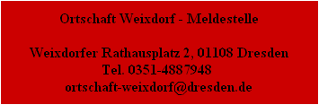
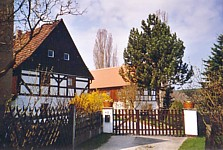
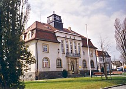
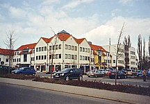
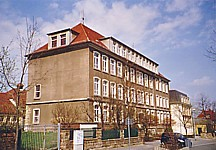

* * *

**Gemeindewappen von Weixdorf**

* * *

**Weixdorfer Ortsteile:**

 *** * ***

* * *

 **Stadtteilseite Weixdorf:**

* * *

**Bildungseinrichtungen**

**in Weixdorf:**

* * *

**Vereine in Weixdorf:**

Die Ortschaft Weixdorf, seit 1. Januar 1999 Stadtteil von Dresden, besteht aus den ehemals selbstständigen Orten Weixdorf, Lausa, Friedersdorf, Gomlitz und Marsdorf. Bereits am 1. Januar 1879 schlossen sich Lausa und Friedersdorf zusammen, am 1. Juli 1914 kamen Weixdorf und Gomlitz hinzu. Noch bis 1938 trug die Gemeinde den Doppelnamen Lausa-Weixdorf, bevor der aus dem slawischen stammende Ortsname Lausa im Sinne der nationalsozialistischen Ideologie offiziell gestrichen wurde. Erst im Zusammenhang mit der jüngsten Gemeindereform in Sachsen kam der Ort, der ehemals zum Landkreis Dresden gehörte, 1999 zur Landeshauptstadt. Weixdorf genießt als Ortschaft, ebenso wie die anderen 1997/99 eingemeindeten Orte um Dresden, einen Sonderstatus mit eigenem Ortschaftsrat, der über ortschaftsinterne Angelegenheiten selbst entscheiden kann. Sitz des Ortschaftsrates ist das Weixdorfer Rathaus.

Aus der Geschichte von Weixdorf

Weixdorf wurde 1378 als Wignandisstorf erstmals urkundlich erwähnt. Das von deutschen Siedlern gegründete Platzdorf erhielt seinen Namen nach einem Lokator Wignand (“Wignands Dorf”). Zunächst gehörte der Ort einem Jacobus von Naundorf, ab 1456 der Familie von Ziegelheim, um 1600 der Familie von Zschieren. Auch das Dresdner Brückenamt besaß zeitweise Zinsrechte. Ab 1696 unterstand das Dorf am Nordrand der Dresdner Heide bis ins 19. Jahrhundert dem Rittergut Hermsdorf. Kirchlich gehörte Weixdorf zum benachbarten Lausa. Schwere Schäden richteten 1637 die durchziehenden Schweden an, welche den Ort plünderten.

Bis ins 19. Jahrhundert blieb der Ort unbedeutend. Erst nach dem Bau der [Eisenbahnstrecke](../../nord/klotzsche/dresden_-_gorlitz/schmalspurbahn/) 1884 siedelten sich auch einige kleinere Gewerbebetriebe an. Gleichzeitig wuchs die Einwohnerzahl, was zum Aufblühen des Vereinslebens im Ort führte. So wurde 1885 der bis heute bestehende Männerchor Lausa-Weixdorf gegründet. 1891 entstand ein Turnverein. Diese nutzten für ihre Stiftungsfeste und Vereinstreffen den 1870 errichteten [Gasthof](../../nord/klotzsche/strassen_klotzsche/konigsbrucker_landstrasse/), der nach 1945 bis zur Wende als Kulturhaus “Heiterer Blick” weitergeführt wurde. 1906 richtete die Gemeinde am Lausaer Großteich das [Waldbad Weixdorf](../../nord/weixdorf/lausa/waldbad_weixdorf/) ein.

Die im Laufe der Zeit zusammengewachsenen Orte Weixdorf und Gomlitz vereinigten sich 1914 mit Lausa und Friedersdorf zur Gemeinde Lausa - Weixdorf. Bereits zuvor war mit dem Bau einiger neuer Villenviertel am Fuchsberg und am Eierbusch begonnen worden, denen 1919 die nach einem früheren Dorfmüller benannte Hollersiedlung folgte. 1928 erhielt der Ort ein neues Rathaus mit Sparkasse, welches heute Sitz des Ortschaftsrates ist _(Foto)_. Ein Jahr später wurde die Straßenbahnlinie von Klotzsche bis Weixdorf verlängert. Zu den in den 1930er Jahren errichteten öffentlichen Gebäuden gehören die nach 1945 als “Haus der Gemeinschaft” und Kindergarten genutzte frühere Gaststätte “Bürgergarten” und das 1938 eröffnete, nach 1990 geschlossene und inzwischen abgerissene Kino.

Auch der Bau des [Klotzscher Flughafens](../../nord/klotzsche/flughafen/) hatte Folgen für Weixdorf. So mussten Teile der Dorfflur für die erforderlichen Rollbahnen abgetreten werden. Außerdem verschwand der frühere Seifzerteich, an den heute nur noch ein Damm in der Nähe der Fuchsbergsiedlung erinnert. Dieser war im 16. Jahrhundert als “Weicksdorffer Teich” zur Fischzucht angelegt, um 1840 jedoch bereits wieder trocken gelegt worden. Zuletzt wurde das Areal landwirtschaftlich genutzt. Teile des historischen Wegenetzes um Weixdorf, darunter der Rähnitzer und der Marsdorfer Weg, verschwanden zugunsten der Rollbahn und Nebenflächen. In der Nähe des ehemaligen Seifzerteichdamms erinnert ein Gedenkstein an den Kältetod des Weixdorfers G. Zschiesche im Jahr 1770.

1938 erhielt der Ort offiziell den Namen Weixdorf. Traditionell eng waren die Bindungen von Weixdorf nach Dresden, da die Gemeinde beliebter Wohnvorort war. Die im Zuge der Bodenreform enteignete Rittergutsflur wurde 1946 an Kleinbauern verteilt, die sich 1954 zu einer LPG zusammenschlossen. Wichtige gewerbliche Unternehmen waren ein 1920 gegründetes Werk zur Herstellung optischer Geräte, ein Baustoffwerk und die frühere Möbelfabrik Willi Groß KG, die ab 1972 als Betriebsteil zu den Deutschen Werkstätten Hellerau gehörte. 1965 wurde das benachbarte Marsdorf nach Weixdorf eingemeindet.

Nachdem nach 1990 weitere Gewerbegebiete und das Einkaufszentrum Hohenbusch _(Foto)_ sowie einige neue Wohnsiedlungen entstanden waren, nahmen Weixdorf und Dresden Verhandlungen zur Eingemeindung auf, die am 1. Januar 1999 erfolgte. Zuvor hatte es 1996 bereits Gespräche mit dem benachbarten Langebrück über einen Zusammenschluss gegeben. Im Dorfkern (Altweixdorf) sind noch einige historische Bauerngüter erhalten geblieben.

Rathaus Weixdorf:

Bis zur Vereinigung der Gemeinden Weixdorf, Lausa, Friedersdorf und Gomlitz war die Gemeindeverwaltung in den Wohnhäusern des jeweiligen Gemeindevorstandes untergebracht. Lediglich Lausa besaß eine eigene Verwaltungsstelle in der früheren Kirchschule. Ab 2. Januar 1915 übernahm dann ein hauptberuflicher Bürgermeister die Amtsgeschäfte. Allerdings genügten die zur Verfügung stehenden Räume schon damals nicht den gewachsenen Anforderungen, so dass man nach Alternativen suchte. Dise fanden sich zunächst auf dem zentral gelegenen Grundstück Königsbrücker Straße 77, wo nach einem Umbau im September 1917 neue Räume bezogen werden konnten.

Allerdings erwiesen sich auch diese bald als zu klein. So entschied sich der Gemeinderat 1923, den Bau eines Rathauses auszuschreiben. Vier Jahre später, am 25. April 1927 nahm der Rat den Entwurf des Architekten Willi Meltzer an und übertrag die Bauausführung der Lausaer Firma Karl Wustmann. Die Grundsteinlegung erfolgte am 21. Juli 1927. Bereits am 27. August des gleichen Jahres konnte das Richtfest gefeiert werden. Die feierliche Einweihung des Neubaus fand am 4. April 1928 statt. Im Inneren erhielt der Neubau neben Dienst- und Beratungsräumen einen im Art-deco-Stil gestalteten Sitzungssaal, Räume für die Gemeindekasse, die örtliche Sparkasse und eine Polizeiwache. Im Dachgeschoss wurden zwei Wohnungen für Beamte geschaffen. Bis zur Eingemeindung wurde dieses Rathaus für seinen Zweck genutzt. Heute hat hier die Ortschaftsverwaltung ihren Sitz.

Schule:

Ursprünglich befand sich die auch für Weixdorf zuständige Schule in Lausa in unmittelbarer Nähe der Kirche. Das noch heute vorhandene Gebäude an der Kirchgasse entstand 1845 und wurde später als Wohnhaus des Kantors genutzt. Seit 2011 befindet sich hier ein evangelischer Kindergarten.

Um 1900 errichteten die Gemeinden Weixdorf, Lausa, Gomlitz und Friedersdorf ein neues Schulhaus an der heutigen Alten Dresdner Straße _(Foto rechts)_. Architekt des Gebäudes, welches am 10. März 1901 eingeweiht wurde, war der Langebrücker Baumeister Max Otto. Das Gebäude brannte 1945 beim Einmarsch der Roten Armee aus, konnte jedoch schon bald wieder genutzt werden. Heute befindet sich hier die Weixdorfer Oberschule. Eine grundlegende Sanierung und Erweiterung erfolgte 2011/12.

1965 wurde aus Platzgründen neben dem Rathaus ein weiterer provisorischer Schulbau errichtet. Dieser diente bis zur Schulreform 1991 den Kindern der Klassen 1-3 als Unterrichtsgebäude und gehört seit 1992 zur Grundschule des Ortes. Das den Anforderungen nicht mehr genügende Gebäude wurde 2004 durch einen modernen Neubau ersetzt, der im Februar 2005 als Grundschule “Am Zollhaus” eingeweiht werden konnte.

[_Weiterführende Literatur und Quellen_](../../impressum/quellenverzeichnis/)

 \[ [Home](../../index.html)\] \[ [Nord](../../nord/)\] \[ [Nordwest](../../nordwest/)\] \[ [Neustadt](../../neustadt/)\] \[ [Nordost](../../nordost/)\] \[ [West](../../west/)\] \[ [Zentrum](../../zentrum/)\] \[ [Südwest](../../sudwest/)\] \[ [Süd](../../sud/)\]
 \[ [Südost](../../sudost/)\] \[ [Ost](../../ost/)\] \[ [Register](../../Register/register.html)\] \[ [Kontakt](../../Kontakt/kontakt.html)\] \[ [Impressum](../../impressum/)\]
