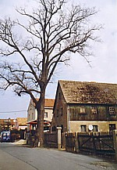

* * *

* * *

Friedersdorf entstand als Waldhufendorf in einer Niederung mit mehreren Teichen und wurde 1378 erstmals urkundlich erwähnt. Der Ortsname (früher Fridrichstorf) weist auf den Namen des deutschen Ortsgründers
hin. Im Jahr 1556 erwarb der Hermsdorfer Rittergutsbesitzer Christoph von Carlowitz ein Friedersdorfer Gut, nachdem dessen Besitzer Andrees dieses wegen Überschuldung verkaufen musste. Ab 1696 unterstand der gesamte Ort
der Grundherrschaft dieses Rittergutes.

**_Foto:_** _Blick über den Mittelteich nach Friedersdorf um 1910_

Zu Friedersdorf gehörten einst auch zwei Wassermühlen, welche ihren Standort an der
heutigen Straße An den Teichen hatten. Die alte Dorfmühle, nach ihrem letzten Besitzer auch Hollermühle genannt, wurde 1917 von der Gemeinde erworben. Wenige Jahre später entstand
auf dem Grundstück die sogenannte “Hollersiedlung” mit mehreren Einfamilienhäusern. Unweit davon lag die Felchnermühle, deren noch erhaltenes Wohngebäude 1840 entstand. An dem
2000 Jahr sanierten Gebäude erinnert ein Türsturz mit der Inschrift “F. G. Felchner” an den früheren Mühlenbesitzer.

Das südlich des Lausaer Dorfkerns gelegene Gassendorf vereinigte sich bereits 1879 mit
seiner Nachbargemeinde und schloss sich 1914 dem Doppelort Lausa-Weixdorf an. Gemeinsam mit den anderen Weixdorfer Ortsteilen kam auch Friedersdorf am 1. Januar 1999
zu Dresden. Im Ortskern Altfriedersdorf, der sich parallel zu den zur Fischzucht genutzten Lausaer Teichen erstreckt, sind noch einige historische Gehöfte erhalten geblieben _(Foto)_.

[_Weiterführende Literatur und Quellen_](../../../impressum/quellenverzeichnis/)

 \[ [Home](../../../index.html)\] \[ [Nord](../../../nord/)\] \[ [Nordwest](../../../nordwest/)\] \[ [Neustadt](../../../neustadt/)\] \[ [Nordost](../../../nordost/)\] \[ [West](../../../west/)\] \[ [Zentrum](../../../zentrum/)\] \[ [Südwest](../../../sudwest/)\] \[ [Süd](../../../sud/)\] \[ [Südost](../../../sudost/)\] \[ [Ost](../../../ost/)\] \[ [Register](../../../Register/register.html)\] \[ [Kontakt](../../../Kontakt/kontakt.html)\] \[ [Impressum](../../../impressum/)\]
