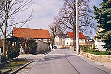

* * *

* * *

Gomlitz wurde 1378 erstmals als Komenicz urkundlich erwähnt. Der aus dem
slawischen stammende Ortsname ist entweder von “komon” (= Pferd) oder aber von “gomola” (= Hügel) abgeleitet. Der Ort entstand als Gassendorf am Rande des Schelsbachtales und war eng mit dem benachbarten Weixdorf und
mit Lausa verbunden. Älteste Besiedlungsspuren reichen bis zur Bronzezeit zurück. Reste eines Gräberfeldes wurden auf dem Grundstück Alte Moritzburger Straße 55 entdeckt.

1450 ist in Gomlitz ein Vorwerk erwähnt, dem bis 1547 ein weiteres folgte. 1600 befand sich das Dorf wie auch seine Nachbarorte Weixdorf, Lausa und Hermsdorf im Besitz der Familie von
Zschieren. Ab 1696 unterstand Gomlitz dem Rittergut Hermsdorf und gehörte zur Lausaer Kirche. Die Bewohner des Ortes lebten vorrangig von der Landwirtschaft und der Viehzucht. An letztere erinnert bis heute ein um 1830
aufgestellter Feldstein mit der Inschrift “Geteilt Anno 1830 Gomlitz”. Der sogenannte “Hutungsstein” weist auf den
früher in vielen Dörfern üblichen Brauch der Gemeindehutung hin, bei der das Vieh aller Dorfbewohner durch einen Gemeindehirten betreut wurde.

Nachdem Gomlitz um 1900 mit dem benachbarten Weixdorf zusammengewachsen war, vereinigten sich beide Orte 1914 mit Lausa und Friedersdorf zu einer Gemeinde. 1999 kam Gomlitz mit den übrigen Weixdorfer Ortsteilen zu
Dresden. Einige interessante Gebäude haben sich im alten Ortskern erhalten. Zu den ältesten gehört das um 1763 entstandene Fachwerkhaus Alte Moritzburger Straße 7.

**Foto:** _Altgomlitz im Frühjahr 2006_

[_Weiterführende Literatur und Quellen_](../../../impressum/quellenverzeichnis/)

 \[ [Home](../../../index.html)\] \[ [Nord](../../../nord/)\] \[ [Nordwest](../../../nordwest/)\] \[ [Neustadt](../../../neustadt/)\] \[ [Nordost](../../../nordost/)\] \[ [West](../../../west/)\] \[ [Zentrum](../../../zentrum/)\] \[ [Südwest](../../../sudwest/)\] \[ [Süd](../../../sud/)\] \[ [Südost](../../../sudost/)\] \[ [Ost](../../../ost/)\] \[ [Register](../../../Register/register.html)\] \[ [Kontakt](../../../Kontakt/kontakt.html)\] \[ [Impressum](../../../impressum/)\]
