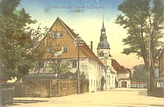
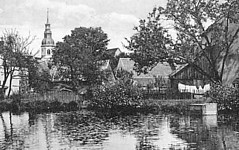
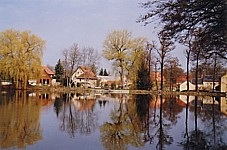
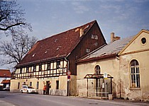

Lausa ist ältester Ortsteil von Weixdorf und wurde bereits 1273 erstmals urkundlich erwähnt. Der von slawischen Siedlern gegründete Ort erhielt seinen Namen (1378: Lusyn) nach den hier gelegenen sumpfigen Flächen, da das altsorbische Luza mit Sumpf, Pfütze übersetzt werden kann. Ursprünglich war Lausa von mehreren Teichen umgeben und wahrscheinlich Standort einer Wasserburg, von der jedoch keine Spuren erhalten blieben. Heute erinnert nur noch der Pfarrteich an diese Zeit. Weitere Teiche südlich des Dorfkerns werden vom Lausabach gespeist und bis heute zur Fischzucht genutzt. Größter ist der ehemals 50 Hektar große Großteich, welcher 1846 zur Hälfte abgelassen wurde und seit 1906 als [Weixdorfer Waldbad](../../../nord/weixdorf/lausa/waldbad_weixdorf/) genutzt wird.

Früh besaß Lausa eine eigene [Kirche](../../../nord/weixdorf/lausa/lausaer_kirche/) mit Friedhof. Der heutige Bau stammt von 1650 und war Wirkungsort des volkstümlichen Pfarrers Roller, der mit der Familie Kügelgen befreundet war. 1349 gehörte der Ort den Brüdern Peter und Fritz von Rakenitz, um 1600 der Familie von Zschieren. Ab 1696 unterstanden Lausa und seine Nachbargemeinden der Grundherrschaft des Rittergutes Hermsdorf. Schwer betroffen wurde das Dorf im Dreißigjährigen Krieg, als 1637 schwedische Truppen die Pfarre und zahlreiche weitere Gebäude niederbrannten.

Von Bedeutung war einst die forstwirtschaftliche und jagdliche Nutzung der nahen Dresdner Heide, für die im 18. Jahrhundert der [Lausaer Saugarten](../../../nordost/dresdner_heide/) angelegt wurde. Bereits 1560 ist “die Lawwse” im Zusammenhang mit der Neuvergabe von Jagdrechten urkundlich genannt. Lausaer Bauern mussten zudem Frondienste beim Holzeinschlag und
 -transport leisten und durften im Gegenzug in den angrenzenden Wäldern Leseholz sammeln, um dieses als Brennmaterial in Dresden zu verkaufen. Zeitweise befand sich auch ein Forsthaus im Ort.

Lausa behielt bis ins 19. Jahrhundert seine Zentrumsfunktion für die umliegenden Dörfer. 1858 erhielt der Ort eine eigene Poststelle, die auch für die Nachbargemeinden zuständig war. Im Jahr 1879 vereinigten sich Lausa und Friedersdorf zu einer Gemeinde. Der Ort erhielt 1884 [Eisenbahnanschluss](../../../nord/klotzsche/dresden_-_gorlitz/schmalspurbahn/) nach Dresden und entwickelte sich in der Folgezeit zum Wohnvorort. 1914 schlossen sich Lausa und Weixdorf zu einer Doppelgemeinde zusammen, die noch bis 1938 den Namen Lausa-Weixdorf trug. Am 1. Januar 1999 kam diese als Ortsteil zu Dresden.

**_Foto:_** _Blick über den Lausaer Mühlteich zum Dorfkern_

Erbgericht:

Das “Alte Erb-, Brau- und Schänkgut” Lausa gehörte seit dem 16. Jahrhundert zu den größten Lausaer Anwesen und war Sitz des Erbrichters des Ortes, der für die Ahndung kleinerer Vergehen zuständig war. Zugleich besaß dieser das Braurecht, das Tanz- und Herbergsrecht sowie die Berechtigung zum Brot-, Salz- und Fleischverkauf. Später wurde das Gebäude in erster Linie als Dorfgasthof genutzt. Im Inneren ist noch eine Gerichtssäule erhalten geblieben, die als “Mittelpunkt” der streng geregelten Sitzordnung bei Gemeindeversammlungen diente. 1951 wurde das frühere Erbgericht zum Kulturhaus umgebaut.

[_Weiterführende Literatur und Quellen_](../../../impressum/quellenverzeichnis/)
