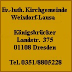
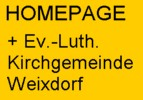
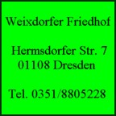
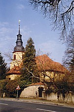
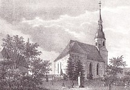
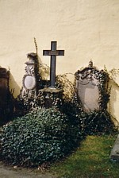
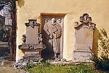
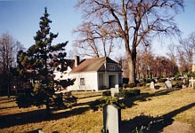

* * *

* * *

_Porträt Pastor Rollers_

_Grab Pastor Rollers auf dem Lausaer Kirchhof_

_Pastorengräber an der Kirchenmauer_

_(SLUB/Fotothek)_

Lausaer Kirche:

Die Kirche von Lausa entstand vermutlich bereits im 12. Jahrhundert. 1346 ist erstmals eine Bestattung auf dem Lausaer Kirchhof nachgewiesen. Der Ursprungsbau fiel 1429 einem Angriff der Hussiten zum Opfer, entstand jedoch bald darauf neu. 1539 wurde auch Lausa reformiert und die Kirche ein protestantisches Gotteshaus.

Mit Unterstützung der Hermsdorfer Rittergutsherrschaft wurde die Kirche ab 1607 völlig umgebaut und erhielt 1624 einen neuen Turm. Die Kanzel stiftete der kurfürstliche Amtsverwalter Knauth. 1637 besetzten schwedische Soldaten den Ort und brannten zahlreiche Gebäude, darunter auch das Pfarrhaus, nieder. Die Kirche selbst blieb jedoch unbeschädigt.

Der jetzige Kirchenbau geht auf den letzten größeren Umbau des Jahres 1650 zurück. Zehn Jahre später entstand der noch heute vorhandene Anbau mit der Sakristei und einer darüber liegenden Betstube. 1729 und 1786 sind Renovierungen der Lausaer Kirche in den Annalen verzeichnet. Im 18. Jahrhundert war sie Wirkungsort des bekannten Pfarrers David Samuel Roller. Roller war als volkstümlicher Kirchenmann bekannt und eng mit der Malerfamilie Kügelgen befreundet. Wilhelm von Kügelgen, der 1816 in Lausa konfirmiert wurde, setzte ihm in seinen “Jugenderinnerungen eines alten Mannes” ein literarisches Denkmal. Roller verstarb 1850 und liegt auf dem Kirchhof begraben. Nach ihm wird die Kirche heute oft auch Pastor-Roller-Kirche genannt.

Wenige Jahre nach Rollers Tod erfolgten erneut Veränderungen im Innenraum. So wurde 1855 eine Orgel eingebaut. 1871 erhielt die Kirche drei Bronzeglocken, die 1917 eingeschmolzen und nach dem Ersten Weltkrieg durch Stahlglocken ersetzt wurden. Eine umfassende Erneuerung des Innenraumes nahm 1912 der Lausaer Architekt Reuter vor. Dabei wurden auch die Bilder an der Empore geschaffen, die Szenen aus der biblischen Geschichte zeigen und von J. P. Herrmann und D. Ricken stammen. Gleichzeitig ersetzte die Gemeinde die bisherige Orgel durch eine neue der Firma Jahn. Sehenswert sind auch die aus dem 18. Jahrhundert stammende Saaldecke des Innenraumes sowie die einstige Patronatsloge der Hermsdorfer Rittergutsbesitzer, die heute eine kleine Ausstellung zur Kirchengeschichte beherbergt. Die 1986/87 restaurierte Lausaer Kirche ist als Pfarrkirche auch für die Orte Hermsdorf und Grünberg und die heutigen Weixdorfer Ortsteile zuständig _(Foto um 1930: Walter Möbius - SLUB / Fotothek)._

In der nordöstlichen Ecke des Pfarrgartens steht die inzwischen ca. 20 Meter hohe sogenannte “Dohna-Eiche”. Sie wurde 1815 anlässlich ihres 10. Todestages zu Ehren der Burggräfin Marianna Amalia zu Dohna (1779-1805) gepflanzt und steht heute unter Naturschutz. Ein weiterer Gedenkbaum ist die in der Nähe befindliche Lutherlinde. Der ursprüngliche Baum wurde Anfang November 1883 zu Ehren Martin Luthers auf dem Kirchhof gepflanzt und am 23. Januar 1958 zum Naturdenkmal erklärt. Unsachgemäße Pflegearbeiten führten in den 1960er Jahren jedoch zu schweren Schäden und dem Absterben der Linde. Als Ersatz wurde ein einige Jahre jüngerer Baum als Lutherlinde gewidmet. An seinem Stamm ist ein vom Weixdorfer Maler und Bildhauer Franz Rädlein geschaffenes Flachbild des Reformators angebracht.

Friedhof:

Der alte Friedhof befand sich unmittelbar an der Kirche und war von 1346 bis ins 19. Jahrhundert Gottesacker für die umliegenden Gemeinden. Nachdem die Bevölkerungszahl gestiegen war und der Friedhof damit zu klein wurde, entstand 1833 ein neuer Friedhof an der Hermsdorfer Straße.

Auf dem Kirchhof sind einige historische Grabdenkmale interessant. Neben dem erhaltenen Grab des Pfarrers David Samuel Roller (1774-1850) _(Foto um 1910)_ liegt hier auch einer seiner Amtsvorgänger, Theodorus Schumann (+ 1632) begraben. Das Grabmal zeigt ihn in Lebensgröße mit Halskrause und langem Talar. Zu den älteren Grabstellen gehören auch die der Pfarrer Christian Friedrich Karg (1718-1787) und Jonathan Glasewaldt (1707-1768), beide mit typischer Symbolik ihrer Zeit.

**_Fotos:_** _historische Gräber auf dem alten Kirchhof - links das Grab Pastor Rollers_

Am Langhaus der Kirche erinnern zwei weitere Grabplatten an Georg Prinz von Schönburg-Waldenburg (1828- 1900) und seine Gemahlin Luise. Georg war Generaladjudant des sächsischen Königs Albert und Besitzer des Rittergutes Hermsdorf. Auch Angehörige anderer Adelsfamilien fanden auf dem Kirchhof ihre letzte Ruhe, so die Fürstin Maria Reuss zu Lobenstein (+ 1810) und die Burggräfin Marianna Amalia Burggräfin und Gräfin zu Dohna (1779-1805), welche mit nur 26 Jahren bei der Geburt eines Kindes verstarb. Schöpfer des fünf Meter hohen Grabdenkmals war ein italienischer Steinmetz, der beim Bau der Dresdner Hofkirche beteiligt war. Ebenfalls bemerkenswert ist ein frühklassizistischer Grabtempel, der 1789 für Charlotte Dorothea von Schönberg, geb. Gräfin von Hoym errichtet wurde. Zwei weitere Gedenkstätten erinnern an die im Ersten und Zweiten Weltkrieg gefallenen Ortsbewohner. Letztere entstand erst nach 1990 mit Hilfe der Deutschen Kriegsgräberfürsorge.

_Foto: Neuer Weixdorfer Friedhof mit Feierhalle_

* * *

 \[ [Home](../../../../index.html)\] \[ [Nord](../../../../nord/)\] \[ [Nordwest](../../../../nordwest/)\] \[ [Neustadt](../../../../neustadt/)\] \[ [Nordost](../../../../nordost/)\] \[ [West](../../../../west/)\] \[ [Zentrum](../../../../zentrum/)\] \[ [Südwest](../../../../sudwest/)\] \[ [Süd](../../../../sud/)\] \[ [Südost](../../../../sudost/)\] \[ [Ost](../../../../ost/)\] \[ [Register](../../../../Register/register.html)\] \[ [Kontakt](../../../../Kontakt/kontakt.html)\] \[ [Impressum](../../../../impressum/)\]
