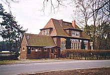
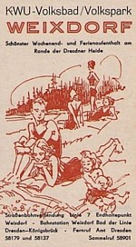
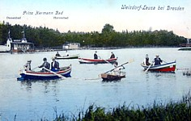

* * *

* * *

* * *

**Werbung um 1950**

Das Waldbad Weixdorf entstand unter dem Namen Prinz-Hermann-Bad 1906 am Lausaer Großteich und wurde am 17. Juni des Jahres feierlich eingeweiht. Dieser Teich war bereits 1560 künstlich angestaut worden und diente dem Hochwasserschutz der am Seifzerbach liegenden Dörfer. Initiator für den Bau des Freibades war der Rittergutsbesitzer von Hermsdorf, Prinz Hermann von Schönburg-Waldenburg, der das Gelände zu günstigen Konditionen an die Gemeinde verpachtet hatte. Neben den für den Badebetrieb erforderlichen Anlagen gab es auch eine Bootsverleihstation sowie eine Sommerhaussiedlung.

1919 erfolgten erste Erweiterungen des Areals und der Bau neuer Umkleidekabinen. Um Kosten zu sparen, erwarb die Gemeinde Lausa das ehemalige Elbebad Heinrich Mätschkes sowie eine zuvor militärisch genutzte Baracke, ließ die hölzernen Gebäude abtragen und im Bad wieder zusammenbauen. Der Turnverein Lausa übernahm die Anlage eines am 10. Juli 1921 eingeweihten Sportplatzes. 1926 folgte die heute unter dem Namen Gaststätte “Waldbad” betriebene Teichwirtschaft _(Foto)_. Für Probleme sorgte das sumpfige Gelände in der Umgebung des Teiches, welches erst 1928 trockengelegt wurde. Zu den Badegästen gehörten u.a. Erich Kästner und der Komponist Hans Hendrik Wehding, der hier 1941 sein wohl bekanntestes Werk “Der Goldene Pavillon” erstmals der Öffentlichkeit vorstellte.

Nach 1945 wurde das Prinz-Hermann-Bad zunächst in Volksbad, später in Waldbad Weixdorf umbenannt. Umweltverschmutzungen durch Industrie- und Haushaltabwässer sowie durch die Rote Armee machten 1957 den Anschluss an das Schleusensystem der Stadt Dresden erfoderlich. Trotzdem kam es wiederholt zu Schließungen durch die Bezirkshygieneinspektion. Ab 1962 erfolgten umfassende Modernisierungsarbeiten. Die bestehende Gaststätte wurde auf Selbstbedienung umgestellt. Im Obergeschoss richtete man 1970 einen Kindergarten ein. 1965 konnte der alte hölzerne Sprungturm durch einen Neubau ersetzt werden. Später kamen noch modernere Toilettenanlagen und ein Kinderplanschbecken hinzu. Das Freibad am Rand der Dresdner Heide ist bis heute beliebtes Erholungsziel der Bewohner der Umgebung. Gespeist wird das Naturbad vom Seifzerbach und zwei weiteren Kleingewässern. Seit 1993 kümmert sich der Verein Erholungszentrum Waldbad Weixdorf e. V. um das Bad. Teile der Anlage, u.a. die alten Umkleidekabinen, stehen unter Denkmalschutz.

**_Foto:_** _Das Weixdorfer Waldbad auf einer historischen Postkarte_

__

* * *

 \[ [Nord](../../../../nord/)\] \[ [Nordwest](../../../../nordwest/)\] \[ [Neustadt](../../../../neustadt/)\] \[ [Nordost](../../../../nordost/)\] \[ [West](../../../../west/)\] \[ [Zentrum](../../../../zentrum/)\] \[ [Südwest](../../../../sudwest/)\]
 \[ [Süd](../../../../sud/)\] \[ [Südost](../../../../sudost/)\] \[ [Ost](../../../../ost/)\] \[ [Register](../../../../Register/register.html)\] \[ [Kontakt](../../../../Kontakt/kontakt.html)\] \[ [Impressum](../../../../impressum/)\]
