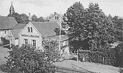
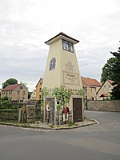
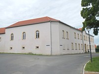
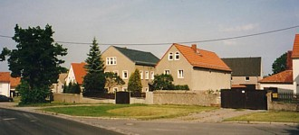
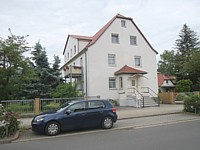
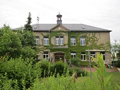

* * *

**Gemeindesiegel von Wilschdorf**

* * *

Wilschdorf entstand vermutlich um 1150 und wurde 1242 erstmals als Ranis maius (Groß-Rähnitz) erwähnt. 1279 ist in einer alten Urkunde erstmals von Wilczdorf die Rede. Der Name bedeutet Ort am Wolfsbach und vereint slawische und deutsche Elemente. Möglicherweise ist er auch vom Lokator des Dorfes abgeleitet (“Wielandsdorf”), da Wilschdorf als slawische Siedlung entstanden ist, später jedoch von deutschen Bauern erweitert und ausgebaut
wurde. Insgesamt sind heute 14 verschiedene Schreibweisen überliefert, die eine genauere Deutung erschweren. Unklar ist auch, ob eine in der Nähe der “Entenpfütze” genannte Wüstung (“Das alte Dorf”) als frühe Dorfanlage von Wilschdorf betrachtet werden kann.

Im Mittelalter befand sich Wilschdorf im Besitz des St. Afra-Stiftes Meißen. Ab 1547 gehörte es dem Rittergutsbesitzer Christoph von Carlowitz. Durch diesen Besitzerwechsel unterstand der Ort bis ins 19. Jahrhundert dem Rittergut Hermsdorf und dessen wechselnden Eigentümern. Wilschdorfer Bauern mussten dort bis zur Ablösung der Fronen 1832 verschiedene Dienstpflichten erfüllen und waren auch am Wiederaufbau des 1729 abgebrannten Hermsdorfer Schlosses beteiligt. Wichtigster Wirtschaftszweig blieb bis zur Gegenwart die Landwirtschaft. Die Bauern bewirtschafteten um 1900 ca. 480 Hektar Land, wozu auch die Fluren des untergegangenen Ortes Cunnersdorf südlich des Oberen Waldteiches gehörten. Außerdem wurde an den Hängen der Hellerberge zeitweise Weinbau betrieben. Betroffen von Plünderungen und Einquartierungen war Wilschdorf im Dreißigjährigen Krieg (1637) und im Siebenjährigen Krieg (1756-1759). 1850 fielen Teile des Oberdorfes einem Brand zum Opfer, welches jedoch schnell wieder aufgebaut wurde.

Im Dorfkern sind bis heute einige historische Bauerngüter erhalten geblieben. Bemerkenswert ist u. a das Gehöft Lößnitzweg 2. An der Kirchstraße steht die bereits 1243 erstmals erwähnte [Christophoruskirche](../../nord/wilschdorf/christophoruskirche/), älteste Kirche im Dresdner Stadtgebiet. An der Mauer des Pfarrhaus-Grundstücks befindet sich ein historisches Portal von 1612. Zu den alten Wilschdorfer Schankstätten gehören die Gaststätte “Der alte Graf”, welche bereits zwischen 1883 und 1949 bestand und der 1242 erstmals genannte Dorfgasthof am Anger _(Foto)_. Bekannt ist auch die in der Jungen Heide gelegene Gaststätte [“Waldmax”](../../nordost/dresdner_heide/waldmax/). Nach 1885 entstanden abseits vom Ortskern die Siedlung Waldhof sowie neue Wohnhäuser an der Radeburger und der Keulenbergstraße. Erweiterungen dieser Siedlungen erfolgten nach dem Ersten und dem Zweiten Weltkrieg. Am 1. Juli 1950 kam Wilschdorf als Ortsteil zu Dresden. Zu den bedeutendsten Dresdner Neuansiedlungen von Industrie gehört das 1999 eröffnete Chipwerk des US-Herstellers [AMD](../../nord/wilschdorf/amd/) im Gewerbegebiet an der Wilschdorfer Landstraße.

**_Foto:_** _Bauerngehöfte in Altwilschdorf_

Gemeindeamt:

Bis zur Eingemeindung 1950 besaß der Ort eine eigene Gemeindeverwaltung, die in mehrfach wechselnden Gebäuden untergebracht war. Zunächst befand sie sich im Wohnhaus Hauptstraße 5 (Altwilschdorf), wechselte 1922 jedoch ins nahegelegene Gut Nr. 1. 1925 konnte an der damaligen Dresdner Straße (heute Keulenbergstraße 41 - _Foto_) ein Neubau bezogen werden, der bis zum Anschluss an Dresden als Verwaltungsstelle erhalten blieb. Heute werden die Räume gewerblich genutzt.

Schulen in Wilschdorf:

Die erste Wilschdorfer Schule entstand um 1809 an der heutigen Kirchstraße 8. Zuvor fand der Unterricht in dem 1612 erbauten Wohnhaus des Küsters statt. 1899 wurde am Reineckeweg 6 ein Neubau errichtet, welcher 1929 erweitert und später als 86. Oberschule genutzt wurde. Jetzt befindet sich hier die Kindertagesstätte “Fuchsbau”, die zeitweise nach dem Begründer der Kindererholungsstätte am Oberen Waldteich, Max Hünig, benannt war _(Foto)._ Heute besuchen die Kinder des Ortes die 85. Grundschule an der Radeburger Straße 168, die 1983 als gemeinsames Schulhaus für Wilschdorf und Rähnitz eingeweiht wurde.

[_Weiterführende Literatur und Quellen_](../../impressum/quellenverzeichnis/)

 \[ [Home](../../index.html)\] \[ [Nord](../../nord/)\] \[ [Nordwest](../../nordwest/)\] \[ [Neustadt](../../neustadt/)\] \[ [Nordost](../../nordost/)\] \[ [West](../../west/)\] \[ [Zentrum](../../zentrum/)\] \[ [Südwest](../../sudwest/)\] \[ [Süd](../../sud/)\]
 \[ [Südost](../../sudost/)\] \[ [Ost](../../ost/)\] \[ [Register](../../Register/register.html)\] \[ [Kontakt](../../Kontakt/kontakt.html)\] \[ [Impressum](../../impressum/)\]
