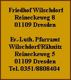
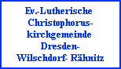
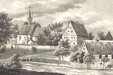
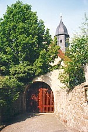

* * *

* * *

Die Christophoruskirche entstand als Dorfkirche des Ortes Wilschdorf
bereits im 11. Jahrhundert und gehört zu den ältesten Kirchen im Stadtgebiet. 1243 wurde sie erstmals urkundlich erwähnt. Aus der Entstehungszeit sind ein mittelalterliches Weihekreuz und eine um 1250
gegossene Glocke erhalten geblieben, älteste in Dresden. Die beiden anderen Glocken stammen aus dem 14. und 15. Jahrhundert und überstanden wegen ihres hohen Alters beide Weltkriege unbeschadet. Den
Altar mit einer Darstellung des heiligen Abendmahls schuf um 1570 Hans Schroer aus Lüttich. Weitere Zeugnisse der frühen Kirchengeschichte
wurden 1971 bei Renovierungsarbeiten entdeckt. Dabei konnten mehrere gotische Fresken aus dem 15. Jahrhundert freigelegt werden, die u. a. den Patron der Kirche St. Christophorus sowie Szenen aus der
Passionsgeschichte darstellen. Ein historischer Taufstein fiel 1945 bei der Zerstörung des Altertumsmuseums im Palais im Großen Garten den Bomben zum Opfer.

1539 wurde Wilschdorf mit seiner Kirche reformiert und somit evangelisch. Ein
Pfarrhaus, von dem heute nur noch das Eingangstor erhalten ist, entstand 1612 und wurde 1904 durch einen Neubau ersetzt. Am 22. Juni 1727 wurde die Kirche bei einem
Blitzschlag beschädigt. 1784 und 1850 erfolgten einige Umbauten, die ihr mittelalterliches Aussehen jedoch nicht beeinträchtigten. 1932 beginnt das bis heute
bestehende Schwesternkirchverhältnis zum benachbarten Rähnitz. Erst 1986 erhielt die Wilschdorfer Kirche offiziell den Namen Christophoruskirche. Neun Jahre später
konnte die Weihe einer neuen Orgel der Firma Wegschneider aus Rähnitz gefeiert werden. Das Instrument besitzt 14 Register und 988 Pfeifen und ermöglicht als eine der
wenigen Orgeln Dresdens sowohl ein renaissancetypisches als auch ein barockes Klangbild. 2008 kehrten die drei historischen Glocken der Kirche nach erfolgreicher Reparatur wieder an ihren Platz zurück.

Video: Dresdens ältestes Geläut der Christophoruskirche in Aktion

Friedhof:

Um die Dorfkirche entstand bereits im 12. Jahrhundert der erste Friedhof des Ortes. Leider sind jedoch keine
historischen Gräber erhalten geblieben. Ein barocker Grabstein an der Südwand der Kirche erinnert an den Wilschdorfer Pfarrer Johann Friedrich Gerhard. Außerdem befindet sich hier eine Gedenktafel für die Gefallenen
des Ersten Weltkrieges. Mit der Eröffnung des neuen Friedhofs am Reinickeweg wurde der alte Kirchhof für Beisetzungen geschlossen.

De
r neue Wilschdorfer Friedhof wurde 1892 angelegt und im folgenden Jahr eröffnet. Gleichzeitig entstand eine kleine Leichenhalle. Obwohl bedeutende Grabdenkmale fehlen, ist dieser als “Bauernfriedhof” interessant. Hier
finden sich die Gräber alteingesessener Wilschdorfer Bauernfamilien. Motive wie Ähren auf den Grabsteinen weisen
auf den wichtigsten Erwerbszweig der Einwohner hin. Außerdem liegen hier ein beim Luftangriff auf Dresden 1945 ums Leben gekommener Kreuzschüler und zwei im sowjetischen Kriegsgefangenenlager an der Radeburger Straße
verstorbene deutsche Soldaten.

* * *

 \[ [Home](../../../index.html)\] \[ [Nord](../../../nord/)\] \[ [Nordwest](../../../nordwest/)\] \[ [Neustadt](../../../neustadt/)\] \[ [Nordost](../../../nordost/)\] \[ [West](../../../west/)\] \[ [Zentrum](../../../zentrum/)\] \[ [Südwest](../../../sudwest/)\] \[ [Süd](../../../sud/)\] \[ [Südost](../../../sudost/)\] \[ [Ost](../../../ost/)\] \[ [Register](../../../Register/register.html)\] \[ [Kontakt](../../../Kontakt/kontakt.html)\] \[ [Impressum](../../../impressum/)\]
