* * *

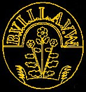

**Gemeindesiegel von Bühlau**

* * *

_Bühlauer Siegelmarke_

* * *

**Bildungseinrichtungen in Bühlau:**

[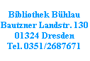](http://www.bibo-dresden.de)

[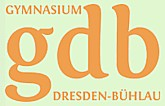](http://www.gymnasium-buehlau.de)

* * *

**Bühlauer Vereine:**

[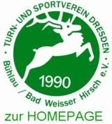](http://www.tsv-dresden-buehlau.de)

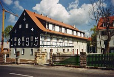Bühlau wurde 1349 im Lehnsbuch Friedrich des Strengen als “Bele” erstmals urkundlich erwähnt und befand sich damals im Besitz des Nikolaus Karas aus Blasewitz. Der Name weist auf eine slawische Gründung hin und bedeutet “hell, weiߔ. Möglicherweise lag an dieser unbewaldeten, “hellen” Stelle im Heidewald einst eine vorchristliche Opferstätte. Eine Besiedlung des Gebietes ist durch Funde zumindest seit der Jungsteinzeit belegt. Der heutige Stadtteil ist aus mehreren Ortsteilen zusammen gewachsen. Neben dem Dorfkern Altbühlau _(Foto rechts)_, welches auch als Oberdorf bezeichnet wurde, gehören noch Quohren, Neubühlau und Adelig-Bühlau dazu.

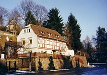An das Straßendorf Altbühlau schließt sich unmittelbar das 1365 erstmals als “Quorne” genannte Bauerndorf Quohren an (slawisch: dwor = Hof). Beide Orte unterstanden dem [Rittergut Helfenberg](../../nordost/schonfeld-weissig/helfenberg/) und gehörten im 16. Jahrhundert der Familie Dehn-Rothfelser bzw. dem Dresdner Rat. Während in diesen beiden Dörfern größere Bauerngüter dominierten, entwickelte sich die Häuslersiedlung Neubühlau entlang der [Bautzner Landstraße](../../nordost/page10246/strassen_weisser_hirsch/bautzner_landstrasse/). Vierter Teil des Ortes ist die Ansiedlung Adelig-Bühlau im oberen Teil der Grundstraße _(Foto links)_. Im 16. Jahrhundert kam noch die auf Neubühlauer Flur an der Ullersdorfer Straße entstandene Waldarbeitersiedlung Dürr-Bühlau hinzu.

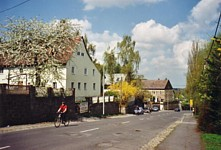

_**Foto:** Blick nach dem Bühlauer Ortskern um 1900_

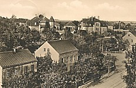Die Dörfer lebten neben der Landwirtschaft vor allem von der Nutzung der Dresdner Heide. 1596 verlegte der für das Gebiet zuständige Revierförster seinen Amtssitz von Weißig nach Bühlau, weil “darinnen viel Holzdiebe wohnten”, wie alte Urkunden berichten. Außerdem bestanden seit dem 15. Jahrhundert drei Wassermühlen an der [Grundstraße](../../nordost/loschwitz/strassen_loschwitz/grundstrasse/), die heute jedoch nicht mehr erhalten sind. Als Gegenleistung für die Nutzung des kurfürstlichen Heidewaldes zum Holzeinschlag und zur Heugewinnung mussten die Bewohner Wege und Brücken im Heidegebiet unterhalten sowie Jagddienste und verschiedene Abgaben leisten. Zu den Nachteilen der Lage am Waldrand gehörten häufige Wildschäden an den Feldern. Schwer betroffen war Bühlau im Siebenjährigen Krieg, als große Teile des Oberdorfes und der Ortsteil Quohren abbrannten. Auch am 12. Mai 1813 wurden 15 Güter durch ein Großfeuer zerstört, weil russische Soldaten bei ihrem Rückzug Teile des Oberdorfes von Quohren in Brand gesteckt hatten.

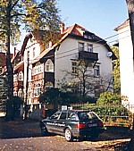Nachdem die einzelnen Gemeindeteile bis zum 19. Jahrhundert weitgehend zusammengewachsen waren, wurden sie 1839 auch politisch zur Landgemeinde "Bühlau mit Quohren" vereinigt. Auf Beschluss des sächsischen Innenministeriums hieß diese ab 8. Juli 1907 amtlich nur noch "Bühlau". Ebenso wie im benachbarten Weißen Hirsch entstanden ab 1894 in Neubühlau Villenviertel _( **Fotos:** links Königsberger Straße 8, rechts Hegereiterstraße 16)_ sowie das [Kurhaus](../../nordost/buhlau/kurhaus_buhlau/) am Ullersdorfer Platz, welches aus dem früheren Dorfgasthof hervorging. 1899 errichtete die Gemeinde ein eigenes Rathaus sowie eine [Kirche](../../nordost/buhlau/st_-michaels-kirche/) an der Quohrener Straße. Bereits 1896 war an der Neubühlauer Straße eine [Methodistische Kirche](../../nordost/buhlau/ev_-methodistische_friedenskir/) eingerichtet worden. Im gleichen Jahr erhielt Bühlau Anschluss an die Straßenbahn, die ab 1908 bis nach Weißig weiterführte (1949 stillgelegt). 1904 entstand ein 1928 wieder geschlossenes [Sanatorium](../../nordost/buhlau/strassen_buhlau/sanatorium_buhlau/), 1930 in unmittelbarer Nachbarschaft das modernisierte [Freibad](../../nordost/buhlau/freibad_buhlau/). Außerdem wurden fast alle Gebäude Bühlaus bis zum Ersten Weltkrieg an die öffentliche Wasser- und Stromversorgung angeschlossen, wofür ein Hochbehälter am Heiderand und ein Elektrizitätswerk an der Bautzner Landstraße 112 errichtet wurden. Trotz dieser Bemühungen stand die Gemeinde immer im Schatten des bedeutenderen Kurortes Weißer Hirsch. Gemeinsam mit dieser Gemeinde und weiteren Orten kam Bühlau am 1. April 1921 zu Dresden.

_“Das heutige Bühlau hat sich zu einem der schönsten Vororte Dresdens emporgeschwungen, wird als beliebte Sommerfrische und Luftkurort mit Vorliebe gewählt, vorzüglich als dauernder Wohnsitz für privatisierende, ruhe- und erholungsbedürftige Menschen”_

_**Werbung aus dem Bühlauer Adressbuch von 1919**_

In den 1920er und 1930er Jahren folgten weitere Neubauten. So wurde zwischen Bautzner und Kolberger Straße eine Siedlung des Spar- und Bauvereins Bühlau und Umgebung errichtet. Weitere Siedlungen entstanden am Taubenberg (Rossendorfer Straße) und als Einzelbauvorhaben an verschiedenen Standorten. Nach Machtübernahme der Nationalsozialisten setzte sich die Bautätigkeit bis zum Beginn des Zweiten Weltkrieges fort. Trotz dieser Entwicklung blieb auch nach 1945 die Landwirtschaft von Bedeutung. 1958 schlossen sich die Bauern des Oberdorfes zur LPG “Neues Leben” zusammen, die in der Nähe der Kirche bis 1990 Werkstatt und Büros besaß. Zu dieser gehörten ab 1960 auch die Mitglieder der LPG “Am Taubenberg” sowie seit Anfang der 1970er Jahre die Bauern der umliegenden Orte. Neben der Bewirtschaftung von ca. 960 Hektar Feldfläche oblag dieser auch die Rindermast in mehreren Ställen in Bühlau, Pappritz, Pillnitz und Helfenberg. Die in Bühlau beheimateten Gärtnereien an der Quohrener und Grundstraße wurden zur Gärtnerischen Produktionsgenossenschaft Bühlau - Weißer Hirsch vereinigt. Nach 1990 erfolgte die Auflösung aller Genossenschaften, deren Nachfolge privatwirtschaftliche Agrarunternehmen antraten.

Der 1945 fast unbeschädigt gebliebene Stadtteil war in der Nachkriegszeit Schauplatz einiger bedeutender gesellschaftlicher und kultureller Ereignisse. So leitete Joseph Keilberth am 16. Juli 1945 im Kurhaus Bühlau _(Foto um 1956)_ das erste Nachkriegskonzert der Staatskapelle. Ein knappes Jahr später, am 7. April 1946, fand an gleicher Stelle der Vereinigungsparteitag von KPD und SPD in Sachsen statt. Nach Einstellung des Straßenbahnverkehrs nach Weißig wurde 1949/50 eine [O-Bus-Linie](../../sudwest/lobtau/strassen_lobtau/ebertplatz/o-bus/) zwischen Löbtau und Bühlau eröffnet, die 1975 stillgelegt wurde. Heute ist Bühlau vor allem als Wohnvorort von Bedeutung. In den 1990er Jahren erfolgte die Umgestaltung des Kurhauses und seiner Umgebung zum Stadtteilzentrum.

Rathaus Bühlau:

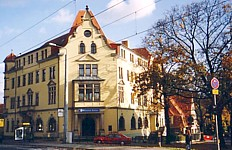Das Rathaus wurde 1899 nach Plänen von Paul Winkler aus Loschwitz errichtet. Mit dem am 17. Juli 1899 bezogenen Gebäude an der Bautzner Landstraße 130 schuf sich die Gemeinde einen repräsentativen Verwaltungssitz, welcher bis zur Eingemeindung 1921 Sitz des Gemeinderates und des Bürgermeisters war. Erster hauptamtlicher Gemeindevorstand des Ortes war ab 1901 Richard Hofmann. Im Erdgeschoss befand sich die Gaststätte “Ratskeller”. Reliefs an der Fassade und an den Eingängen zeigen Figuren der griechischen Mythologie. Am Eingang Neukircher Straße erinnert ein Männerkopf an den Baumeister Karl Huhle, der sich um den Bau des Gebäudes verdient gemacht hat und 1918 in Bühlau verstarb. Das Rathaus dient heute verschiedenen Zwecken, u. a. als Sitz einer Zweigstelle der Stadtbibliothek und als Ärztehaus. 1999 wurde aus Anlass des 650. Ortsjubliäums eine Gedenktafel angebracht.

Schulen in Bühlau:

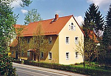Dorfschule: Ursprünglich gehörten die Orte Bühlau und Quohren zur Schönfelder Kirchschule, während die Kinder der Amtsgemeinde die Schule im benachbarten Weißig besuchten. Erst ab 1680 wurde im Ort selbst in einer “Winkelschule” unterrichtet, wobei die Schulstunden in den Wohnungen verschiedener Bauerngüter stattfanden.

Auf Initiative und mit finanzieller Unterstützung des Helfenberger Rittergutsbesitzers Heinrich Gottlieb Neitzsch entstand 1806 das erste eigene Bühlauer Schulhaus an der Quohrener Straße 15 _(Foto)_. Dieses wurde bis 1882 auch von den Kindern aus dem Nachbarort Rochwitz besucht. Obwohl seit langer Zeit nicht mehr genutzt, blieb das Gebäude bis heute als Wohnhaus erhalten und wurde 1993/95 saniert. Hier unterrichtete ab 1814 der Lehrer Johann Christoph Benke, der auch die erste Bühlauer Ortschronik verfasste. An ihn erinnert seit 1903 ein Gedenkstein auf dem örtlichen Friedhof.

_Blick zur Bühlauer Schule und zur Kirche Anfang der 1930er Jahre_

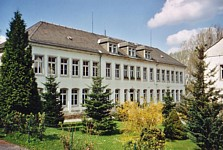60\. Grundschule: Nachdem die alte Schule nicht mehr ausreichte, ließ die Gemeinde 1861 ein größeres Schulhaus in unmittelbarer Nähe errichten. 1889 folgte ein Ergänzungsbau, der mehrfach erweitert und umgebaut wurde und bis zum Sommer 2007 Sitz der 60. Grundschule war (Quohrener Straße 12). 1925 entstand eine Turnhalle, welche man 1961 um zwei Etagen aufstockte, um in den Obergeschossen weitere Klassenräume und Lehrmittelkabinette unterzubringen. Zwischen 1972 und 1990 trug die Bühlauer Schule nach einem Arbeiterfunktionär den Namen 60. POS “Hermann Matern.” Ein 1975 auf dem Schulhof aufgestelltes Denkmal des Politikers verschwand nach 1989. Im Zuge der Neugliederung des sächsischen Schulsystems erfolgte 1992 die Trennung in die 60. Grundschule (im Altbau an der Quohrener Straße) und die 60. Mittelschule (im Neubau im Hof). Nach deren Schließung und teilweisem Abriss begann hier im Oktober 2008 der Bau eines neuen Gymnasiums.

Gymnasium Bühlau: Das Bühlauer Gymnasium wurde 2006 als Oberschule für den Dresdner Nordosten gegründet und nutzte bis 2010 ein provisorisches Ausweichquartier am Weißen Hirsch (Kurparkstraße 12). 2008/10 entstand auf dem Grundstück der früheren 60. Mittelschule ein moderner Neubau, welcher im August 2010 übergeben wurde. Die Grundsteinlegung erfolgte am 6. April 2009, die offizielle Einweihung am 29. September 2010. Der vom Architektenbüro Hartmann + Helm / Junk & Reich entworfene Komplex besteht insgesamt aus fünf teilweise miteinander verbundenen Einzelgebäuden und bezieht auch das historische Schulhaus an der Quohrener Straße ein. Zudem entstand eine moderne Dreifeldsporthalle. 2014/16 kam noch ein Erweiterungsbau mit zwölf zusätzlichen Klassenzimmern und Fachkabinetten hinzu.

Ortsfeuerwehr:

Zur Verbesserung des Brandschutzes erhielt Bühlau bereits 1808 ein eigenes Spritzenhaus an der heutigen Quohrener Straße. Das Gebäude befand sich vor dem Wohnhaus Nr. 17 und ist heute nicht mehr erhalten. Untergestellt war hier die gemeindeeigene Feuerspritze. Zur Brandbekämpfung mussten im Bedarfsfall alle Männer des Dorfes ausrücken. 1899 entstand gegenüber dem Grundstück Quohrener Straße 42 noch ein Leiternhaus für die Feuerleitern.

Da diese Art des Brandschutzes um 1900 als nicht mehr ausreichend angesehen wurde, gründeten am 27. April 1901 26 Bühlauer Bürger die Freiwillige Feuerwehr des Ortes. Mitglieder waren in den Anfangsjahren meist ortsansässige Handwerker, die sich zu regelmäßigen Übungen und Weiterbildungen trafen. Zur Ausstattung gehörten eine pferdebespannte Dampfspritze, ein Hydrantenwagen und ab 1911 eine Schiebeleiter. Neben der Brandbekämpfung in Bühlau und den umliegenden Dörfern gehörten auch verschiedene Hilfsleistungen zu den Aufgaben der Feuerwehr.

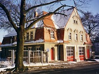Ursprünglich hatte diese Wehr ihr Domizil im 1901 erbauten Spritzenhaus an der Quohrener Straße 30. 1914 entstand auf der Neukircher Straße 1 das bis heute genutztes Gerätehaus _(Foto)_, welches zugleich als Wohnhaus und Domizil der Bühlauer Kinderbewahranstalt diente. Nach dem Ersten Weltkrieg erwarb die Bühlauer Feuerwehr zwei motorbetriebene Löschfahrzeuge. In den Wirren der Jahre nach dem Zweiten Weltkrieg erfolgte 1946 zunächst eine Auflösung der Wehr, 1958 dann die Neugründung. 1961 konnte ein modernes Löschfahrzeug angeschafft werden. Eine grundlegende Sanierung des Feuerwehrdepots erfolgte 1987. 2001 konnte die Stadtteilfeuerwehr Dresden-Bühlau ihr 100-jähriges Jubiläum feierlich begehen.

Postamt:

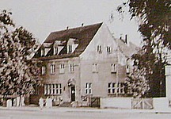Ältestes Zeugnis der Bühlauer Postgeschichte ist das heutige Gasthaus “Trompeter” an der Bautzner Landstraße, an dessen Stelle sich einst eine Poststation mit Raststätte für Fuhrleute befand. Später war die Poststelle des Ortes auf der Quohrener Straße 21 untergebracht. 1936 entstand an Stelle eines kleinen Gehöfts an der Bautzner Landstraße 136 ein neues Postamt für den Stadtteil. Diese Filiale hatte bis Ende 2002 geöffnet. Im Anschluss wurde sie zum Ullersdorfer Platz verlegt. Im Erdgeschoss des alten Postamtes war später einige Jahren eine Gaststätte untergebracht (“Alte Post”). Ende 2009 erhielt sie den Namen “Kleines Blaues Wunder”. Heute nutzt eine Physiotherapie die Räume.

Bühlauer Waldgärten (Waldpark):

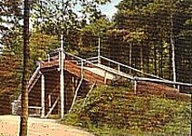 Die Kleingartenanlage "Bühlauer Waldgärten" geht auf den früheren Waldpark zurück, der ab 1901 vom Verschönerungsverein Bühlau am Nachtflügelweg angelegt wurde, um dem aufstrebenden Kurort zu höherer Attraktivität zu verhelfen. Auf einem sechs Hektar großen Waldstück entstanden unter Einbeziehung des vorhandenen Baumbestandes ein Konzertplatz mit Bühne, eine kleine Gartenwirtschaft mit Kaffeeausschank, zwei Schutzhütten, ein Kinderspielplatz sowie 1907 eine Rodelbahn mit hölzernem Ablaufgerüst _(Foto)_. Die Bahn war ca. 400 Meter lang und existierte bis 1935. Regelmäßig fanden im Waldpark kulturelle Veranstaltungen und die alljährlichen Waldparkfeste statt.

**_Fotos:_** _Aufgang zum Waldpark und Waldparkfest 1910_

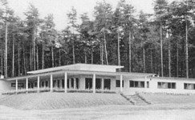 1930 legte der Golfclub Dresden-Bad Weißer Hirsch/Bühlau einen am 11. Juni 1932 eröffneten Golfplatz an. Nach einem Plan von Edwin Barnes entstand auf ca. 54 Hektar Fläche das Spielfeld mit künstlich angelegten Teichen und Neun-Loch-Spielbahnen. Die Ausführung übernahm die britische Firma Colt Alison & Morisson. Ergänzt wurde der Komplex um ein Klubhaus mit Gaststätte, Freiterrasse sowie Umkleide- und Sanitäreinrichtungen. Die Entwürfe für den am 9. Juli 1931 seiner Bestimmung übergebenen bungalowartigen Bau _(Foto)_ stammen von Wilhelm Kreis. Die Bewirtschaftung übernahmen Mitarbeiter des renommierten "Englischen Gartens" im Stadtzentrum. Zwischen 1932 und 1943 fanden hier Turniere der deutschen Städtemannschaften sowie von wohlhabenden in- und ausländischen Kurgästen statt. 1944 wurde der Platz umgepflügt und fortan als militärisches Übungsgelände der SS genutzt.

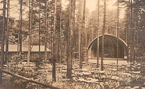 Infolge der Einstellung des Kurbetriebes und mangelnder Pflege während des Zweiten Weltkrieges verfielen fast alle baulichen Anlagen und sind heute bis auf geringe Reste nicht mehr auffindbar. 1946/47 verschwanden die hölzerne Konzertmuschel und die beiden Schutzhütten, um Brennholz zu gewinnen. Zudem wurden die Rasenflächen parzelliert und an Interessenten als Gartenland abgegeben. 1948 schlossen sich die Pächter zur "Gartenkolonie Golfplatz" zusammen, aus der 1951 der Kleingartenverein "Bühlauer Waldgärten" hervorging. 1958 war die Auflösung der Gartenanlage und Wiederaufforstung des Gebietes geplant, die jedoch durch das Engagement der Gartenfreunde verhindert werden konnte.

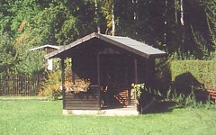 Nach dieser Bestandssicherung konnte nun mit dem weiteren Ausbau begonnen werden. In den 1960er Jahren begannen die Vereinsmitglieder mit der Errichtung von Lauben, wobei der Gartenfreund und Baumeister Walter Schöler eigens eine für die waldnahe Lage passende Form entwarf. Aus dem zu DDR-Zeiten zeitweise als Wohnheim genutzten ehemaligen Golfplatz-Restaurant entstand ein Vereinsheim mit öffentlicher Gaststätte. Seit 2016 dient es als Apartment-Hotel. In der Sparte ist seit 2003 auch die museal aufgearbeitete letzte erhaltene "Schöler-Laube" _(Foto)_ zu sehen. Die "Bühlauer Waldgärten" gehören bis heute zu den schönsten Kleingartenanlagen in Dresden und wurden nicht zuletzt wegen ihres kulturellen und ökologischen Engagements mehrfach ausgezeichnet.

## [Bühlauer Straßen](../../nordost/buhlau/strassen_buhlau/)

[_Weiterführende Literatur und Quellen_](../../impressum/quellenverzeichnis/)

 \[ [Home](../../index.html)\] \[ [Nord](../../nord/)\] \[ [Nordwest](../../nordwest/)\] \[ [Neustadt](../../neustadt/)\] \[ [Nordost](../../nordost/)\] \[ [West](../../west/)\] \[ [Zentrum](../../zentrum/)\] \[ [Südwest](../../sudwest/)\] \[ [Süd](../../sud/)\]
 \[ [Südost](../../sudost/)\] \[ [Ost](../../ost/)\] \[ [Register](../../Register/register.html)\] \[ [Kontakt](../../Kontakt/kontakt.html)\] \[ [Impressum](../../impressum/)\]
