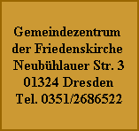
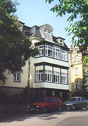

* * *

* * *

* * *

* * *

* * *

* * *

Neben der [St.-Michaels-Kirche](../../../nordost/buhlau/st_-michaels-kirche/) besitzt Bühlau noch ein weiteres Gotteshaus, welches heute
von der Evangelisch-Methodistischen Gemeinde genutzt wird. Dieses geht auf die seit 1873 in Dresden aktive Evangelische Gemeinschaft zurück, die ihre Gottesdienste zunächst in einer
Villa am Weißen Hirsch durchführte. 1896 stiftete eine wohlhabende Gemeindeangehörige das neue Gemeindehaus auf der Neubühlauer Straße 3, welches am 24. Mai 1896 als Friedenskirche geweiht wurde _(Foto)_
. Im Erdgeschoss befand sich der Gemeindesaal mit farbig verglasten Fenstern und einer Rosette an der Altarwand, das Obergeschoss diente Wohnzwecken.

In den letzten Kriegstagen 1945 diente das Gebäude zeitweise als Kaserne des Volkssturms, wurde jedoch nach Beseitigung der Schäden schnell wieder für die Gemeindearbeit genutzt. Seit 1952
bildet die Bühlauer Gemeinde einen selbstständigen Gemeindebezirk. Im gleichen Jahr wurde die Kirche komplett saniert. Seit dem Zusammenschluss der Evangelischen Gemeinschaft mit der
Methodistischen Kirche im Jahr 1968 tragt die Bühlauer Gemeinde offiziell die Bezeichnung Evangelisch-Methodistische
Friedenskirche Dresden-Bühlau. Einige Erneuerungen und Umbauten erfolgten ab 1972, so dass die Kirche heute auch als Begegnungszentrum und Gästeherberge genutzt werden kann.

* * *

 \[ [Home](../../../index.html)\] \[ [Nord](../../../nord/)\] \[ [Nordwest](../../../nordwest/)\] \[ [Neustadt](../../../neustadt/)\] \[ [Nordost](../../../nordost/)\] \[ [West](../../../west/)\] \[ [Zentrum](../../../zentrum/)\] \[ [Südwest](../../../sudwest/)\] \[ [Süd](../../../sud/)\] \[ [Südost](../../../sudost/)\] \[ [Ost](../../../ost/)\] \[ [Register](../../../Register/register.html)\] \[ [Kontakt](../../../Kontakt/kontakt.html)\] \[ [Impressum](../../../impressum/)\]
