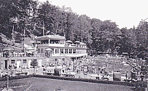
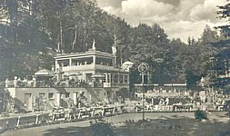
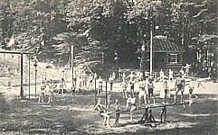

* * *

Die Geschichte des Bühlauer Freibades begann bereits Ende des 19.
Jahrhunderts, als der damalige Besitzer und Direktor der Sächsischen Elektrizitätsgesellschaft Paul Oswald Bachmann ein Grundstück im oberen Loschwitzgrund erwarb und hier verschiedene Sportgeräte und Hütten
aufstellen ließ. Hinzu kamen ein kleines Schwimmbecken und andere Erholungsflächen. Zur Bewirtschaftung gründete Bachmann 1896 die “Sanatorium und Kaiser Barbarossa Bad GmbH” mit dem Ziel, auch Bühlau
zu einem Kurort zu machen. 1904 entstand in unmittelbarer Nachbarschaft ein [Sanatorium](../../../nordost/buhlau/strassen_buhlau/sanatorium_buhlau/) mit mehreren Gebäuden und einer 40 Hektar großen Parkanlage.
Am 30. Mai 1908 eröffnete auf dem Gelände unterhalb der Klinik ein zu bestimmten Zeiten auch der Öffentlichkeit zugängliches Luftbad, nach seinem Gründer im Volksmund “Bachmann-Bad” genannt.

Da das Sanatorium immer im Schatten der bekannteren Kureinrichtungen des Bades Weißer Hirsch stand und nicht den
erhofften wirtschaftlichen Erfolg brachte, verkaufte Bachmann das Areal 1912 an die “Sanatorium Bühlau bei Dresden
AG”. Unter Leitung des Medizinalrates Dr. Schreck wurde der Kurbetrieb noch bis 1928 weitergeführt. Hauptsächlich fanden hier Patienten mit Magen-Darm-, Nerven- und Stoffwechselerkrankungen Linderung ihrer Leiden.

Nach Schließung des Sanatoriums und Übergabe des Bades an die
“Familien-Schwimm- und Luftbad Kurort Weißer Hirsch - Bühlau GmbH” entschloss sich diese, das Freibad komplett zu erneuern und in eine öffentliche Erholungsanlage umzuwandeln. Nach Plänen des Architekten Hans
Immendorf und des Architektenbüros Kell & Löser entstanden ein Schwimmbecken mit 50-Meter-Bahn, Liegewiesen, Tennis- und Minigolfanlagen sowie eine Badgaststätte mit großer Freiterrasse und über
600 Plätzen. 1930/31 konnte das Bachmannbad wieder eröffnet werden. Wegen wirtschaftlicher Schwierigkeiten der privaten Betreiber übernahm die Stadt Dresden die Einrichtung 1939 in städtische Trägerschaft.

Nach 1945 diente das Bühlauer Bad hauptsächlich der Naherholung der
Anwohner in den angrenden Stadtvierteln Bühlau und Weißer Hirsch. Reparaturen erfolgten jedoch, mit Ausnahme der Beseitung von Unwetterschäden nach einem Gewitter 1952, nur spärlich, so dass sich der
bauliche Zustand ständig verschlechterte. Erst zwischen 1979 und 1981 kam es zu einer umfangreichen Sanierung, bei der der Sprungturm entfernt und das
Becken verkleinert wurden. Fortan fanden hier in den Sommermonaten auch verschiedene Konzerte und ähnliche kulturelle Veranstaltungen statt. Die
gesamte Anlage steht seit 1995 unter Denkmalschutz. In diesem Jahr erfolgte eine Erneuerung der Sanitäranlagen.

Nach einem Stadtratsbeschluss zur Schließung des Bades entstand 2002 eine Bürgerinitiative, die sich für den Erhalt
einsetzte. Auch die Übernahme durch einen privaten Träger wurde erwogen. Allerdings scheiterten alle Versuche zur
Rettung des Bühlauer Bades, so dass das Bad seit 2006 geschlossen ist. Das Areal wird seit 2007 als Hochseil-
Klettergarten genutzt. Dafür entstanden insgesamt acht Kletterbahnen unterschiedlicher Schwierigkeitsstufen. Auch die frühere Badgaststätte hat inzwischen wieder geöffnet.

* * *

 \[ [Nord](../../../nord/)\] \[ [Nordwest](../../../nordwest/)\] \[ [Neustadt](../../../neustadt/)\] \[ [Nordost](../../../nordost/)\]
 \[ [West](../../../west/)\] \[ [Zentrum](../../../zentrum/)\] \[ [Südwest](../../../sudwest/)\] \[ [Süd](../../../sud/)\] \[ [Südost](../../../sudost/)\] \[ [Ost](../../../ost/)\] \[ [Register](../../../Register/register.html)\] \[ [Kontakt](../../../Kontakt/kontakt.html)\] \[ [Impressum](../../../impressum/)\]
