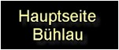
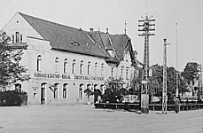
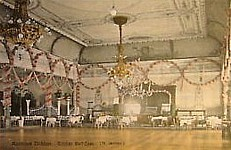
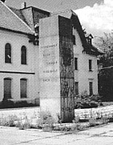
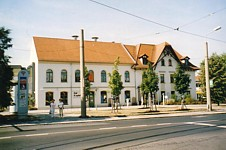

* * *

* * *

* * *

* * *

* * *

“Keiner, der sie erlebt hat, wird die oft unerträglich verzögerten, mit unregel- mäßig verkehrenden Straßenbahnen bewerk- stelligten Pilgerreisen
in diesen Vorort vergessen,

an winterkalten Sonn- abendnachmittagen, da auf der Plattform sich die Besucher festklammerten, an der anderen die Musiker mit ihren Instrumenten hingen, denen sie
eine halbe Stunde später den samtenen Klang eines Beethoven-Adagios entlocken sollten...”

**Aus “Jahrbuch zur Pflege der Künste” (1950)**

* * *

* * *

Das Kurhaus Bühlau am [Ullersdorfer Platz](../../../nordost/buhlau/strassen_buhlau/ullersdorfer_platz/) geht auf den alten Bühlauer Gasthof
zurück, der einst an dieser Stelle stand und 1608 erstmals erwähnt wurde. 1756 erfolgte eine Erweiterung dieses Gebäudes, welches neben der Gaststube auch
Kammern und Pferdeställe zur Unterbringung auswärtiger Fuhrleute besaß. Noch heute erinnert ein historisches Relief an der vorderen Hausfassade an diesen Umbau. Im Zusammenhang mit der Entwicklung Bühlaus zum Kurort
entstanden Ende des 19. Jahrhunderts verschiedene Kultur- und Erholungseinrichtungen im Ort, darunter auch das neue Kurhaus Bühlau mit Gasträumen, Gartenterrasse und großem Saal _(Foto)_.

Das 1899 eröffnete Gebäude war bis 1945 gesellschaftlicher Mittelpunkt des
Ortes und Schauplatz für Tanzveranstaltungen und andere Vergnügungen. Teile des Hauses wurden auch gewerblich genutzt. So bestand bis 1945 unmittelbar
vor dem Kurhaus eine Tankstelle. Eine Drogerie gab es noch bis in die 1960er Jahre direkt am Eingang zum Gästegarten. In der Nachkriegszeit gehörte das
Kurhaus Bühlau zu den wenigen erhaltenen großen Veranstaltungsgebäuden in Dresden. Deshalb wurde der Saal bereits wenige Wochen nach Kriegsende
zum Theater- und Konzertsaal umfunktioniert. Am 16. Juli 1945 leitete Joseph Keilberth hier das erste Sinfoniekonzert der Staatskapelle nach dem Zweiten
Weltkrieg. Später folgten Aufführungen der Dresdner Staatsoper, des Schauspiels und anderer Bühnen, so dass Bühlau eines der wichtigsten Kulturzentren der zerstörten Stadt wurde.

Auch ein politisches Großereignis fand 1946 im Kurhaus statt: Am 7. April 1946 vereinigten
sich hier die sächsischen Landesverbände von KPD und SPD unter Leitung von Wilhelm Koenen und Otto Buchwitz zur SED. An diesen Vereinigungsparteitag erinnerte eine 1961 von
Vincenz Wanitschke geschaffene Granitstele mit Reliefdarstellungen revolutionärer Arbeiter und der Inschrift “Proletarier aller Länder, vereinigt Euch” _(Foto)_. Das Denkmal auf dem Vorplatz
des Kurhauses wurde am 6. Juni 1999 auf Beschluss des Stadtrates entfernt und eingelagert. Auch eine Gedenktafel an der Fassade ist heute nicht mehr vorhanden.

Nach der Wiedereröffnung einiger Dresdner Bühnen in der Innenstadt wurde das Kurhaus seit Ende der 1950er Jahre wieder verstärkt für Gastronomie und Tanzveranstaltungen genutzt. Ab
1962 spielte hier die “Bühne junger Talente”, auf der junge Dresdner Nachwuchskünstler ihr Können präsentieren
durften. 1972 verkauften die privaten Besitzer das Kurhaus Bühlau an die staatliche Handelsorganisation HO. Eine
umfangreiche Sanierung erfolgte zwischen 1979 und 1986. Trotz des relativ guten Bauzustandes wurden Saal und Gaststätte 1991 geschlossen und standen einige Jahre leer.

Erst mit dem Komplettumbau des Gebäudes ab 1997 rückte das Kurhaus wieder in den Mittelpunkt des Interesses.
Während das Hauptgebäude sich heute äußerlich wieder weitgehend im Originalzustand befindet, musste der frühere
Ballsaal wegen baulicher Schäden abgerissen werden. Heute wird das Kurhaus Bühlau als Stadtteilzentrum für die
umliegenden Orte genutzt. In einigen Nebenräumen entstanden verschiedene Geschäfte und Gaststätten. Auch eine Tanzschule hat hier ihren Sitz. 2005 wurde im hinteren Teil des Grundstücks mit dem Bau von sechs modernen
Einfamilienhäusern begonnen.

**_Foto:_** _Das Kurhaus Bühlau nach seinem Umbau zum Bühlauer Stadtteilzentrum_
