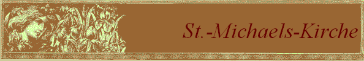
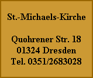
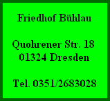
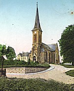
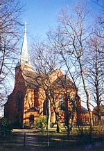
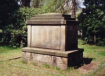
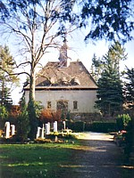

* * *

* * *

* * *

* * *

* * *

* * *

* * *

Die Kirche an der Quohrener Straße entstand Ende des 19. Jahrhunderts für die
gewachsene Gemeinde Bühlau mit ihren Ortsteilen Quohren und Neubühlau sowie die Nachbarort Rochwitz und Gönnsdorf. Zuvor gehörten diese Orte zur Schönfelder bzw. zur
Weißiger Kirche. Erst ab 1890 fanden auch in Bühlau regelmäßige Gottesdienste im Erdgeschoss der Schule statt. Da infolge der gewachsenen Einwohnerzahl dieses
Provisorium nicht mehr den Wünschen der Gemeinde genügte, entschloss man sich 1896 zum Bau eines eigenen Gotteshauses, für das am 21. Juli 1898 der erste Spatenstich erfolgte.
Der neogotische Bau mit seinem 43 Meter hohen Turm wurde von Woldemar Kandler entworfen und am 29. Oktober 1899 geweiht. 1901 folgte das Pfarrhaus in unmittelbarer
Nachbarschaft. Die Kirche ist als Klinkerbau mit zahlreichen Schmuckelementen der Gotik und des Jugendstils gestaltet. Turmhaube und Dach des Kirchenschiffs bestehen aus einer
Holzkonstruktion. Auch im Inneren kam, u.a. bei der Decke des Kirchzenschiffs, viel Holz zum Einsatz, so das der Raum eine warme Athmosphäre aufweist.

Für die zunächst Erlöserkirche genannte Bühlauer Kirche schuf die Orgelbaufirma Jehmlich
1904 eine bis heute im Originalzustand erhaltene Orgel mit zwei Manualen und 23 Registern. Bereits 1899 konnten für den Turm drei Glocken erworben werden, von denen jedoch im
Ersten Weltkrieg die beiden größeren zu Rüstungszwecken eingeschmolzen wurden. Die letzte erhaltene Glocke befindet sich heute in der Dorfkirche von Ruppertsgrün im Vogtland,
während in Bühlau seit 1922 drei in Apolda gegossene Stahlgussglocken läuten.

1949 wurde die Kirche in St.-Michaels-Kirche Dresden-Bühlau umbenannt, da es seit der Eingemeindung des Ortes nach Dresden zwei [Erlöserkirchen](../../../ost/striesen/erloserkirche/) in der Stadt gab. Eine umfassende Erneuerung des Gebäudes erfolgte zwischen 1974 und 1980. Dabei erhielt die
Kirche auch neue, von Albrecht Ehnert gestaltete Glasfenster mit Engelsmotiven. Das mittlere Altarfenster zeigt den Erzengel Michael im Kampf gegen den Drachen, die beiden
Seitenfenster die Erzengel Rafael und Gabriel. Der aus Bühlau stammende Grafiker war auch Schöpfer der Paramente
an Altar, Kanzel und Lesepult. Das weitgehend im Ursprungszustand erhaltene Kirchenschiff bietet Platz für ca. 550 Gläubige und besitzt eine bemalte hölzerne Empore im Stil der Entstehungszeit.

Gemeindehaus: Bereits in den 1930er Jahren plante die Gemeinde, zur Erfüllung ihrer wachsenden Aufgaben ein eigenes Gemeindehaus zu errichten. Da sich jedoch auch die von Woldemar Kandler entworfene alte Friedhofskapelle als zu klein erwies, entschied man sich schließlich, stattdessen lieber eine neue Kapelle zu bauen. Erst 1960 konnten die beengten Raumverhältnisse im Pfarrsaal durch den Ankauf zweier Holzhütten im Pfarrgarten etwas gelindert werden. In Anlehnung an den Namen der Kirche wurde diese Begegnungsstätte umgangssprachlich "Michaelshütte" genannt. 2015 entschloss sich die Gemeinde zum Bau eines modernen Gemeindezentrums mit einem großem Saal und weiteren Veranstaltungs- und Begegnungsräumen. Architekt des Neubaus war Thomas Bär.

Wettingedenkstein und Kriegerdenkmal:Vor der Kirche stand bis 1947 ein Gedenkstein, der an das 800-jährige Bestehen
des Hauses Wettin erinnerte. Das 1890 an der Quohrener Straße aufgestellte und nach dem Ersten Weltkrieg zur Kirche umgesetzte Denkmal fiel in der
Nachkriegszeit der Bilderstürmerei zum Opfer. Der heute verschollene Gedenkstein trug die Inschrift: _“Zur Erinnerung an die 800jährige Jubelfeier des Hauses Wettin. Gewidmet von der Gemeinde Bühlau”_
. Erhalten blieb hingegen ein schlichtes Denkmal für die Opfer des Ersten Weltkrieges _(Foto)_. Dieses wurde 1922 von Josef Häsler geschaffen und zeigt ein Relief mit Mutter und Kindern sowie zwei Soldaten.

Bühlauer Friedhof:

Zeitgleich mit dem Bau der Kirche erhielt Bühlau auch einen eigenen Friedhof, für den nach Plänen des Baumeisters Woldemar Kandler eine kleine Friedhofskapelle entstand. Für den
Friedhof erwarb die Gemeinde 1897 einige Flächen von Bühlauer Bauern, obwohl zu diesem Zeitpunkt bereits die ersten Beisetzungen auf dem Areal stattgefunden hatten. Offiziell
eingeweiht wurde er am 1. Januar 1898. Die Gräberfelder erstrecken sich zu beiden Seiten einer mit Linden bepflanzten Mittelachse, weshalb der Friedhof früher auch als
Lindenfriedhof bekannt war. Bereits kurz nach Eröffnung erhielt dieser ein Gemeinschaftsgrab, in dem die sterblichen Überreste von zehn russischen und vier
französischen am 11. Mai 1813 gefallenen Soldaten beigesetzt wurden. Diese waren am 7. August 1902 bei Bauarbeiten entdeckt worden. Am 16. September wurden die Gebeine
beigesetzt. Eine Gedenktafel stiftete der Königlich-Sächsische Militärverein “Prinz Friedrich August” zu Bühlau und Umgebung. Die später verloren gegangene Gedenkplatte wurde 2002 von der französischen
Kriegsgräberfürsorge erneuert.

Am 4. Dezember 1938 erfolgte die Einweihung einer neuen Friedhofskapelle _(Foto)_. Der schlichte Neubau wurde von
Walter Menzel entworfen und besitzt eine Orgel der Firma Jehmlich. Zuvor war der Friedhof  bereits 1934 räumlich
erweitert worden. Zu den hier beigesetzten Personen gehören einige Bühlauer Unternehmer, der Architekt des Dresdner Fernsehturms, Hermann Rühle, der Glaskünstler Oskar Fritz Beier sowie der dritte “Retter des Blauen
Wunders” Max Mühle. Im Gegensatz zu den bekannteren Paul Zickler und Erich Stöckel hatte auch Mühle zum Kriegsende die Sprengung der Brücke durch abrückende Wehrmachtsverbände verhindert. Das älteste noch erhaltene
Grabmal des Friedhofs entstand 1897 für den verstorbenen Butterhändler Johann Ernst Kappler.

Seit 1903 erinnert am Hauptweg in der Nähe der Kapelle ein Gedenkstein an den Bühlauer Lehrer und Ortschronisten
Johann Christoph Benke (1794-1859). Ursprünglich befand sich dieser Stein auf dem Schönfelder Friedhof, kam nach
Auflösung der Grabstelle jedoch 1903 nach Bühlau und wurde 2007 durch eine Kopie ersetzt. Der Stein ist in Form eines Buches gestaltet und trägt eine Dankesinschrift Bühlauer Schüler und ein Bibelzitat.

Bedeutende Grabstätten und Gräber bekannter Persönlichkeiten:

**_Grabstätte_**

**_Todesjahr_**

Johann Ernst Kappler, Butterhändler (ältestes Grabmal des Friedhofs)

1897

Martin Richter, Kommunalpolitiker und 1946-1950 Zweiter Bürgermeister Dresdens

1954

Hans Kircheis, ehem. Rektor der Diakonissenanstalt

1981

Karl-Heinz Bäumer, Mundart-Schriftsteller

1987

Rudolf Dittrich, Opernsänger

1990

Theo Schumann, Jazzmusiker, Gründer der “Theo Schumann Combo”

1990

Jobst Christoph Halank, Pfarrer der Bühlauer Kirche

1993

Hermann Rühle, Architekt des Dresdner Fernsehturms

1993

* * *

 \[ [Home](../../../index.html)\] \[ [Nord](../../../nord/)\] \[ [Nordwest](../../../nordwest/)\] \[ [Neustadt](../../../neustadt/)\] \[ [Nordost](../../../nordost/)\] \[ [West](../../../west/)\] \[ [Zentrum](../../../zentrum/)\] \[ [Südwest](../../../sudwest/)\] \[ [Süd](../../../sud/)\] \[ [Südost](../../../sudost/)\] \[ [Ost](../../../ost/)\] \[ [Register](../../../Register/register.html)\] \[ [Kontakt](../../../Kontakt/kontakt.html)\] \[ [Impressum](../../../impressum/)\]
