## Am Bauernbusch

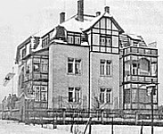 Die direkt zur Dresdner Heide führende Straße Am Bauernbusch erinnert an eine frühere Flurbezeichnung. Traditionell besaßen die Einwohner des Ortes das Recht, Teile des hiesigen Heidewaldes zum Holzeinschlag und zur Gewinnung von Heu zu nutzen. Ab 1870 entstanden auf dem Areal repräsentative Villen für wohlhabende Zuzügler, weshalb der Volksmund dem Weg den Namen "Millionengässchen" gab. Offiziell wurde die Straße ab 1901 bis zum 1. Juni 1926 Forststraße genannt.

Zu den hier befindlichen Villen und Landhäusern gehört das Haus Am Bauernbusch 8, welches ab 1909 das Fremdenheim Winde beherbergte _(Foto links)_. Während des Ersten Weltkrieges wurde die Pension als Militär-Genesungsheim des Roten Kreuzes für verwundete Soldaten und Offiziere genutzt, ab 1921 wieder als Fremdenheim "Uhlenhorst". Mit Rückgang der Gästezahlen musste dieses jedoch Mitte der 1930er Jahre geschlossen werden. Heute dient das Gebäude als Wohnhaus.

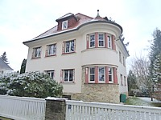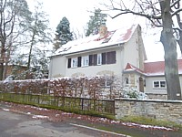Weitere Wohnhäuser entstanden bis zum Ausbruch des Zweiten Weltkrieges in offener Bauweise, teilweise mit angebauten Garagen. Typische Beispiele dieser Zeit sind die unter Denkmalschutz stehenden Gebäude Nr. 15, 17, 22 und 23 aus der Zeit zwischen 1936 und 1939. Interessant ist das Anfang der 1930er Jahre errichtete Haus Am Bauernbusch 22 _(Foto links)_, an dessen Fassade sich Reliefs mit Darstellungen verschiedener Berufe befinden. 1991 setzte der Schriftsteller Martin Walser diesem Gebäude in seinem Roman "Die Verteidigung der Kindheit" ein literarisches Denkmal. In dem gegenüber liegenden Wohnhaus (Nr. 23 - _Foto rechts_) wohnte 1945/46 der Dresdner Oberbürgermeister Dr. Gustav Leißner. Der SPD-Politiker hatte das Amt am 1. Februar 1946 übernommen und übte dieses bis zur Kommunalwahl im Oktober 1946 aus. Während seiner Amtszeit begann der planmäßige Wiederaufbau der zerstörten Stadt. Einige noch verbliebene Baulücken wurden nach 1990 mit modernen Neubauten geschlossen.

Neues Deutschland Verlagsgesellschaft (Nr. 6): In diesem Gebäude hatte in den 1930er Jahren die "Neues Deutschland Verlagsgesellschaft mbH" des Schriftstellers und Publizisten Carl Heinrich Huter (1898-1974) ihren Sitz. Huter befasste sich mit der physiognomische Lehre seines Vaters und widmete sich zudem astrologischen Forschungen und Vortragsreisen. Während der Nazizeit gab er in seinem Verlag ariosophisch-rassistische Bücher und die Zeitschrift "Neues Deutschland" heraus Bekannt war auch sein "Arisch-Mythologischer Kalender". Später wandte sich Huter vom Nationalsozialismus ab und war zeitweise sogar inhaftiert. Seine letzte Dresdner Wohnung auf der Lindenaustraße wurde 1945 zerstört, womit auch die Geschichte des Verlags endete.

Nr. 19: Hier lebte bis zu ihrem Tod 1984 die Malerin und Scherenschnittkünstlerin Hanna Hausmann-Kohlmann (1897-1984). Nach ihrem Studium an der Kunstakademie arbeitete sie ab 1923 als freischaffende Künstlerin und schuf zahlreiche Zeichnungen, Aquarelle und Scherenschnitte von bekannten Dresdner Persönlichkeiten sowie Bilder mit Motiven der Dresdner Vogelwiese. Zudem war sie als Pressezeichnerin für Zeitungen tätig und gestaltete viele Jahre die Programmhefte des Staatstheaters.

Die Straße Am Kurhaus Bühlau entstand Ende der 1990er Jahre als Zufahrt zu einem P+R-Parkplatz und erhielt ihren Namen 2000 nach dem angrenzenden [Kurhaus Bühlau](../../../nordost/buhlau/kurhaus_buhlau/). Das heute als Einkaufszentrum genutzte Gebäude am Ullersdorfer Platz geht auf den früheren Dorfgasthof des Ortes zurück. Im hinteren Teil entstanden einige moderne Reihenhäuser.

## Bachmannstraße

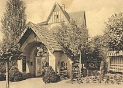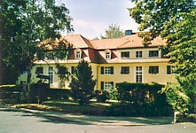Die Bachmannstraße wurde 1905 als Seitenstraße der Bautzner Landstraße angelegt. Hier befand sich bis 1928 das von Paul Oswald Bachmann (1871-1923) gegründete [Sanatorium Bühlau](../../../nordost/buhlau/strassen_buhlau/sanatorium_buhlau/), nach dem die Privatstraße auf eigenen Wunsch hin ihren Namen erhielt. Am 7. Februar 1910 wurde sie gegen den Willen des Bühlauer Gemeinderates auf Beschluss der Kreishauptmannschaft Dresden als öffentliche Straße anerkannt, 1913 jedoch wieder eingezogen. Grund für diese Entscheidung war, dass Bachmann an der Einfahrt einen Torbogen errichten ließ, der den öffentlichen Verkehr behinderte. Nach dem Konkurs des Sanatoriums 1928 wurde der Bogen wieder abgetragen und die Straße unter Beihaltung ihres Namens wieder zum öffentlichen Verkehrsweg. Zugleich diente sie als oberer Zugang des [Bühlauer Freibades](../../../nordost/buhlau/freibad_buhlau/) (heute Waldseilpark).

## [Bautzner Landstraße](../../../nordost/page10246/strassen_weisser_hirsch/bautzner_landstrasse/)

## Bühlauer Schützensteig

Der Straßenname Bühlauer Schützensteig erinnert an den früheren Bühlauer Schützenverein, der nach dem Ersten Weltkrieg hier ein Grundstück erworben hatte und als Schießplatz nutzte. Als Vereinshaus diente die [Gaststätte „Zum Grünen Tal“](../../../nordost/loschwitz/strassen_loschwitz/grundstrasse/) (Grundstraße 148), ab 1928 als „Bühlauer Schützenhaus“ bezeichnet. Am 13. September 1938 wurde der Weg offiziell Bühlauer Schützensteig benannt. Seit der Auflösung des Vereins 1945 dient das Gebäude als Wohnhaus.

## Crostauer Weg

Der Crostauer Weg verbindet die Wilthener Straße mit dem Gründelsteig und wurde erst am 2. November 1995 offiziell benannt. Mit der Benennung nach dem kleinen Ort Crostau, heute Ortsteil der Stadt Schirgiswalde-Kirschau, knüpfte man an die 1967 begonnene Tradition an, Bühlauer Straßen bevorzugt nach Orten in der Oberlausitz zu benennen.

## Cunewalder Straße

Die heutige Cunewalder Straße entstand als Planstraße Q und wurde am 7. März 1935 nach einem ostpreußischen Ort Marienwerder Straße genannt. Marienwerder war Hauptstadt des gleichnamigen Regierungsbezirkes in der Provinz Westpreußen und ist historisch eng mit dem Deutschen Orden verbunden. Da die deutschen Ostgebiete nach 1945 zu Polen gekommen waren, entschloss sich die Stadt Dresden, alle entsprechenden Straßennamen in Bühlau entsprechend zu ändern. In diesem Rahmen erhielt auch die Marienwerder Straße am 20. Januar 1967 ihren neuen Namen nach der Gemeinde Cunewalde in der Oberlausitz (Infos zu den Umbenennungen siehe Königsberger Straße).

Im Wohnhaus Marienwerder Straße 11 lebte ab 1950 die Schriftstellerin Annemarie Reinhard, die zahlreiche Romane und Kinderbücher verfasste. 1956 wurde sie Mitglied des Vorstandes des DDR-Schriftstellerverbandes und war zeitweise Vorsitzende des Bezirksverbandes Dresden. Verheiratet war sie mit dem Schriftsteller Georg Reinhard-Fleischhauer, der unter dem Pseudonym Götz Gode mehrere historische Jugendbücher schrieb und von 1949-1953 als Lektor im Sachsenverlag arbeitete.

## Eibauer Straße

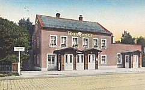Die heutige Eibauer Straße wurde 1893 als Trompeterstraße angelegt und verdankte ihren ursprünglichen Namen der gegenüberliegenden und noch bis heute existierenden Gaststätte [“Trompeter”](../../../nordost/page10246/strassen_weisser_hirsch/bautzner_landstrasse/) _(Foto)_. Zunächst führte sie nur bis zur Elisabethstraße, wurde 1898 jedoch verlängert. Da es im Stadtzentrum bereits eine Trompeterstraße gab, erfolgte nach der Eingemeindung Bühlaus 1926 die Umbenennung in Bromberger Straße. Bromberg war bis 1945 Hauptstadt eines Regierungsbezirks in der preußischen Provinz Posen und kam nach dem Zweiten Weltkrieg zu Polen. Seit dem 20. Januar 1967 heißt die frühere Bromberger Straße nach einer Gemeinde in der Oberlausitz Eibauer Straße.

Nr. 17: Architektonisch interessant ist das 1963-1965 erbaute Einfamilienhaus Eibauer Straße 17. Der moderne Bau im kubischen Stil wurde von Kurt Nowotny entworfen und steht als Zeugnis der Nachkriegsmoderne unter Denkmalschutz. Bauherr war der Obermedizinalrat Dr. Werner Ludwig, Präsident des DRK in der DDR. Das in Hanglage errichtete Gebäude oberhalb der Grundstraße ist in modernem Stil, jedoch mit traditionellen Baumaterialien errichtet. Farbige Akzente setzen rote Klinkerwände. Einige Details wie Türen, Fenster und die Holzverkleidung im Obergeschoss sind heute verändert.

## Elisabethstraße

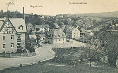
Die Elisabethstraße, welche im Westen Bühlaus die Bautzner Landstraße mit der Grundstraße verbindet, erhielt ihren Namen um 1870 nach der Unternehmersgattin Elisabeth Klemm. Deren Ehemann, der Kaufmann Alfred Klemm hatte die kleine Sackgasse Ende des 19. Jahrhunderts ausbauen und nach seiner Ehefrau benennen lassen. 1903 entstand ausgehend von der Grundstraße eine weitere Stichstraße, die nach ihrer Lage ab 1908 zunächst Bergstraße genannt wurde _(Foto)_. Noch vor dem Ersten Weltkrieg erfolgte eine Verbindung beider Abschnitte durch einen Fußweg, später durch eine ausgebaute Straße. Im Zusammenhang mit der Eingemeindung von Bühlau und Loschwitz erhielt diese am 1. Juni 1926 den einheitlichen Namen Elisabethstraße.

Das Straßenbild der Elisabethstraße prägen bis heute überwiegend Villen und Landhäuser, welche meist in der Zeit kurz vor dem Ersten Weltkrieg entstanden. Dazu gehören das Landhaus Helgoland an der Einmündung in die Grundstraße (Nr. 2) und die Villen "Anna" und "Talblick" (Nr. 4 und 8). In der Elisabethstraße 3 betrieb bis zu seinem Tod 1942 der Heilpraktiker Alfred Hermann Richter sein Naturheilinstitut und Kurbad. In der 1915 als "Villa Minna" bezeichneten Nr. 14 lebte in den 1930er Jahren der Textilingenieur Alois Herzog (1872-1956), der ab 1920 Leiter der Biologischen Abteilung des Forschungsinstitutes für Textilindustrie war. Zudem lehrte er zwischen 1925 und 1939 und ab 1948 an der Technischen Hochschule als ordentlicher Professor für Papier- und Textiltechnologie. Bemerkenswert ist auch das Eckhaus zur Bautzner Landstraße (Nr. 19), in dem sich einst die Fleischerei Hering befand und das unter Denkmalschutz steht.

## Erkmannsdorfer Straße

Die Erkmannsdorfer Straße befindet sich im oberen Teil des Bühlauer Ortsteils Quohren und wurde am 26. September 1929 benannt. Erkmannsdorf ist ein kleiner Ort südlich von Radeberg, wird jedoch bereits seit 1560 zur besseren Unterscheidung in Groß- und Kleinerkmannsdorf aufgeteilt. Seit 1999 gehört die zuvor selbständige Gemeinde zu Radeberg.

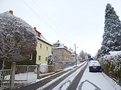

**_Foto:_** _Blick in die Erkmannsdorfer Straße im Winter 2021_

## Eschdorfer Straße

Die Eschdorfer Straße zweigt im südlichen Teil des Bühlauer Ortsteils Quohren von der Quohrener Straße ab und entstand Ende der 1930er Jahre beim Bau einer neuen Wohnsiedlung. Seit dem 28. Januar 1939 trägt sie ihren Namen nach der Gemeinde [Eschdorf](../../../nordost/schonfeld-weissig/eschdorf/) im Schönfelder Hochland, welche seit 1999 ebenfalls ein Stadtteil von Dresden ist.

## Eschdorfer Weg

Der nicht öffentlich gewidmete Eschdorfer Weg verbindet den von der Quohrener Straße abzweigenden Querweg mit dem Landsteig und wurde früher als Kirchweg bezeichnet. In der Nähe befindet sich der sogenannte "Bühlauer Blick", ein als Aussichtspunkt gestaltete Erhebung, die zugleich höchster Punkt des Stadtteils ist.

## Gartenstraße

Die heute nicht mehr benannte Gartenstraße zweigt vom früheren Grenzweg (heute Neugersdorfer Straße) in der Nähe Einmündung in die Bautzner Landstraße ab und ist erstmals im Bühlauer Adressbuch von 1903 erwähnt. Im Zuge der Eingemeindung Bühlaus wurde sie 1926 der Danziger Straße zugeordnet. Heute gehören die Gebäude zur Neugersdorfer Straße (Nr. 18-24).

## Gnaschwitzer Straße

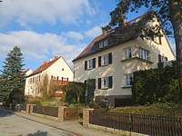Die Gnaschwitzer Straße entstand 1938 und wurde am 13. September offiziell Dirschauer Straße benannt. Die Stadt Dirschau liegt im ehemaligen preußischen Regierungsbezirk Danzig an der Weichsel und gehört seit 1945 zu Polen (Tczew). Da die Erinnerung an die früheren deutschen Ostgebiete in der DDR nicht erwünscht war, entschloss man sich, die entsprechenden Straßennamen zu verändern _(siehe dazu Königsberger Straße)_. In diesem Zusammenhang erhielt auch die Dirschauer Straße am 20. Januar 1967 einen neuen Namen. Gnaschwitz liegt in der Nähe von Bautzen und gehört heute als Ortsteil zu Doberschau-Gaußig.

## Großschönauer Straße

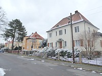Die frühere Neidenburger Straße entstand 1903 und erhielt am 9. April 1903 auf Beschluss des Bühlauer Gemeinderates den Namen Körnerstraße. Um Verwechslungen mit der Körnerstraße in der Inneren Neustadt zu vermeiden, erfolgte am 1. Juni 1926 die Umbenennung nach der Stadt Neidenburg in der Nähe von Königsberg. Da man zu DDR-Zeiten die Benennung von Straßen nach Orten in den ehemaligen deutschen Ostgebieten für ungeeignet erhielt, erfolgte 1967 eine größere Umbenennungsaktion, von der mehrere Bühlauer Straßen betroffen waren _(siehe dazu Königsberger Straße)_. In diesen Zusammenhang erhielt die Neidenburger Straße am 20. Januar 1967 ihren heutigen Namen nach der Webergemeinde Großschönau in der Oberlausitz.

Das Straßenbild dominieren Ein- und Zweifamilienhäuser, die zwischen 1900 und 1940 entstanden. Zu den ältesten Häusern gehört das unter Denkmalschutz stehende Landhaus Nr. 19 mit Zierfachwerk, Holzloggien und Jugendstilelementen. An der Einmündung des Heidemühlweges befindet sich das 1928 erbaute jüngste Bühlauer Forsthaus. Zu den früheren Bewohnern der Großschönauer Straße gehören der Schriftsteller Ludwig Renn, der Geodät und TH-Professor Reinhard Hugershoff (beide Nr. 30) und der Arbeiterfunktionär Otto Buchwitz (Nr. 21).

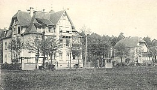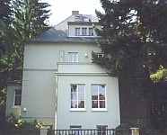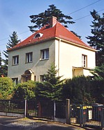

**_Fotos:_** _Die Großschönauer Straße mit den Wohnhäusern von Otto Buchwitz (Nr. 21 - Mitte)_

_und Ludwig Renn (Nr. 30 - rechts)_

Als Gründelsteig wird der von der Grundstraße aus ansteigende Fußweg zum Crostauer Weg bezeichnet. Am 6. Juni 1937 erhielt er nach seiner geografischen Lage in einem kleinen Taleinschnitt seinen heutigen Namen. Im Wohnhaus Nr. 8 wohnte viele Jahre der Verkehrswissenschaftler und Rektor der Hochschule für Verkehrswesen Prof. Dr. Gerhard Rehbein.

## [Grundstraße](../../../nordost/loschwitz/strassen_loschwitz/grundstrasse/)

1897 beschloss der Bühlauer Gemeinderat den Bau von zwei neuen Straßen, im Projekt als Planstraßen A (heute Oybiner Straße) und B bezeichnet. Antragsteller war der Grundstücksbesitzer Ernst Robert Kunath, der das Gebiet für eine Bebauung erschließen wollte. Um 1900 erhielt die Planstraße B offiziell den Namen Mittelstraße. Da es nach der Eingemeindung Bühlaus in Dresden bereits eine gleichnamige Straße in der Wilsdruffer Vorstadt gab, benannte man die Bühlauer Mittelstraße am 1. Juni 1926 in Tilsiter Straße um. Tilsit ist eine Stadt im früheren ostpreußischen Regierungsbezirk Gumbinnen in der Nähe der Grenze zu Litauen.

Weil man die Namensgebung vieler Bühlauer Straßen nach Orten in den ehemaligen deutschen Ostgebieten als nicht mehr zeitgemäß betrachtete, gab es 1967 eine große Umbenennungsaktion _(siehe Königsberger Straße)_. In diesem Zusammenhang erhielt die Tilsiter Straße am 20. Januar 1967 nach der Gemeinde Hainewalde bei Zittau den Namen Hainewalder Straße.

## Hegereiterstraße

Die Straße wurde Ende des 19. Jahrhunderts als Waldparkstraße angelegt und ist 1897 erstmals im Adressbuch zu finden. Nach der Eingemeindung Bühlaus erhielt sie am 1. Juni 1926 den Namen Hegereiterstraße. Ein solcher war in Bühlau bereits ab 1720 eingesetzt. Im Auftrag des Kurfürsten oblag dem Hegereiter die Hege und Pflege des zugewiesenen Forstreviers und der hier lebenden Wildbestände. Sein Amtssitz befand sich im Bühlauer Forsthaus, dessen Geschichte sich bis 1596 zurückverfolgen lässt. Bekanntester Bühlauer Hegereiter war der Forstmeister Beckmann, der sich auch als Schriftsteller betätigte. Sein Sohn legte um 1800 eine forstkundliche Sammlung mit ausgestopften Tieren und verschiedenen Holzproben an.

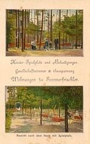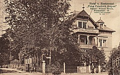Am nördlichen Ende der Hegereiterstraße lag einst der Eingang zum [Bühlauer Waldpark](../../../nordost/buhlau/) mit der 1907 errichteten Rodelbahn. Das für diese Bahn errichtete hölzerne Aussichtsgerüst musste 1935 wegen Baufälligkeit abgetragen werden. An der Straße stehen mehrere denkmalgeschützte Wohnhäuser aus der Zeit um 1900, so die Nummern 5, 7, 8 (Villa Buen-Ayre) und 9 (ehem. Fremdenheim Beichler). Alle sind im typischen Landhaustil ihrer Zeit mit Zierfachwerk, Balkons und Loggien und verschiedenen Jugendstilelementen gestaltet. Das Landhaus Hegereiterstraße 10, 1897 als Villa Rheingold errichtet, war noch bis nach 1945 als Hotel und Restaurant "Prinz Friedrich August" in Betrieb _(Fotos)_. Neben Gästezimmern und Gesellschaftszimmern gehörten ein schattiger Kaffeegarten und ein Kinderspielplatz mit verschiedenen Belustigungen zum Lokal. Auch in der Villa Waldfrieden (Nr. 16) gab es vor dem Zweiten Weltkrieg eine Pension. Ursprünglich befand sich diese im Besitz des Restaurateurs Moritz Eduard Richter, Betreiber des Loschwitzer Ratskellers.

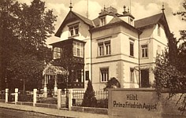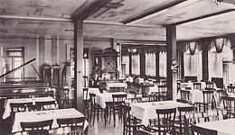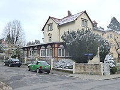

**_Fotos:_** _Das frühere Hotel Prinz Friedrich August auf der Hegereiterstraße 10 einst und jetzt_

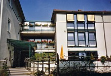Ruheheim Bühlau (Nr. 6): Das Heim entstand als Seniorenwohnheim an der Hegereiterstraße 6 und wurde am 21. November 1931 eröffnet. Bis 1945 wurde es von einem gemeinnützigen Verein betrieben und ging dann in den Besitz der Inneren Mission über. Bedingt durch die Not der Nachkriegszeit mussten die ursprünglich großzügig angelegten Wohn- und Gemeinschaftsräume in kleine Zimmer aufgeteilt werden. 1955 erwarb die Innere Mission das Wohnhaus Königsberger Straße 46 und schloss es als Haus 2 dem Heim an. Ein weiteres Gebäude kam 1978 hinzu. Das seit den 1980er Jahren schrittweise modernisierte Altersheim wurde 1990 vom Diakonischen Werk - Stadtmission Dresden e.V. übernommen. 2001 entstand ein moderner Ergänzungsbau an der Ecke Königsberger/ Hegereiterstraße _(Foto)_.

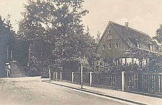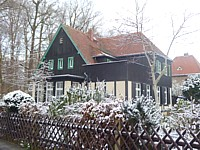Nr. 20: Ein weiteres Erholungsheim befand sich früher in der Nr. 20. Das Heim gehörte zum Ehrlichschen Gestift, einer von einem Dresdner Ratsherren gestiftete Bildungseinrichtung, die sich bis 1945 am heutigen Straßburger Platz befand. Zuvor lebte hier ab ca. 1922 die Bildhauerin Glenny Oelsner von Lorck, Mitglied der 1904 entstandenen "Gruppe Dresdner Künstlerinnen", die sich der Förderung und Gleichstellung kunst- und kunstgewerbetreibender Frauen widmete und ab 1906 mehrere Ausstellungen organisierte. Zugleich setzte der Verein 1919 die Zulassung von Frauen an der Kunstakademie durch. Heute dient das Gebäude als privates Wohnhaus.

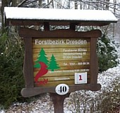Der früher auch als Haidemühlweg bzw. Haidemühlenweg bezeichnete Heidemühlweg ist erstmals 1841 erwähnt und seit 1897 offiziell im Adressbuch verzeichnet. Sein Name erinnert an die inmitten der Dresdner Heide gelegene [Heidemühle](../../../nordost/dresdner_heide/heidemuhle/), die in Verlängerung des Weges über den "Zweienweg" erreichbar ist. Zunächst existierte der Heidemühlweg nur innerhalb eines Wohngebietes an der heutigen Großschönauer Straße, wurde jedoch 1901 bis zur Ullersdorfer Straße und später bis zur Bautzner Landstraße verlängert.

Das Wohnhaus Nr. 26, ein schlichter, historisierender Putzbau mit kleinen, turmartigen Dachgauben, steht unter Denkmalschutz. Am Ende des Heidemühlweges befindet sich heute der Sitz des Forstreviers Bühlau (Nr. 40).

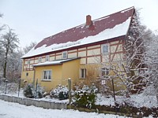Der kurze Hempelweg führt südlich des 299 m hohen Taubenbergs entlang und verbindet die hier gelegene kleine Wohnsiedlung mit der Quohrener Straße. Seinen Namen verdankt er einem Bauerngehöft (ehem. Quohrener Straße 71), welches sich einst im Besitz der Familie Hempel befand (heute Hempelweg 5 - _Foto_). Amtlich benannt ist die als Zufahrt zu diesem Gehöft angelegte Straße jedoch erst seit dem 2. November 1995. Das unter Denkmalschutz stehende Wohnstallhaus entstand in seinen Grundzügen in der zweiten Hälfte des 18. Jahrhunderts und wurde im 19. Jahrhundert umgebaut. Der giebelständige Fachwerkbau besteht aus Wohn- und Stallbereich im hinteren Teil sowie einem angebauten Backhaus. Das Erdgeschoss ist massiv aus Natursteinen gemauert. Amtlich benannt ist die als Zufahrt zu diesem Gehöft angelegte Straße jedoch erst seit dem 2. November 1995.

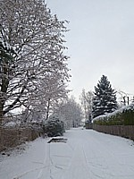Der Hornweg geht auf einen alten Kammweg über das Schönfelder Hochland zurück, der die Verbindung zwischen Dresden und Stolpen herstellte und deshalb Stolpischer Weg genannt wurde. Nach dem Ausbau der Bautzner Landstraße verlor dieser Weg an Bedeutung, ist heute jedoch in einigen Abschnitten noch als Wanderweg erhalten. Teile gingen in der heutigen Eschdorfer Straße auf. Der übrige Abschnitt des Weges erhielt am 4. November 1926 auf Bühlauer Flur amtlich den Namen Hornweg.

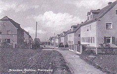Wenig später entstand hier eine kleine Wohnsiedlung. Bauherr der Häuser war der Siedlerverein der Kinderreichen, dessen Mitglieder mindestens vier Kinder haben mussten, wobei selbst bis zu 16-köpfige Familien dem Verein engehörten. Nach Entwürfen des Architekten Willy Schubert entstanden preiswerte Wohnhäuser mit mehreren Wohn- und Schlafräumen, Bädern und ausgebauten Dachgeschossen. Zur Eigenversorgung gehörte zu jedem Grundstück ein 600 m² großer Garten und meist ein Stallgebäude für die Kleintierhaltung. Hinter dem Haus Nr. 1a gab es eine Wäschemangel für die Bewohner.

Nach 1990 wurden die kleinen Siedlungshäuser saniert und dabei modernen Ansprüchen entsprechend verändert. Weitere Wohnhäuser entstanden ab 1999 an der Einmündung Reitzendorfer Straße.

Der Juliusweg am Rand der Dresdner Heide entstand bereits vor dem Zweiten Weltkrieg und wurde nach dem sächsischen Hofbuchdrucker Julius Walter Meinhold damals Walter-Meinhold-Weg genannt. Meinhold war ab 1877 Mitinhaber der bekannten [Druckerei Meinhold & Söhne](../../../Zentrum/Pirnaische_Vorstadt/Strassen_Pirnaische_Vorstadt/Zinzendorfstrasse/Meinhold_Sohne/meinhold_sohne.html), die bis 1945 ihren Sitz auf der Zinzendorfstraße in der Pirnaischen Vorstadt hatte. Nach dem Krieg erfolgte aus unbekannten Gründen die Umbenennung in Juliusweg.

## Kirschauer Straße

Die in der Nähe des Bühlauer Rathauses gelegene Kirschauer Straße entstand um 1908 als Planstraße N und erhielt im Anschluss den Namen Wiesenstraße, wobei wohl die damals noch weitgehend fehlende Bebauung den Ausschlag gab. Um eine Namensdoppelung zu vermeiden, erfolgte fünf Jahre nach der Eingemeindung am 1. Juni 1926 die Umbenennung in Lötzener Straße. Dabei wählte man wie bei den anderen zeitgleich erfolgten Neubenennungen den Namen einer ostpreußischen Stadt im früheren Regierungsbezirk Gumbinnen. Am 20. Januar 1967 erhielt die Straße ihren heutigen Namen nach dem Erholungsort Kirschau in der Oberlausitz.

Von 1966 bis zu seinem Tod 1982 wohnte im Haus Kirschauer Straße 8 der Maler und Graphiker Wilhelm Rudolph, der durch seine Federzeichnungen des zerstörten Dresden bekannt wurde. Rudolph erhielt für seine Verdienste 1979 die Ehrenbürgerwürde der Stadt verliehen.

## Königsberger Straße

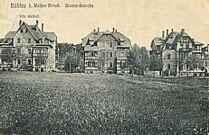
Die heutige Königsberger Straße wurde 1903 als Planstraße C angelegt und erhielt noch im gleichen Jahr den Namen Bismarckstraße. Zunächst bezog sich dieser Name nur auf den Abschnitt zwischen Milkeler und Bautzner Landstraße, während der westliche Abschnitt kurzzeitig Reinholdstraße genannt wurde. Wenig später übertrug man den Namen des früheren Reichskanzlers Otto von Bismarck auf den gesamten Straßenzug. Um Verwechslungen mit gleichnamigen Straßen zu vermeiden, erfolgte mit Wirkung vom 1. Juni 1926 eine umfassende Neubenennung fast aller Bühlauer Straßen. Dabei entschied man sich für Ortsnamen aus dem ostpreußischen Gebiet. In diesem Zusammenhang wurde die Bismarckstraße nach der Hauptstadt der Provinz in Königsberger Straße umbenannt.

Das seit 1945 als Exklave zu Russland gehörende Königsberg erhielt 1946 auf Weisung Stalins den Namen Kaliningrad. Diese Namensänderung war der Grund, am 15. August 1962 auch die Königsberger Straße in Kaliningrader Straße umzubenennen. 1967 wurden auch die übrigen Namen ostpreußischer Herkunft von den Bühlauer Straßenschildern entfernt und durch politisch unverfängliche Bezeichnungen nach Orten in der Oberlausitz ersetzt _(siehe Übersicht)_. Als einzige dieser Straßen erhielt die Königsberger Straße am 18. November 1991 ihren alten Namen zurück.

Alte und neue Bühlauer Straßennamen (Auswahl):

**aktueller Name (ab 1967)**

**alter Name (bis 1967)**

**ursprünglicher Name**

**(vor 1926)**

Cunewalder Straße

Marienwerder Straße (ab 1935)

-

Eibauer Straße

Bromberger Straße (ab 1935)

Trompeterstraße (ab 1893)

Gnaschwitzer Straße

Dirschauer Straße (ab 1938)

-

Großschönauer Straße

Neidenburger Straße (ab 1926)

Körnerstraße (ab 1903)

Hainewalder Straße

Tilsiter Straße (ab 1926)

Mittelstraße (ab 1900)

Kirschauer Straße

Lötzener Straße (ab 1926)

Wiesenstraße (ab 1908)

Leppersdorfer Straße

Elbinger Straße (ab 1931)

-

Liegauer Straße

Angerburger Straße (ab 1937)

-

Lomnitzer Straße

Ortelsburger Straße (ab 1929)

Lotzdorfer Straße

Gumbinner Straße (ab 1937)

-

Lückendorfer Straße

Johannesburger Straße (ab 1926)

-

Milkeler Straße

Memelstraße (ab 1926)

Goethestraße (ab 1914)

Neschwitzer Straße

Gilgenburger Straße (1937)

-

Neudecker Straße

Neudecker Straße (ab 1926)

-

Neugersdorfer Straße

Danziger Straße (ab 1926)

Grenzweg (ab 1903)

Neukircher Straße

Darkehmer Straße (ab 1926)

Angerapper Straße (ab 1938)

Südstraße (ab 1903)

Olbersdorfer Straße

Marienburger Straße (ab 1926)

Querallee (ab 1914)

Oppacher Straße

Rigaer Straße (ab 1936)

-

Ostritzer Straße

Friedlandstraße (ab 1934)

Kurze Straße (ab 1903)

Oybiner Straße

Pillauer Straße

(1926-1945 Ostmarkstraße)

Carolastraße (ab 1903)

Moltkestraße (ab 1903)

Rossendorfer Straße

Kolberger Straße (ab 1929)

-

Sohlander Straße

Graudenzer Straße (ab 1938)

-

Taubenheimer Straße

Lycker Straße (ab 1935)

-

Wachauer Straße

Insterburger Straße (ab 1933)

-

Wehrsdorfer Straße

Allensteiner Straße (ab 1925)

-

Weißenberger Straße

Tannenbergstraße (ab 1926)

Braunsberger Straße (ab 1945)

Loschwitzer Straße (ab 1903)

Schillerstraße (ab 1906)

Wetroer Straße

Thorner Straße (ab 1926)

Theresienstraße (ab 1896)

Wilthener Straße

Posener Straße (ab 1926)

Feldstraße (ab 1903)

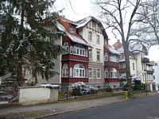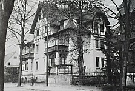In diesem Teil Bühlaus sind bis heute verschiedene architektonisch interessante Gebäude erhalten geblieben. Bereits kurz nach der Jahrhundertwende entstanden die ersten Landhäuser Nr. 6, 8 _(Foto links)_ und 10 _(Foto rechts)_ mit Zierfachwerk, hölzernen Balkonen, Loggien und Jugendstilelementen. In einem dieser Häuser (Nr. 6), 1904 von Ernst Härtwig als "Villa Waldrast" erbaut, befindet sich seit 1945 der Sitz der traditionsreichen Firma Glas-Beier, die sich auf Glasmalerei und Bleiverglasungen spezialisiert hat. Gründer Oskar Beier war ab 1927 Präsident des deutschen Glasmalerverbandes. Später übernahm sein Sohn Oskar Fritz Beier den Betrieb. Von ihm stammen unter anderem die Glasfenster der Bethlehemkirche in Tolkewitz, der Lukaskirche, der Friedenskirche und verschiedener öffentlicher Gebäude. Sehenswert ist das kleine Werksmuseum mit Verkaufsausstellung.

Das Gebäude Königsberger Straße 8 diente vor dem Ersten Weltkrieg als Pension "Waldesruh", in welchem u. a. Patienten des Lahmann-Sanatoriums wohnten. In den 1930er Jahren wurde diese nach ihren Besitzern als Pension Harnath bzw. Fremdenheim Becker bezeichnet. Die dritte dieser Villen ist 1910 als "Villa Waldlust" im Adressbuch verzeichnet. Alle drei Häuser stehen unter Denkmalschutz.

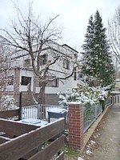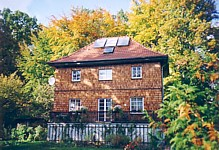Nach dem Ersten Weltkrieg wurden weitere Wohngebäude an der Königsberger Straße und ihren Nebenstraßen errichtet. Bemerkenswert sind die Villen Nr. 18, 1929 im Bauhausstil erbaut _(Foto links)_, sowie das benachbarte Wohnhaus Königsberger Straße 22 _(Foto rechts)_. Dieses entstand 1925 für die große "Jahresschau Deutscher Arbeit", wurde von einer fränkischen Holzhausfirma angefertigt und nach Ausstellungsende von einem Bühlauer Einwohner erworben und umgesetzt. Leider gingen Teile der Fassade 1945 bei einem Bombenangriff verloren. 1936 entstand das ebenfalls unter Denkmalschutz stehende Einfamilienhaus Königsberger Straße 40, ein schlichter, zeittypischer Putzbau mit Heimatstilelementen. Im Haus Nr. 41 lebte bis zu seinem Tod 1990 der Opernsänger Rudolf Dittrich, Ehrenmitglied der Staatsoper, dessen Grab auf dem Bühlauer Friedhof zu finden ist.

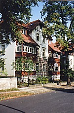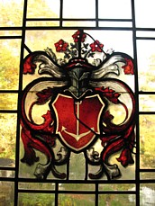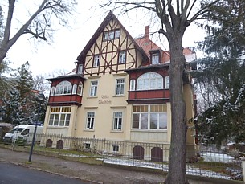

**_Fotos:_** _Wohnhaus Königsberger Straße 8 (links), Bleiglasfenster im Treppenhaus von Nr. 6 (Mitte) und Nr. 10 (rechts)_

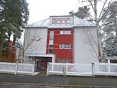Zu den älteren Gebäuden der Königsberger Straße gehören die Mietvillen Nr. 46 und 47, beide aus der Zeit um 1910, und im zeittypischen Stil mit Putzfassaden, Mansarddach und straßenseitigen Giebeln, Ecktürmchen und Holzbalkonen versehen. Baugeschichtlich stehen diese wie viele Villenbauten in Bühlau in der Tradition des Luftkurortes nach dem Vorbild des benachbarten Weißen Hirsch. Einige Baulücken wurden nach 1990 mit modernen Neubauten geschlossen. Architektonisch interessant sind dabei das Wohnhaus Nr. 4 und die beiden Häuser Königsberger Straße 33 _(Foto rechts)_ und Milkeler Straße 15. Letztere bilden ein Häuserpaar und wurden einer früheren Tradition folgend mit Namen versehen: "Fauna" und "Flora" mit stilisierten Darstellungen an der Fassade.

Der Landsteig befindet sich im Bühlauer Ortsteil Quohren und geht auf einen alten Feldweg zurück, der früher in Richtung Rochwitz führte. Ihren Namen trägt die Straße seit dem 28. Januar 1939.

## Langenauer Weg

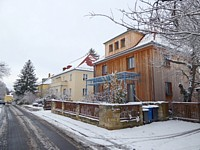Der Langenauer Weg wurde im Zusammenhang mit der Bebauung zuvor landwirtschaftlich genutzter Flächen am östlichen Bühlauer Ortsrand angelegt und am 3. November 1933 offiziell benannt. Namensgeber war, einer Bühlauer Tradition folgend, eine Ortschaft in Ostpreußen (heute Leganow) in der Nähe von Deutsch-Eylau (Ilawa). An dem als reine Anliegerstraße geplanten Weg entstanden in der Folge Einfamilienhäuser. Zeitweise gab es hier auch einen kleinen Lebensmittelladen (Nr. 10) und eine Kohlenhandlung (Nr. 11). Einige kriegsbedingt verbliebene Baulücken konnten in den 1980er und 1990er Jahren durch moderne Doppelhäuser geschlossen werden. Als einzige Bühlauer Straße blieb der Langenauer Weg bei der großen Umbenennungsaktion 1967 unberücksichtigt, wohl weil es in der Nähe von Freiberg ebenfalls einen Ort Langenau gibt.

Nr. 1: Das in den 1930er errichtete Wohnhaus befand sich einst im Besitz der Familie Vollmann. Die Jugendzeit von Tochter Helga Vollmann und eines Freundes der Familie, des Zahnarztsohnes Martin Ranft, verarbeitete der Schriftsteller Martin Walser in seinem Roman “Die Verteidigung der Kindheit” und dokumentierte damit zugleich ein Stück Dresdner Nachkriegsgeschichte. Nach dem Tod von Helga Vollmann stand das Haus viele Jahre leer und wurde 2012 saniert.

Die Leppersdorfer Straße entstand im Zusammenhang mit der Bebauung am östlichen Rand von Bühlau. Die ersten Gebäude wurden um 1930 vom Spar- und Bauverein Bühlau und Umgegend eGmbH errichtet. Im Folgejahr erhielt die Planstraße 28 am 22. Juni 1931 nach der ostpreußischen Stadt Elbing (Elblag) den Namen Elbinger Straße. Im Zuge der großen Umbenennungsaktion 1967 _(siehe Königsberger Straße)_ wurde sie am 20. Januar 1967 in Leppersdorfer Straße umbenannt. Leppersdorf liegt in der Nähe von Pulsnitz und gehört heute als Ortsteil zu Wachau.

Auch die Liegauer Straße wurde im Zuge der baulichen Erweiterung Bühlaus in den 1930er Jahren angelegt. Am 6. Juni 1937 bekam die bisherige Planstraße 27 den Namen Angerburger Straße. Angerburg ist eine Kreisstadt im preußischen Regierungsbezirk Gumbinnen am Fluss Angerapp und gehört heute zu Polen (Wegorzewo). Am 20. Januar 1967 wurde auch die Angerburger Straße umbenannt und trägt seitdem den Namen Liegauer Straße. Namensgeber ist der kleine Ort Liegau (Liegau-Augustusbad), der heute zu Radeberg gehört.

Die Lomnitzer Straße entstand Mitte der 1920er Jahre als Planstraße 23 und wurde am 26. September 1929 Ortelsburger Straße benannt. Die Stadt Ortelsburg liegt im ehemaligen preußischen Regierungsbezirk Allenstein und gehört heute zu Polen (Szczytno). Wenig später entstanden hier durch den Bauunternehmer E.Ad. Willi Schmiedchen einige Wohnhäuser. In einem dieser Gebäude (Nr. 3) wohnte Stadtbaudirektor Erich Hunger. Wie fast alle nach ostpreußischen Orten benannten Straßen wurde auch die Ortelsburger Straße am 20. Januar 1967 umbenannt und heißt seitdem Lomnitzer Straße. Lomnitz gehört als Ortsteil zu Wachau und liegt nördlich von Radeberg.

Die Lotzdorfer Straße wurde Mitte der 1930er Jahre am östlichen Rand von Bühlau als Planstraße 46 angelegt und am 12. Mai 1937 Gumbinner Straße benannt. Die Stadt Gumbinnen liegt an der Pissa im heute russischen Teil Ostpreußens. Bei der Umbennungsaktion der nach ostpreußischen Orten benannten Straßen am 20. Januar 1967 wurde sie in Lotzdorfer Straße umbenannt. Lotzdorf liegt nordwestlich von Radeberg und ist heute ein Ortsteil dieser Stadt.

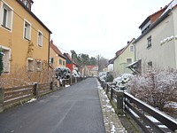Mitte der 1920er Jahre entstand am Rande der Dresdner Heide ein Wasserpumpwerk der DREWAG (Nr. 3), ergänzt um einige Wohnhäuser für Angestellte. Die dabei angelegte Planstraße 44 erhielt am 1. Juni 1926 den Namen Johannisburger Straße. Namensgeber war die Kreisstadt Johannisburg im ostpreußischen Regierungsbezirk Gumbinnen (heute Pisz/Polen). Wie viele andere Bühlauer Straßen wurde diese am 20. Januar 1967 nach einer Gemeinde in Ostsachsen umbenannt und heißt seitdem Lückendorfer Straße. Lückendorf ist ein beliebter Luftkurort im Zittauer Gebirge.

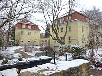Die heutige Milkeler Straße entstand 1906 gemeinsam mit dem Nachtflügelweg als Planstraße E und machte am nördlichsten Punkt einen Knick. Der westliche Abschnitt erhielt den Namen Nachtflügelweg, der östliche wurde nach seinem Ausbau ab 1914 Goethestraße genannt. Parallel erhielt die benachbarte Schillerstraße (heute Weißenberger Straße) ihren Namen. Da es jedoch in Dresden bereits eine Goethestraße gab, erfolgte am 1. Juni 1926, fünf Jahre nach der Eingemeindung, die Umbenennung in Memelstraße. Namensgeber war die heute zu Litauen gehörende Stadt Memel (Klaipeda) im Regierungsbezirk Königsberg.

Auch die Memeler Straße gehörte zu den Bühlauer Straßen, die bei der großen Umbenennungsaktion von Straßen, die nach Orten in den ehemaligen Ostgebieten benannt waren, einen neuen Namen _(siehe Königsberger Straße)_. Seit dem 20. Januar 1967 wird sie Milkeler Straße genannt. Der Ort Milkel liegt in der Nähe von Bautzen und gehört heute zu Radibor. Das Foto zeigt die Häusergruppe Milkeler Straße 29 und 31 aus den 1920er Jahren.

## Nachtflügelweg

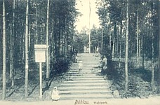
Der Name geht auf eine alte Flurbezeichnung der Dresdner Heide zurück. Ursprünglich wurde dieser Weg Nachtflügel genannt und führte bis zur Bautzner Landstraße. 1898 ist er als Nachtflügelweg erstmals in einer Akte erwähnt und bildet den nördlichen Abschluss des ab 1894 entstandenen Villenviertels Neubühlau. 1906 wurde dieser Weg zusammen mit der heutigen Milkeler Straße ausgebaut. Wenig später entstanden die ersten Wohnhäuser (Nr. 8 und 10) im zeittypischen Villenstil mit verschiedenen Schmuckelementen. Beide Gebäude stehen heute unter Denkmalschutz.
Nr. 12 diente einst wie viele Gebäude in Neubühlau als Fremdenheim (Pension Teihe).

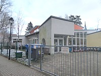 Auf Anregung des Verschönerungsverein Bühlau wurde am Nachtflügelweg ab 1900 der Bühlauer Waldpark angelegt _(Foto links)_. Dieser besaß neben einem Konzertplatz ab 1907 auch eine Rodelbahn, Spazierwege und Ruheplätze. Leider verfiel die Anlage im Laufe der Zeit und ist heute nur noch in Resten erkennbar. 1930/32 entstand auf Teilen des Geländes ein Golfplatz. 1946 wurde auf dem Areal die Kleingartensparte [“Bühlauer Waldgärten”](../../../nordost/buhlau/) angelegt. Außerdem gab es seit 1925 einen in den 1950er Jahren erneuerten Waldsportplatz. Heute wird dieser von der SG Bühlau 2009 genutzt und 2016 mit Kunstrasen versehen. In der Nr. 16, einem modernen eingeschossigen Bau, befindet sich die Kita "Am Hochwald e.V." _(Foto rechts)_.

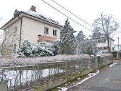Die Neschwitzer Straße entstand 1906 als Planstraße B und verband die heutige Hegereiterstraße mit der Milkeler Straße. Zunächst wurde jedoch nur der westliche Teil bis zur Straße Am Bauernbusch ausgebaut (heute Wetroer Straße). Während der mittlere Abschnitt bis heute nicht ausgeführt wurde, entstand 1937 zwischen Weißenberger und Milkeler Straße eine neue Wohnstraße, die am 17. Februar 1937 den Namen Gilgenburger Straße erhielt. Gilgenburg ist eine heute polnische Stadt (Dabrówno) im früheren preußischen Regierungsbezirk Königsberg.

Im Zuge der Umbenennung der als unzeitgemäß betrachteten Namensgebung nach Orten in den früheren Ostgebieten erhielt die Gilgenburger Straße am 20. Januar 1967 den Namen Neschwitzer Straße nach der Gemeinde Neschwitz in der Nähe von Bautzen. Das um 1930 errichtete Einfamilienhaus Neschwitzer Straße 4 steht als typisches Beispiel eines villenartigen Einfamilienhauses aus dieser Zeit unter Denkmalschutz _(Foto)_.

## Neubühlauer Straße

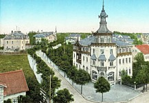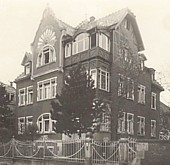Die Neubühlauer Straße wurde 1895 als König-Albert-Allee angelegt und in den folgenden Jahren mit villenartigen Wohnhäusern bebaut. Initiator des neuen Stadtviertels war Reinhold Ulbricht, der 1894 das Gelände erworben hatte und durch ein Straßennetz erschließen ließ. Ursprünglich führte sie nur bis zur Hegereiterstraße, wurde jedoch bis zum Zweiten Weltkrieg abschnittsweise verlängert. Mit Abschaffung der Monarchie veränderte man den Straßennamen 1921 zunächst in Albertstraße, bevor am 1. Juni 1926 der bis heute gültige Name eingeführt wurde.

Kurz nach Erschließung des Viertels errichteten private Bauherren hier villenartige Landhäuser. Im Eckhaus zur Bautzner Landstraße (Nr. 2) mit seinem markanten Turm befand sich ursprünglich die bis heute gegenüber bestehende Hubertusapotheke. 1896 entstand im hinteren Teil des Grundstücks Nr. 3 die erste Bühlauer Kirche für die Evangelische Gemeinschaft, die heute von der [Evangelisch-methodistischen Kirche](../../../nordost/buhlau/ev_-methodistische_friedenskir/) genutzt wird. Das Vorderhaus beherbergte ab 1907 die Pension Wantke und wurde auch später als Fremdenheim genutzt.

Weitere historisch bemerkenswerte Bauten sind die Villen Nr. 1, Nr. 5 (Villa Clara - _Foto rechts oben_), Nr. 8 (Villa Edelweiß), Nr. 9, Nr. 10 (Villa Daheim), Nr. 11 (Villa Diana) und Nr. 12 (Villa Wald-Idyll). Diese entstanden 1895/96 im zeittypischen Stil als Mietvillen und wurden mit markanten Giebeln, Erkern, hölzernen Loggien und Zierfachwerk gestaltet. Teilweise finden sich Anklänge an den Jugendstil, so dass die Neubühlauer Straße heute am deutlichsten das Bild des aufstrebenden Kurorts der Jahrhundertwende vermittelt.

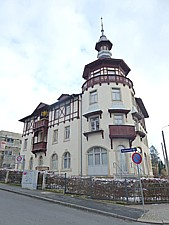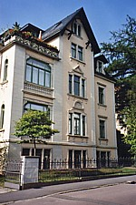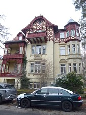

**_Fotos:_** _Villen an der Neubühlauer Straße: Nr. 2 (links) - Nr. 9 (Mitte) - Nr. 11 (rechts)_

Die Neudecker Straße erhielt ihren Namen am 3. November 1933 nach der Ortschaft Neudeck (heute Ogrodzieniec) in der Region Gebiet Ermland-Masuren, die seit 1945 zu Polen gehört. Als eine der wenigen nach Orten in den früheren Ostgebieten benannte Straße behielt sie auch bei der Umbenennungsaktion 1967 ihren Namen.

## Neukircher Straße

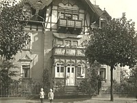
Ebenso wie viele Bühlauer Straßen wechselte auch die am Rathaus von der Bautzner Landstraße abzweigende Neukircher Straße mehrfach ihren Namen. 1897 angelegt, wurde sie ab 1903 zunächst Südstraße genannt. Am 1. Juni 1926 erhielt sie im Zusammenhang mit der Eingemeindung des Ortes den Namen Darkehmer Straße. Darkehmen ist eine Kleinstadt im früheren Regierungsbezirk Gumbinnen und gehört heute zum russischen Oblast Kaliningrad (Königsberg). Der im Ersten Weltkrieg schwer zerstörte Ort war in den 1920 im Rahmen einer Patenschaft zum Wiederaufbau mit Dresden verbunden. 1938 erfolgte eine Umbenennung des Ortes in Angerapp nach dem Fluß, der durch diese Stadt fließt. Wenig später wurde deshalb auch die Darkehmer Straße in Angerapper Straße umbenannt. Beide Bezeichnungen knüpften an die Bühlauer Tradition an, Straßen nach Orten in West- und Ostpreußen zu benennen.

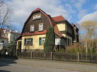 Um die politisch nicht gewünschte Erinnerung an die früheren deutschen Ostgebiete zu tilgen, beschloss der Stadtrat 1967, diese Bezeichnungen aufzuheben und durch Ortsnamen der Oberlausitz zu ersetzen. Neben der Neukircher Straße betraf das weitere Straßen, vor allem im Ortsteil Neubühlau _(vgl. Übersicht im Anschluss an die Königsberger Straße)_.

Markantestes Gebäude ist das 1914/15 entstandene [Feuerwehrdepot](../../../nordost/buhlau/) (Nr. 1). Ursprünglich diente dieses als Kinderbewahranstalt, bevor 1958 die neugebildete Freiwillige Feuerwehr Bühlau einzog und das Gebäude bis heute als Gerätehaus nutzt. Seit 2013 gibt es auch wieder eine Kita an der Neukircher Straße 20. Architektonisch interessant sind auch die Gebäude Nr. 3 (Villa Paula) und Nr. 9, die ebenfalls unter Denkmalschutz stehen.

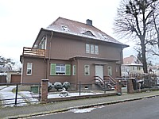Die Olbersdorfer Straße ist erstmals in einem Bebauungsplan von 1906 als Straße M erwähnt und erhielt noch vor dem Ersten Weltkrieg den Namen Querallee. Ursprünglich wurde sie bereits 1898 in der Akte "Das Straßenprojekt von Arnold und Lahode betr." geplant, jedoch findet sich der Name Querallee erst im Adressbuch von 1914. Zur Vermeidung von Verwechslungen bekam sie nach der Eingemeindung Bühlaus am 1. Juni 1926 den Namen Marienburger Straße. Marienburg (poln. Malbork) liegt im ehemaligen Regierungsbezirk Danzig und war im Mittelalter Sitz des Deutschen Ritterordens.

Im Zuge der Umbenennung der nach ostpreußischen Orten benannten Straßen wurde die Marienburger Straße am 20. Januar 1967 in Olbersdorfer Straße umbenannt. Olbersdorf liegt in der Oberlausitz in der Nähe von Zittau. Die Gebäude Nr. 7 und 9 stehen unter Denkmalschutz. Das schlichte, jedoch gestalterisch anspruchsvolle Einfamilienhaus Nr. 7 entstand 1931 und besitzt weit vorkragende Balkone und ein mit vertikalen Fensterbändern gestaltetes Treppenhaus mit Vorhalle. Nr. 9 ist ein für die Zeit charakteristisches Holzhaus in Fertigteilbauweise und wurde 1925 errichtet _(Foto)_.

Die Anfang der 1930er Jahre als Planstraße P angelegte Oppacher Straße erhielt am 2. Mai 1936 zunächst den Namen Rigaer Straße nach der Hauptstadt von Lettland. Ab 20. Januar 1967 wurde sie im Zuge der großen Umbenennungsaktion in Oppacher Straße benannt. Namensgeber ist der Ort Oppach in der Oberlausitz.

Die heutige Ostritzer Straße entstand 1903 als Verbindung zwischen Großschönauer und Oybiner Straße im Zusammenhang mit der Erschließung eines kleinen Wohngebietes. Ab 9. April 1903 wurde sie zunächst Kurze Straße genannt. Am 17. Januar 1934 erfolgte die Umbenennung in Friedlandstraße. Friedland (heute Prawdinsk) ist eine Kreisstadt im früheren Regierungsbezirk Königsberg und gehört heute zur russischen Exklave Kaliningrad. Seit dem 20. Januar 1967 ist sie nach der Kleinstadt Ostritz an der Neiße, unmittelbar an der polnischen Grenze benannt.

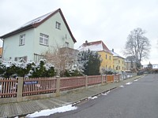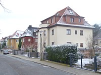

**_Fotos:_** _Neubühlauer Straßen - links die Ostritzer Straße - rechts die Oybiner Straße_

Die Oybiner Straße entstand um 1900 und wurde später mehrfach verlängert. Ältester Teil ist der Abschnitt zwischen Heidemühlweg und Ullersdorfer Straße, der ab 1903 nach der sächsischen Königin Carola Carolastraße benannt wurde (zuvor Straße A). Gleichzeitig erfolgte die Namensgebung Mittelstraße für die heutige Hainewalder Straße (zuvor Straße B). Im westlichen Teil entstand zwischen Königsberger und Olbersdorfer Straße ein zweiter Straßenabschnitt. 1906 erhielt dieser den Namen Moltkestraße. Helmuth Karl Bernhard Graf von Moltke (1800-1891) war ein preußischer Generalfeldmarschall.

Im Zuge der Neubenennung vieler Bühlauer Straßen nach der Eingemeindung wurden Carola- und Moltkestraße am 1. Juni 1926 vereinigt und fortan Ostmarkstraße genannt. Ostmark bezeichnete man damals die östlichen Grenzländer Deutschlands gegen Polen und Rußland. Da diese Bezeichnung jedoch als nationalistisch betrachtet wurde, erfolgte schon am 27. September 1945 eine erneute Umbenennung in Pillauer Straße. Obwohl die Stadt Pillau (heute Baltijsk) in Ostpreußen damals bereits zur Sowjetunion gehörte, wählte man diesen Namen einer 1926 begründeten Tradition entsprechend aus, die Bühlauer Straßen nach Orten in Ostpreußen zu benennen. Erst später galt auch diese Namensgebung als unzeitgemäß, was am 20. Januar 1967 zur bis heute gültigen Straßenbezeichnung Oybiner Straße führte. Der Kurort Oybin liegt im Zittauer Gebirge und ist durch seinen gleichnamigen Berg mit Klosterruine bekannt.

Das Foto zeigt das Wohnhaus Oybiner Straße 25 in den 1930er Jahren. Architektonisch bemerkenswert ist auch die um 1900 erbaute Mietvilla Nr. 26, ein unter Denkmalschutz stehender zeittypischer Putzbau mit aufwendigen Holzbalkons.

## [Quohrener Straße](../../../nordost/buhlau/strassen_buhlau/quohrener_strasse/)

## Reitzendorfer Straße

Das Areal südlich des Taubenberges wurde noch bis nach dem Ersten Weltkrieg landwirtschaftlich genutzt. Erst 1932 bildete sich der Verein "Siedler-Selbsthilfe Bühlau e.V.", der hier - ohne regulären Bebauungsplan - mit der Errichtung einer kleinen Wohnsiedlung begann. Die Häuser entstanden in einfachster Ausführung und befanden sich meist im Besitz gering verdienender Arbeiter und Angestellter _(Foto rechts)_. Am 12. Januar 1933 erhielt die zur Erschließung der Siedlung angelegte Straße nach dem benachbarten Ort Reitzendorf den Namen Reitzendorfer Straße. Bis zur Eingemeindung Schönfeld-Weißigs war das Areal höchster Punkt im Stadtgebiet.

Nach 1990 wurde die Reitzendorfer Straße in nördlicher und westlicher Richtung verlängert und mit modernen Eigenheimen bebaut. Beim Ausbau der Straße fand ein bereits 1933 an der Ecke zum Langenauer Weg aufgestellter Prellstein seinen neuen Platz am Straßenrand _(Foto links)_. Der Stein erhielt dabei eine Acrylplatte mit der lateinischen Inschrift “Finis Coronat Opus” (“Das Ende krönt das Werk”) und erinnert an das Gemeinschaftswerk der Siedler beim Bau dieser Bühlauer Straße.

Die Rochwitzer Straße verbindet Bühlau mit dem benachbarten Oberrochwitz und existierte bereits im 19. Jahrhundert als Rochwitzer Weg. Im Volksmund wurde dieser auch Leichenweg genannt, da er einst dem Transport Verstorbener zum Schönfelder Friedhof diente. Amtlich trug die Straße ab 1901 auf Rochwitzer Flur den Namen Friedensstraße, in Bühlau Rochwitzer Weg. Im Zuge der Neubenennung der Bühlauer Straßen 1926 wurden beide Abschnitte unter dem Namen Rochwitzer Straße vereinigt. In der Nr. 1 gab es früher die Hunde-Dressur-Anstalt von Alfred Kretschmar. Zuvor hatte diese wohl mit einer heutigen Hundeschule vergleichbare Einrichtung ihren Sitz an den Teichen an der Ullersdorfer Straße.

## Rossendorfer Straße

Die nach dem kleinen Ort [Rossendorf](../../../nordost/schonfeld-weissig/rossendorf/), seit 1999 ebenfalls ein Stadtteil von Dresden, benannte Rossendorfer Straße entstand 1929 im Zusammenhang mit der Wohnanlage am Taubenberg. Vom 26. September 1929 bis zum 20. Januar 1967 war sie als Kolberger Straße in den Stadtplänen verzeichnet. Namensgeber war die heute zu Polen gehörende Stadt Kolberg in Pommern.

Hier errichtete der Spar- und Bauverein Bühlau und Umgebung um 1930 mehrere Wohnhäuser, die vor allem an kinderreiche Familien vermietet wurden. Die Wohnanlage zwischen Quohrener und Bautzner Landstraße wurde in den letzten Jahren saniert und gehört heute zur WGS Aufbau Dresden-Ost e.G. Eine geplante Erweiterung des Wohngebietes wurde nach 1990 von einer Bürgerinitiative erfolgreich verhindert.

**_Foto:_** _Die Wohnsiedlung an der Rossendorfer Straße_

Die nur wenige Meter lange Sohlander Straße zweigt von der Grundstraße ab und war ursprünglich nur als Platzanlage geplant. Am 14. Februar 1938 erhielt sie nach der Festung Graudenz an der Weichsel den Namen Graudenzer Straße und bestand 1943 nur aus einem einzigen Gebäude. Eine geplante Verlängerung über die Neukircher Straße bis zur Bautzner Landstraße kam nicht zustande. Im Zuge der Umbenennungsaktion von 1967 _(siehe Königsberger Straße)_ erhielt sie am 20. Januar 1967 den Namen Sohlander Straße. Namensgeber ist die Gemeinde Sohland an der Spree südlich von Bautzen.

## [Ullersdorfer Platz](../../../nordost/buhlau/strassen_buhlau/ullersdorfer_platz/)

## Ullersdorfer Straße

Die Ullersdorfer Straße verbindet Bühlau mit dem benachbarten Dorf Ullersdorf, welches heute als Ortsteil zu Radeberg gehört. Ursprünglich wurden die hier gelegenen Häuser als Amtsgemeinde Bühlau bezeichnet, da sie direkt dem Dresdner Amt unterstanden. Im 16. Jahrhundert kam im nördlichen Teil noch die Waldarbeitersiedlung Dürr-Bühlau hinzu.

Im 19. Jahrhundert entstanden auch an der Ullersdorfer Straße verschiedene kleine Läden und Handwerksbetriebe. Außerdem gab es hier insgesamt drei Einkehrmöglichkeiten für Heidewanderer, von denen zuletzt nur noch die 1880 eröffnete "Erholung" _(Foto oben links)_ geblieben war (Nr. 17). Die beliebte Zwergbaude (Nr. 2) wurde 1989, das "Bauernhäusel" (Nr. 36), das sich vor dem Zweiten Weltkrieg im Besitz des Kunstmalers Peter Flittert befand, bereits in der Nachkriegszeit geschlossen _(Foto rechts)_. Seit 1893 trägt die Straße offiziell ihren Namen. Die außerhalb der Bühlauer Ortsgrenze gelegene Verlängerung wird Ullersdorfer Landstraße genannt.

Forsthaus (Nr. 1): Bereits 1596 ist erstmals von der Einrichtung eines Forsthauses die Rede. Hier hatte seit 1622 der Revierförster von Bühlau seinen Amtssitz, weshalb das Gebäude auch Hegereiterhaus genannt wurde. Das heutige Gebäude mit Krüppelwalmdach und holzverkleidetem Giebel entstand in der ersten Hälfte des 19. Jahrhunderts. Im hinteren Teil des Grundstücks steht eine zugehörige Scheune. Seit Aufgabe des Dienstsitzes im Jahr 1956 wird das Haus zu Wohnzwecken genutzt. An der Fassade des 2003 sanierten Forsthauses erinnert ein Relief mit der Inschrift “Helene” an die Mutter eines früheren Bewohners.

Zwergbaude (Nr. 2): Die kleine Einkehrstätte wurde 1927 an der Flurgrenze zwischen Bühlau und Weißig errichtet und bestand zunächst nur aus einer einfachen Holzhütte mit Ausschankmöglichkeit. Da sich diese schon bald großer Beliebtheit bei Ausflüglern erfreute, entschieden sich die Besitzer bereits drei Jahre später für einen größeren Neubau. Dieser diente bis zu seiner Schließung 1989 als Gaststätte und wird heute als Wohnhaus genutzt.

**_Fotos:_** _Die Bühlauer Zwergbaude auf historischen Ansichtskarten_

Nr. 5: Zu den älteren Gebäuden der Ullersdorfer Straße gehört das Wohnhaus Nr. 5/5a. Es entstand un der ersten Hälfte des 19. Jahrhunderts als ländliches Wohnhaus unb besitzt ein sogenantes Frackdach und ein Fachwerkobergeschoss. Als typisches Bühlauer Wohnhaus dieser Zeit steht es unter Denkmalschutz. Ähnlich ist das ebenfalls in dieser Zeit errichtete Bauernhaus Nr. 31. Neben dem Fachwerk-Wohnhaus mit Satteldach gehören im hinteren Teil des Grundstücks ein Wirtschaftsgebäude mit Tor und Ladeluke im Obergeschoss, ein Schuppen und eine kleine Scheune zu diesem Kleinbauernanwesen.

Gasthaus "Zur Erholung" (Nr. 17): Das ehemalige Gasthaus "Zur Erholung entstand in der zweiten Hälfte des 19. Jahrhunderts. Markant ist die dekorative Schieferverkleidung der Traufseite und des stadtseitigen Giebels _(Foto 1934)_. Die noch bis nach 1990 existierende Gaststätte dient heute als Wohnhaus.

Nr. 46 - 50: Die drei Villen Ullersdorfer Straße 46, 48 und 50 entstanden um 1900 und gehören zu den zahlreichen Bühlauer Neubauten dieser Zeit, mit denen Bühlau den angestrebten Status eines Luftkurortes zu erreichen. Aus diesem Grund wurden die Gebäude repräsentativ mit Zierfachwerk, hölzernen Loggien und Natursteingliederung gestaltet und markieren den Übergang Bühlaus vom Bauerndorf zur Dresdner Vorstadt. Alle drei Gebäude stehen unter Denkmalschutz.

Hunde-Dressur-Anstalt: Am Rande Bühlaus, an der Ortsgrenze zum Weißig befinden sich zwei künstlich angelegte Teiche, die ursprünglich der Fischzucht dienten. Hier befand sich Ende des 19. Jahrhunderts die Hunde-Dressur-Anstalt von Alfred Ketzschmar, vergleichbar mit einer heutigen Hundeschule _(Foto)_. Später wurde diese zur Rochwitzer Straße 1 verlegt. 1898 erwarb Moritz Richard Scheere das Grundstück und nutzte die beiden vorhandenen Teiche zur Kühleisgewinnung. 1908 entstanden hier die noch heute vorhandenen [Marienbäder](../../../nordost/schonfeld-weissig/weissig/).

Die Wachauer Straße entstand Anfang der 1930er Jahre im Zusammenhang mit dem Ausbau neuer Wohnviertel am östlichen Rand des Stadtteils. Am 14. September 1933 erhielt die bisherige Planstraße 29 den Namen Insterburger Straße. Insterburg (russ. Cernjachovsk) liegt im früheren preußischen Regierungsbezirk Gumbinnen an der Angerapp und gehört heute zur russischen Enklave Königsberg. So wie fast alle ehemals nach ostpreußischen Orten benannten Bühlauer Straße bekam auch die Insterburger Straße 1967 einen neuen Namen. Seit dem 20. Januar 1967 wird sie nach dem nördlich von Radeberg gelegenen Ort Wachau Wachauer Straße genannt.

Die heutige Wehrsdorfer Straße wurde erstmals in einem Bebauungsplan von 1906 als Planstraße G verzeichnet, blieb jedoch bis nach dem Ersten Weltkrieg unbebaut. Erst am 11. Februar 1925 erhielt sie den Namen Allensteiner Straße, benannt nach der Stadt Allenstein (heute Olsztyn) in Ostpreußen. Wie fast alle Bühlauer Straßen, deren Namen aus den einstigen deutschen Ostgebieten stammten, wurde auch die Allensteiner Straße zu DDR-Zeiten umbenannt. Seit dem 20. Januar 1967 wird sie nach der Oberlausitzer Gemeinde Wehrsdorf südlich von Bautzen als Wehrsdorfer Straße bezeichnet.

## Weißenberger Straße

Die Weißenberger Straße entstand 1903 und wurde zunächst als Loschwitzer Straße bezeichnet. Drei Jahre später wechselte der Name in Schillerstraße. Geehrt werden sollte mit dieser Namensgebung der deutsche Dichter Friedrich Schiller, der einige Jahre im benachbarten Loschwitz gelebt hatte. Allerdings gab es auch in Loschwitz eine Schillerstraße, weshalb sich nach der Eingemeindung beider Orte nach Dresden 1921 eine Unbenennung erforderlich machte. Dabei entschied man sich für den Namen Tannenbergstraße, der am 1. Juni 1926 amtlich wurde. Der kleine Ort in der Nähe von Allenstein (heute Polen) wurde durch die Schlacht bei Tannenberg 1410 bekannt, in der der deutsche Ritterorden eine Niederlage gegen Polen und Litauer erlitt. Am 26. August 1914 kam es hier zu einer weiteren großen Schlacht, in der deutsche Truppen die nach Ostpreußen eingedrungene russische Armee bezwang. Als "Mythos von Tannenberg" wurde das Ereignis vor allem in der Nazizeit politisch missbraucht.

Diese Tatsache führte bereits am 27. September 1945 zu einem erneuten Namenswechsel. Fortan trug die Straße bis 1967 den Namen Braunsberger Straße, benannt nach der ostpreußischen Kleinstadt Braunsberg (heute Braniewo) am Friesischen Haff. Am 20. Januar 1967 erfolgte eine nochmalige Umbenennung, diesmal nach der durch ihre Pfefferkuchenherstellung bekannten Oberlausitzer Kleinstadt Weißenberg in der Nähe von Löbau.

Nr. 1: Die Villa wurde 1910 im Reformstil erbaut und steht als markantes Zeugnis dieser Zeit unter Denkmalschutz. Das Haus verfügt über ein ausgebautes Mansarddach mit aufwendig gestalteter Traufzone und einem begleitenden Fries aus Akanthusblättern. Am 10. Juli 1949 entstand in der Villa der erste Bühlauer Kindergarten.

Weitere historisch und architektonisch bemerkenswerte Häuser sind die Einfamilienhäuser Nr. 11 von 1924 und Nr. 32 von 1928 _(Foto rechts)_, beide zeittypische Putzbauten der 1920er Jahre. Zu den älteren Baudenkmalen gehört die Mietvilla Weißenberger Straße 16, um 1900 im Landhausstil mit Zierfachwerk und -türmchen gestaltet. Zwischen 1946 und 1949 wohnte der bekannte Dresdner Opernsänger Kurt Böhme auf der damaligen Braunsberger Straße, bevor er nach Bayreuth und München wechselte.

Der nur in einem kurzen Abschnitt ausgebaute Weißiger Weg verbindet das Bühlauer Oberdorf mit dem benachbarte Weißig und endet dort am ehemaligen Bahnhof. Er entstand Anfang der 1930er Jahre mit der Bebauung am östlichen Ortsrand und erhielt am 3. November 1933 seinen heutigen Namen.

Die Wetroer Straße entstand Ende des 19. Jahrhunderts im Ortsteil Neubühlau und ist 1896 erstmals als Theresienstraße urkundlich erwähnt. Benannt wurde sie vermutlich nach der zweiten Gemahlin des sächsischen Königs Anton, Prinzessin Therese (1767-1827). Ursprünglich war sie als durchgehende Verbindung zwischen Bautzner Landstraße und der heutigen Milkeler Straße geplant, wurde letztlich aber nur bis zur Straße Am Bauernbusch gebaut. Ein zweiter Abschnitt dieser Planstraße ist die heutige Neschwitzer Straße.

Da es nach der Eingemeindung Bühlaus 1921 in der Inneren Neustadt ebenfalls eine Theresienstraße gab, erfolgte am 1. Juni 1926 die Umbenennung in Thorner Straße. Wie bei den meisten Namensgebungen dieser Zeit entschied man sich auch hier für den Namen einer Stadt im Osten des Deutschen Reiches, der Stadt Thorn (heute Torun) im preußischen Regierungsbezirk Marienwerder. Am 20. Januar 1967 wurde die Thorner Straße in Wetroer Straße umbenannt. Wetro ist ein kleiner Ort in der Nähe von Bautzen und gehört heute zur Gemeinde Puschwitz.

Das Straßenbild prägen bis heute Villen und Landhäuser aus der Zeit vor dem Ersten Weltkrieg. Namentlich genannt sind in den Adressbüchern die Häuser Nr. 2 (Villa Hertha), Nr. 3 (Villa Annemarie), Nr. 4 (Villa Anna) und Nr. 5 (Villa Marie). In der Thorner Straße 6 _(Foto links)_ wohnte bis zu seinem Tod der Botaniker und frühere Rektor der Technischen Hochschule Carl Oscar Drude (1852-1933), der zu den Initiatoren des Botanischen Gartens gehörte. Das Landhaus Nr. 9, 1915 als "Villa Glückauf" erwähnt, diente früher als Pension _(Pension Steinkopff - Foto rechts)_. Im Haus Wetroer Straße 12 lebte Walter Vandersee (1901-1984), Professor für Flugzeugfertigung an der Fakultät für Luftfahrtwesen.

Die von der Grundstraße abzweigende Wilthener Straße ist erstmals im Adressbuch von 1903 als Feldstraße erwähnt. Am 1. Juni 1926 erfolgte wie bei vielen Bühlauer Straßen die Umbenennung nach einer Stadt im Osten des deutschen Reiches in Posener Straße. Posen (heute Poznan) war die Hauptstadt eines preußischen Regierungsbezirkes und einer gleichnamigen Provinz und gehört seit 1945 zu Polen. Da man diese Namensgebung zu DDR-Zeiten als unpassend empfand (siehe Königsberger Straße) erfolgte am 20. Januar 1967 die Umbennung in Wilthener Straße nach der in der Oberlausitz gelegenen Kleinstadt Wilthen.

[Bühlau auf OpenStreetMap](https://www.openstreetmap.org/search?query=Dresden+B%C3%BChlau)

* * *

 \[ [Home](../../../index.html)\] \[ [Nord](../../../nord/)\] \[ [Nordwest](../../../nordwest/)\] \[ [Neustadt](../../../neustadt/)\] \[ [Nordost](../../../nordost/)\] \[ [West](../../../west/)\] \[ [Zentrum](../../../zentrum/)\] \[ [Südwest](../../../sudwest/)\] \[ [Süd](../../../sud/)\] \[ [Südost](../../../sudost/)\] \[ [Ost](../../../ost/)\] \[ [Register](../../../Register/register.html)\] \[ [Kontakt](../../../Kontakt/kontakt.html)\] \[ [Impressum](../../../impressum/)\]
