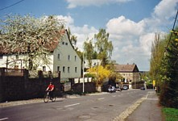
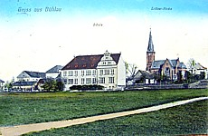
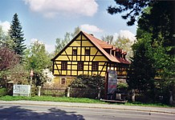

* * *

* * *

Die Quohrener Straße bildet die Hauptstraße des alten Dorfkerns. Ihren Namen
erhielt sie nach dem im Laufe der Zeit mit Bühlau zusammengewachsenen Ortsteil Quohren, der 1365 erstmals als “Quohrne” urkundlich erwähnt wurde. Bis zur
Eingemeindung Bühlaus wurde diese Straße Schönfelder Straße genannt. Die Lage der erhaltenen Gehöfte zu beiden Seiten der Straße, deren Geschichte sich
zum Teil bis ins 16. Jahrhundert zurück verfolgen lässt, lässt noch deutlich die alte fränkische Hufeneinteilung erkennen. Die meisten der zum Teil unter
Denkmalschutz stehenden Häuser entstanden nach den schweren Zerstörungen in den Befreiungskriegen 1813.

Im 19. Jahrhundert wandelte sich das Bild des Ortes. In vielen der kleinen Häuser
wurden Läden und Handwerksbetriebe eingerichtet. So gab es hier gleich an der Ecke zum Ullersdorfer Platz eine Lebensmittel- und Feinkosthandlung, im oberen
Teil u. a. einen Milchladen (Nr. 66 b), zwei Bäckereien und die Parsifal-Drogerie (Nr. 85). 1936 entstand an gleicher Stelle das Wohn- und Geschäftshaus des
Fleischermeisters Kummer. Ackerflächen und Wiesen wurden durch Gärtnereien bzw. durch Wohnungsneubauten verdrängt. Bereits 1806 war an der Quohrener Straße 15 das erste Bühlauer [Schulhaus](../../../../nordost/buhlau/) errichtet worden, welches 1861 durch einen Neubau auf einem der Nachbargrundstücke ersetzt wurde. 1899 folgten die [Kirche](../../../../nordost/buhlau/st_-michaels-kirche/) mit Pfarrhaus und der Bühlauer Friedhof. Vor der Kirche erinnert ein vom Bühlauer Bildhauer Josef Häsler
geschaffenes Ehrenmal an die Opfer des Ersten Weltkrieges. Häsler besaß sein Atelier direkt gegenüber der Schule.

Trotz dieser Veränderungen blieben bis heute eine Reihe historischer Gebäude
erhalten. Bemerkenswert sind u.a. die Fachwerkhäuser Nr. 17, 21, 41 und 59. Das Bauerngut Quohrener Straße 17 _(Foto)_ wurde bereits 1595 erstmals
urkundlich erwähnt und gehörte jahrhundertelang zu den größten Bühlauer Gehöften. Besitzer Robert Schäfer stiftete 1896 einen Großteil des Landes für den
Bau der Kirche und die Anlage des Friedhofes. Heute hat hier ein Kunstschmied seine Werkstatt. Viele Gehöfte wurden in den letzten Jahren saniert. Interessant ist
auch das Holzhaus der früheren Gärtnerei Zscherpe in der Nähe der Schule.

Einzelne Gebäude:

Nr. 29:
Dieses Gut erhielt geht in seiner heutigen Form auf das Jahr 1815 zurück. Neben dem Wohnhaus blieben auch die Scheune und ein historischer Eiskeller erhalten. 2005 begann der Umbau zu einer Wohnanlage, wobei neben dem
Ausbau der historischen Gebäude auch 13 moderne Wohnhäuser entstanden.

Restaurant “Zur Krone”: Die kleine Gastwirtschaft wurde im März 1870 auf der Quohrener Straße 43 eröffnet. Trotz
mehrfachem Besitzerwechsel und zeitweiser Schließung besteht die Gaststätte bis heute und wurde 2002 nach gründlicher Sanierung wieder eröffnet.

Nr. 78:
Das Wohn- und Geschäftshaus an der Ecke zur Rochwitzer Straße entstand 1927/28 für den Geschäftsmann Otto Köhler, der hier 1929 ein Kolonialwarengeschäft eröffnete. Der kleine Laden war erste und einzige
Versorgungsmöglichkeit für Lebensmittel und Waren des täglichen Bedarfs im Bühlauer Oberdorf. Mit Erreichen des
Rentneralters übergab Köhler sein Geschäft Anfang 1960 an die Konsumgenossenschaft, die hier bis nach 1990 einen Lebensmittelladen betrieb. Heute nutzen eine Fensterbaufirma und ein Friseursalon das Gebäude.

* * *

 \[ [Home](../../../../index.html)\] \[ [Nord](../../../../nord/)\] \[ [Nordwest](../../../../nordwest/)\] \[ [Neustadt](../../../../neustadt/)\] \[ [Nordost](../../../../nordost/)\] \[ [West](../../../../west/)\] \[ [Zentrum](../../../../zentrum/)\] \[ [Südwest](../../../../sudwest/)\] \[ [Süd](../../../../sud/)\] \[ [Südost](../../../../sudost/)\] \[ [Ost](../../../../ost/)\] \[ [Register](../../../../Register/register.html)\] \[ [Kontakt](../../../../Kontakt/kontakt.html)\] \[ [Impressum](../../../../impressum/)\]
