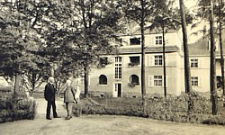
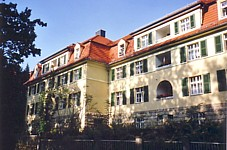

* * *

* * *

* * *

* * *

* * *

* * *

Das Sanatorium an der Bautzner Landstraße 108 wurde 1904 vom früheren
Direktor der Sächsischen Elektrizitätsgesellschaft Paul Oswald Bachmann gegründet und erhielt bei seiner Einweihung den offiziellen Namen “Kaiser
Barbarossa Bad”. Mit Gründung der Heilstätte und der fast zeitgleichen Anlage des Bühlauer Waldparks wollte der Ort an die Kurbadtraditionen des benachbarten Kurortes Weißer Hirschs anknüpfen. 1907 entstand die
“Sanatorium und Kaiser-Barbarossa-Bad GmbH” unter Leitung des Majors a.D. Max Menzel. Zugleich wurde Dr. med. Perske als leitender Arzt eingestellt.

Auf dem Gelände des Sanatoriums wurden nun weitere für den Kurbetrieb erforderliche Anlagen geschaffen, darunter das am 30. Mai 1908 eröffnete [Freibad](../../../../nordost/buhlau/freibad_buhlau/). Dieses stand zu bestimmten Zeiten auch der Öffentlichkeit zur Verfügung und erfreute
sich bald großer Beliebtheit. Interne Differenzen zwischen Eigentümer Bachmann und der Geschäftsleitung führten 1911 zur
zeitweiligen Stilllegung des Kurbetriebes, woraufhin sich Bachmann zum Verkauf des Kaiser-Barbarossa-Bades entschloss.
1912 wurde der Medizinalrat Josef Schreck von den neuen Eigentümern - einem Ärztekonsortium - zum Leiter des Sanatoriums berufen, welches vor allem Behandlungen von Magen-Darm- und Stoffwechselerkrankungen anbot.

Obwohl das Bad zunächst gut ausgelastet war, führten der Erste Weltkrieg und
dessen Folgen später zu wirtschaftlichen Schwierigkeiten. 1928 musste der Kurbetrieb endgültig eingestellt werden. In der Folge übernahm der Verein
“Ruheheim Bühlau” einen Teil der Gebäude und richtete hier ein Altersheim für pensionierte Beamte ein. Heute dienen die Gebäude als Seniorenwohnanlage.
Außerdem wurde das vorhandene Bad von einer neu gegründeten GmbH erworben und umgebaut.

* * *

 \[ [Home](../../../../index.html)\] \[ [Nord](../../../../nord/)\] \[ [Nordwest](../../../../nordwest/)\] \[ [Neustadt](../../../../neustadt/)\] \[ [Nordost](../../../../nordost/)\] \[ [West](../../../../west/)\] \[ [Zentrum](../../../../zentrum/)\] \[ [Südwest](../../../../sudwest/)\] \[ [Süd](../../../../sud/)\] \[ [Südost](../../../../sudost/)\] \[ [Ost](../../../../ost/)\] \[ [Register](../../../../Register/register.html)\] \[ [Kontakt](../../../../Kontakt/kontakt.html)\] \[ [Impressum](../../../../impressum/)\]
