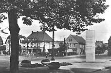
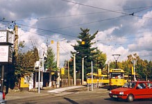
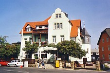

Der Ullersdorfer Platz entwickelte sich an der Kreuzung der Landstraßen nach
Weißig, Ullersdorf und Schönfeld und war bereits in der Vergangenheit ein wichtiger Verkehrsknotenpunkt, da sich hier die Verkehrsströme aus dem Elbtal
in Richtung Oberlausitz vereinigten. Gleichzeitig lag hier ungefähr der Mittelpunkt der aus mehreren Teilen bestehenden Gemeinde Bühlau. Markantestes Gebäude ist das aus dem alten Bühlauer Gasthof hervorgegangene [Kurhaus](../../../../nordost/buhlau/kurhaus_buhlau/). Weitere Gebäude um den Ullersdorfer Platz beherbergen gastronomische und gewerbliche
Einrichtungen. Seinen Namen erhielt er nach der kleinen Gemeinde Ullersdorf am Rand der Dresdner Heide. Der Ort war einst Sitz eines Forstamtes und gehört seit 1999 zu Radeberg.

Ab 1899 befand sich am Ullerdorfer Platz der Endpunkt der Straßenbahn, die
1908 bis nach Weißig verlängert wurde. Im Zuge des Baus einer Gleisschleife für die modernen Hechtwagen wurde der Platz 1932 umgestaltet. Nach dem
“Anschluss” der freien Stadt Danzig an das Deutsche Reich im Jahr 1939 ließen die Nazis den Platz in Danziger Freiheit umbenennen, eine Namensgebung, die jedoch
bereits 1945 wieder aufgehoben wurde. Zu DDR-Zeiten trug er den Namen des Arbeiterfunktionärs und KPD-Reichstagsabgeordneten Siegfried Rädel (1893-1943). Rädel stammte aus Pirna und setzte sich nach der schweren
Hochwasserkatastrophe im Osterzgebirge 1927 für einen verbesserten Hochwasserschutz in der Region ein. Wegen seines Eintretens gegen die NS-Herrschaft wurde er 1943 zum Tode
verurteilt und in Berlin-Plötzensee hingerichtet. 1991 wurde der Siegfried-Rädel-Platz wieder in Ullersdorfer Platz rückbenannt. Zwischen 1949 und 1975 befand sich hier eine Wendeschleife für Dresdens einzige [O-Bus-Linie](../../../../sudwest/lobtau/strassen_lobtau/ebertplatz/o-bus/). In den letzten Jahren wurde der Bereich um das ehemalige Kurhaus zu einem Ortsteil- und Einkaufszentrum umgestaltet.

Einzelne Gebäude:

Nr. 2: Das Gebäude wurde 1938 als Wohn- und Geschäftshaus erbaut und beherbergte seitdem eine Zigarrenhandlung
sowie das Eisenwarengeschäft Richter. Die Firma wurde 1908 von Hermann Richter am Weißen Hirsch gegründet (Bautzner Landstraße 15) und gehörte wegen ihres vielseitigen Angebotes an Haushaltwaren, Eisenwaren und
Werkzeugen zu den bekanntestes Geschäften der Branche in Dresden. Zeitweise war hier der frühere Direktor des Dresdner Stadtmuseums, Matthias Griebel, als Verkäufer beschäftigt. 1980 übernahm die HO Industriewaren das
Geschäft und führte es bis 1990 fort. Zwischen 1994 und 2002  befand sich in den Räumen eine Filiale der Stadtsparkasse.

Café Heiderand:
Das kleine Café am Ullerdorfer Platz wurde 1905 von Clara und Heinrich Schnöder als “Café Schnöder” gegründet und entwickelte sich schnell zu einem beliebten Anziehungspunkt für Heidewanderer. Zum Lokal gehörte auch
eine Bäckerei mit angeschlossener Konditorei. 1925 entstand ein vor allem von Bühlauer Vereinen genutzter Saalanbau. Nach 1945 wurde das Café unter seinem
neuen Besitzer zum Tanzcafé umgewandelt und 2001 umfassend saniert.

* * *

 \[ [Home](../../../../index.html)\] \[ [Nord](../../../../nord/)\] \[ [Nordwest](../../../../nordwest/)\] \[ [Neustadt](../../../../neustadt/)\] \[ [Nordost](../../../../nordost/)\] \[ [West](../../../../west/)\] \[ [Zentrum](../../../../zentrum/)\] \[ [Südwest](../../../../sudwest/)\] \[ [Süd](../../../../sud/)\] \[ [Südost](../../../../sudost/)\] \[ [Ost](../../../../ost/)\] \[ [Register](../../../../Register/register.html)\] \[ [Kontakt](../../../../Kontakt/kontakt.html)\] \[ [Impressum](../../../../impressum/)\]
