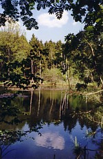
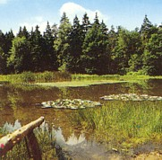
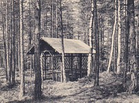
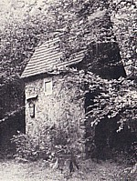
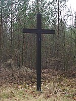
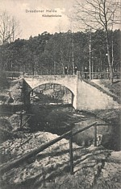
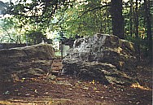

* * *

* * *

* * *

Das rund 50 km² große Waldgebiet der Dresdner Heide im Norden der Stadt nimmt ca. 21 % des Stadtgebietes ein. Ursprünglich war die Heide bedeutend größer und bildete mit dem Moritzburger Friedewald, der
Laußnitzer Heide und dem Karswald eine geschlossene Waldfläche. Noch 1476 befand sich in den Nähe des heutigen Neustädter Bahnhofes eine kleine Antonius-Kapelle, die damals inmitten des Waldes lag, der sich bis in Höhe
des Albertplatzes hinzog. Bis zum 12./13. Jahrhundert ging dieser Zusammenhang durch Rodungen und Besiedlung verloren. Weitere Gebiete fielen im 19. Jahrhundert der Abholzung des Hellers und der Anlage der [Albertstadt](../../neustadt/albertstadt/) ab 1873 zum Opfer.

Auch das Gebiet der [Äußeren Neustadt](../../neustadt/aussere_neustadt/), einst als “auf dem Sande” bezeichnet, war noch bis 1835 weitgehend unbebaut und wurde zur Dresdner Heide gezählt. Zu den wichtigen
Verkehrswegen, die die Heide durchtrennen, gehören die 1841 ausgebaute Radeberger Straße und die 1845 und 1884 angelegten [Eisenbahnstrecken nach Radeberg](../../nord/klotzsche/dresden_-_gorlitz/) und [Königsbrück](../../nord/klotzsche/dresden_-_gorlitz/schmalspurbahn/). In den 1930er Jahren folgte der Bau der Autobahn, der den westlichen Teil
(Junge Heide) endgültig vom übrigen Heidegebiet abschnitt.

Geologisch ist die Dresdner Heide ein Teil der Lausitzer Granitplatte, die am südwestlichen
Rand von der breiten Heidesandterrasse abgelöst wird. Sowohl Granitstein wie auch die im Boden befindlichen Kiese und Sande werden bis zur Gegenwart als Baustoffe abgebaut.
Höchste Erhebung des Waldgebietes ist der 280,8 m hohe Dachsenberg. Die Heide wird von zahlreichen kleinen Gewässern durchflossen, die teilweise auch Teiche und Tümpel
bilden bzw. als “verlorenes Wasser” im Boden versickern. Einige dieser Teiche sind natürlichen Ursprungs, andere wie der “Silbersee” an der Straße nach Langebrück _(Foto links)_ wurden künstlich
geschaffen. Wichtigste Bäche sind die [Prießnitz](../../nordost/dresdner_heide/priessnitzgrund/), der Stechgrundbach und der früher zur Wasserversorgung der
Neustadt dienende Eisenbornbach. Wirtschaftlich genutzt wurde die Heide seit dem Mittelalter sowohl zur Gewinnung von Holz und Heu als auch für die Jagd. Ferner war die Erzeugung von Honig und Bienenwachs von Bedeutung.
Dominierende Baumarten sind Kiefer und Fichte, gefolgt von Rotbuche, Stieleiche und weiteren Laubbäumen.

Durch ur- und frühgeschichliche Funde lässt sich eine Besiedlung bis in die Bronzezeit zurückverfolgen. So finden sich
im Langebrücker Forstrevier an mehreren Stellen Gräberfelder bzw. Hügelgräber, u.a. westlich vom Gänsefuß. Ein größeres Gräberfeld der Lausitzer Kultur konnte östlich des Leichenweges nachgewiesen werden. Hinzu kommen
Einzelfunde von Keramik und Schmuckgegenständen. Reste frühgeschichtlicher Siedlungen finden sich u.a. an der “Alten Eins” und am südlichen Heiderand.

Erstmals urkundlich genannt wurde das Waldgebiet im Jahr 1279. Ab 1372 gehörte die
zum Besitz der Meißner Markgrafen zählende Dresdner Heide zum Amt Radeberg, unterstand jedoch ab 1484 dem neugebildeten Forstamt Dresden. 1447 wurde der
erste Oberförster eingestellt. Durch den Wald führten bereits zu dieser Zeit einige Wege, die in ihrem Verlauf zum Teil bis heute erhalten sind. Da die Heide wichtiges Jagdgebiet
der Kurfürsten war und auch wirtschaftlich genutzt wurde, ließ Kurfürst August im 16. Jahrhundert ein neues Wegenetz entwerfen und Revierförster einsetzen. Ausgehend vom
Dresdner Saugarten wurden acht sternförmige Wege angelegt, die heute als Alte Eins bis Alte Acht bezeichnet werden. Hinzu kamen Verbindungswege zwischen diesen
Flügeln. Erstmals ist dieses Netz auf alten Karten von 1598 eingezeichnet. Bereits ab 1543 regelte eine Forstordnung die Nutzung und Pflege des Waldes und des hier lebenden Wildbestandes.

Seit dem 16.
Jahrhundert war das Jagdrecht in der Heide in alleinigem Besitz der Kurfürsten. Neben Rot- und Schwarzwild wurden früher auch Wölfe und Bären erlegt, der letzte im Jahr 1612. Bis Mitte des 19. Jahrhunderts
mussten die Bewohner der angrenzenden Dörfer Jagddienste leisten. Für diese Zwecken entstanden weitere neue Wege, zahlreiche Brücken und Dämme sowie verschiedene jagdliche Einrichtungen. Zu diesen gehörten Saugärten zur
Fütterung der Wildschweine und die 1547 erstmals erwähnte [Hofewiese](../../nordost/dresdner_heide/hofewiese/). Große Schäden richtete der Dreißigjährige
Krieg an, in dem nicht nur die Wildbestände dezimert und der Forst stellenweise niedergebrannt wurde, sondern auch die Heideorte Bühlau, Klotzsche, Ullersdorf und Großerkmannsdorf geplündert und zerstört wurden. Auch im
Siebenjährigen Krieg war der Wald Schauplatz von Kriegshandlungen, als preußische Soldaten einige Schanzen anlegten, um die herannahenden Österreicher aufzuhalten.

Im 19. Jahrhundert erfolgte, bedingt durch neue forstwirtschaftliche Prinzipien, die
Anlage eines rechtwinkligen Schneisensystems durch den Forstmann Heinrich Cotta. Die von jeweils zwei Schneisen und zwei Flügeln gebildeten Segmente konnten so
einheitlich mit Buchstaben und Zahlen nummeriert werden. Zuvor waren die Waldstücke durch rote und schwarze Zeichen markiert, von denen bis heute insgesamt 124 verschiedene rote und 270 schwarze Waldzeichen nachgewiesen
sind. Deren Form gab auch Anlass zur Namensgebung für viele historische Wegverbindungen, wie Gänsefuß, Kannenhenkel und Kuhschwanz. Um dem zunehmenden Besucherverkehr zu begegnen, entstanden neben der Hofewiese
weitere Gaststätten, darunter die [Heidemühle](../../nordost/dresdner_heide/heidemuhle/) an der Radeberger Landstraße und das [Fischhaus](../../nordost/dresdner_heide/fischhaus/). 1875 wurde ein Teil der Heide als [Waldpark Klotzsche](../../nord/klotzsche/waldpark_klotzsche/) abgetrennt und als Kurpark gestaltet. 1899 erwarb die Stadt Dresden weitere Gebiete für den Heidepark an der Fischhausstraße und den [Albertpark](../../nordost/page10246/albertpark/) am Weißen Hirsch. 1912 folgte der Kauf einer 47 Hektar großen Waldfläche an der Stadtgrenze zu Radebeul, welche als [Friedrich-August-Park](../../nordost/dresdner_heide/friedrich-august-park/) bzw. Waldpark
Junge Heide gestaltet wurde. Die bereits seit 1831 in Staatsbesitz befindliche Dresdner Heide blieb jedoch noch bis 1918 Jagdrevier des sächsischen Königs. Zwischen 1893 und 1945 war sie mit einen Zaun zum Schutz vor
Wildschäden umgeben.

**_Alte Waldzeichen der Dresdner Heide (v. l. n. r.):_** _Bischofsweg, Gänsefuß, Kannenhenkel, Kreuz-R, Alte Acht_

Ab 1918 unterstand das Waldgebiet dem Sächsischen Forstamt Dresden mit Revierförstereien in Bühlau, Ullersdorf
und Langebrück. Der Sitz des Forstamtes befindet sich in Klotzsche. Der räumlich vom übrigen Heidegebiet getrennte westliche Teil am Heller, meist als Junge Heide bezeichnet, wurde 1927 als Platz für den städtischen [Heidefriedhof](../../nordost/dresdner_heide/heidefriedhof/) gewählt und gemeinsam mit dem Jägerpark am 1. April 1927 dem Stadtgebiet zugeschlagen. Unweit davon liegt die
beliebte Ausflugsgaststätte [“Waldmax”](../../nordost/dresdner_heide/waldmax/). Erst mit Auflösung der drei Staatsforstreviere Klotzsche, Langebrück und
Weißer Hirsch ordnete man die Heide im März 1949 auch administrativ dem Stadtgebiet Dresden zu, welches sich dadurch deutlich vergrößerte. Am 27. März 1969 wurde die Dresdner Heide zum Landschaftsschutzgebiet erklärt.
Außerdem stehen sieben Flächennaturdenkmale unter besonderem Schutz. Bis heute ist die Heide bedeutendes Naherholungsgebiet der Dresdner geblieben.

Jagd- und forstwirtschaftliche Denkmale im Heidegebiet:

Dresdner Saugarten: Der Dresdner Saugarten wurde um 1560 als “Treybegarten” angelegt um hier Wildschweine für
die Hofjagden zu halten. Gleichzeitig war dieser Platz Mittelpunkt der Dresdner Heide und Ausgangspunkt von acht
strahlenförmigen Wegen, die noch heute als Alte Eins bis Alte Acht bezeichnet werden. 1710 ließ sich August der Starke von Pöppelmann am Saugarten ein kleines Jagdschlösschen errichten, welches jedoch nach 1800 wieder
abgerissen wurde. 1926 wurde am Saugarten ein 1972 restaurierter Gedenkstein aufgestellt. Unweit des Saugartens liegt das Saugartenmoor, welches als Flächennaturdenkmal geschützt ist.

Liegauer Saugarten: Nachdem der alte Dresdner Saugarten nicht mehr ausreichte, um den hohen Wildschweinbestand
in der Heide ausreichend zu versorgen, entstand im 18. Jahrhundert der ca. 1 Hektar große “alte Saugarten” zwischen
Liegau und Langebrück. An die 1876 beseitigte Anlage erinnert heute am Unterringel ein Gedenkstein mit einem kleinen Rastplatz.

Langebrücker Saugarten: Dieser Garten wurde 1781/82 als “neuer Saugarten” angelegt, um
den Bedarf des Hofes an Schwarzwild für Jagdvergnügungen abzudecken. Von der früheren Anlage des größten Saugartens in der Heide sind noch ein Gerätehäuschen _(Foto)_ und Teile
der Mauer erhalten. Weitere Steine wurden zum Wiederaufbau des Dorfes Klotzsche nach dem Dorfbrand von 1868 verwendet. Nach 1945 wurde im Langebrücker Saugarten ein
kleines Wildgehege für Muffelwild angelegt. Ein Denkmal erinnert an eine Parforcejagd Friedrich August des Gerechten 1827.

Lausaer Saugarten:
Der ursprünglich 0,42 Hektar große Lausaer Saugarten, auch als “Sausprudel” bezeichnet, entstand im 18. Jahrhundert zwischen Langebrück und Weixdorf
und diente demselben Zweck wie die anderen Anlagen dieser Art. Nach 1830 wurden alle Saugärten aufgegeben, da die bisherigen Hetz- und Parforcejagden nicht mehr in Mode
waren. Die Steine der Umfassungsmauer wurden 1869 für den Wiederaufbau des abgebrannten Dorfes Klotzsche verwendet. Seit 2007 informiert ein Gedenkstein mit einer Informationstafel über die Geschichte des Lausaer
Saugartens.

Um den ehemaligen Saugarten verläuft heute ein kleiner ca. 5 km langer Lehrpfad. Dieser führt zu einer volkstümlich
“Pilz” genannten Sandsteinsäule mit Holzdach, welche an die letzte Parforcejagd in der Dresdner Heide 1827 erinnert.
Sehenswert sind auch die in unmittelbarer Nähe befindlichen “Rieseneichen” am Sauerbusch (Naturdenkmal).

Meschwitzruh:
Der 1888 geschaffene Ruheplatz befindet sich in der Nähe von Klotzsche an der Einmündung des Sandschluchtweges in den Prießnitzgrund. Ein Gedenkstein erinnert an den Forstinspektor Friedrich Wilhelm Meschwitz
(1815-1888), der im 19. Jahrhundert am Ausbau des Wegenetzes und an der Erschließung der Dresdner Heide für den Tourismus beteiligt war. An Meschwitz erinnert auch die “Meschwitz-Eiche” mit Gedenktafel auf dem [St.-Pauli- Friedhof](../../neustadt/leipziger_vorstadt/hechtviertel/st_-pauli-friedhof/) sowie die 1946 benannte [Meschwitzstraße](../../neustadt/albertstadt/strassen_albertstadt/) im Industriegelände.

Unmittelbar neben dem Stein befindet sich ein steinerner Tisch mit Sitzbänken, der im 18. Jahrhundert Lieblingsplatz des
Herzogs Carl von Kurland, einem Enkel August des Starken, war. Ursprünglich stammt dieser Tisch aus Trachau und wurde 1839 an seinen heutigen Platz verbracht.

Forstarbeiterdenkmal:
Im Süden der Dresdner Heide erinnert in der Nähe der Fischhausstraße ein Denkmal an die im
Ersten Weltkrieg gefallenen Forstarbeiter. Das aus Sandsteinblöcken errichtete Denkmal ist ca. vier Meter hoch und
wurde am 24. Oktober 1921 eingeweiht. 2012 wurde dieses Ehrenmal um eine Gedenkstätte für die Gefallenen des
Zweiten Weltkrieges erweitert. Drei Sandsteinsäulen tragen die Namen von 229 sächsischen Forst- und Waldarbeitern,
die zwischen 1939 und 1945 ums Leben kamen. Schöpfer war der Bildhauer Thomas Reimann. Die Einweihung der neuen Denkmals erfolgte am Volkstrauertag im November 2012.

Weitere Denkmale und Ausflugsziele:

Dachsenberg: Mit 280,8 m über NN ist der Dachsenberg höchste Erhebung im Heidegebiet. Bereits in der Bronzeit
war das Areal besiedelt, wie verschiedene Funde und ein Hügelgrab am Südwesthang beweisen. Seinen Namen erhielt
der Berg der Überlieferung nach, weil sich hier ein besonders alter und weitverzweigter Dachsbau befunden haben soll.
Nach dem Zweiten Weltkrieg war der Dachsenberg bis 1989 nicht für die Bevölkerung zugänglich, da hier der DDR-
Staatssicherheitsdienst eine Sende- und Überwachungsstation betrieb. Die ehemaligen Gebäude dieser Außenstelle
werden heute als Naturschutzstation der Naturschutzjugend Sachsen (NAJU) genutzt. Außerdem besitzt die Telekom auf dem Dachsenberg einen Funkturm.

Erzberg:
Die kleine Erhebung in der Nähe der Prießnitzbrücke an der Radeberger Straße erinnert an frühere, allerdings
erfolglose, Bergbauversuche im Heidegebiet. Noch bis ins 18. Jahrhundert wurde an verschiedenen Stellen der
Dresdner Heide nach Gold und Silber gesucht. Reste dieser Stollen sind noch heute am Erzberg zu finden. Von diesen
erzählt auch die Sage um das verfluchte Silberbergwerk im Prießnitzgrund, welches wegen der Hartherzigkeit seiner Besitzerin gegenüber einem Bettler eingegangen sein soll.

Färberfleck:
Der sogenannte “Färberfleck” befindet sich im Forstrevier Ullersdorf an der Ortsgrenze zu Radeberg. Wegen seiner sumpfigen Lage waren hier die als natürliche Rohstoffquelle dienenden Roterlen zu finden, aus deren
Blütenständen, Rinde und Zapfen einst Farbstoffe und Gerberlohe gewonnen wurde. Der Legende nach soll hier das “Erlenweib” gelebt haben, welches Heidewanderer in den Sumpf lockte und dort verhexte.

Mückenloch: Auch das im Nordostteil der Heide gelegene “Mückenloch” weist auf eine frühere Feuchtstelle hin, welche
wohl einst eine berüchtigte Brutstätte für Mücken und andere Insekten war. Durch spätere Entwässerungsmaßnahmen
verschwanden der Sumpf, ebenso wie die einst hier vorkommenden Erlen, fast völlig. Erstmals wurde das Mückenloch auf einer Heidekarte von 1598 genannt.

Altes Loch:
Als “Altes Loch” wird eine grubenartige Geländevertiefung in der Nähe der Radeberger Landstraße im Nordosten der Heide bezeichnet. Der Überlieferung nach soll diese Grube früher Unterschlupf für Braunbären gewesen
sein, welche noch bis ins 17. Jahrhundert in der Dresdner Heide vorkamen.

Sauerbusch: Als Sauerbusch wird der nördlichste Zipfel der Dresdner Heide, gelegen zwischen den Bahnlinien nach Königsbrück und Görlitz, bezeichnet. In alten Flurkarten findet sich auch der Name Lausaer Holz bzw. Lausaer Seite. Der Name Sauerbusch deutet auf die feuchten Bodenverhältnisse in diesem Gebiet hin. Dominierend sind Stiel- und Sumpfeichen, darunter zwei Eichen, die bereits 1679 erwähnt wurden und zu den ältesten Bäumen im Heidegebiet gehören. Seit 1938 stehen diese Bäume unter Naturschutz, sind mittlerweile jedoch vom Alter stark geschädigt.

Hakenweg: Der Hakenweg ist ein alter Heideweg, der im Weixdorfer Wohngebiet Fuchsberg beginnt und von dort in südöstlicher Richtung bis zum Lausaer Saugarten führt und am Ortsteingang von Langebrück endet. Früher wurde er auch "Hackenweg" bzw. in seinem bebauten Abschnitt in Weixdorf ab 1917 Forststraße genannt. Die Namensgebung geht auf ein hakenförmiges altes Waldzeichen zurück.

Kannenhenkelweg: Der Kannenhenkelweg beginnt an der Marienallee in der Nähe des Nordfriedhofs und führt von
dort in nordöstlicher Richtung nach Langebrück. Der Weg gehört zu den ältesten Verbindungen durch die Heide und
erhielt seinen Namen nach einem alten Wegzeichen (P). Früher wurde er auch als Kolmischer bzw. Köllnischer Weg
bezeichnet. Markantestes Bauwerk ist die Kannenhenkelbrücke über die Prießnitz. Diese entstand in heutiger Form
1926 und wurde 1998 saniert. Außerdem erinnert ein Obelisk an die 800-jährige Jubelfeier des Hauses Wettin im Jahr 1889. Ein weiteres Denkmal ist dem 1898 in Langebrück verstorbenen Maler Albert Richter gewidmet.

Schwarzes Kreuz:
Das an der Kreuzung Diebsweg / Kannenhenkelweg befindliche Denkmal entstand bereits in vorreformatorischer Zeit als Gebetskreuz an einem alten Verbindungsweg
nach Langebrück. Erstmals erwähnt ist es als “Drebischkreuz” im Jahr 1572. Das Kreuz war später Schauplatz mehrerer tragischer Ereignisse, u. a. der Hinrichtung eines Offiziers im
Nordischen Krieg 1706 und eines Duells zweier sächsischer Gardeoffiziere am 25. 11. 1715. 1993 wurde dieses historische Denkmal _(Foto)_ erneuert. Eng verbunden mit diese Stelle sind
mehrere Sagen, u.a. das Auftauchens des “Mittagsweibchens” und des verfluchten Försters Hans Jagenteufel, der mit seinem abgeschlagenen Kopf unter dem Arm arglose Heidewanderer erschreckte.

Schwarzer Bildweg: Ebenso wie das Schwarze Kreuz erinnert der Name Schwarzer Bildweg und das hier fließenden Schwarze Bildwasser an eine vorreformatorische Gebetsstätte, über deren Aussehen und
genauen Standort jedoch nichts bekannt ist. Diese wurde vermutlich nach der Reformation, möglicherweise durch Brandstiftung, zerstört.

Prießnitzwasserfall:
Der Wasserfall liegt im Heiderevier Klotzsche und ist seit 1967 Naturdenkmal. Hier finden Wanderer auch eine kleine Schutzhütte vor, deren Vorgänger bis zum Anfang des 20. Jahrhunderts zurückreichen.
2008 wurde diese erneuert, im Juli 2010 jedoch durch einen Brand zerstört. Der Wiederaufbau erfolgte im Jahr 2011.
Unweit des Prießnitzwasserfalls befinden sich die nach dem Heideforscher Oskar Pusch benannte Puschquelle und die
Königsbuche. Auf dem vor der Buche liegenden Felsbrocken soll der Überlieferung nach König Johann bei seinen Besuchen im Prießnitzgrund gern gerastet haben.

Die Blumben:
Als “Blumben” wird in alten Heidekarten eine steppenartige Waldlichtung am früheren Bischofsweg bezeichnet. Der Name stammt wahrscheinlich aus dem Sorbischen und bedeutet “Wiesenplatz” (von “blon”).
Möglicherweise nutzten die Bewohner der Heidedörfer diese Lichtung als Weidefläche für ihre Tiere oder zur Heugewinnung.

Am Palz:
Dieser Forstort befindet sich südlich des “Kannenhenkels” und steht in enger Verbindung mit den benachbarten Flurbezeichnungen “großer Palz” und “kleiner Palz”. Der Begriff leitet sich wahrscheinlich vom sorbischen
Wort “polica” für eine glatte, ebene Fläche her. Möglich ist auch ein Zusammenhang mit dem waidmännischen Begriff “Balz” für die Paarungszeit von Großvögeln.

Klotzscher Stadtweg:
Dieser Weg verband einst das Dorf Klotzsche mit der Residenzstadt und wird deshalb Klotzscher Stadtweg genannt. Bemerkenswert ist eine große Eiche. Zu ihren Füßen soll der Legende nach 1813 eine
französische Kriegskasse vergraben wordens ein. Ähnliche Geschichten sind auch von anderen Plätzen in der Heide überliefert.

Moritzburg-Pillnitzer Weg: Der Weg wurde in der zweiten Hälfte des 18. Jahrhundert als Verbindung zwischen den Schlössern Moritzburg und Pillnitz angelegt und entsprechend ausgebaut. Für den Weg entstanden mehrere Sandsteinbrücken über kleinere Gewässer in der Heide, darunter die obere und untere Wettinbrücke sowie die 2001 erneuerte Küchenbrücke _(Bild)_ über die Prießnitz. Diese verdankt ihren Namen einem ehemaligen Rastplatz der Wettiner. Im [Albertpark](../../nordost/page10246/albertpark/) erinnert ein Obelisk an den früheren sächsischen König Albert.

Rennsteig: Der Rennsteig gehört zu den ältesten Heidewegen und verband einst die Heidedörfer Bühlau und Klotzsche.
Dabei überquert er in der Nähe vom Ruheplatz “Meschwitz Ruhe” die Prießnitz auf einer historischen Holzbrücke, die
2000 saniert wurde. Der frühere Weg ist heute nicht mehr durchgehend erhalten, dient jedoch noch immer zu weiten
Teilen als Wanderweg. Ursprünglich wurde er auch als “Roßsteig” bezeichnet, da er als einer der wenigen Heidewege
mit Pferd und Wagen passierbar war. Der Name Rennsteig weist auf die frühere Nutzung durch “Renner”, d. h. zu Fuß gehende Boten hin.

Spitzberg:
Als Spitzberg wird eine südwestlich des Schänkhübels gelegene Erhebung in der “Jungen Heide” bezeichnet. Der Berg ist 208 Meter hoch und liegt am Rand der Klotzscher Flur. Um 1900 plante der “Verein zur Erbauung eines
Aussichtsturmes auf dem Spitzberg” die Errichtung eines solchen Ausflugsziel, scheiterte jedoch letztlich an den
fehlenden finanziellen Mitteln. Auch eine Straßenbahnhaltestelle in der Nähe des früheren Straßenbahnhofes trug einst
den Namen “Am Spitzberg”. 2013 entstand auf dem Hügel eine überdachte Schutzhütte, welche zugleich von den Schülern der privaten Natur- und Umweltschule als Klassenzimmer im Grünen genutzt wird.

Gänsefuß: Der Weg führt von Langebrück in südlicher Richtung bis zur [Heidemühle](../../nordost/dresdner_heide/heidemuhle/). Der Name ist wie bei vielen alten
Heidewegen von einem früheren Waldzeichen abgeleitet. Die benachbarte Gänsefußbrücke entstand in ihrer heutigen Form nach dem Prießnitzhochwasser von 1926. Am Gänsefuß liegt auch die 1547 erstmals erwähnte [Hofewiese](../../nordost/dresdner_heide/hofewiese/), die später zur beliebten Ausflugsgaststätte wurde.

Ullersdorfer Stausee:
Der kleine Heideteich entstand in den Dreißiger Jahren durch Aufstau des Haarweidebachs in der Nähe von Ullersdorf. Am Ufer des beliebten Ausflugsziels wurde 2009 eine Schutzhütte mit Tischen und Bänken aufgestellt.

Läusehübel: Als Läusehübel wird eine Erhebung in der Nähe des Mönchsholzes im Stadtteil Weißer Hirsch bezeichnet. Erstmals genannt wurde diese Flurbezeichnung in einer Urkunde des Markgrafen Friedrich vom 18. August 1420, in der er ein Stück Heidewald dem Altendresdner Augustinerkloster überließ. Die Bezeichnung “Luczehobil” geht wahrscheinlich auf die slawischen Worte “luc” (= Kienholz) und “obli” (= ovales Flurstück) zurück. Mangels Kenntnis um diese Zusammenhänge entstand im 17. Jahrhundert die heutige Bezeichnung “Läusehübel”. In der Nähe entstand 1926/27 die [Wohnsiedlung Mönchsholz](../../nordost/page10246/strassen_weisser_hirsch/) des Spar- und Bauvereins Bühlau & Umgebung.

Napoleonschanze: In der Nähe der [Mordgrundbrücke](../../nordost/page10246/strassen_weisser_hirsch/bautzner_landstrasse/) liegt die sogenannte Napoleonschanze, die bereits im Siebenjährigen Krieg 1760 von den Preußen aufgeschüttet wurde. Ziel war der militärische Schutz der strategisch wichtigen Heerstraße nach Schlesien. Dafür entstanden mehrere Wälle und Gräben, die als Stellplatz für Kanonen dienten. Die Anlage war Teil eines Schanzengürtels rund um Dresden, zu der auch eine heute nur noch in Teilen erhaltene Anlage an der Fischhausstraße gehörte. Eine weitere Befestigung befand sich auf dem Meisenberg, die jedoch 1909 der dortigen Bebauung weichen musste. 1778/79 wurden die Schanzen erneut im Zusammenhang mit dem bayerischen Erbfolgekrieg genutzt.

Ihren heutigen Namen erhielt die Napoleonschanze im Zusammenhang mit den napoleonischen Kriegen. 1813 hatte der Franzosenkaiser den Befestigungsring um Dresden reaktiviert, um so die Demarkationslinie an der Elbe militärisch verteidigen zu können. Dabei diente sie als Beobachtungsposten der französischen Armee vor der Schlacht bei Dresden. Damals ließ General Davonte das Bollwerk eigens zum Schutz der strategisch wichtigen Mordgrundbrücke wiederherstellen. Später wurde das Areal der Napoleonschanze in den Albertpark einbezogen. Als letzte vollständig erhaltene Schanze aus dieser Zeit steht sie heute als archäologisches Bodendenkmal unter Schutz.

Oberförster-Jahn-Weg: Der Weg wurde 1997 am Nordrand der Hellerberge angelegt. Gleichzeitig entstand in der
Nähe der “Deutschen Werkstätten” Hellerau eine kleine Gedenkstätte für den verdienstvollen Forstmann. Karl Jahn (1910-1996) war zwischen 1958 und 1975 Leiter der Oberförsterei Dresdner Heide und setzte sich für die
naturschutzgerechte Pflege und Erhaltung des Heidewaldes ein. Maßgeblich war ihm die Ausweisung des Areals als Landschaftsschutzgebiet  zu verdanken. Seit 2014 erinnert an Jahn eine Gedenkstele mit Bronzetafel.

Der Umwurf: Der Name dieses Platzes an der Kreuzung Diebssteig/Sternweg erinnert an ein Schlittenunglück Herzog
Heinrichs des Frommen im Jahr 1539. Der Wettiner war bei einem Jagdausflug mitsamt seinem Pferdeschlitten umgestürzt, hatte sich jedoch wie durch ein Wunder nur leicht verletzt. 1650 wurde an dieser Stelle eine später
mehrfach erneuerte, heute jedoch verschollene Bildtafel aufgestellt.

Rehsprung: Der sogenannte “Rehsprung” bezeichnet eine markante Waldstelle im Bereich der “Jungen Heide” am
Augustusweg. Dieses Gebiet war früher für seine großen Rehvorkommen bekannt und dadurch beliebtes Jagdrevier der
sächsischen Kurfürsten und Könige. Als “Sprung” wird in der Jägersprache eine Rehfamilie mit mindestens drei Tieren genannt.

Oltersteine und Olterteich: Die Oltersteine und der nahegelegen Olterteich gehören zu
den Naturdenkmalen im Bereich der Jungen Heide in der Nähe der Autobahnabfahrt Dresden-Hellerau. Der Olterteich ist einer der wenigen ständig mit Wasser gefüllten
Teiche in der Heide und Heimat seltener Tier- und Pflanzenarten wie Wasserläufer, Fieberklee und Erdkröte. 1725 wurde er als “Olter Teichelgen” erwähnt und steht seit 1937 unter Naturschutz.

Die Oltersteine entstanden im Tertiär im Niederlausitzer Braunkohlengebiet und wurden durch die Eiszeit an ihren Platz transportiert. Einige Vertiefungen und Bohrungen weisen auf die Nutzung der
beiden Steinblöcke als frühgeschichtliche Kultstätte, möglicherweise mit astronomischem Bezug, hin. Nähere Forschungen stehen jedoch noch aus. Der Legende nach sollen heidnische Priester hier Opferhandlungen vollzogen
haben, weshalb der Name Oltersteine auch als “Altarsteine” gedeutet wird. Im 19. Jahrhundert versammelte sich an
dieser Stelle die Sekte der Stephanisten um den Pastor Martin Stephan, der später nach Amerika auswanderte. Um den Olterteich und das ehemalige Gasthaus “Zum letzten Heller” rankt sich außerdem die [Sage vom Schlangenkönig](../../nord/hellerau/hellerschanke/olterteichsage/).

Räuberhöhle:
Die sogenannte Räuber- bzw. Diebshöhle befindet sich nördlich der Autobahnauffahrt Dresden - Wilder Mann und war ursprünglich ca. 10 Meter lang. Eine schmale Felstreppe führt zu einer kleinen Kanzel an der Felswand,
was zur Annahme beiträgt, dass die Höhle einst Teil einer frühgeschichtlichen Kultstätte war. Während des Zweiten
Weltkriegs diente die Höhle als Munitionsdepot einer Geschützstellung und wurde in diesem Zusammenhang ausgebaut. Aus Sicherheitsgründen ist die Räuberhöhle seit 2008 verschlossen.

[_Weiterführende Literatur und Quellen_](../../impressum/quellenverzeichnis/)

* * *

 \[ [Nord](../../nord/)\] \[ [Nordwest](../../nordwest/)\] \[ [Neustadt](../../neustadt/)\] \[ [Nordost](../../nordost/)\] \[ [West](../../west/)\] \[ [Zentrum](../../zentrum/)\] \[ [Südwest](../../sudwest/)\] \[ [Süd](../../sud/)\] \[ [Südost](../../sudost/)\]
 \[ [Ost](../../ost/)\] \[ [Register](../../Register/register.html)\] \[ [Kontakt](../../Kontakt/kontakt.html)\] \[ [Impressum](../../impressum/)\]
