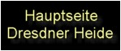
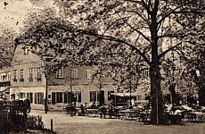

* * *

* * *

* * *

* * *

* * *

* * *

Das Fischhaus entstand im Zusammenhang mit der 1476 angelegten hölzernen
Röhrfahrt aus der Dresdner Heide zur Wasserversorgung des Neustädter Augustinerklosters. Die durch Anstauen des Eisenbornbaches als Speicher angelegten Teiche dienten zugleich der Fischzucht für den Bedarf des
sächsischen Hofes. 1573 wurde ein Wohnhaus für den Teichwächter gebaut, welches als “Fischhaus” bezeichnet wurde. Obwohl die Zucht wenig später eingestellt wurde, blieb der Name des Anwesens erhalten. Das Gebäude
diente nun als kurfürstliches Forstamt und erhielt 1650 die Schank- und Gastgerechtigkeit.

Als im 17./18. Jahrhundert die Dresdner Heide in den Mittelpunkt höfischer Jagdvergnügungen rückte, wurde das
Fischhaus erweitert, um auch Übernachtungsgäste aufnehmen zu können. Bis 1830 diente das Gebäude zugleich der Aufbewahrung von Jagdutensilien, vor allem der über 16.000 für die Treibjagd benötigten “Jagdlappen”. Danach
verwahrloste das Fischhaus und wurde Ende des 19. Jahrhunderts von der Stadt Dresden erworben. In unmittelbarer Nachbarschaft legte diese einen Volkspark an, der später mit dem [König-Albert-Park](../../../nordost/page10246/albertpark/) vereinigt wurde. Das Fischhaus
wurde 1901 als Waldgaststätte eröffnet, die schnell zum beliebten Ausflugsziel für Heidewanderer wurde. Nach 1945
erwarb ein Betrieb das Gebäude und begann noch vor 1989 mit der Sanierung des denkmalgeschützten Gebäudes. Da diese nicht mehr fertiggestellt werden konnte, stand das Fischhaus
einige Jahre leer. Im Mai 2000 wurde die historische Gaststätte wieder eröffnet. Im Obergeschoss gibt es außerdem eine Hochzeitssuite und mehrere Pensionszimmer

* * *

 \[ [Home](../../../index.html)\] \[ [Nord](../../../nord/)\] \[ [Nordwest](../../../nordwest/)\] \[ [Neustadt](../../../neustadt/)\] \[ [Nordost](../../../nordost/)\] \[ [West](../../../west/)\] \[ [Zentrum](../../../zentrum/)\] \[ [Südwest](../../../sudwest/)\] \[ [Süd](../../../sud/)\] \[ [Südost](../../../sudost/)\] \[ [Ost](../../../ost/)\] \[ [Register](../../../Register/register.html)\] \[ [Kontakt](../../../Kontakt/kontakt.html)\] \[ [Impressum](../../../impressum/)\]
