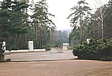
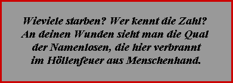
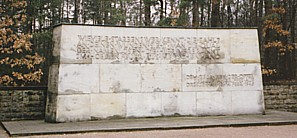
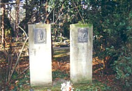

* * *

Heidefriedhof der stadt dresden  moritzburger landstr. 299 01129 dresden  tel. 0351/8 49 89 58

Erste Pläne zum Bau eines neuen städtischen Großfriedhofes entstanden bereits vor dem
Ersten Weltkrieg, wobei Stadtbaurat Hans Erlwein an den Planungen beteiligt war. Bedingt durch den Ersten Weltkrieg und die Inflationsjahre konnten diese jedoch erst
1927 wieder aufgegriffen werden. In diesem Jahr erwarb die Stadt einen Teil des Waldgebietes der Jungen Heide, um hier einen neuen Friedhof unter kommunaler
Verwaltung anzulegen. Nach Entwürfen der Gartenarchitektin Rosi Pohl aus dem Stadtbauamt wurde ab 1934 der Heidefriedhof auf regelmäßigem Grundriss geschaffen,
wobei man den vorhandenen Waldbestand in die Gestaltung einbezog. Ursprünglich war eine Gesamtfläche von 75 Hektar vorgesehen, die jedoch bedingt durch den Autobahnbau auf 53 Hektar eingeschränkt werden musste. Am 3.
Januar 1936 erfolgte die erste Urnenbeisetzung auf dem Heidefriedhof, im November 1937 folgte die erste Erdbestattung.

Für den Friedhof wurden
mehrere Gebäude errichtet. Neben dem repräsentativen früheren Haupteingang an der Neuländer Straße entstand ein Wirtschaftshof mit Verwaltungsgebäude. Die Anlage der Gräberfelder erfolgte nach
einheitlichen Vorgaben, die sowohl Urnen- als auch Erdgräber vorsahen. Eine geplante Feierstätte mit Denkmal  für die
Gefallenen des Ersten Weltkrieges konnte bis zum Beginn des Zweiten Weltkrieges nicht mehr realisiert werden. An ihrer
Stelle wurden bereits 1943/44 Massengräber geplant, in denen nach dem 13. Februar 1945 über 20.000 Opfer der
Luftangriffe auf Dresden beigesetzt wurden, unter ihnen auch die sterblichen Überreste der auf dem Altmarkt verbrannten Toten. Bis 1963 erinnerte ein hölzernes Gedenkkreuz am Ende der Anlagenachse an diese Opfer.

1948-55 erfolgte die Umgestaltung der Massengrabanlage zum Ehrenhain, wobei die Pläne der gärtnerischen Gestaltung
von Karl Girt und Duglore Goldtammer stammten. Die Gesamtplanung sowie der Entwurf für die Feierhalle oblagen dem
Architekten Kurt Röthig vom Stadtplanungsamt. Hier wurden 14 Stelen des Bildhauers Werner Hempel aufgestellt. Die
Sandsteinsäulen tragen die Namen von Konzentrationslagern und im Zweiten Weltkrieg schwer zerstörter Städte wie
Coventry und Leningrad. Am Ende der Anlage mahnt eine Mauer mit einer Inschrift Max Zimmerings an die Opfer der Bombennacht _(Foto)_:

2010 wurde auf dem Heidefriedhof eine weitere Gedenkstätte für die Luftkriegstoten des Zweiten Weltkriegs geschaffen.
Mit Hilfe von Geldern aus dem Nachlass der Pädagogin und Dozentin Dr. Helga Petzold, welche die Bombennacht des
13./14. Februar 1945 selbst mit erlebt hatte, schuf die polnische Künstlerin Malgorzata Chodakowska die Plastik
“Trauerndes Mädchen”. Die ca. 1,50 Meter hohe Bronzefigur steht auf einer schwarzen polierten Granitplatte, das “Tränenmeer” symbolisierend. Das Denkmal wurde am 19. September 2010 eingeweiht.

Seit 1951 erinnert außerdem eine Gedenkstätte an die Opfer des Nationalsozialismus. Sie entstand nach einem Entwurf
des Baurates Leibold vom Entwurfsamt der Stadt Dresden. Ursprünglich sollte für diese Opfer des NS-Regimes eine
zentrale Grabanlage im Park des Japanischen Palais geschaffen werden, bevor man sich für den Standort Heidefriedhof
entschied. Nach Umbettung einiger Toter an die große Mittelachse des Ehrenhains errichte man 1963 einen Obelisken
mit dem Zeichen der FIR (Internationale Förderation der Widerstandskämpfer). Dabei beseitigte man auch das schlichte Holzkreuz und setzte die gewölbte Mauer mit dem Zimmerling-Vers an ihren heutigen Standort um.

In diesem Teil des Heidefriedhofes ruhen zahlreiche Persönlichkeiten des politischen Lebens der Stadt, darunter die ehemaligen Dresdner Oberbürgermeister Walter Weidauer und Herbert Gute, der KPD-Funktionär und Dresdner
Ehrenbürger Karl Friedemann sowie der sächsische Politiker Otto Buchwitz. 1980 wurde auch die Urne des am 13. Juni 1948 auf dem Waldfriedhof Weißer Hirsch beigesetzten ersten Dresdner Nachkriegs-Oberbürgermeisters und
sächsischen Ministerpräsidenten Dr. Rudolf Friedrichs in den Ehrenhain überführt.

1975 entstand auf dem Heidefriedhof eine Urnengemeinschaftsanlage, die auch anonyme Beisetzungen ermöglicht. Die
Plastik “Werden und Vergehen” stammt von Rudolf Sitte. Als letzte größere Anlage des Heidefriedhofes wurde 1989 ein
Ehrenhain für die in Dresden verstorbenen sowjetischen Kriegsgefangenen angelegt. Die Plastiken für diese Anlage - fünf
auf dem Boden liegende und mit Tüchern verhüllte Körper - wurden von Thea Richter geschaffen. Zu den bedeutenden
Persönlichkeiten, die auf dem Heidefriedhof ihre letzte Ruhestätte gefunden haben, gehören der Arzt Dr. Rainer Fetscher,
der am 8. Mai 1945 beim Versuch der kampflosen Übergabe der Stadt erschossen wurde, das Malerehepaar Hans und
Lea Grundig, der Maler und Grafiker Rudolf Nehmer, die Fotografen und Chronisten Erich Höhne und Richard Peter
sen., Zoodirektor Wolfgang Ullrich, der frühere Dynamo-Trainer Walter Fritzsch und der Conférencier O. F. Weidling.

Die jüngste Erweiterung des Heidefriedhofes erfolgte im Herbst 2015. Am 27. September wurde im Beisein buddhistischer Mönche und Nonnen ein buddhistisches Gräberfeld übergeben. Der erste buddhistische Friedhof im Osten Deutschlands ist ca. 1.600 Quadratmeter groß und gemäß der religiösen Lehre in Form eines Rades mit acht Pfaden gestaltet. An den Ecken symbolisieren vier Buddha-Statuen die zentralen Tugenden des buddhistischen Glaubens.

**_Foto:_** _Das Grab des Malerehepaares Hans und Lea Grundig auf dem Heidefriedhof_

Gräber bedeutender Persönlichkeiten:

**_Grabstätte_**

**_Todesjahr_**

Martha Weidauer, älteste Grabstelle des Heidefriedhofes

1936

Karl Quarck, Landschaftsmaler

1943

Kurt Dämmig, Bildhauer

1944

Dr. Rainer Fetscher, Arzt und Erbforscher, am 8. Mai 1945 erschossen

1945

Dr. Rudolf Friedrichs,  Oberbürgermeister und sächs. Ministerpräsident (1980 umgebettet)

1947

Karl Quarck, Maler und Grafiker

1949

Friedrich A. Bäßler, Lehrer und Ornithologe

1956

Hans Grundig, Maler, Rektor der Hochschule für Bildende Künste

1958

Otto Buchwitz, Politiker, Parlamentspräsident des sächs. Landtags

1964

Fidelio F. Finke, Komponist

1968

Karl Zuchardt, Schriftsteller

1968

Olga Körner, Antifaschistin und Politikerin

1969

Rudolf Kreische, Bildhauer

1969

Rudolf Bergander, Maler und Grafiker

1970

Wolfgang Ullrich, Direktor des Dresdner Zoos

1973

Max Zimmering, Schriftsteller

1973

Johannes Paul Thilmann, Komponist

1973

Herbert Gute, Oberbürgermeister

1975

Lea Grundig, Malerin, Präsidentin des Verbandes Bildender Künstler der DDR

1977

Richard Peter sen., Fotograf (“Dresden - eine Kamera klagt an”)

1977

Wilhelm Adam, Offizier und Politiker, Mitbegründer der NPDP

1978

Rudolf Nehmer, Maler

1983

O. F. Weidling, Conférencier

1985

Walter Weidauer, Oberbürgermeister

1986

Max Seydewitz, Politiker und Schriftsteller, sächs. Ministerpräsident

1987

Walter Fritsch, Fußballtrainer von Dynamo Dresden

1997

Erich Höhne, Fotograf

1999

Karl Friedemann, Arbeiterfunktionär, Ehrenbürger Dresdens

2000

* * *

 \[ [Nord](../../../nord/)\] \[ [Nordwest](../../../nordwest/)\] \[ [Neustadt](../../../neustadt/)\] \[ [Nordost](../../../nordost/)\]
 \[ [West](../../../west/)\] \[ [Zentrum](../../../zentrum/)\] \[ [Südwest](../../../sudwest/)\] \[ [Süd](../../../sud/)\] \[ [Südost](../../../sudost/)\] \[ [Ost](../../../ost/)\] \[ [Register](../../../Register/register.html)\] \[ [Kontakt](../../../Kontakt/kontakt.html)\] \[ [Impressum](../../../impressum/)\]
