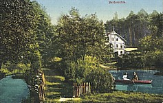
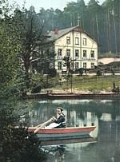
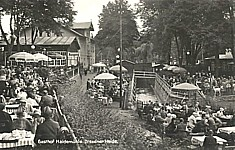
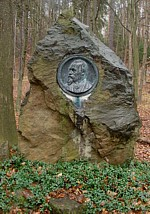

* * *

* * *

* * *

* * *

* * *

* * *

Die spätere Ausflugsgaststätte Heidemühle ging aus einer alten Wassermühle im
Prießnitzgrund hervor, welche bereits im 16. Jahrhundert entstand und sich in der Nähe der noch erhaltenen Mühlbrücke befand. 1540 wurde sie erstmals urkundlich erwähnt. 1641 erwarb der Ullersdorfer Revierförster Urban
Tretzsch diese Mühle und verpachtete sie an den Weißiger Dorfmüller Georg Senff. Später wechselten mehrfach die Besitzer, zu denen Nachkommen Tretzschs und der Radeberger Stadtrichter Martin Hartitzsch gehörten. Im
Zusammenhang mit dem Ausbau der Radeberger Straße zur Chaussee und einem Brand des Mühlengebäudes 1841 wurde der Standort aufgegeben und
die Mühle an ihren heutigen Platz verlegt. Neben wenigen Spuren der Fundamente und des ehemaligen Mühlteichs sowie der Mühlbrücke erinnern heute noch der Mühlweg und die Mühlbrüche an diese Zusammenhänge.

1843 wurden die neuen Gebäude als Mahl-, Schneide- und Brettmühle errichtet. Gleichzeitig
eröffnete Mühlenbesitzer Johann Samuel Hempel eine Gaststätte auf dem Mühlengrundstück, die als “Haidemühle”, volkstümlich auch “Zur schwarzen Gake” (Gake = Krähe), bekannt
wurde und sich zum beliebten Ziel für Heidewanderer entwickelte. 1869 entstand ein kleiner Tanzpavillon für sommerliche Vergnügungen. Beliebt waren auch die häufigen Wettbewerbe
im Vogel- und Sternschießen, welche der Mühlenbesitzer für seine Ausflügler veranstaltete. Da die Wassermenge der Prießnitz trotz eines extra angelegten Mühlteiches vor allem in den
Sommermonaten für einen wirtschaftlichen Betrieb nicht ausreichte, ließ der Besitzer der Heidemühle 1874 eine Dampfmaschine als Antrieb seiner Mühle einbauen. Der Teich wurde
daraufhin zum Gondelteich für die Gaststättenbesucher.

1880 brannte die Mühle, wahrscheinlich infolge von Brandstiftung, ab und wurde im Folgejahr
durch einen Neubau im Schweizerstil ersetzt. Die Heidemühle diente nun vorrangig als Ausflugslokal und wurde mehrfach erweitert. 1909 übernahm der Gastwirt Franz Riemer den Restaurationsbetrieb und richtete zudem einige
Sommerwohnungen ein. 1930 entstand ein kleines Wildgehege an der Mühle. Außerdem existierte vor dem Zweiten
Weltkrieg ein kleiner Teich zur Forellenzucht und eine Gartenhalle mit Bildern des Kunstmalers Fritz Kaltwasser.

Nach Kriegsende wurde die noch bestehende Sägemühle stillgelegt und die Heidemühle nur noch als Gaststätte genutzt. Erster Pächter der Nachkriegszeit
war der stadtbekannte Gastronom Rudolf Hoppe, Wirt der Bahnhofswirtschaft des Neustädter Bahnhofs. Der umtriebige Unternehmer ließ das während des
Zweiten Weltkriegs verfallene und geplünderte Gebäude schrittweise wieder herstellen, organisierte den Gaststättenbetrieb und richtete zudem als zweites
Standbein ein “Reichsbahner-Gästehaus” ein, in dem Eisenbahner ihre dienstfreie Zeit verbringen konnten. Politische und wirtschaftliche Benachteiligungen zwangen Hoppe 1950 zur Aufgabe seiner Wirtstätigkeit.

Nach mehrfachem Besitzerwechsel übernahmen in den 1960er Jahren die Volkseigenen Senftenberger Braunkohlenwerke das Areal und richteten hier ein Betriebsferienheim sowie ein Kinderferienlager ein. Für dieses
entstand 1969 auf den Fundamenten des alten Mühlengebäudes ein Bettenhaus sowie ein kleines Freibad. 1995 wurde
die beliebte Ausflugsgaststätte aus hygienischen Gründen geschlossen. Nach jahrelangem Leerstand sollen die Gebäude bis 2013 saniert und künftig als Pension genutzt werden.

Bereits 1998 wurde mit dem Umbau des 1892 entstandenen alten Pferdestalles auf der gegenüberliegenden Straßenseite
begonnen, der heute als rustikale Schänke “Einkehr zur Heidemühle” mit Biergarten dient. Ursprünglich befand sich hier
eine Umspannstation für Postkutschen, später ein Stall für die im Forst eingesetzten Pferde. Außerdem unterhielt der
Forstbetrieb hier einen Holzplatz. Bemerkenswert ist auch die im 16. Jahrhundert erstmals genannte und 1840 in heutiger Form erbaute Bogenbrücke über die Prießnitz.

Guido-Hammer-Gedenkstein:
In der Nähe der Heidemühle befindet sich an der Gabelung des Gänsefußes und der Prießnitztalstraße ein Denkmal für den Maler und Schriftsteller Guido Hammer (1821-1898), der hier häufig zu Besuch war. Der Granitstein
_(Foto)_ zeigt ein Porträtmedaillon Hammers sowie die Inschrift

_“Dem trefflichen Schilderer des deutschen Waldes Guido Hammer gewidmet._

_\\* 4\. Februar 1821 - + 24. Januar 1898”_

Hammer wurde vor allem durch seine Jagd- und Tierbilder bekannt und schuf auch zahlreiche Darstellungen der Dresdner Heide. Zeitweise arbeitete er auch als Autor und Illustrator für die
Zeitschrift “Gartenlaube”. Sein Grab befindet sich auf dem St.-Pauli-Friedhof in der Leipziger Vorstadt.

* * *

 \[ [Home](../../../index.html)\] \[ [Nord](../../../nord/)\] \[ [Nordwest](../../../nordwest/)\] \[ [Neustadt](../../../neustadt/)\] \[ [Nordost](../../../nordost/)\] \[ [West](../../../west/)\] \[ [Zentrum](../../../zentrum/)\] \[ [Südwest](../../../sudwest/)\] \[ [Süd](../../../sud/)\] \[ [Südost](../../../sudost/)\] \[ [Ost](../../../ost/)\] \[ [Register](../../../Register/register.html)\] \[ [Kontakt](../../../Kontakt/kontakt.html)\] \[ [Impressum](../../../impressum/)\]
