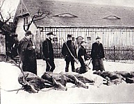
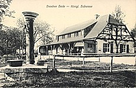
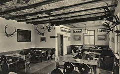
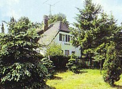

* * *

* * *

* * *

* * *

* * *

* * *

Die Hofewiese, auf Langebrücker Flur inmitten der Heide gelegen, wurde 1547
erstmals urkundlich erwähnt. Der Name leitet sich von einer Wiese im Heidegebiet ab, deren Heu zur Wildfütterung des kurfürstlichen Jagdreviers genutzt wurde. Solche
Wiesen befanden sich früher auch in anderen Teilen der Heide, woran noch der Flurname Ullersdorfer Hofewiese erinnert. Ihre Verwaltung oblag ab 1593 dem [Ostravorwerk](../../../zentrum/friedrichstadt/ostragehege/), weshalb die Hofewiese früher auch Vorwerkswiese genannt wurde.
Vermutlich gab es an dieser Stelle bereits um 1560 zwei Scheunen zur Lagerung des Heus. Dieses musste von den Langebrücker und Klotzscher Bauern geschnitten und
bei Bedarf nach Dresden gebracht werden. Noch bis 1830 musste jeder erwachsene Einwohner Langebrücks einen Tag im Jahr unentgeltlich das Gras der Hofewiese mähen. 1724 hatte die Hofewiese
einen Umfang von 4.720 Schritten, was ungefähr 4,7 km entspricht. Neben dem Ostravorwerk durften auch die Langebrücker Förster Teile der Wiesen für ihre Zwecke nutzen.

Bereits im 16. Jahrhundert entstand an der Langebrücker Hofewiese ein
einfaches Gebäude, welches am 21. Juli 1804 vom sächsischen Kabinettsminister Graf Camillo Marcolini in Besitz genommen und durch einen Neubau ersetzt wurde. Außerdem erwarb Marcolini einige Randflächen und
ließ das gesamte Terrain mit Sandsteinsäulen einfassen. Die bis heute zum Großteil erhaltenen Säulen weisen durch ihre Inschrift C. M., die Jahreszahl
1804 und den Kurschwertern noch auf diese Aktion hin. 1828 kaufte König Anton die Hofewiese wieder zurück und nutzte sie zeitweise für die
Fohlenzucht sowie als Futterstelle der königlichen Marstallpferde. Das Haus diente nun als Wohnsitz des Wiesenvogtes. Dieser richtete hier, zunächst ohne behördliche Genehmigung, einen
Ausschank für Bier, Milch und Kaffee ein. Später erhielt er die Erlaubnis für die Einrichung einer kleinen
Schankwirtschaft, die 1877 die volle Schankkonzession bekam. Bereits 1873 war in der Hofewiese der erste Dresdner Reitsportverein gegründet worden.

Schnell entwickelte sich die “Hofewiese” zum beliebten Rastplatz für die
Heidewanderer. Neben dem Ausschank von Getränken gab es auch eine eigene Schlachterei und die Zulassung, Wildgerichte anzubieten. Letzter vom König eingesetzter Wiesenvoigt war ab 1913 Max Frommert, der nach dem
Ende der Monarchie und der Auflösung der Hofewiese das Gasthaus als Pächter übernahm. 1935 erhielten die Wettiner die Nutzungsrechte für die Hofewiese zurück. In diesem Zusammenhang erfolgte nochmals eine
Erweiterung des Gebäudes, welches mit wertvollen Jagdtrophäen und historischen Gemälden ausgestattet wurde _(Foto)_. Neben einem Stich
Canalettos wurden hier einige Bilder des Langebrücker Kunstmalers Karl Hanns Taeger aufgehängt. Die historische
Gaststätte blieb auch nach 1945 noch bis 1960 in Privatbesitz, wurde dann jedoch von der HO übernommen. In der
Nachkriegszeit dienten die Räumlichkeiten zeitweise als FDJ-Jugendschule für Lehrgänge und politische Schulungen. Da
jedoch bauliche Erhaltungsmaßnahmen unterblieben, musste der Gaststättenbetrieb 1985 eingestellt werden. Lediglich ein Kiosk blieb für die Besucher geöffnet.

Nach 1990 entwickelte sich ein komplizierter Eigentumsstreit zwischen der Stadt Dresden und der Gemeinde Langebrück. 1992 konnte die Gaststätte an einen Pächter übertragen werden, der erste Sanierungsarbeiten begann und 1993 die Hofewiese wieder eröffnete. Da jedoch für umfangreiche Arbeiten die Mittel fehlten, musste das Lokal wegen seines schlechten Bauzustandes Ende 2000 erneut geschlossen werden. Für Aufsehen sorgte die Sicherstellung der historischen Bilder aus der Gaststube kurz vor Schließung der Hofewiese. 2006 erwarb ein bayrischer Investor das Haus und vermietete dieses an den Verein “Erster Sachsenbund zu Dresden”, der das Haus zu einem Alterswohnsitz der Wettiner ausbauen wollte. Nachdem auch diese Pläne scheiterten und sich der bauliche Zustand immer mehr verschlechterte, erhielt die Stadt Dresden auf Gerichtsbeschluss das historische Gebäude wieder zurück und setzte im Januar 2013 eine Zwangsräumung durch.

2015 wurde die Hofewiese an den FDP-Politiker Holger Zastrow verkauft, der die Bauten schrittweise sanieren und künftig wieder gastronomisch nutzen will. Im Mai 2016 eröffnete bereits eine Sommerwirtschaft mit Imbissbetrieb.
