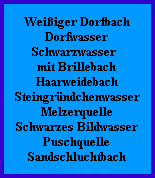
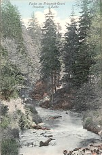
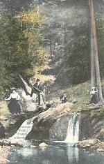
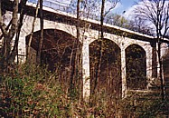

* * *

* * *

* * *

**Nebenflüsse der Prießnitz**

* * *

Die Prießnitz ist größter Bach der Dresdner Heide und führt ca. 24 km durch das Waldgebiet und die Äußere Neustadt, bevor sie in die Elbe mündet. Ihre Quelle hat sie im Rossendorfer Teich in 281 m Höhe. Der Name stammt vom slawischen Wort “breza” und bedeutet übersetzt “Birkenwasser”. Der Prießnitzgrund gehört zu den schönsten Tälern in der Dresdner Heide und wird auch von einem Wanderweg genutzt. Insgesamt nimmt der Bach 35 kleinere Gewässer auf, von denen einige jedoch nur zeitweise Wasser führend sind. Im 16.-18. Jahrhundert fanden im Prießnitzgrund erfolglose Bergbauversuche statt, an die noch ein vermauertes Stollenloch in der Nähe der Kellerbrücke erinnert. Dieser 1547 als Grube “Wille Gottes am Silberwasser” erwähnte Silberstollen wurde mangels Funden jedoch bereits nach kurzer Zeit wieder geschlossen. Auch an anderen Stellen wurde nach dem Edelmetall gesucht, so in den “Silbergruben” in der Nähe des Prießnitzwasserfalls und an der benachbarten “Bergwerksbrücke”. 1769/70 betrieb der Unternehmer Traugott Starke im Prießnitzgrund sogar eine Goldwäsche. Auch für die Fischzucht wurde der Bach genutzt. Reste eines Aufzuchtbeckens befinden sich am Waldbad Klotzsche. Noch bis in die Nachkriegszeit nutzte ein Fischgeschäft auf der Wolgaster Straße dieses Becken zur Lagerung von Frischfisch.

Kurz vor Eintritt in die Dresdner Heide befindet sich an der Prießnitz die Ullersdorfer Todmühle, die ihren Namen nach dem früheren Brauch des Todaustreibens erhielt. Dabei zogen die Kinder der Heideorte am Sonntag Lätare mit einer Strohpuppe zur Todbrücke, wo diese angezündet und brennend ins Wasser geworfen wurde, um so symbolisch den Winter zu vertreiben. Später wurde die Mühle zur Ausflugsgaststätte umgebaut. Unweit davon erinnern die Mühlbrücke, der Mühlsteig und der Mühlbruch an den früheren Standort der Heidemühle. 1841 wurde sie im Zusammenhang mit dem Neubau der Radeberger Landstraße an ihren jetzigen Standort wenige Kilometer flussabwärts verlegt.Diese neue [Heidemühle](../../../nordost/dresdner_heide/heidemuhle/) wurde ebenfalls als Wassermühle gebaut, zugleich als Gaststätte und zuletzt bis 1990 als Betriebsferienheim genutzt. Derzeit gibt es Bestrebungen, hier wieder eine Ausflugsgaststätte einzurichten. Auf dem Gelände der Heidemühle speist der Bach ein in den 1970er Jahren angelegtes kleines Freibad.

Jenseits der Radeberger Straße setzt der Bach seinen Weg in nordwestlicher Richtung fort. Mehrere historische Steinbrücken überqueren die Prießnitz, die zum Teil bereits aus dem 16. Jahrhundert stammen und in den letzten Jahren saniert wurden. Zu den ältesten gehört die zinnenbekrönte Schwedenbrücke, deren Name an ein hier gelegenes Militärlager während des Dreißigjährigen Krieges 1637/39 erinnert. Ihre heutige Gestalt erhielt sie 1841. Erwähnenswert sind die Kellersteigbrücke, die Kannenhenkelbrücke, die Kuhschwanzbrücke und die Todbrücke in der Nähe des [Waldbades Klotzsche](../../../nord/klotzsche/). Auch dieses seit 2005 geschlossene Bad wurde mit Prießnitzwasser betrieben. Kurz zuvor bildet der Fluß den seit 1967 unter Naturschutz stehenden Prießnitzwasserfall _(Foto)_. Bereits um 1900 gab es hier eine Schutzhütte, welche mehrfach erneuert werden musste, zuletzt nach einem Brand im Juli 2010. Die Erhebung oberhalb des Wasserfalls ist in alten Karten als “Burgstadel” eingetragen und war Standort einer frühdeutschen Befestigungsanlage. 1671 ist in ihrer Nähe eine heute verschwundene Brettschneidemühle erwähnt, deren genauer Standort jedoch nicht mehr lokalisierbar ist. Bereits 1767 erinnerte nur noch der Flurname „die Brettmühle“ an die verschwundene Mühle.

Unweit des Prießnitzwasserfalles gab es zwischen 1769 und 1771 das Silberbergwerk “Morgenstern Erbstollen”, welches vom kurfürstlichen Kammerschreiber Anton Reyssig betrieben wurde. Da die u.a. von Kurfürstin Maria Antonia unterstützten Bergbauversuche erfolglos blieben, ersuchte Reyssig um Erlaubnis, an dieser Stelle einen Ausschank zu betreiben, was ihm jedoch verwehrt blieb. Nach Streitigkeiten mit dem Bergamt wegen nicht bezahlter Abgaben und einigen Geschäftspartnern mussten alle Abbauversuche Anfang 1771 eingestellt werden.

Am Waldbad wechselt der Bach seine Richtung und fließt nun nach Süden zur Elbe. Der Abschnitt zwischen Klotzsche und dem heutigen Industriegelände ist in vielen alten Karten als Schillergrund verzeichnet, wobei die Namensherkunft unklar ist. Möglicherweise spielte das hier besonders schön “schillernde” Wasser der Prießnitz dabei ein Rolle. Einst gab es hier auch die sogenannte “Schillerhütte”, welche heute nicht mehr vorhanden ist. Auch eine Schillerbrücke ist in Plänen von 1870 und 1880 verzeichnet. Bis heute gilt dieser Teil des Prießnitzgrunds als romantischster und abwechslungsreichster im Heidegebiet.

Der untere Prießnitzgrund war nach 1873 Standort von Bunkern und Pulvermagazinen der [Albertstadt](../../../neustadt/albertstadt/), die jedoch nach 1918 beseitigt werden mussten. In diesem Bereich bildet die Prießnitz die östliche Grenze dieses früheren Militärbezirkes. An der [Stauffenbergallee](../../../neustadt/albertstadt/strassen_albertstadt/stauffenbergallee/) überspannt eine 23 m hohe und 75 m lange Bogenbrücke _(Foto)_ den
Prießnitzgrund. Diese wurde 1873/76 für die Heerstraße der Albertstadt errichtet und früher Carolabrücke genannt.

Nach Verlassen der Albertstadt durchquert der Fluß das dichtbebaute Wohngebiet der
Äußeren Neustadt und fließt zum Teil direkt durch die Hinterhöfe der Häuser an der Prießnitzstraße. In diesem Viertel
befand sich zwischen 1831 und 1875 das “Prießnitzbad” mit einem beliebten Gartenlokal (Bischofswerdaer Str. 1). Zu
Ehren Friedrich Schillers pflanzte der Besitzer der Gastwirtschaft am 10. November 1859, dem 100. Geburtstag des
Dichters, eine Schillerlinde am rechten Prießnitzufer. Nachdem die Prießnitz in der Nähe des Diakonissenkrankenhauses die Bautzner Straße erreicht hat mündet sie wenige Schritte unterhalb der Holzhofgasse in die Elbe.

Obwohl der Fluss normalerweise relativ wenig Wasser führt, kann die Prießnitz nach starken Regenzeiten erheblich
anschwellen, was sich zuletzt beim schweren Hochwasser im August 2002 zeigte, bei dem die Prießnitz Teile der Neustadt überflutete. Schwere Schäden im Prießnitzgrund sind auch aus den Jahren 1854, 1876, 1897 und 1926
bekannt, als die Fluten Brücken beschädigten und das Waldbad Klotzsche in Mitleidenschaft zogen.

* * *

 \[ [Nord](../../../nord/)\] \[ [Nordwest](../../../nordwest/)\] \[ [Neustadt](../../../neustadt/)\] \[ [Nordost](../../../nordost/)\]
 \[ [West](../../../west/)\] \[ [Zentrum](../../../zentrum/)\] \[ [Südwest](../../../sudwest/)\] \[ [Süd](../../../sud/)\] \[ [Südost](../../../sudost/)\] \[ [Ost](../../../ost/)\] \[ [Register](../../../Register/register.html)\] \[ [Kontakt](../../../Kontakt/kontakt.html)\] \[ [Impressum](../../../impressum/)\]
