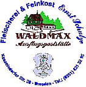
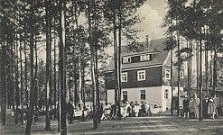
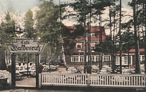
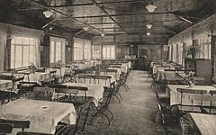

* * *

Die Ausflugsgaststätte “Waldmax” entstand 1922 am Rande der Jungen
Heide auf der Waldhofstraße 26. Zunächst wurde die Raststätte nur als einfacher Kiosk für Heidewanderer betrieben. Durch den Besitzer Max Schmiedgen, der dem Lokal auch seinen Namen gab, erfolgten Mitte der
Zwanziger Jahre umfangreiche Erweiterungen. Nach Bau des heutigen Gaststättengebäudes führte Schmiedgen die Gaststätte bis zu seinem Tod 1941 als Café Waldesruh weiter _(Foto)_.

Anschließend erwarben neue Besitzer die beliebte Ausflugsgaststätte, die nach 1945 von der HO bewirtschaftet wurde. Auf Grund des schlechten Bauzustandes und mangelnder hygienischer
Bedingungen musste der “Waldmax” 1987 geschlossen werden. Erst nach 1990 wurde die Gaststätte verkauft und nach umfangreicher Sanierung im Mai 1996 wieder eröffnet. Neben dem großen Gastraum besitzt das Lokal auch
Gesellschaftszimmer und eine Terrasse

**_Fotos:_** _Das “Café Waldesruh in den Dreißiger Jahren mit Gästegarten und Innenräumen_

* * *

 \[ [Home](../../../index.html)\] \[ [Nord](../../../nord/)\] \[ [Nordwest](../../../nordwest/)\] \[ [Neustadt](../../../neustadt/)\] \[ [Nordost](../../../nordost/)\] \[ [West](../../../west/)\] \[ [Zentrum](../../../zentrum/)\] \[ [Südwest](../../../sudwest/)\] \[ [Süd](../../../sud/)\] \[ [Südost](../../../sudost/)\] \[ [Ost](../../../ost/)\] \[ [Register](../../../Register/register.html)\] \[ [Kontakt](../../../Kontakt/kontakt.html)\] \[ [Impressum](../../../impressum/)\]
