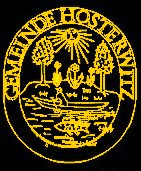
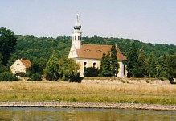
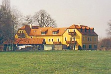
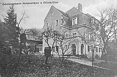
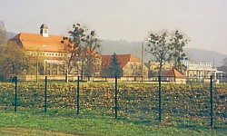
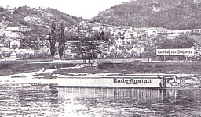

* * *

**Gemeindesiegel von Hosterwitz**

* * *

* * *

 **Schulen in Hosterwitz:**

****

Der Ort Hosterwitz wurde 1406 als Hostembricz urkundlich erwähnt, entstand
jedoch bereits bedeutend eher als slawische Schiffersiedlung. Der Name ist vermutlich vom slawischen Wort hostis (= Gast, Fernhändler) abgeleitet und weist
auf die Bedeutung dieses Platzes für Händler und Elbschiffer hin. Aufgrund einer Untiefe mussten diese hier ihre Kähne umladen, was die Entstehung der kleinen
Siedlung begünstigte. Hier befand sich neben einer bis ins 18. Jahrhundert genutzten Furt auch eine kleine Kirche, Vorgängerin der heutigen Schifferkirche [“Maria am Wasser”](../../nordost/hosterwitz/maria_am_wasser/) _(Foto)_.

Bereits 1371 existierte  in Hosterwitz ein Vorwerk, welches 1445 der Familie von Carlowitz gehörte und später aufgelöst
wurde. Neben dem ursprünglichen Sackgassendorf am Elbufer entstanden ab 1618 weitere neun Häusleranwesen am [Keppgrund](../../nordost/hosterwitz/keppgrund/) und der [Dresdner Straße](../../nordost/hosterwitz/dresdner_strasse/). Trotzdem blieb die kleine Siedlung unbedeutend und war ab 1622 Teil der
Herrschaft Pillnitz, die zu diesem Zeitpunkt der Familie von Loß gehörte. Joachim von Loß galt als besonders
rücksichtsloser Grundherr, was nach einer von ihm verfügten Ausweitung der Frondienste im Jahr 1623 zum Aufstand
führte. Bei den Auseinandersetzungen kam es zu Plünderungen und Zerstörungen im Ort. Stark in Mitleidenschaft gezogen
wurde Hosterwitz auch durch den Dreißigjährigen Krieg und seine Folgen, was um 1680 fast zu einer völligen
Entvölkerung des Dorfes führte. Um dem Dorf eine wirtschaftliche Zukunft zu verschaffen, verkauften die Grundherren 1687 das größte Gut (Laubegaster Straße 2) an Johann Weißkopf.

Dieser veräußerte seinen Besitz wenig später an den kurfürstlichen Hoffourier August Zenker, der dieses Gut zum
“Plantagengut” umwandelte und zunächst als landwirtschaftliches Mustergut weiterbetrieb. 1745 bezog der Bildhauer Lorenzo
Mattielli das Anwesen und richtete hier seine Bildhauerwerkstatt ein. Mattielli schuf in Hosterwitz den größten Teil seiner Heiligenfiguren für die Dresdner Hofkirche,
die von hier aus per Schiff in die Residenz verbracht wurden. 1749 erwarb Graf Heinrich von Brühl das Plantagengut und betrieb in den Räumen eine Manufaktur für Schnupf- und Rauchtabak. Durch die kurfürstliche
Landeskommerziendeputation wurde wenig später eine Seidenraupenzucht mit Seidenmanufaktur und einer Maulbeerbaumplantage eingerichtet, die bis um 1800 bestand. 1801 pachtete Graf Marcolini
das Hosterwitzer Gut und ließ Brühls Wohnsitz am Elbhang zum [Keppschloss](../../nordost/hosterwitz/keppschloss/) umbauen. Nach Marcolinis Tod 1814
wurde der bis dahin zusammenhängende Besitz aufgeteilt und das Plantagengut aufgelöst. Auf einem Teil der Fluren entstand 1908 das Hosterwitzer Wasserwerk. Der größte Teil der früheren Gutsfelder wird heute jedoch von
Obstplantagen eingenommen.

Im 19. Jahrhundert zog die reizvolle Umgebung von Hosterwitz zunehmend Dresdner Bürger an, die hier ihre
Sommerhäuser errichteten. Bekanntester Gast war Carl Maria von Weber, der zwischen 1818 und 1824 die Sommermonate im Haus des Hosterwitzer Winzers Felsner verbrachte und hier an seinen Werken arbeitete. In dem
erhaltenen Gebäude (Dresdner Straße 44) befindet sich heute die [Weber-Gedenkstätte](../../nordost/hosterwitz/dresdner_strasse/webergedenkstatte/). Auch die Wettiner ließen sich im
Ort nieder und erwarben hier 1864 ein [Landhaus](../../nordost/hosterwitz/dresdner_strasse/sommervilla_/).

In der zweiten Hälfte des 19. Jahrhunderts entstand auf Hosterwitzer Flur eine
weitere Siedlung an der heutigen Van-Gogh-Straße. 1877 wurde die katholische Kapelle [“Maria am Wege”](../../nordost/hosterwitz/dresdner_strasse/) als Privatkapelle der Wettiner errichtet. Auf eine
Schenkung der Prinzessin Maria Immaculata geht das benachbarte [Haus Hoheneichen](../../nordost/hosterwitz/dresdner_strasse/) zurück _(Foto)_, welches bis heute als Niederlassung des
Jesuitenordens dient. Von größeren Neubauprojekten blieb der kleine Ort jedoch verschont und konnte so bis heute sein ländliches Bild bewahren. Am 2. März
1945 trafen Bomben einige Wohnhäuser an der Dresdner Straße sowie die angrenzenden Obstplantagen. Nachdem 1929/30 die Verhandlungen zum
Anschluss an Dresden kurz vor ihrer Beendigung am Einspruch der Gemeinderäte gescheitert waren, wurde Hosterwitz unter neuen politischen Voraussetzungen am 1. Juli 1950 nach Dresden eingemeindet.

Schulen in Hosterwitz:

Das erste Hosterwitzer Schulhaus wurde 1745 erwähnt. Diese Schule besuchten im 19. Jahrhundert auch die Kinder aus
Ober- und Niederpoyritz, Söbrigen und Pillnitz. Da das Gebäude nicht mehr den Anforderungen genügte, schlossen sich
Hosterwitz und Pillnitz 1920 zum Schulverband zusammen. 1969 entstand ein Schulneubau an der Dresdner Straße, der heute von der 88. Grund- und Mittelschule genutzt wird.

Gemeindeamt:

Das Hosterwitzer Gemeindeamt befand sich bis zur Eingemeindung des Ortes 1950 im Haus Bergstraße 15 (heute
Van-Gogh-Straße). Seit Frühjahr 1951 wurden einige Räume als Kindergarten genutzt. Nach dem Auszug der letzten
Mieter konnte dieser 1966 erweitert werden. In den Jahren 1980-82 erfolgte ein kompletter Umbau des Gebäudes zur
modernen Kindertagesstätte, bei der auch das frühere Uhrtürmchen auf dem Dach verschwand. Heute hat hier die städtische Kindertagesstätte “Am Elbhang” ihren Sitz.

Wasserwerk Hosterwitz:

Das Wasserwerk an der [Pillnitzer Landstraße](../../nordost/loschwitz/strassen_loschwitz/pillnitzer_landstrasse/) entstand 1905-1908 als drittes
in Dresden, nachdem die Stadt ein Jahr zuvor 82 Hektar Flächen des ehemaligen Plantagengutes erworben hatte. Die offizielle Inbetriebnahme erfolgte am 11. Dezember 1908. Nach Plänen von Hans Erlwein wurde die
Anlage in Form eines Gutshofes gestaltet und mit einem kleinen Park umgeben _(Foto)_. Hinzu kam ein Wohnhaus für die Angestellten an der Wasserwerkstraße 2. Das Areal befindet sich auf einer Sand-Kies-Terrasse
mit einer bis zu 2 Meter mächtigen Lehmdecke, was sich als günstig für die Trinkwasseraufbereitung erwies. Das aus der Elbe entnommene Wasser wird
nach Vorreinigung in vier Absetzbecken geklärt, in speziellen Filtern nochmals gereinigt und dann in neun
Versickerungsbecken geleitet. Durch den Sand dieser Becken gelangt das gereinigte Wasser in den Boden, erhöht dort
den Grundwasserspiegel und wird anschließend mit Hilfe von 111 Rohrbrunnen wieder nach oben gefördert. Der für die
Speicherung notwendige Trinkwasserbehälter befindet sich in der Nähe des Fischhauses am Rand der Dresdner Heide. Zwischen 1928 und 1932 machte sich eine Erweiterung des Hosterwitzer Wasserwerkes erforderlich, um die
gewachsene Großstadt auch weiterhin ausreichend versorgen zu können.

Ab 1983 erfolgte eine umfassende Modernisierung des Werkes, welches durch den Bau einiger neuer Hallen jedoch viel
von seinem ursprünglichen Aussehen einbüßte. In den 1990er Jahren wurde die Anlage erneut rekonstruiert, wobei
sowohl die Erlweinbauten als auch der frühere Park weitgehend in den Ursprungszustand zurückversetzt werden konnten.
Dabei stellte man auch die Pergola und einen 1908 von Georg Wrba geschaffenen Trinkbrunnen wieder her. Der kleine
Brunnen  zeigt vier Putten mit verschiedenen Wassergefäßen sowie einen Fischkopf, der als Wasserspeier dient. Nach
Beseitigung der beim Hochwasser 2002 entstandenen Schäden ist das moderne Wasserwerk bis heute in Betrieb. Die unter Denkmalschutz stehenden Erlwein-Bauten werden heute von der DREWAG für Verwaltungszwecke genutzt

Zuckerhut:

Als Zuckerhut wird seit Mitte des 18. Jahrhunderts ein ca. 220 Meter hoher Bergrücken in der Nähe von Hosterwitz
bezeichnet. Der Name, der erstmals 1752 genannt wurde, geht vermutlich auf die markante Form der Bergkuppe zurück.
Ursprünglich befand sich das Gelände im Besitz des kursächsischen Oberstallmeisters Graf Camillo Marcolini, der den
Berg um 1800 an den Leibschützen Carl Christian Lulius Petzold verpachtete. Später wechselten mehrfach die
Eigentümer, zu denen u.a. Marcolinis Sohn Peter, der Finanzprokurator Julius Hermann Beschorner und die Großherzogin
Auguste Caroline von Mecklenburg-Strelitz gehörten. 1904 legte die Gemeinde Hosterwitz am Zuckerhut einen Hochbehälter des Wasserwerkes an. Nachdem der Ort 1935 den Berg zurückerworben hatte, entstand ein
Promenadenweg vom nahegelegenen Keppgrund bis zum Gipfel. Von dort bietet sich eine schöne Aussicht über die Umgebung.

Elbfähre:

Hosterwitz war schon früh wichtiger Fährort im oberen Elbtal. Bereits 1422 ist erstmals eine Kahnfähre erwähnt, welche zwischen dem Ortskern und dem gegenüberliegenden Kleinzschachwitz verkehrte.
Eine weitere Fährstelle befand sich wenige hundert Meter stromabwärts in der Nähe des späteren Gasthauses “Zur Schanze”. Diese ist erstmals im Jahr
1501 in den Urkunden verzeichnet und gehörte zum Besitz der Familie von Carlowitz, ab 1529 der Herren von Bünau.
Zeitweise diente diese Fähre auch als Zollstation für gebrochene Steinblöcke, welche aus dem nahen Liebethaler Grund in Richtung Lockwitztal transportiert werden sollten.

Die Hosterwitzer Fährstelle besaß zugleich strategische Bedeutung, was im Dreißigjährigen Krieg zum Bau einer Schanze
am Elbufer durch schwedische Soldaten führte. Aus einem hier befindlichen Gut ging um 1720 die Schankwirtschaft [“Zur Schanze”](../../nordost/hosterwitz/schanzschenke/) hervor, welche noch bis in die Nachkriegszeit existierte. In Erinnerung an die Bedeutung von Hosterwitz als
Fährort wurde 1950 ein Sgraffito an der Fassade angebracht, welches eine historische Gierseilfähre zeigte, leider jedoch
bei der jüngsten Sanierung des Gebäudes verloren ging. Der Fährbetrieb zwischen Hosterwitz und Kleinzschachwitz
wurde 1953, zwischen Hosterwitz und Laubegast 1992 aus wirtschaftlichen Gründen eingestellt. Das frühere Fährhaus, bis 1894 zugleich Wohnsitz des Fährmeisters, ist jedoch noch erhalten.

Elbebad Hesse:

Wie
in vielen anderen Elbdörfern gab es auch in Hosterwitz ein Elbebad. Es wurde 1901 vom Fährmeister Wilhelm Hesse ca. 50 Meter oberhalb der Fährstelle eingerichtet. Eine Besonderheit war ein eigenes
Schülerbadebecken, speziell für den Schwimmunterricht. Um auch einkommensschwachen Familien die Benutzung des Bades zu ermöglichen, wurden durch die Gemeinde Laubegast Badefreimarken ausgegeben, welche
zugleich die kostenlose Benutzung der Fähre ermöglichten.  Das Elbebad Hesse, zuletzt von Richard Hesse betrieben, exisitierte bis 1914.

[_Weiterführende Literatur und Quellen_](../../impressum/quellenverzeichnis/)

 \[ [Home](../../index.html)\] \[ [Nord](../../nord/)\] \[ [Nordwest](../../nordwest/)\] \[ [Neustadt](../../neustadt/)\] \[ [Nordost](../../nordost/)\] \[ [West](../../west/)\] \[ [Zentrum](../../zentrum/)\] \[ [Südwest](../../sudwest/)\] \[ [Süd](../../sud/)\]
 \[ [Südost](../../sudost/)\] \[ [Ost](../../ost/)\] \[ [Register](../../Register/register.html)\] \[ [Kontakt](../../Kontakt/kontakt.html)\] \[ [Impressum](../../impressum/)\]
