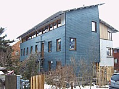
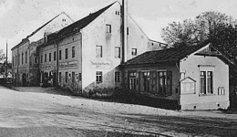
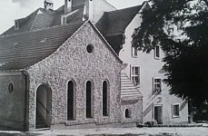
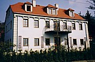
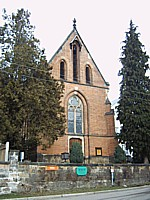

* * *

* * *

* * *

Die Dresdner Straße verbindet parallel zur Pillnitzer Landstraße die Stadtteile Hosterwitz und Pillnitz. Ursprünglich war sie Teil der bedeutenden Staatsstraße von Loschwitz nach Pillnitz und bildete die
einzige Verbindung der Elbdörfer nach Dresden. Die ersten Gebäude entstanden im 17. Jahrhundert als Häusleranwesen an der Einmündung des Keppgrundes. Weitere Häuser wurden im 19. Jahrhundert errichtet, als sich
Hosterwitz zur Sommerfrische entwickelte. In diesem Zusammenhang wurde 1879 eine neue Brücke über den Keppbach gebaut, welche 2002 durch einen Neubau ersetzt werden musste. Bereits 1862 hatte die Straße offiziell den
Namen Pillnitzer Straße erhalten. Im Zusammenhang mit dem Straßenbahnbau nach Pillnitz entstand 1900 eine neue Trassierung entlang der Obstplantagen ( [Pillnitzer Landstraße](../../../nordost/loschwitz/strassen_loschwitz/pillnitzer_landstrasse/)). Dadurch verlor die bisherige Straße zwischen Gustavheim und Pillnitzer Ortskern ihre
Verkehrsbedeutung. 1926 wurde ise in Dresdner Straße umbenannt.

Am Abzweig der Copitzer Straße in Pillnitz steht eine historische Wegsäule, die den Weg
nach Malschendorf und Krieschendorf weist. Am 2. März 1945 trafen bei einem der letzten Luftangriffe auf Dresden einige Bomben Hosterwitzer Wohngebäude und richteten
erheblichen Schaden an. Diesem Angriff fiel u.a. das Haus Dresdner Straße 51 zum Opfer.

Im Winzerhaus Dresdner Straße 44 verbrachte Carl Maria von Weber 1818 bis 1824 die Sommermonate (heute [Gedenkstätte)](../../../nordost/hosterwitz/dresdner_strasse/webergedenkstatte/). In Pillnitz wurde 2001 eine interessante
Holzhausanlage durch die Bauherrengemeinschaft “Nestwerk Pillnitz” errichtet. Die nach streng ökologischen Prinzipien gebauten Einfamilienhäuser wurden vom Architektenbüro Reiter & Rentzsch entworfen und
mit dem “Innovationspreis Holzbau” ausgezeichnet _(Foto)_.

Einzelne Gebäude:

Nr. 2:
Das Gebäude wurde Ende des 19. Jahrhunderts erbaut und war ab 1907 Wohnsitz der Familie Rosenlöcher. Vater Curt und Sohn Hans waren früher bekannte Radrennfahrer und betrieben im Haus eine Fahrradwerkstatt, später eine
Tankstelle. Curt Rosenlöcher war zeitweise Erster der Weltrangliste der Profirennfahrer und ein Radsportidol der 20er
Jahre. Das Gebäude wurde 1945 durch eine Bombe beschädigt, die erst 1994 im Keller des Gebäudes entdeckt und entschärft wurde.

Gasthof “Zum Kronprinzen”: Die Gaststätte entstand aus dem früheren
Hosterwitzer Dorfgasthof und wurde um 1900 zum Ballhaus mit großem Saal und Gästegarten umgestaltet. Nach Einstellung des Schankbetriebes1950 dienten die Räumlichkeiten noch als Konsum-Verkaufsstelle und Möbellager,
bevor der baufällige Gebäudekomplex 1996 abgerissen wurde.

Nr. 36: In diesem Haus wohnte von 1903 bis zu seinem Tod am 21. Dezember
1907 der Porträtmaler Emil von Hartitzsch. Hartitzsch schuf Ende des 19. Jahrhunderts zahlreiche Bildnisse von Vertretern des sächsischen Königshauses
und  war auch an der künstlerischen Ausgestaltung der 800-Jahr-Feier des Hauses Wettin 1889 beteiligt. Sein Grab befindet sich auf dem Neuen Hosterwitzer Friedhof.

Haus Hoheneichen (Nr. 73):
Ursprünglich befand sich das Grundstück Dresdner Straße 73 im Besitz der Familie Angermann. Zu den häufigen Sommergästen gehörte die später als Malerin bekannt gewordene Paula Modersohn-Becker,
die mit ihren Eltern mehrfach in der Villa weilte. Am 19. Juli 1886 kam es auf dem Grundstück zu einem tragischen Unfall, bei dem deren Cousine Cora Parizot beim Sturz in eine Sandgrube ums Leben kam.

Nach mehrfachem Besitzerwechsel erwarb nach dem Ersten Weltkrieg Prinzessin
Maria Immaculata das Areal, die den Umbau des Hauses zu einer katholischen Einrichtung finanzierte. Am 13. Dezember 1921 wurde Haus Hoheneichen als
Dresdner Ordensmission der Jesuiten eingeweiht. Zu den Aufgaben der Pater gehörten regelmäßige Exerzitien für Männer und die Seelsorge. 1941 beschlagnahmten die Nazis das Haus und nutzten es bis 1945 als Heim der
Hitlerjugend. Da Pater Otto Pies sich dieser Verfügung widersetzte, wurde er im KZ Dachau inhaftiert. Kurz nach Kriegsende erhielten die Jesuiten ihr Eigentum zurück.
Nach Beseitigung der Kriegsschäden konnte Haus Hoheneichen wieder als Missionsstation genutzt werden. 1954 entstand eine neue Kapelle, die der Dresdner Künstler Max Lachnit mit drei
Mosaikbildern ausgestaltete. Zu sehen sind u.a. Maria als Himmelskönigin und eine Taufszene mehrerer Männer durch den Jesuitenpater Franziskus Xaverius. Eine umfassende Erneuerung des Gebäudes erfolgte 1997/98.

Nr. 74: Das Landhaus entstand als eines der ersten an der Dresdner Straße um 1860, als sich zahlreiche Dresdner in dieser
Gegend niederließen. Bauherr war der Hosterwitzer Baumeister Eduard Beeger, der das Gebäude 1872 an den Unternehmer Georg Bodemer verkaufte. Bodemer war als Besitzer einer Baumwollspinnerei zu erheblichem Wohlstand
gekommen und finanzierte zahlreiche soziale Projekte, vor allem Bibliotheken und Lehrmittelsammlungen für sächsische
Schulen. Die im italienischen Stil gestaltete Villa nannte er nach seiner Frau “Villa Therese”. Nach seinem Tod lebte Therese
Bodemer noch bis zu ihrem Lebensende 1916 in diesem Haus. 1925 erwarb das sächsische Landwirtschaftsministerium das Grundstück und richtete hier einen Lehr- und Versuchsgarten ein.

Nr. 101:
Das Haus entstand 1846 für den Hofmarschall Georg Rudolph von Gersdorff, der es bis 1863 als Sommersitz
nutzte. Ab 1887 wohnte hier die aus Böhmen stammenden Glasbläserfamilie Blaschka, welche im Haus auch ihre Werkstatt
einrichtete. Leopold Blaschka (1822-1895) war 1863 nach Dresden gekommen und produzierte zunächst an wechselnden
Standorten in der Pirnaischen Vorstadt naturwissenschaftliche Lehrmittel und Glasaugen. Berühmt wurde er durch seine
naturgetreuen Glas-Nachbildungen von Tieren und Pflanzen, die ab 1890 exklusiv im Auftrag der Harvard University in
Canbridge (USA) entstanden. Nach seinem Tod setzte Sohn Rudolf die Familientradition bis 1936 in Hosterwitz fort. Die
umfangreiche Sammlung befindet sich bis heute im Bestand der Universität. Weitere Modelle sind in Großbritannien, Irland,
Österreich, Belgien, den Niederlanden und in Berlin, Rostock, Gotha, Görlitz und Leipzig erhalten. Das 1945 schwer
beschädigte Haus wurde nach 1990 saniert. Künftig ist hier die Einrichtung einer kleinen Gedenkstätte geplant.

**Die Glasblumen der Familie Blaschka befinden sich heute zum Großteil in der Sammlung der Harvard-Universität in**
**Boston. Mehr darüber unter:**

[www.hmnh.harvard.edu/on\_exhibit/the\_glass\_flowers.html](http://www.hmnh.harvard.edu/on_exhibit/the_glass_flowers.html)

Nr. 105 (Alte Säge):
Das Grundstück war einst Standort einer Wassermühle, welche bereits 1476 erstmals erwähnt wurde. 1547 ist in den Amtsbüchern der Müller Laucas König als Besitzer einer Kornmühle genannt. 1786 erwarb Graf Camillo
Marcolini die Hosterwitzer Mühle. Die für den Betrieb notwendige Wasserkraft lieferte der Keppbach, welcher in einem
künstlich angelegten Mühlteich angestaut wurde. 1846 übernahm der Rockauer Mühlzeugarbeiter Carl August Kuhner die Hosterwitzer Mühle und erweiterte diese zu einer Schneidemühle.

1882 kaufte Emil Kuhnert das Unternehmen und wandelte es in ein modernes Dampfsägewerk um. Fortan blieb dieses in
Familienbesitz und war bis Mitte der 1960er Jahre in Betrieb. Schwere Schäden richtete im Februar 1945 eine Luftmine an,
welche das Säge- u. Hobelwerk weitgehend zerstörte. Seit Einstellung des Betriebes werden die erhaltenen Gebäude nur
noch zu Wohnzwecken genutzt. Heute befindet sich hier die Pension „Zur alten Säge“. Auf den alten Grundmauern der Brettmühle entstand vor einigen Jahren ein neues Wohngebäude.

Nr. 123:
In diesem Haus, welches sich um 1900 im Besitz der Familie Roick befand, logierte ab 1895 in den Sommermonaten die Dresdner Hofschauspielerin Marie Bayer. Zuvor hatte sie über 50 Jahre dem Ensemble des
Hoftheaters angehört und zog sich erst 1891 von der Bühne zurück. Später bewohnte sie zeitweise Zimmer auf der Laubegaster Straße 15 bzw. 21, bevor sie am 10. Februar 1910 im Alter von 89 Jahren in Dresden verstarb.

Königliche Villa: Das im 19. Jahrhundert entstandene [Landhaus](../../../nordost/hosterwitz/dresdner_strasse/sommervilla_/) (Dresdner Straße 149) befand sich ab 1864 im Besitz der
Wettiner und wurde von diesen bis 1918 als Sommerresidenz genutzt. Ab 1919 bewohnte bis 1933 die Schwester des
letzten sächsischen Königs, Prinzessin Mathilde das Haus. Die botanisch interessierte Adlige ließ hier einen parkartigen
Garten anlegen. Nach ihrem Tod 1933 wurde die Villa mit einigen Nebengebäuden zu Mietwohnungen umgebaut.

Katholische Kapelle “Maria am Wege”: Die Kapelle _(Foto)_ entstand 1877 im neogotischen Stil
als Privatkapelle der Wettiner auf Initiative des Prinzen Georg von Sachsen. Architekt des Gebäudes war der österreichische Ingenieur Joseph Rokita, welcher bereits wenige Jahre zuvor
in Brennbichl / Tirol die sogenannte Königskapelle zur Erinnerung an den 1854 in den Alpen tödlich verunglückten König Friedrich August II. erbaut hatte. Die Weihe des Gotteshauses mit
dem offiziellen Namen “Maria Himmelfahrt” erfolgte am 15. August 1878, dem Namenstag von Georgs Gemahlin Maria Anna. Die Kapelle wurde in den Anfangsjahren fast ausschließlich von
katholischen Mitgliedern und Bediensteten des Hofes genutzt. Seit 1940 dient sie der katholischen St.-Petrus-Canisius-Gemeinde Pillnitz als Werktagskapelle. 2011 wurde sie der [Pfarrei St. Hubertus](../../../nordost/page10246/hubertuskirche/) am Weißen Hirsch unterstellt.

Zur Ausstattung gehören ein Altarbild “Maria mit Jesuskind” der Dresdner Malerin Anna Maria Freiin von Oer (1846-
1929) sowie einige Wandbilder und Glasmalereien, die u.a. Schutzheilige und Namenspatrone von Mitgliedern der
königlichen Familie darstellen. Diese entstanden in der Mayerschen Hofkunstanstalt und Glasmalerei München. Weitere
Ausstattungsstücke stammen aus der Dresdner Hoftischlerei Udluft & Hartmann sowie der Kunstgießerei Lauchhammer. Außerdem fanden einige Kunstwerke aus den Sammlungen der Wettiner Aufstellung.

Bildliche Darstellungen in den Fenstern der Kapelle

**_linkes Fenster:_**

**_rechtes Fenster:_**

Heiliger Georg mit sächsischem Wappen und dem Wahlspruch der Wettiner “Providentiae memor”.

Maria Immaculata (Patronin von Maria Anna von Portugal, der Frau PrinzŽ Georgs und Wappen der Braganza

Heiliger Friedrich von Lüttich

(Namenspatron PrinzŽ Friedrich August)

Heilige Mathilde (Namenspatronin Prinzessin Matthildes)

Heiliger Maximilian (Namenspatron PrinzŽ Max)

Verkündigung Mariens

Heiliger Johann Nepomuk

(Namenspatron PrinzŽ Johann Georg)

Heiliger Josef (Namenspatron Prinzessin Maria Josepha)

Heiliger Albertus Magnus (Namenspatron PrinzŽ Albert)

Krönung Mariens

Nr. 155: Das frühere Grundstück Pillnitz Nr. 33, heute Dresdner Straße 155, befand sich Mitte des 19. Jahrhunderts im
Besitz des Dresdner Ratszimmermeisters Johann Heinrich Fuchs, der sich hier ein Somerhaus im Schweizerstil errichten ließ.
1868 übernahm es sein Sohn Friedrich Wilhelm Fuchs, Schneidermeister und Kaufmann aus Dresden. Familiär verbunden
war Fuchs durch seine Hochzeit mit Marie Julie Brandt mit den Eigentümern des Landhauses Copitzer Straße 3. Dadurch kamen beide Grundstücke in Familienbesitz.

* * *

 \[ [Home](../../../index.html)\] \[ [Nord](../../../nord/)\] \[ [Nordwest](../../../nordwest/)\] \[ [Neustadt](../../../neustadt/)\] \[ [Nordost](../../../nordost/)\] \[ [West](../../../west/)\] \[ [Zentrum](../../../zentrum/)\] \[ [Südwest](../../../sudwest/)\] \[ [Süd](../../../sud/)\] \[ [Südost](../../../sudost/)\] \[ [Ost](../../../ost/)\] \[ [Register](../../../Register/register.html)\] \[ [Kontakt](../../../Kontakt/kontakt.html)\] \[ [Impressum](../../../impressum/)\]
