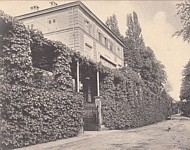
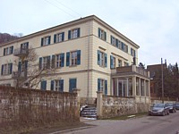

* * *

* * *

* * *

* * *

* * *

* * *

Die Villa Dresdner Straße 149 entstand 1844 als Landhaus des Geheimen Rates Wolf
Adolf August von Lüttichau, Generaldirektor der königlichen Kapelle und des Hoftheaters. 1864 erwarb Prinz Georg, Bruder des späteren Königs Albert, das
Gebäude und nutzte es als Sommersitz seiner Familie. Neben der Königlichen Villa kamen im Laufe der Jahre noch mehrere Nebengebäude hinzu: ein Wirtschaftsgebäude,
ein Wohnhaus für die Bediensteten, die Privatkapelle “Maria am Wege” und ein im Schweizerstil gestaltetes Haus am Hang.

Die eigentliche Villa, ein dreigeschossiges schlichtes Landhaus mit Flachdach, wurde
mit Veranda und einem darüberliegenden Balkon im ersten Stock versehen. Die Räume des Hauses gruppieren sich um einen Lichthof und standen dem Prinzen und seinen engsten Familienangehörigen zur Verfügung. Auf einem
Nachbargrundstück entstand 1865 ein Wirtschaftsgebäude (Nr. 145), welches zugleich als Wohnung für Hofbedienstete und Gäste diente. Verbunden waren diese Häuser durch eine Pergola.

Der Garten des Anwesens wurde unter aktiver Mitwirkung des botanisch interessierten Wettiners parkartig gestaltet und mit einem zickzackförmigen Wegenetz versehen. 1877 ließ Georg die katholische Privatkapelle [“Maria am Wege”](../../../../nordost/hosterwitz/dresdner_strasse/) errichten. 1893 entstand nach Abbruch eines Vorgängerbaus ein weiteres Nebengebäude im Schweizerstil, welches
Küche und zugleich Wohnsitz des Hofgärtners war (Nr. 147). Bereits zwei Jahre zuvor hatte Prinz Georg das frühere Landhaus des Hofrats Friedrich Marks erworben, kurze Zeit später jedoch abreißen lassen.

Bis zu seinem
Regierungsantritt 1902 nutzte Georg seinen Hosterwitzer Besitz in den Sommermonaten als Wohnhaus. Nach dessen Tod übernahm 1904 König Friedrich August III. das Anwesen und überließ es seiner Schwester Mathilde. Nach
Abdankung der Wettiner im Zuge der Novemberrevolution übersiedelte Mathilde 1919 ganz nach Hosterwitz und bewohnte die Villa bis zu ihrem Tod 1933. Hier
ordnete sie den Nachlass ihrer Eltern und schuf einen Großteil ihrer bis heute erhaltenen Zeichnungen und Aquarelle mit Darstellungen des Alltagslebens in Hosterwitz und Pillnitz.

Die nach ihrem Tod zunächst leerstehende Villa wurde 1938 zum Wohnhaus umgebaut und vermietet. Weitere Wohnungen entstanden im Nebengebäude und in den Räumen der früheren Hofküche. Nach dem Luftangriff fanden hier
ausgebombte Familien, nach 1945 auch Umsiedler ihr neues Zuhause. Seit 1947 befand sich die frühere Königliche Villa
im Staatsbesitz und wurde von der städtischen Wohnungsverwaltung vermietet. Die unter Denkmalschutz stehenden Gebäude wurden nach 1990 saniert und dienen Wohnzwecken.

* * *

 \[ [Home](../../../../index.html)\] \[ [Nord](../../../../nord/)\] \[ [Nordwest](../../../../nordwest/)\] \[ [Neustadt](../../../../neustadt/)\] \[ [Nordost](../../../../nordost/)\] \[ [West](../../../../west/)\] \[ [Zentrum](../../../../zentrum/)\] \[ [Südwest](../../../../sudwest/)\] \[ [Süd](../../../../sud/)\] \[ [Südost](../../../../sudost/)\] \[ [Ost](../../../../ost/)\] \[ [Register](../../../../Register/register.html)\] \[ [Kontakt](../../../../Kontakt/kontakt.html)\] \[ [Impressum](../../../../impressum/)\]
