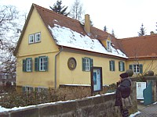
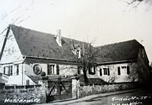
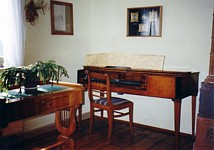

* * *

* * *

* * *

* * *

* * *

* * *

Zu den Besuchern des Ortes Hosterwitz gehörte Anfang des 19. Jahrhunderts auch
der Komponist Carl Maria von Weber mit seiner Familie, der sich in den Sommermonaten zwischen 1818 und 1824 im Winzerhaus von Gottfried Felsner
einmietete. Weber hatte ein Jahr zuvor nach mehrmaligen Besuchen in Dresden eine Anstellung als Kapellmeister auf Lebenszeit erhalten. Am 18. Juni 1818 bezog er
mit seiner Frau Caroline erstmals das Haus. Häufig nutzte er seine Besuche in Hosterwitz für Ausflüge in den nahen Keppgrund zur Keppmühle und für seine
Kompositionen. So entstanden Teile des “Freischütz” und des “Oberon”, die Oper “Euryanthe” sowie seine “Aufforderung zum Tanz” in Hosterwitz. Nach seinem
Weggang aus Dresden 1826 blieb die kleine Wohnung unverändert und stellt so ein einmaliges Zeugnis der Dresdner Musikgeschichte des 19. Jahrhunderts dar.

Bereits im Jahr 1836 entstand im Haus eine kleine Gedenkstätte, die nach
Zerstörung der Stadtwohnungen Webers heute einzig erhaltener Dresdner Wohnsitz des Komponisten ist. 1865 folgte eine von Friedrich Wilhelm Jähns gestiftete Gedenktafel an der Fassade.
1928 übernahm der Landesverein Sächsischer Heimatschutz das Gebäude. 1948 wurde nach kriegsbedingter Schließung das kleine Museum wieder eröffnet und in den 50er Jahren und
1972/76 umfassend saniert. Als Außenstelle des Stadtmuseums Dresden erinnert die Gedenkstätte an Leben und Werk Carl Maria von Webers. Neben den historisch eingerichteten Wohnräumen und dem wiederhergestellten Garten
sind auch Webers Dirigentenstab und verschiedene Dokumente und Partituren aus Webers Besitz zu sehen. Regelmäßig finden im Haus Vorträge zur Musikgeschichte und Kammerkonzerte statt.

**_Foto:_** _Webers Arbeitszimmer in der Hosterwitzer Gedenkstätte_

Video: Ouvertüre zum “Freischütz” mit Bildern aus der Webergedenkstätte

* * *

 \[ [Home](../../../../index.html)\] \[ [Nord](../../../../nord/)\] \[ [Nordwest](../../../../nordwest/)\] \[ [Neustadt](../../../../neustadt/)\] \[ [Nordost](../../../../nordost/)\] \[ [West](../../../../west/)\] \[ [Zentrum](../../../../zentrum/)\] \[ [Südwest](../../../../sudwest/)\] \[ [Süd](../../../../sud/)\] \[ [Südost](../../../../sudost/)\] \[ [Ost](../../../../ost/)\] \[ [Register](../../../../Register/register.html)\] \[ [Kontakt](../../../../Kontakt/kontakt.html)\] \[ [Impressum](../../../../impressum/)\]
