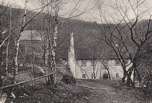
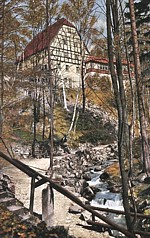

* * *

Der Keppgrund gehört zu den romantischen Seitentälern der Elbe zwischen
Loschwitz und Pillnitz und ist Teil des Landschaftsschutzgebietes “Elbhänge Dresden - Pirna”. Der Grund wird vom Keppbach durchflossen, der im Schönfelder Hochland entspringt und nach ca. 5 km bei Hosterwitz in die Elbe
mündet. Älteste Spuren der Besiedlung finden sich auf einem als Kuhberg bezeichneten Felssporn über dem Grund, welcher Standort einer frühgeschichtlichen
Wehranlage war. Um 1618 entstanden im unteren Teil des Keppgrundes die ersten Häusleranwesen außerhalb des Hosterwitzer Dorfkerns.  1721 gab es vier Mühlen
im Grund, von denen heute nur noch die Keppmühle erhalten ist. Im 19. Jahrhundert war der Keppgrund bevorzugter Aufenthalt Carl Maria von Webers, der hier an seiner Oper “Euryanthe” arbeitete. Das
Tal blieb bis heute beliebtes Ausflugsziel der Dresdner.

Keppmühle:

Die Geschichte der Keppmühle reicht vermutlich bis ins 12. Jahrhundert zurück. 1569 wurde
sie erstmals urkundlich erwähnt, bestand aber zu diesem Zeitpunkt bereits längere Zeit. Die Mühle auf Malschendorfer Flur diente als Mahlmühle der umliegenden Dörfer. Das noch heute
vorhandene Fachwerkhaus entstand, vermutlich nach einem Brand, im Jahr 1781.

Nachdem der Keppgrund im 18./19. Jahrhundert als Ausflugsgebiet entdeckt und erschlossen
worden war, entwickelte sich die Keppmühle zur beliebten Ausflugsgaststätte. Berühmtester Gast war Carl Maria von Weber, der während seiner Sommeraufenthalte in Hosterwitz gern
zur Mühle wanderte. An ihn erinnert seit 1963 eine Gedenktafel am früheren Mühlengebäude.

Die Keppmühle wurde im 19. Jahrhundert mehrfach erweitert und umgebaut. Während der
Schankbetrieb an Bedeutung gewann, geriet die Mahlmühle immer mehr in wirtschaftliche Schwierigkeiten und wurde deshalb als letzteWassermühle rechts der Elbe 1902 stillgelegt.
Nach Verfüllung des Mühlgrabens ließ der Besitzer der Mühle 1927 ein großes Schaurad anfertigen, welches noch bis
1950 existierte. Die Gaststätte, die zeitweise beliebter Treffpunkt für Studenten und Bergsteiger war, wurde 1984
geschlossen. Eine Wiedereröffnung nach Sanierung des Gebäudes scheiterte bislang an den hohen Kosten und mangels geeigneter Interessenten, so dass die Keppmühle heute nur noch als Wohnhaus genutzt wird.

Weitere Mühlen im Keppgrund:

Neben der Keppmühle existierten im unteren Teil des Keppgrundes zwei weitere Wassermühlen. Ihren Standort hatten sie
vermutlich auf den heute mit den Hausnummern Keppgrund Nr. 2 bzw. Nr. 3 bezeichneten Flurstücken. Beide sind 1792
in den Dresdner Meilenblättern verzeichnet und existierten noch bis ins 19. Jahrhundert. Um 1850 wurden sie nach ihren
Besitzern als Marschners Mühle bzw. Huhles Mühle bezeichnet. Besitzer der erstgenannten Mühle war 1902 Julius
Marschner, der sie zu diesem Zeitpunkt jedoch bereits als Dampfmühle betrieb. Wenig später erfolgte die Stilllegung der
Mühle. Huhles Mühle, zuletzt im Besitz der Familie Höhne befindlich, ist bereits 1854 nicht mehr erwähnt.

Die vierte Wassermühle des Keppgrundes, ebenfalls im unteren Teil gelegen, war die zum Weingut des Grafen Thun gehörende Weinberggutsmühle. Die Besitzer hatten diese wahrscheinlich nach dem Reblausbefall des Weinbergs
1880 als wirtschaftliche Alternative eingerichtet. Der Mühlenbetrieb wurde jedoch bereits um 1900 wieder eingestellt. Heute
erinnert noch ein Mühlstein im Vorgarten des Grundstücks Keppgrund 4 sowie das Wappen des Grafen am Gartentor an das Unternehmen.

* * *

 \[ [Nord](../../../nord/)\] \[ [Nordwest](../../../nordwest/)\] \[ [Neustadt](../../../neustadt/)\] \[ [Nordost](../../../nordost/)\]
 \[ [West](../../../west/)\] \[ [Zentrum](../../../zentrum/)\] \[ [Südwest](../../../sudwest/)\] \[ [Süd](../../../sud/)\] \[ [Südost](../../../sudost/)\] \[ [Ost](../../../ost/)\] \[ [Register](../../../Register/register.html)\] \[ [Kontakt](../../../Kontakt/kontakt.html)\] \[ [Impressum](../../../impressum/)\]
